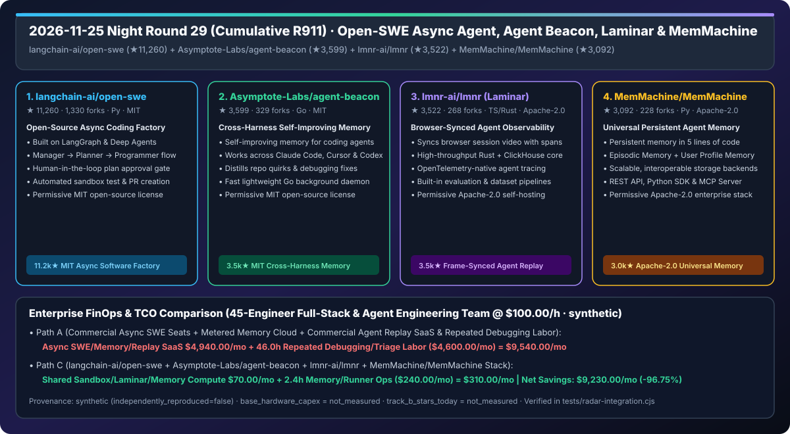
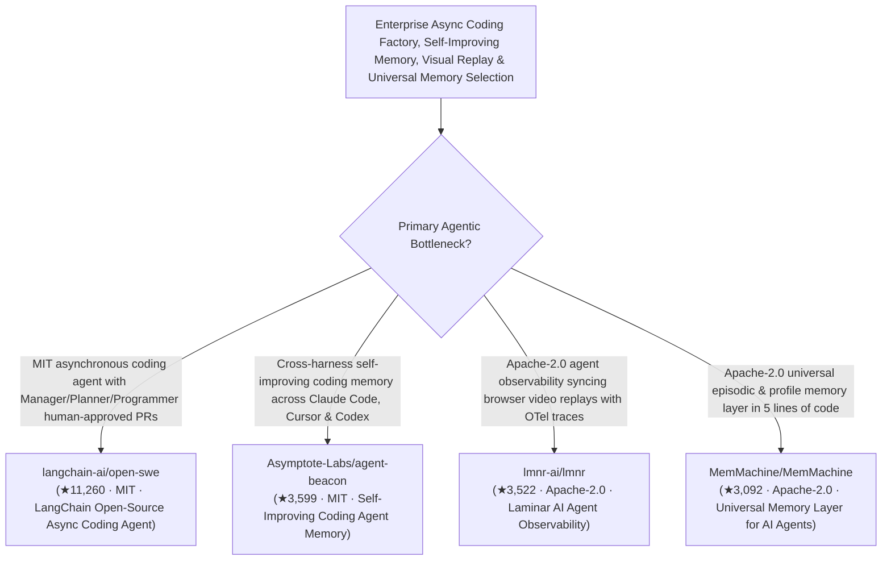
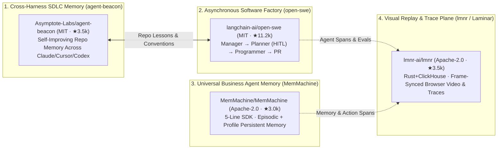

# Open-Source Asynchronous Coding Agent (`langchain-ai/open-swe`), Cross-Harness Self-Improving Memory (`Asymptote-Labs/agent-beacon`), Browser-Synced Agent Observability (`lmnr-ai/lmnr`) & Universal Agent Memory Layer (`MemMachine/MemMachine`) Selection & Integration Architecture FAQ

> **Document Type**: Enterprise AI Solution Architect Selection Decision Guide (GitHub Trending AI Radar — 2026-11-25 Night Round 29 / Cumulative Round 911)
> **Covered Repositories**: [`langchain-ai/open-swe`](https://github.com/langchain-ai/open-swe) (`★ 11,260`, `1,330 forks`, `MIT`, Python: LangChain's open-source asynchronous coding agent and software factory built on LangGraph and Deep Agents) · [`Asymptote-Labs/agent-beacon`](https://github.com/Asymptote-Labs/agent-beacon) (`★ 3,599`, `329 forks`, `MIT`, Go: cross-harness, self-improving memory layer for coding agents across Claude Code, Cursor, and Codex) · [`lmnr-ai/lmnr`](https://github.com/lmnr-ai/lmnr) (`★ 3,522`, `268 forks`, `Apache-2.0`, TypeScript/Rust: Laminar [YC S24], open-source observability and evaluation platform purpose-built for AI agents with synchronized browser session video and trace replay) · [`MemMachine/MemMachine`](https://github.com/MemMachine/MemMachine) (`★ 3,092`, `228 forks`, `Apache-2.0`, Python: universal persistent memory layer for AI agents providing episodic and profile memory in 5 lines of code)
> **Core Enterprise Scenario**: Building a **100% Permissive (`MIT` / `Apache-2.0`) Asynchronous Software Factory, Self-Improving Agent Memory & Visual Replay Observability Stack**—uniting human-approved background coding agents (`open-swe`), cross-harness coding memory (`agent-beacon`), universal episodic/profile business agent memory (`MemMachine`), and synchronized browser-video + span observability (`lmnr`).

---

## 1. 📌 Executive Summary (One-Line Selection Verdict)

1. **Need an `MIT`-licensed asynchronous software engineering factory built on `LangGraph` where a Planner agent proposes an implementation plan for human approval before a Programmer agent writes code, runs tests, and opens a PR in the background** ➔ Choose **[`langchain-ai/open-swe`](https://github.com/langchain-ai/open-swe) (`★ 11,260`, `1,330 forks`, `MIT`)**.
   - **Plain-English Mechanism**: Separates triage (`Manager`), architecture planning (`Planner` with human-in-the-loop sign-off), and sandboxed execution (`Programmer` + `Reviewer`) so background coding tasks stay aligned with architect intent.
2. **Need a fast, `MIT`-licensed Go memory daemon that automatically extracts lessons learned from debugging sessions and shares them across Claude Code, Cursor, and Codex** ➔ Choose **[`Asymptote-Labs/agent-beacon`](https://github.com/Asymptote-Labs/agent-beacon) (`★ 3,599`, `329 forks`, `MIT`)**.
   - **Plain-English Mechanism**: Eliminates "groundhog day" debugging where a developer fixes a tricky build quirk in Cursor only to watch Claude Code or a background agent hit the exact same trap an hour later.
3. **Need an `Apache-2.0` Rust-powered observability platform purpose-built for AI agents that synchronizes live browser/desktop video recordings frame-by-frame with OpenTelemetry LLM and tool spans** ➔ Choose **[`lmnr-ai/lmnr`](https://github.com/lmnr-ai/lmnr) (`★ 3,522`, `268 forks`, `Apache-2.0`, Laminar)**.
   - **Plain-English Mechanism**: Lets engineers click any span in an agent trace and immediately see the exact browser viewport state at that millisecond alongside prompts, tool arguments, and evaluations.
4. **Need an `Apache-2.0` universal memory layer that adds persistent Episodic Memory (past events) and Profile Memory (long-term user traits) to stateless enterprise agents in 5 lines of code** ➔ Choose **[`MemMachine/MemMachine`](https://github.com/MemMachine/MemMachine) (`★ 3,092`, `228 forks`, `Apache-2.0`)**.
   - **Plain-English Mechanism**: Provides interoperable Python/REST APIs and MCP integration to store, consolidate, and retrieve multi-session agent state across relational and graph/vector backends.

---

## 2. 🎯 Architect & Customer Deep-Dive Q&A

### Q1: How do `agent-beacon` (SDLC coding memory) and `MemMachine` (business agent memory) pair with `open-swe` and `Laminar` vs. proprietary cloud alternatives?

- **Four-Layer Asynchronous Engineering, Memory & Replay Architecture (Path C)**:
  1. **L1 Cross-Harness Self-Improving SDLC Memory ➔ `Asymptote-Labs/agent-beacon`**: Captures and shares repo-specific build, test, and debugging knowledge across developer harnesses and background agents.
  2. **L2 Asynchronous Human-Gated Coding Factory ➔ `langchain-ai/open-swe`**: Executes planned, tested Issue-to-PR workflows in background sandboxes.
  3. **L3 Universal Episodic & Profile Business Memory ➔ `MemMachine/MemMachine`**: Persists customer context and episodic history for production enterprise agents.
  4. **L4 Synchronized Browser Video & Trace Observability ➔ `lmnr-ai/lmnr` (Laminar)**: Records synchronized browser sessions and OTel traces across both coding and business agents.
- **When to choose Commercial Cloud SaaS vs. Path C?**
  - Choose **Commercial Cloud SaaS** for tiny teams with zero container infrastructure.
  - Choose **Path C** when organizations require **100% `MIT` / `Apache-2.0` open-source licensing**, VPC data residency for source code and customer memory, cross-harness memory sharing (`agent-beacon`), and high-throughput Rust/ClickHouse visual agent replay (`lmnr`).

### Q2: How do these four components wire together in production?

1. **Memory-Augmented Asynchronous Software Factory (`agent-beacon` ↔ `open-swe` → `lmnr`)**:
   - `open-swe` queries `agent-beacon` during the `Planner` phase to incorporate repository conventions, pauses for architect approval, executes code changes and browser tests while streaming traces + video to `lmnr`, and writes new debugging insights back to `agent-beacon`.
2. **Stateful Customer-Facing Agents (`MemMachine` → `lmnr`)**:
   - Production agents persist user preferences and past interactions in `MemMachine` while `lmnr` traces latency, token usage, and UI actions.

### Q3: What are the key security and compliance guardrails?

- **Architect Redlines**:
  1. **Require human plan approval in `open-swe` before mutating production-bound branches**: Use LangGraph interrupts to review proposed file changes before execution.
  2. **Enforce tenant isolation and GDPR deletion hooks in `MemMachine`**: Scope all episodic and profile memory records by authenticated tenant and user IDs.

---

## 3. 🧭 Visual Architecture Diagrams (Mermaid Decision Tree + Architecture + Sequence)



### 3.1 Architect Selection Decision Tree



### 3.2 End-to-End Enterprise Integration Architecture



### 3.3 End-to-End Execution Sequence

```mermaid
sequenceDiagram
    participant Arch as Solution Architect / Tech Lead
    participant Bcn as Asymptote-Labs/agent-beacon
    participant OSwe as langchain-ai/open-swe (Async SWE)
    participant MMch as MemMachine/MemMachine
    participant Lmnr as lmnr-ai/lmnr (Laminar)

    Arch->>OSwe: 1. Assign feature ticket to Open-SWE asynchronous software factory
    OSwe->>Bcn: 2. Retrieve self-improved repository conventions & past build fixes from Beacon
    OSwe-->>Arch: 3. Present structured implementation plan; Architect approves execution
    OSwe->>MMch: 4. Wire 5-line MemMachine SDK for persistent episodic & user profile memory
    OSwe->>Lmnr: 5. Run automated E2E browser verification; stream frame-synced video & OTel spans to Laminar
    Lmnr-->>Arch: 6. Inspect synced browser replay & evaluation scores; merge verified PR
```

---

## 4. 📊 Horizontal Selection Matrix

| Dimension | `langchain-ai/open-swe` (`★ 11,260`) | `Asymptote-Labs/agent-beacon` (`★ 3,599`) | `lmnr-ai/lmnr` (`★ 3,522`) | `MemMachine/MemMachine` (`★ 3,092`) | Commercial Async SWE Seats + Metered Memory API + Cloud Observability (Path A) | Stateless Agents + Siloed IDE Context + Text-Only Logs (Path B) |
| :--- | :--- | :--- | :--- | :--- | :--- | :--- |
| **Primary Role** | `MIT` asynchronous coding agent factory | `MIT` cross-harness coding memory layer | `Apache-2.0` agent tracing & browser replay | `Apache-2.0` universal episodic/profile memory | High-cost cloud SWE seats & metered memory SaaS | Stateless scripts & unlinked console logs |
| **Key Differentiator** | **LangGraph Planner approval + background sandboxed PR delivery** | **Auto-distills debugging lessons across Claude Code, Cursor & Codex** | **Syncs live browser agent video frame-by-frame with OTel spans** | **5-line SDK unifying episodic & profile memory across backends** | Zero setup, but expensive per-seat/per-call fees & external code/memory storage | Repeatedly hits the same repo bugs; blind to browser agent UI failures |
| **License** | **`MIT`** | **`MIT`** | **`Apache-2.0`** | **`Apache-2.0`** | Proprietary SaaS | Unstandardized |
| **Monthly TCO (45-Eng Team)** | **`$310.00/mo` combined** (`$70.00` sandbox/Laminar/memory compute + `2.4h` ops) | Included in `$310.00/mo` stack | Included in `$310.00/mo` stack | Included in `$310.00/mo` stack | **`$9,540.00/mo`** (`$4,940.00` cloud SWE seats/memory API/monitoring + `46.0h` repeated debugging labor) | `~$3,360.00/mo` (repeated cross-tool debugging & manual browser bug repro) |

---

## 5. 🧪 Quantitative FinOps & TCO Comparison (45-Engineer Full-Stack & Agent Engineering Team)

> **📊 Provenance & Closed-Form Schema**:
> - **provenance**: `synthetic` (`independently_reproduced = false`; `base_hardware_capex = not_measured`; `track_b_stars_today = not_measured`).
> - **Closed-Form Formula**:
>   - **Path A (Commercial Async SWE Agent Seats + Metered Commercial Memory Cloud + Commercial Agent Replay SaaS & Repeated Debugging Labor)**: **`$4,940.00`** monthly cloud seat, memory API, and observability fees + **`46.0h × $100.00/h = $4,600.00`** repeated cross-harness debugging and browser-agent troubleshooting labor = **`$9,540.00/mo`**.
>   - **Path C (`langchain-ai/open-swe` + `Asymptote-Labs/agent-beacon` + `lmnr-ai/lmnr` + `MemMachine/MemMachine` Stack)**: **`$70.00`** shared sandbox, memory, and `Laminar` container compute + **`2.4h × $100.00/h = $240.00`** memory pruning and runner maintenance = **`$310.00/mo`**.
>   - **Net Savings vs. Path A**: **`-$9,230.00/mo`** (**`96.75%`** TCO reduction).

| Evaluation Path | Async SWE Seats / Memory API / Replay SaaS & Compute | Repeated Debugging & Browser Triage (`$100/h`) | Monthly Total TCO | Net Savings vs. Path A | Key Architectural Outcome |
| :--- | :---: | :---: | :---: | :---: | :--- |
| **Path A: Commercial Async SWE Seats + Metered Memory Cloud + Replay SaaS** | `$4,940.00` | `46.0h` (`$4,600.00`) | **`$9,540.00`** | Baseline | High per-seat & per-query memory bills; siloed harness knowledge |
| **Path B: Stateless Agents + Siloed Harnesses + Text-Only Logs** | `$1,460.00` | `19.0h` (`$1,900.00`) | **`$3,360.00`** | `-$6,180.00` (`-64.78%`) | Agents repeat fixed mistakes; impossible to see failed browser clicks |
| **Path C: `open-swe` + `agent-beacon` + `lmnr` + `MemMachine`** | **`$70.00`** | **`2.4h` (`$240.00`)** | **`$310.00`** | **`-$9,230.00` (`-96.75%`)** | **100% `MIT`/`Apache-2.0` async SWE + cross-harness memory + synced video replay** |

- 🔗 **7-Card 4:5 Visual Benchmark Deck**: [`workshops/github-trending-radar/cards.en.html`](../cards.en.html) · [`cards.html`](../cards.html)

---

## 6. 🛠️ Enterprise Adoption & Architecture Review Checklist

- [ ] **Enable Human Plan Approval in `langchain-ai/open-swe`**: Require architect sign-off on the `Planner` output before background code execution begins.
- [ ] **Connect Developer Harnesses to `Asymptote-Labs/agent-beacon`**: Share self-improving repository debugging memory across Claude Code, Cursor, and Codex.
- [ ] **Stream Browser-Agent Video and OTel Spans to `lmnr-ai/lmnr` (Laminar)**: Correlate every LLM/tool span with synchronized browser session recordings.
- [ ] **Persist Multi-Session Customer Context in `MemMachine/MemMachine`**: Enforce tenant-scoped episodic and profile memory isolation with automated retention policies.
