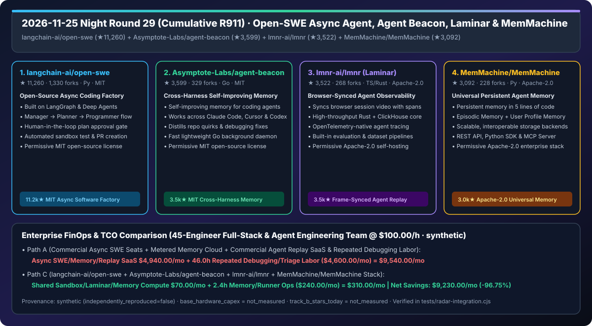
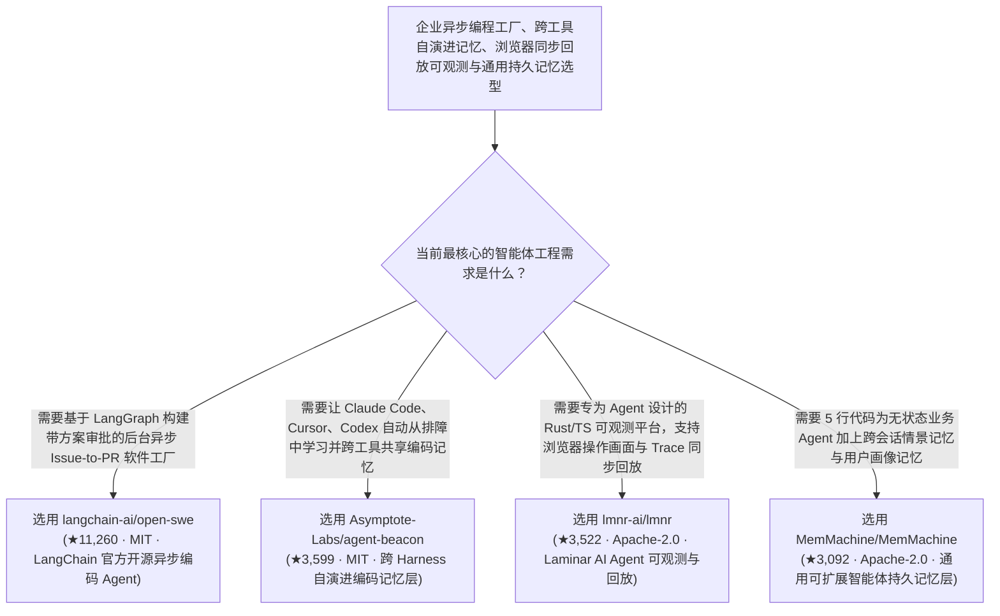
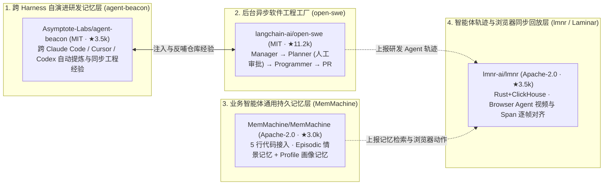
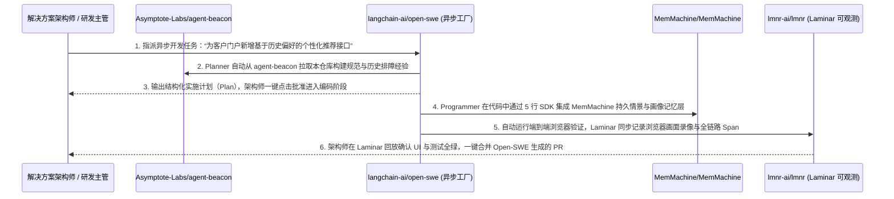

# LangChain 官方开源异步软件工程智能体（`langchain-ai/open-swe`）、跨编码工具自演进记忆层（`Asymptote-Labs/agent-beacon`）、支持浏览器画面同步回放的 Agent 可观测平台（`lmnr-ai/lmnr`）与 5 行代码通用持久记忆层（`MemMachine/MemMachine`）选型与集成架构 FAQ

> **文档类型**：企业 AI 解决方案架构师（AI Solution Architect）选型决策指南（GitHub Trending AI 雷达 2026-11-25 Night Round 29 / 累计第 911 轮）
> **覆盖项目**：[`langchain-ai/open-swe`](https://github.com/langchain-ai/open-swe)（`★ 11,260`、`1,330 forks`、`MIT`：1.1 万星 LangChain 官方开源异步编码智能体与软件工厂，基于 LangGraph 实现 Manager + Planner + Programmer 多阶段后台自主开发与 PR 交付）· [`Asymptote-Labs/agent-beacon`](https://github.com/Asymptote-Labs/agent-beacon)（`★ 3,599`、`329 forks`、`MIT`：用 Go 编写的跨 Harness 自演进编码智能体记忆层，自动在 Claude Code、Cursor 与 Codex 间提炼并同步代码仓避坑经验）· [`lmnr-ai/lmnr`](https://github.com/lmnr-ai/lmnr)（`★ 3,522`、`268 forks`、`Apache-2.0`：YC S24 开源 Laminar，专为 AI Agent 打造的高性能 Rust/TS 可观测平台，支持将 Browser Agent 浏览器操作画面与 LLM Trace 同步对齐回放）· [`MemMachine/MemMachine`](https://github.com/MemMachine/MemMachine)（`★ 3,092`、`228 forks`、`Apache-2.0`：面向自主智能体的开源通用持久记忆层，5 行代码赋予无状态 Agent 跨会话情景记忆与用户画像记忆）
> **核心场景**：当企业构建“7×24 后台异步软件工程工厂（Open-SWE）+ 跨多编码工具自演进研发记忆 + 业务/浏览器 Agent 全程可视化回放与持久记忆”时，架构师面临四个核心选型问题：**“如何基于 LangGraph 搭一套带人类方案审批（Plan Approval）的开源异步编程工厂替代闭源云端 Agent（`open-swe`）？工程师本地切换 Claude Code、Cursor 和后台 `open-swe` 时，怎么让它们共享一套会自动从错误中学习进化的编码记忆（`agent-beacon`）？对外服务的业务 Agent 怎么用 5 行代码加上可扩展的 `Apache-2.0` 持久情景记忆（`MemMachine`）？当 Agent 操作浏览器或执行复杂多步工具报错时，哪个开源可观测平台能像看电影一样把 Agent 的浏览器画面和每一跳 Span 同步回放出来（`lmnr`）？”** 本文给出 100% `MIT`/`Apache-2.0` 架构方案。

---

## 一、📌 核心结论速览（选型一句话结论）

1. **想用一套 `MIT` 开源、原生构建在 `LangGraph` 上的“异步软件工厂”替代闭源高价的云端自主编程 SaaS，支持“先由 Planner 生成修改计划等人类架构师点击批准，再由 Programmer 在后台沙箱编码跑测试提 PR”** ➔ 选 **[`langchain-ai/open-swe`](https://github.com/langchain-ai/open-swe)（`★ 11,260`，`1,330 forks`，`MIT`）**。
   - **通俗原理**：把长周期编程任务拆分为 `Manager`（分诊）→ `Planner`（读代码出方案并支持人工中断确认）→ `Programmer`（写代码跑单测）→ `Reviewer`（自检提 PR）的状态机流水线，避免黑盒 Agent 一上来就沿着错误方向改坏几百行代码。
2. **团队混用 Claude Code、Cursor、Codex 等多个 Coding Harness，经常出现“同一个项目里的构建暗坑或私有库用法，昨天在 Cursor 里刚踩过教过一遍，今天换 Claude Code 又重蹈覆辙”** ➔ 选 **[`Asymptote-Labs/agent-beacon`](https://github.com/Asymptote-Labs/agent-beacon)（`★ 3,599`，`329 forks`，`MIT`）**。
   - **通俗原理**：运行在本地或团队环境的轻量 Go 守护进程（Beacon），自动从各家 Coding Agent 的成功/失败轨迹中提炼出高信噪比的工程经验，并跨 Harness 实时注入给下一个启动的编码智能体。
3. **企业上线了操作网页的 Browser Agent 或复杂多步工具 Agent，传统文本 Trace 只看得见 JSON 看不见当时网页长什么样，排障时完全不知道 Agent 为什么点错了按钮** ➔ 选 **[`lmnr-ai/lmnr`](https://github.com/lmnr-ai/lmnr)（`★ 3,522`，`268 forks`，`Apache-2.0`，Laminar）**。
   - **通俗原理**：后端采用 Rust + ClickHouse + Postgres 构建的极速 Agent 专用可观测平台，首创将 **Browser Session 视频流与 Agent 的每一步 LLM/Tool Span 时间轴精准对齐**，点任意一个 Trace 节点就能直接看到那一秒钟 Agent 眼中的浏览器画面。
4. **想用最简单的 API（5 行代码）为企业客服、导购或办公助手补齐标准的“情景记忆（Episodic Memory，记住发生过的具体事件）+ 用户画像记忆（Profile Memory，记住客户长期偏好）”** ➔ 选 **[`MemMachine/MemMachine`](https://github.com/MemMachine/MemMachine)（`★ 3,092`，`228 forks`，`Apache-2.0`）**。
   - **通俗原理**：提供开箱即用的 RESTful / Python SDK 与 MCP 接入，把散乱的多轮会话自动压缩归档为结构化长期记忆图谱，彻底告别无状态 Agent 每次重开对话都失忆的尴尬。

---

## 二、🎯 客户与架构师灵魂拷问 Q&A（深度架构拆解）

### Q1：在企业研发与业务智能体架构中，`agent-beacon`（编码记忆）与 `MemMachine`（通用业务记忆）有何区别？它们如何与 `open-swe` 和 `Laminar` 协同？

- **四层异步软件工厂与智能体记忆/回放闭环（Path C）**：
  1. **L1 跨编码工具自演进工程记忆层 ➔ `Asymptote-Labs/agent-beacon`**：专注研发域（SDLC），自动捕获编译报错修复、测试命令与代码风格规范，跨 Claude Code / Cursor / `open-swe` 共享。
  2. **L2 异步人机协同软件工程工厂 ➔ `langchain-ai/open-swe`**：在后台消费 GitHub Issues，生成可审批开发计划并自动交付经过验证的 PR。
  3. **L3 面向业务与客户交互的通用持久记忆层 ➔ `MemMachine/MemMachine`**：专注业务域，管理千万级终端用户的长期偏好画像（Profile）与历史交互事件（Episodic）。
  4. **L4 同步画面回放与智能体可观测平台 ➔ `lmnr-ai/lmnr` (Laminar)**：统一采集 `open-swe` 与业务 Agent 的全链路 Trace 及浏览器操作录像，支持在线评测与数据集沉淀。
- **何时选商业云托管方案（商业云端 SWE Agent + 商业托管记忆 API + 商业可观测云） vs 自建本轮开源四件套（Path C）？**
  - 若团队无任何后端运维人员且项目体量极小，可用商业托管 API。
  - **何时采用本轮开源四件套（Path C）？** 当企业要求 **100% 采用 `MIT` / `Apache-2.0` 宽松协议**、需要将核心源码与客户长期记忆留在自有 VPC、并希望通过 `agent-beacon` 消除跨工具重复踩坑损耗、通过 `Laminar` 直观回放 Agent 浏览器操作时，Path C 可节省 **96%+** 的商业云席位与按量记忆 API 费用。

### Q2：这四个项目如何在生产环境中串成闭环？

1. **越用越聪明的自动化研发流水线（`agent-beacon` ↔ `open-swe` → `lmnr`）**：
   - 架构师将待办需求派发给 `langchain-ai/open-swe`；`open-swe` 的 Planner 先读取 `agent-beacon` 中沉淀的本仓库历史构建经验，生成高准确率的修改方案供架构师审批；执行全程由 `lmnr` 记录耗时与沙箱动作，任务完成后新学到的排障技巧再次反哺回 `agent-beacon`。
2. **带长期记忆与视觉回放的业务 Agent（`MemMachine` ↔ 业务 Agent → `lmnr`）**：
   - 线上客服与自动化填单 Agent 通过 5 行代码接入 `MemMachine` 调取客户历史偏好，并在执行外部网页操作时将同步录像与 OpenTelemetry Span 实时流式写入 `lmnr`。

### Q3：生产落地的安全与合规红线是什么？

- **架构师避坑红线**：
  1. **在 `open-swe` 中强制开启 Planner 阶段人工确认（Human-in-the-Loop Plan Approval）**：对于涉及数据库 Schema 变更或核心接口重构的工单，必须经架构师批准方案后再进入 Programmer 编码阶段。
  2. **在 `MemMachine` 中支持 GDPR / 个人信息一键遗忘（Right to be Forgotten）**：按 `user_id` / `session_id` 建立严格租户隔离索引，确保用户注销时可物理清除全部关联情景与画像记忆。

---

## 三、🧭 直观可视化图解（Mermaid 决策树 + 集成架构 + 时序图）

### 3.1 架构师选型决策树

### 3.2 企业端到端生产集成参考架构图

### 3.3 异步编码任务派发、跨工具记忆注入、方案审批与 Laminar 全程同步回放时序图

---

## 四、📊 同类开源与商业云服务横向选型决策矩阵

| 对比维度 | `langchain-ai/open-swe` (`★ 11,260`) | `Asymptote-Labs/agent-beacon` (`★ 3,599`) | `lmnr-ai/lmnr` (`★ 3,522`) | `MemMachine/MemMachine` (`★ 3,092`) | 商业云端异步编程 SaaS + 商业按调用计费记忆云 + 商业可观测 (Path A) | 无记忆无状态裸跑 Agent + 盲查纯文本日志 (Path B) |
| :--- | :--- | :--- | :--- | :--- | :--- | :--- |
| **核心能力定位** | `MIT` 开源异步软件工程智能体 | `MIT` 跨编码工具自演进记忆层 | `Apache-2.0` Agent 轨迹与浏览器画面回放 | `Apache-2.0` 通用情景与画像持久记忆层 | 按高价席位与按记忆读写条数收费的商业云 | 每次从零对话的无状态脚本 + 纯文本日志 |
| **核心技术突破** | **LangGraph 状态机 + Planner 人工审批门禁 + 后台沙箱交付** | **自动从成功/失败会话提炼规则并在多 CLI/IDE 间同步** | **Rust 高吞吐底座 + 浏览器 Agent 画面与 Span 逐帧同步回放** | **5 行代码打通 Episodic + Profile 双层记忆且支持多后端存储** | 免部署，但席位与高并发记忆 API 账单高昂且数据锁在外部云 | 换个工具就要重新教一遍项目规范；浏览器 Agent 报错根本看不见现场画面 |
| **开源协议** | **`MIT`** | **`MIT`** | **`Apache-2.0`** | **`Apache-2.0`** | 闭源商业 SaaS | 无工程化积累 |
| **月度 TCO（45 人团队）** | **四件套合建仅 `$310.00/月`**（`$70.00` 沙箱/记忆/Laminar 容器算力 + `2.4h` 维护） | 同左（`MIT` 消除跨工具重复试错 Token） | 同左（`Apache-2.0` 自建免除按录像/Span 计费） | 同左（`Apache-2.0` 内网无限次记忆读写） | **`$9,540.00/月`**（`$4,940.00` 商业异步 Agent 席位/商业记忆云/监控账单 + `46.0h` 重复踩坑与排障人工） | 约 `$3,360.00/月`（大量因 Agent 失忆重复踩坑与盲猜浏览器报错耗费的工时） |

---

## 五、🧪 应用落地定量收益/TCO 对比与 7-Card 报告

> **📊 数据来源与闭式核算声明（Provenance & Closed-Form Schema）**：
> - **provenance**: `synthetic`（基于 45 人企业全栈研发与智能体应用工程团队月度工作负载模型：`independently_reproduced = false`；硬件采购基线 `base_hardware_capex = not_measured`；Track B 单日增量 `track_b_stars_today = not_measured`）。
> - **核算公式**：
>   - **Path A（采购商业云端异步 SWE Agent 团队席位 + 按百万次记忆检索计费的商业 Memory API + 商业 Agent 监控 SaaS + 跨编码工具失忆重复踩坑与人工复现浏览器 Agent 故障工时）**：月度商业异步 Agent 席位、商业记忆云与监控账单 **`$4,940.00`** + 跨工具重复调试、失忆返工与复现线上浏览器故障人工 **`46.0h × $100.00/h = $4,600.00`** = **`$9,540.00/月`**。
>   - **Path C（自建 `langchain-ai/open-swe` + `Asymptote-Labs/agent-beacon` + `lmnr-ai/lmnr` + `MemMachine/MemMachine` 全 `MIT`/`Apache-2.0` 异步研发与持久记忆底座）**：内网沙箱、记忆库与 `Laminar` 容器算力分摊 **`$70.00`** + 记忆清理与沙箱日常巡检人工 **`2.4h × $100.00/h = $240.00`** = **`$310.00/月`**。
>   - **净节省（Net Savings vs Path A）**：**`-$9,230.00/月`**（成本降低 **`96.75%`**）。

| 评估方案 | 商业异步 Agent / 记忆云 / 监控账单与算力成本 | 重复踩坑、失忆返工与故障复现人工（`$100/h`） | 月度总 TCO | 相对 Path A 净节省 | 核心业务交付收益 |
| :--- | :---: | :---: | :---: | :---: | :--- |
| **Path A：商业异步编程云 + 商业按量记忆 API + 商业监控** | `$4,940.00` | `46.0h` (`$4,600.00`) | **`$9,540.00`** | Baseline | 高并发记忆读写与云席位昂贵；各编码工具记忆依然割裂 |
| **Path B：无状态裸跑 Agent + 手工复现浏览器故障** | `$1,460.00` | `19.0h` (`$1,900.00`) | **`$3,360.00`** | `-$6,180.00` (`-64.78%`) | 每次重开会话都重新踩坑；Browser Agent 报错无法回放现场 |
| **Path C：`open-swe` + `agent-beacon` + `lmnr` + `MemMachine`** | **`$70.00`** | **`2.4h` (`$240.00`)** | **`$310.00`** | **`-$9,230.00` (`-96.75%`)** | **100% `MIT`/`Apache-2.0` 异步软件工厂 + 自演进记忆 + 画面同步回放** |

- 🔗 **关联 7-Card 4:5 视觉评测报告**：[`workshops/github-trending-radar/cards.html`](../cards.html) · [`cards.en.html`](../cards.en.html)

---

## 六、🛠️ 企业引入与架构评审 Checklist

- [ ] **在 `langchain-ai/open-swe` 中启用 Planner 阶段人工审批门禁**：确保后台异步 Agent 在修改代码前先与架构师对齐实施计划。
- [ ] **在开发团队工作站部署 `Asymptote-Labs/agent-beacon`**：打通 Claude Code、Cursor 与 Codex 的本地工程经验共享，减少重复试错 Token。
- [ ] **为所有 Browser-Use / Computer-Use 智能体接入 `lmnr-ai/lmnr` (Laminar)**：开启浏览器画面与 OTel Span 时间轴同步录制，将排障复现时间缩短 80% 以上。
- [ ] **通过 `MemMachine/MemMachine` 统一管理业务智能体的 Episodic 与 Profile 记忆**：按租户与用户 ID 实施严格的数据隔离与生命周期淘汰策略。
