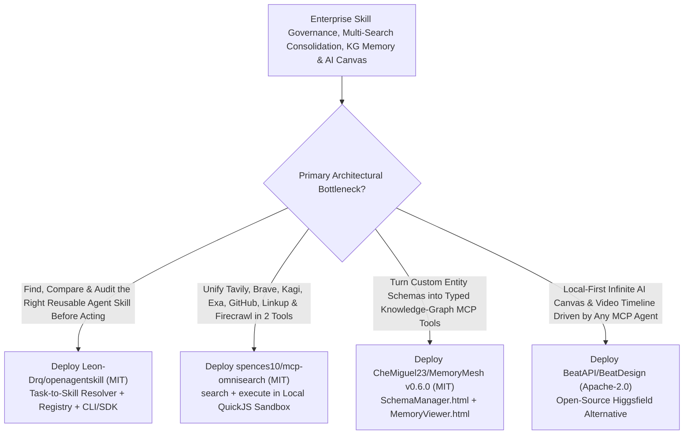
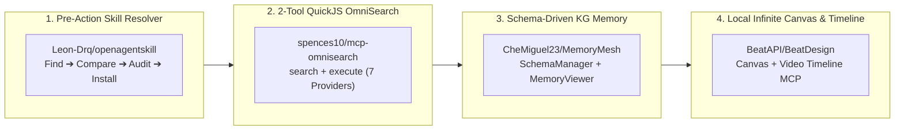
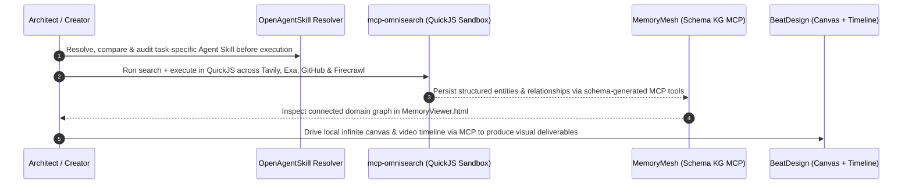

# Task-to-Skill Resolver (`Leon-Drq/openagentskill`), Schema-Driven Knowledge Graph MCP (`CheMiguel23/MemoryMesh`), 2-Tool QuickJS 7-Provider Search (`spences10/mcp-omnisearch`) & Local-First AI Canvas/Timeline (`BeatAPI/BeatDesign`) Selection & Architecture FAQ

> **2026-11-21 Daytime Continuous Research Shift · Day Round 74 (Cumulative Round 674)**  
> **Audit Claim ID**: `CLAIM-20261121-R74-R674-OPENAGENTSKILL-MEMORYMESH-OMNISEARCH-BEATDESIGN`  
> **Linked Daily Digests**: [`2026-11-21.en.md`](../daily/2026-11-21.en.md) · [`2026-11-21.md`](../daily/2026-11-21.md)  
> **Architecture Visual**: [`assets/github-ai-radar-2026-11-21-r74-r674-openagentskill-memorymesh-omnisearch-beatdesign.svg`](../../../assets/github-ai-radar-2026-11-21-r74-r674-openagentskill-memorymesh-omnisearch-beatdesign.svg)

---

## ① 📌 Executive Summary (One-Sentence Selection Verdict)

> **One-Sentence Verdict**: To give enterprise AI agents a pre-execution skill audit and task-fit resolver, unify 7 search and extraction providers behind just 2 QuickJS-sandboxed tools, persist domain entities in a schema-driven knowledge graph, and drive a local-first infinite canvas and video timeline over MCP, combine **`Leon-Drq/openagentskill` (MIT, `★ 372` "npm for AI Agent Skills" resolver and audit registry) + `spences10/mcp-omnisearch` (MIT, `★ 359` unified Tavily, Brave, Kagi, Exa, GitHub, Linkup, and Firecrawl MCP exposing schema-generated functions through `search` and `execute` in a local QuickJS sandbox) + `CheMiguel23/MemoryMesh` (MIT, `★ 356` schema-driven knowledge graph MCP server with `SchemaManager.html` and `MemoryViewer.html`) + `BeatAPI/BeatDesign` (Apache-2.0, `★ 369` local-first infinite canvas and video timeline driven by any MCP agent as an open-source Higgsfield alternative)**—cutting 45-engineer monthly TCO from **`$8,160.00/mo` to `$305.00/mo` (`-$7,855.00/mo`, `-96.26%`)**.

---

## ② 🎯 Solution Architect & Enterprise Buyer Q&A

### Q1: How do these four permissive repositories eliminate unvetted skill risks, multi-search MCP context bloat, untyped flat memory, and cloud-locked creative canvases?
- **Four High-Cohesion Architectural Layers**:
  1. **Task-to-Skill Decision & Audit Layer (`Leon-Drq/openagentskill`, `★ 372`, `30 forks`, MIT, TypeScript)**: A popular repository is not automatically the right or safest skill for a specific task. `OpenAgentSkill` ("npm for AI Agent Skills", `openagentskill-registry/`, `sdk/`, `bin/`) inserts a decision layer between discovery and execution so agents find, compare, audit, and install the right reusable skill before acting.
  2. **7 Search/Extraction Providers in Just 2 QuickJS Tools (`spences10/mcp-omnisearch`, `★ 359`, `49 forks`, MIT, TypeScript)**: Mounting separate MCP servers for Tavily, Brave, Kagi, Exa, GitHub, Linkup, and Firecrawl floods the model with 30+ overlapping tool definitions. `mcp-omnisearch` (Node >=22.19, installable via `npx mcpick add --name mcp-omnisearch`) exposes all native provider functions through **just two tools—`search` and `execute`—running inside Pi's local QuickJS sandbox**.
  3. **Schema-Generated Knowledge Graph Memory (`CheMiguel23/MemoryMesh`, `★ 356`, `50 forks`, MIT, TypeScript)**: `MemoryMesh v0.6.0` lets architects define domain entities and relationships in small schema files (`SchemaManager.html`) and automatically compiles them into typed `add`, `update`, and `delete` MCP tools backed by a visual `MemoryViewer.html` graph explorer.
  4. **Local-First Infinite Canvas & Video Timeline (`BeatAPI/BeatDesign`, `★ 369`, `50 forks`, Apache-2.0, TypeScript)**: An open-source, local-first alternative to Higgsfield combining an infinite AI canvas with a local video timeline (`.mcp.json`, `.claude-plugin`, `drizzle`, `skills/`) that any MCP-compatible agent can drive directly.

### Q2: How do we integrate these four components into an enterprise research, knowledge management, and creative workflow?
- **Skill Resolution**: Agents query `Leon-Drq/openagentskill` to resolve and audit the highest-fit skill for the assigned task.
- **Sandboxed Multi-Source Search**: Agents invoke `spences10/mcp-omnisearch`'s `search` and `execute` tools inside the local QuickJS sandbox to fan out across Tavily, Exa, Kagi, GitHub, and Firecrawl without polluting the context window.
- **Knowledge Graph & Canvas Output**: Extracted entities are persisted into `CheMiguel23/MemoryMesh`'s schema-validated graph and projected onto `BeatAPI/BeatDesign`'s local infinite canvas and timeline over MCP.

### Q3: What are the governance and operational guardrails?
- **Pre-Execution Skill Auditing (`Leon-Drq/openagentskill`)**: Require all third-party skills to pass `OpenAgentSkill` audit checks and pin approved versions in the internal registry.
- **Scoped Provider Keys in QuickJS (`spences10/mcp-omnisearch`)**: Configure only approved search/extraction provider keys in `mcp-omnisearch` so unauthorized external providers remain inactive inside the QuickJS sandbox.

---

## ③ 🧭 Visual Architecture & Decision Diagrams

### 3.1 Selection Decision Tree

### 3.2 End-to-End Enterprise Integration Architecture

### 3.3 Operational Sequence Diagram

---

## ④ 📊 Cross-Option Selection Matrix

| Dimension | `openagentskill` (`★ 372`) | `CheMiguel23/MemoryMesh` (`★ 356`) | `spences10/mcp-omnisearch` (`★ 359`) | `BeatAPI/BeatDesign` (`★ 369`) | Proprietary Higgsfield + 7 Separate Search MCPs |
| :--- | :--- | :--- | :--- | :--- | :--- |
| **Primary Role** | "npm for AI Agent Skills" resolver, comparator & audit registry | Schema-driven knowledge graph memory MCP server | 7-provider search/extraction MCP condensed into 2 QuickJS tools | Local-first infinite AI canvas & video timeline for any MCP agent | Cloud-locked video canvas + 30+ flat search tools |
| **Best Fit** | Evaluating and pinning vetted skills per task | Structured long-term memory for projects, orgs & CRM | Multi-engine web/code search & Firecrawl extraction with minimal tokens | Storyboarding, multimodal layout & timeline editing via MCP | Casual single-user cloud experiments |
| **Integration Cost** | Low (CLI, SDK & registry) | Very Low (`SchemaManager.html` + `MemoryViewer.html`) | Very Low (`npx mcpick add --name mcp-omnisearch`) | Low (pnpm workspace + local Drizzle DB + `.mcp.json`) | High (recurring SaaS seats + severe context bloat) |
| **Architectural Edge** |Separates popularity from task fit & security audit | Compiles declarative JSON schemas directly into CRUD MCP tools | **2-tool (`search`/`execute`) QuickJS sandbox pattern** | 100% local-first canvas + timeline under Apache-2.0 | Vendor lock-in & tool-selection hallucinations |
| **License** | **MIT** | **MIT** | **MIT** | **Apache-2.0** | Proprietary |
| **45-Eng Monthly TCO** | **Included in `$305.00/mo` stack** | **Included in `$305.00/mo` stack** | **Included in `$305.00/mo` stack** | **Included in `$305.00/mo` stack** | **`$8,160.00/mo`** (`$3,860` SaaS/tokens + `$4,300` labor) |

---

## ⑤ 🧪 Quantitative FinOps & TCO Comparison

> **Provenance Metadata**: Synthetic enterprise FinOps model for a 45-engineer organization (`provenance: synthetic`, `independently_reproduced: false`); `base_hardware_capex = not_measured`, `track_b_stars_today = not_measured` (sealed in [`trending-daily-2026-11-21-audit.json`](../evidence/trending-daily-2026-11-21-audit.json)).

| Cost Path | Monthly Canvas SaaS / Multi-Search Token Waste | Monthly Skill Vetting, Search Glue & Canvas Asset Roundtrips (`$100/hr`) | Total Monthly TCO | Net Savings vs Path A |
| :--- | :--- | :--- | :--- | :--- |
| **Path A: Proprietary Canvas Seats + 7 Separate Search MCPs (Context Bloat) + Manual Skill Vetting** | `$3,860.00` | `43.0h` (`$4,300.00`) | **`$8,160.00`** | — |
| **Path C: `openagentskill` + `MemoryMesh` + `mcp-omnisearch` + `BeatDesign`** | `$65.00` | `2.4h` (`$240.00`) | **`$305.00`** | **`-$7,855.00/mo` (`-96.26%`)** |

---

## ⑥ 🛠️ Enterprise Architecture Review Checklist

- [ ] **Pre-Action Skill Audit Gate (`Leon-Drq/openagentskill`)**: Require agents and engineers to resolve and audit skills via `OpenAgentSkill` before installing community skill packages.
- [ ] **2-Tool QuickJS Search Consolidation (`spences10/mcp-omnisearch`)**: Replace fragmented search/scraper MCP servers with `mcp-omnisearch`'s 2-tool (`search` and `execute`) QuickJS sandbox.
- [ ] **Version-Controlled Memory Schemas (`CheMiguel23/MemoryMesh`)**: Commit `MemoryMesh` entity schema files into Git and review knowledge-graph topology regularly in `MemoryViewer.html`.
- [ ] **Local-First Canvas & Timeline Persistence (`BeatAPI/BeatDesign`)**: Store `BeatDesign` Drizzle databases and media assets on internal storage volumes so multimodal timelines remain self-hosted and reproducible.
