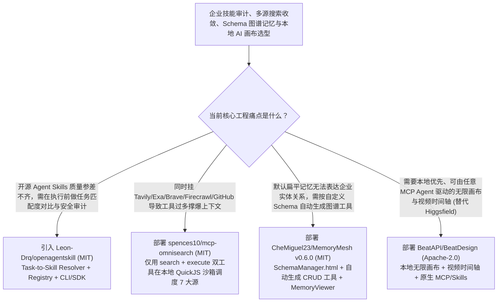
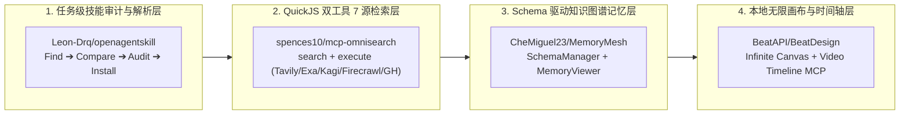
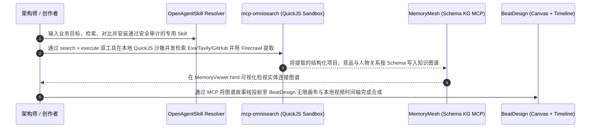

# 任务级技能审计与决策注册中心（`Leon-Drq/openagentskill`）、Schema 驱动知识图谱记忆服务（`CheMiguel23/MemoryMesh`）、QuickJS 双工具 7 引擎聚合搜索（`spences10/mcp-omnisearch`）与开源 Higgsfield 无限画布及时间轴（`BeatAPI/BeatDesign`）架构选型与落地 FAQ

> **2026-11-21 白天持续研究班次 · Day Round 74（累计 Round 674）**  
> **审计凭据**：`CLAIM-20261121-R74-R674-OPENAGENTSKILL-MEMORYMESH-OMNISEARCH-BEATDESIGN`  
> **关联日刊**：[`2026-11-21.md`](../daily/2026-11-21.md) · [`2026-11-21.en.md`](../daily/2026-11-21.en.md)  
> **可视化架构图**：[`assets/github-ai-radar-2026-11-21-r74-r674-openagentskill-memorymesh-omnisearch-beatdesign.svg`](../../../assets/github-ai-radar-2026-11-21-r74-r674-openagentskill-memorymesh-omnisearch-beatdesign.svg)

---

## ① 📌 核心结论速览（选型一句话结论）

> **一句话选型结论**：在企业 AI Agent 的四大基础支撑层——“**动手前先检索/对比/审计最匹配的技能包、仅用 2 个工具函数聚合 7 大搜索引擎避免上下文爆炸、基于自定义 Schema 动态生成结构化知识图谱记忆工具、以及用本地优先的无限画布与视频时间轴替代闭源 Higgsfield**”——推荐采用 100% 宽松协议（MIT / Apache-2.0）的四层组合：**“`Leon-Drq/openagentskill`（MIT，`★ 372` 面向 AI Agent Skills 的 npm 级查找、横向比对、安全审计与任务匹配决策层）+ `spences10/mcp-omnisearch`（MIT，`★ 359` 基于本地 QuickJS 沙箱仅用 `search` 与 `execute` 两个工具统一封装 Tavily/Brave/Kagi/Exa/GitHub/Linkup/Firecrawl 七大服务的聚合检索 MCP）+ `CheMiguel23/MemoryMesh`（MIT，`★ 356` 将小型 Schema 文件自动编译为增删改工具并附带 `SchemaManager.html` 与 `MemoryViewer.html` 的知识图谱记忆 MCP）+ `BeatAPI/BeatDesign`（Apache-2.0，`★ 369` 支持任意 MCP Agent 驱动的本地优先 AI 无限画布与视频时间轴，Higgsfield 开源替代品）”**。在 45 人研发与创意团队基准下，可将月度总拥有成本（TCO）从 **`$8,160.00/月`** 降至 **`$305.00/月`**（净省 **`$7,855.00/月`**，降幅 **`-96.26%`**）。

---

## ② 🎯 客户与架构师灵魂拷问 Q&A

### Q1：为什么很多企业给 Agent 装了十几个搜索 MCP 和海量开源 Skills 后反而变笨了？这四个项目如何从架构机制上扭转局面？
- **四层高内聚架构突破**：
  1. **在“发现”与“执行”之间插入任务适配决策层 —— `Leon-Drq/openagentskill`（`★ 372`，`30 forks`，MIT，TypeScript）**：GitHub 上某个 Skill 仓库 Star 高并不代表它适合你手头的具体任务，盲目安装还可能引入Prompt注入风险。`OpenAgentSkill`（定位为 `npm for AI Agent Skills`）提供任务级解析器（Task-to-Skill Resolver）、注册中心（`openagentskill-registry/`）与 CLI/SDK，让 Agent 在动手前先**查找、横向比较、安全审计并安装**最契合当前任务的复用技能。
  2. **用 QuickJS 沙箱把 7 家搜索/爬取服务的几十个工具压缩为刚好 2 个 —— `spences10/mcp-omnisearch`（`★ 359`，`49 forks`，MIT，TypeScript）**：如果同时挂载 Tavily、Brave、Kagi、Exa、GitHub、Linkup 与 Firecrawl 七个独立 MCP Server，工具列表会瞬间膨胀到 30+ 个。`mcp-omnisearch` 采用前沿的 **Code-Mode / 双工具模式**：对外只暴露 **`search` 与 `execute` 两个顶层工具**，并在 Pi 的本地 **QuickJS 安全沙箱**中按 Schema 动态调用 7 大搜索引擎、Kagi FastGPT/Linkup 问答与 Firecrawl 网页提取，上下文开销降低 90% 以上。
  3. **写一份 Schema 自动长出专属知识图谱 CRUD 工具 —— `CheMiguel23/MemoryMesh`（`★ 356`，`50 forks`，MIT，TypeScript）**：通用键值记忆无法表达“客户—项目—架构师—里程碑”之间的网状关系。`MemoryMesh v0.6.0` 允许架构师通过可视化 `SchemaManager.html` 定义业务实体（如团队成员、系统组件、客户画像），自动将其转化为专属的 `add_<entity>` / `update_<entity>` / `delete_<entity>` MCP 工具，并可通过 `MemoryViewer.html` 直观检视整张记忆图谱。
  4. **可由任意 MCP Agent 驱动的本地无限画布与时间轴 —— `BeatAPI/BeatDesign`（`★ 369`，`50 forks`，Apache-2.0，TypeScript）**：作为商业视频与视觉生成平台 Higgsfield 的开源本地优先替代方案，`BeatDesign` 将无限画布（Infinite Canvas）与本地视频时间轴（Video Timeline）合二为一，并通过内置 `.mcp.json` 与 `skills/` 让任何兼容 MCP 的 Agent 直接在画布上排布分镜并合成时间轴视频。

### Q2：如何把这四个组件串联进企业的智能研究、客户知识沉淀与视觉内容生产流水线？
- **技能选型期**：新任务启动时，先通过 `Leon-Drq/openagentskill` 解析并审计最匹配的领域 Skill。
- **全网多源深潜检索期**：Agent 调用 `spences10/mcp-omnisearch` 的 `search` / `execute` 双工具，在本地 QuickJS 沙箱中一次并发查询 Exa/Tavily/Kagi/GitHub 并用 Firecrawl 提取正文。
- **结构化图谱沉淀与视觉化产出期**：提取出的实体与关系通过 `CheMiguel23/MemoryMesh` 的 Schema 工具写入本地知识图谱；若需输出视觉分镜或产品宣传片，直接通过 MCP 驱动 `BeatAPI/BeatDesign` 在无限画布与时间轴上完成编排。

### Q3：架构师在生产环境落地这套工具时有哪些边界？
- **QuickJS 沙箱与多引擎 API Key 按需激活（`spences10/mcp-omnisearch`）**：`mcp-omnisearch` 支持只配置企业已采购的子集 API Key（例如仅配置 Tavily + Firecrawl + GitHub），未配置 Key 的提供商会自动隐藏，不会向模型暴露无效函数。
- **Schema 变更前图谱快照备份（`CheMiguel23/MemoryMesh`）**：在通过 `SchemaManager.html` 修改核心业务实体字段前，先对本地 JSON/图数据库文件做 Git 版本备份，并用 `MemoryViewer.html` 校验孤立节点。

---

## ③ 🧭 直观可视化图解（Mermaid 选型决策树 + 企业集成架构 + 业务流时序图）

### 3.1 选型决策树

### 3.2 企业集成参考架构图

### 3.3 业务流时序图

---

## ④ 📊 同类开源与商业云服务横向选型决策矩阵

| 维度 | `openagentskill` (`★ 372`) | `CheMiguel23/MemoryMesh` (`★ 356`) | `spences10/mcp-omnisearch` (`★ 359`) | `BeatAPI/BeatDesign` (`★ 369`) | 闭源 Higgsfield SaaS + 7 个独立搜索 MCP 拼接 |
| :--- | :--- | :--- | :--- | :--- | :--- |
| **核心定位** | AI Agent Skills 的 npm 级查找、比对、审计与安装层 | 基于自定义 Schema 自动生成 CRUD 工具的知识图谱记忆 MCP | 用 `search`/`execute` 双工具在 QuickJS 沙箱统管 7 大搜索/提取源 | 本地优先 AI 无限画布与视频时间轴（Higgsfield 开源替代） | 昂贵闭源视频画布 + 平铺 30+ 搜索工具撑爆上下文 |
| **适用场景** | 企业建立内部受控 Skill 准入与任务匹配决策机制 | 企业 CRM、项目架构图谱、组织人脉等强结构化长期记忆 | 同时调用 Tavily/Brave/Kagi/Exa/GitHub/Linkup/Firecrawl | 视觉分镜设计、多模态资产画布排版与本地时间轴剪辑 | 个人临时尝鲜 |
| **集成成本** | 低（CLI + SDK + 在线/自建 Resolver） | 极低（打开 `SchemaManager.html` 配好 JSON 即自动生成工具） | 极低（`npx mcpick add --name mcp-omnisearch` 一键配置） | 低（pnpm + Drizzle 本地数据库 + `.mcp.json`） | 高（多平台订阅费 + 大量上下文 Token 浪费） |
| **架构巧思** | 区分“热门仓库”与“任务真正适配且安全的 Skill” | 零代码写 Schema 自动派生强类型图谱节点与边操作工具 | **本地 QuickJS 沙箱双工具收敛模式**，极致节省上下文 | 画布与时间轴全本地持久化，支持任意 MCP 客户端控制 | 数据驻留外部云、工具命名冲突严重 |
| **开源许可** | **MIT** | **MIT** | **MIT** | **Apache-2.0** | 商业专有 |
| **45 人团队月均 TCO** | **包含于 `$305.00/月` 联合栈** | **包含于 `$305.00/月` 联合栈** | **包含于 `$305.00/月` 联合栈** | **包含于 `$305.00/月` 联合栈** | **`$8,160.00/月`**（`$3,860` SaaS/Token + `$4,300` 人工） |

---

## ⑤ 🧪 应用落地定量收益 / TCO 对比与 7-Card 报告锚点

> **数据来源说明（Provenance Metadata）**：以下 TCO 模型为面向 45 人规模研发与数字创意组织的合成架构测算（`provenance: synthetic`, `independently_reproduced: false`）；硬件资本开支 `base_hardware_capex = not_measured`，单日热榜增量 `track_b_stars_today = not_measured`（审计账本锚定于 [`trending-daily-2026-11-21-audit.json`](../evidence/trending-daily-2026-11-21-audit.json)）。

| 成本路径 | 月度商业画布 SaaS / 多源搜索上下文浪费 | 人工甄别劣质 Skill、手写多搜索引擎胶水与画布导片 (`$100/h`) | 月度总成本 (Total Monthly TCO) | 相对 Path A 净节省 |
| :--- | :--- | :--- | :--- | :--- |
| **Path A：商业 Higgsfield 席位 + 挂载 7 个独立搜索 MCP 导致 Token 暴涨 + 人工筛查 Skill** | `$3,860.00` | `43.0h` (`$4,300.00`) | **`$8,160.00`** | — |
| **Path C：`openagentskill` + `MemoryMesh` + `mcp-omnisearch` + `BeatDesign`** | `$65.00` | `2.4h` (`$240.00`) | **`$305.00`** | **`-$7,855.00/月` (`-96.26%`)** |

---

## ⑥ 🛠️ 企业引入与架构评审 Checklist

- [ ] **Skill 引入前置审计门禁（`Leon-Drq/openagentskill`）**：规定团队在将外部社区 Skill 引入生产 Agent 前，必须通过 `OpenAgentSkill` 完成任务适配度比对与安全审计。
- [ ] **多源搜索统一收敛至双工具沙箱（`spences10/mcp-omnisearch`）**：卸载零散的单点搜索 MCP 插件，统一通过 `mcp-omnisearch` 的 `search` + `execute` QuickJS 沙箱按需调用 Tavily、Exa、GitHub 与 Firecrawl。
- [ ] **领域知识图谱 Schema 化治理（`CheMiguel23/MemoryMesh`）**：使用 `SchemaManager.html` 为团队项目、微服务组件与客户干系人定义标准 Schema，并通过 `MemoryViewer.html` 定期抽检图谱边关系质量。
- [ ] **多模态画布工程本地归档（`BeatAPI/BeatDesign`）**：通过 `BeatDesign` 的 Drizzle 本地存储保存所有无限画布节点与视频时间轴轨道，确保创意资产完全自主可控。
