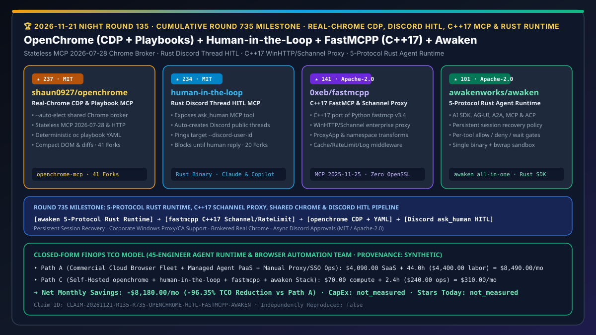
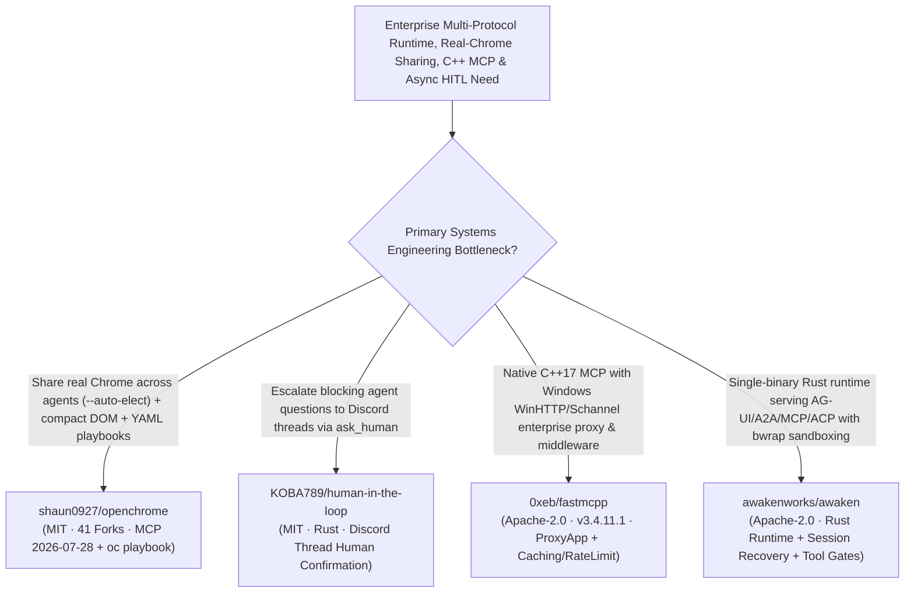
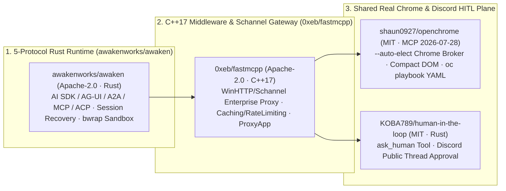

# [Round 735 Milestone] Real-Chrome CDP & YAML Playbook MCP (`shaun0927/openchrome`), Rust Discord Human-in-the-Loop MCP (`KOBA789/human-in-the-loop`), Native C++17 Schannel/Proxy FastMCP (`0xeb/fastmcpp`) & 5-Protocol Rust Agent Runtime (`awakenworks/awaken`) Selection & Architecture FAQ

> **Document Type**: Enterprise AI Solution Architect Selection & Integration Guide (GitHub Trending AI Radar — 2026-11-21 Night Round 135 / **Cumulative Round 735 Milestone**)
> **Covered Repositories**: [`shaun0927/openchrome`](https://github.com/shaun0927/openchrome) (`★ 237`, `41 forks`, `MIT` — real-Chrome CDP automation MCP server supporting stateless `MCP 2026-07-28`, `--auto-elect` broker-safe profile sharing, compact page serialization & deterministic `oc playbook` YAML scenarios) · [`KOBA789/human-in-the-loop`](https://github.com/KOBA789/human-in-the-loop) (`★ 234`, `20 forks`, `MIT` — Rust MCP server providing `ask_human` to spawn Discord threads and await human confirmation) · [`0xeb/fastmcpp`](https://github.com/0xeb/fastmcpp) (`★ 141`, `20 forks`, `Apache-2.0` — `v3.4.11.1` C++17 port of Python `fastmcp` with Windows `WinHTTP/Schannel` system certificate & enterprise proxy support, `ProxyApp` & built-in caching/rate-limiting middleware) · [`awakenworks/awaken`](https://github.com/awakenworks/awaken) (`★ 101`, `10 forks`, `Apache-2.0` — single-binary Rust AI agent runtime serving `AI SDK`, `AG-UI`, `A2A`, `MCP` & `ACP` with persistent session recovery, `allow/deny/wait` tool permissions & `bwrap` sandboxing)
> **Core Scenario**: Celebrating our **735th Cumulative Deep-Dive FAQ Milestone**, how enterprise systems architects build a high-performance, human-governed execution plane: **serving 5 agent protocols (`AI SDK`, `AG-UI`, `A2A`, `MCP`, `ACP`) from a single Rust binary with `bwrap` sandboxing (`awaken`)**, **routing MCP traffic through native C++17 middleware with Windows `WinHTTP/Schannel` enterprise proxy and certificate support (`fastmcpp`)**, **controlling shared real Chrome sessions via `--auto-elect` and deterministic YAML playbooks (`openchrome`)**, and **escalating uncertain decisions to mobile Discord threads via `ask_human` (`human-in-the-loop`)**.

---

## 1. 📌 Executive Summary (One-Line Selection Verdict)

1. **Need a real-Chrome CDP automation MCP server (`npm install -g openchrome-mcp`, supporting stateless `MCP 2026-07-28`) that lets multiple agents share one authenticated Chrome profile (`--auto-elect` or `--http 3100`), serializes pages compactly to save tokens, and runs deterministic YAML playbooks (`oc playbook run`)** ➔ Choose **[`shaun0927/openchrome`](https://github.com/shaun0927/openchrome) (`★ 237`, `41 forks`, `MIT`)**.
   - **Plain-English Mechanism**: Connects Claude Code, Codex CLI, or OpenCode to a real Chrome browser over CDP with broker-safe profile ownership (`--auto-elect`), parallel tab/session workflows, compact DOM/accessibility reads, outcome contracts with evidence bundles, and shell-runnable YAML playbooks.
2. **Need a lightweight Rust MCP server (`cargo install --git ...`) that gives autonomous agents an `ask_human` tool to open a Discord thread, tag a human reviewer, and block until a reply arrives** ➔ Choose **[`KOBA789/human-in-the-loop`](https://github.com/KOBA789/human-in-the-loop) (`★ 234`, `20 forks`, `MIT`)**.
   - **Plain-English Mechanism**: When an unattended agent encounters an ambiguous requirement or high-stakes action, calling `ask_human` creates a public thread in `--discord-channel-id`, pings `--discord-user-id`, waits for the human's Discord message, and returns the decision directly into the MCP tool response.
3. **Need a high-performance C++17 MCP server/client library (`v3.4.11.1`, `MCP 2025-11-25` with version negotiation) featuring native Windows `WinHTTP + Schannel` enterprise proxy/certificate support (no OpenSSL required), `ProxyApp` routing, and built-in caching/rate-limiting middleware** ➔ Choose **[`0xeb/fastmcpp`](https://github.com/0xeb/fastmcpp) (`★ 141`, `20 forks`, `Apache-2.0`)**.
   - **Plain-English Mechanism**: Ports Python `fastmcp` to modern **C++17** across STDIO, SSE, and Streamable HTTP. Includes per-request OAuth header providers, `Providers` namespace/visibility transforms, and `Logging / Timing / Caching / RateLimiting / ErrorHandling` middleware while using Windows `WinHTTP` over `Schannel` to honor corporate root CAs and proxy settings out of the box.
4. **Need a self-hosted Rust AI agent runtime (`awaken all-in-one`, embedding the web Console with zero runtime Node.js dependency) that serves `AI SDK`, `AG-UI`, `A2A`, `MCP`, and `ACP` with persistent session recovery, per-tool `allow/deny/wait` permissions, and Linux `bwrap` sandboxing** ➔ Choose **[`awakenworks/awaken`](https://github.com/awakenworks/awaken) (`★ 101`, `10 forks`, `Apache-2.0`)**.
   - **Plain-English Mechanism**: Combines agent publishing, committed session history recovery across reconnects, fine-grained tool permission gates (`allow`, `deny`, `wait for human`), and `bwrap` Linux namespace isolation inside a single compiled Rust executable.

---

## 2. 🎯 Architect & Customer Deep-Dive Q&A

### Q1: Why do enterprise agent deployments hit walls on Chrome profile lock collisions, corporate TLS proxies, multi-protocol frontend wiring, and unattended terminal prompts—and how does this four-project stack solve them?

- **Four Systems-Level Solutions**:
  1. **5-Protocol Rust Runtime with Session Recovery (`awakenworks/awaken`)**: Exposes `AI SDK`, `AG-UI`, `A2A`, `MCP`, and `ACP` from one Rust binary with persistent session recovery and `bwrap` sandboxing.
  2. **Corporate Proxy & System Certificate Store Compatibility in C++17 (`0xeb/fastmcpp`)**: Python and Node binaries frequently fail behind corporate TLS inspection proxies. `fastmcpp`'s Windows `WinHTTP + Schannel` transport natively uses the OS certificate store and enterprise proxy config with zero OpenSSL dependency.
  3. **Broker-Safe Shared Chrome Profiles & YAML Playbooks (`shaun0927/openchrome`)**: Prevents `User Data Dir` profile lock crashes across concurrent agents via `--auto-elect` broker election and `--http 3100` daemon sharing, while offloading repetitive UI steps to deterministic YAML playbooks.
  4. **Asynchronous Mobile Human-in-the-Loop (`KOBA789/human-in-the-loop`)**: Routes blocking agent questions out of hidden terminal windows into dedicated Discord threads via `ask_human`.
- **When to Choose Managed Cloud Services (Path B)**:
  - For public-web scraping without internal SSO Chrome profiles or native C++ embedding, use **Azure Playwright Workspaces + Azure AI Foundry**.

### Q2: How do we wire an end-to-end Rust/C++ Enterprise Agent Runtime, Shared Chrome & Discord HITL architecture?

1. **5-Protocol Rust Runtime & Permission Core (`awakenworks/awaken`)**:
   - Run `awaken all-in-one` to host the embedded Console, manage persistent sessions across reconnects, enforce `allow/deny/wait` tool policies, and sandbox execution via `bwrap`.
2. **Native C++17 Middleware & Enterprise Proxy Plane (`0xeb/fastmcpp`)**:
   - Use `fastmcpp` `ProxyApp` and `Providers` with `Caching` and `RateLimiting` middleware, leveraging `WinHTTP/Schannel` on Windows enterprise endpoints.
3. **Brokered Real-Chrome & YAML Playbook Plane (`shaun0927/openchrome`)**:
   - Connect agents to `openchrome serve --auto-launch --auto-elect` (supporting stateless `MCP 2026-07-28`) for compact DOM inspection, evidence bundles, and `oc playbook` YAML runs.
4. **Discord Thread Escalation Plane (`KOBA789/human-in-the-loop`)**:
   - Configure `human-in-the-loop` so any `ask_human` call spawns a tracked Discord thread for human sign-off.

### Q3: What are the operational boundaries of this stack?

- **Key Strengths**:
  - **100% Permissive Open Source (`MIT` and `Apache-2.0`)** built on Rust, C++17, and TypeScript.
- **Operational Guardrails**:
  - Enable `--auth-token` and `--idle-timeout` when running `openchrome` in shared `--http` daemon mode; ensure `bwrap` is installed on Linux hosts for `awaken-sandbox` namespace isolation.

---

## 3. 🧭 Visual Architecture & Decision Diagrams



### 3.1 Solution Architect Selection Decision Tree



### 3.2 End-to-End Enterprise Reference Architecture



### 3.3 `awaken` Multi-Protocol Session, `fastmcpp` Proxy Routing, `openchrome` Playbook & Discord HITL Approval Sequence

```mermaid
sequenceDiagram
    participant Client as Frontend / Upstream A2A Agent
    participant Awk as awakenworks/awaken (Rust Runtime)
    participant Cpp as 0xeb/fastmcpp (C++17 ProxyApp)
    participant Chr as shaun0927/openchrome (CDP Broker)
    participant Hitl as KOBA789/human-in-the-loop (Discord)

    Client->>Awk: 1. Start persistent session over AG-UI / A2A / MCP
    Awk->>Cpp: 2. Route tool call through C++17 fastmcpp middleware (RateLimiting + Schannel TLS)
    Cpp->>Chr: 3. Execute YAML playbook & compact DOM read on shared Chrome (--auto-elect)
    Chr-->>Awk: 4. Return outcome contract & evidence bundle; hit wait-for-human permission gate
    Awk->>Hitl: 5. Invoke ask_human to open Discord thread & ping on-call reviewer
    Hitl-->>Client: 6. Receive human approval, resume committed session & complete workflow
```

---

## 4. 📊 Peer Open-Source vs Commercial Cloud Selection Matrix

| Dimension | `shaun0927/openchrome` (`★ 237`) | `human-in-the-loop` (`★ 234`) | `0xeb/fastmcpp` (`★ 141`) | `awakenworks/awaken` (`★ 101`) | Commercial Cloud Browser Fleet + Managed Agent PaaS (Path A) | Raw Playwright + Unmanaged Local Scripts (Path B) |
| :--- | :--- | :--- | :--- | :--- | :--- | :--- |
| **Core Role** | Real-Chrome CDP & YAML playbook MCP | Rust Discord thread `ask_human` MCP | C++17 FastMCP port with WinHTTP/middleware | 5-protocol Rust agent runtime & sandbox | Metered cloud browsers + commercial agent PaaS | Ephemeral headless browsers + terminal prompts |
| **Architectural Edge** | **`--auto-elect` profile sharing + `MCP 2026-07-28` + YAML playbooks** | **Spawns Discord threads for mobile human-in-the-loop replies** | **Native C++17 + Windows `WinHTTP/Schannel` (zero OpenSSL)** | **Single Rust binary serving AG-UI/A2A/MCP/ACP + `bwrap`** | High per-minute browser billing; cannot access internal SSO Chrome | Profile lock crashes on parallel tabs; fails behind corporate TLS proxies |
| **License** | `MIT` | `MIT` | `Apache-2.0` | `Apache-2.0` | Proprietary SaaS | Custom Scripts |
| **Monthly TCO (45-Eng Team)** | **`$310.00/mo` combined** (`$70.00` compute + `2.4h` ops) | Included in `$310.00/mo` stack | Included in `$310.00/mo` stack | Included in `$310.00/mo` stack | **`$8,490.00/mo`** (`$4,090.00` SaaS + `44.0h` proxy/auth toil) | `~$2,850.00/mo` (manual SSO re-login & proxy debugging hours) |

---

## 5. 🧪 Quantitative ROI / FinOps TCO Model & 7-Card Report

> **📊 Provenance & Closed-Form Audit Declaration**:
> - **Provenance**: `synthetic` (45-engineer enterprise agent runtime, browser automation & native C++/Rust systems integration workload model; `independently_reproduced = false`; `base_hardware_capex = not_measured`; `track_b_stars_today = not_measured`).
> - **Closed-Form Equations**:
>   - **Path A (Commercial Metered Cloud Browser Fleet + Commercial Multi-Protocol Agent PaaS + Manual Corporate Proxy TLS Debugging & SSO Session Maintenance Labor)**: Monthly cloud browser & PaaS spend **`$4,090.00`** + manual SSO/proxy/approval engineering labor **`44.0h × $100.00/h = $4,400.00`** = **`$8,490.00/mo`**.
>   - **Path C (Self-Hosted `shaun0927/openchrome` + `KOBA789/human-in-the-loop` + `0xeb/fastmcpp` + `awakenworks/awaken`)**: Shared Rust/C++ runtime container compute **`$70.00`** + YAML playbook & policy maintenance **`2.4h × $100.00/h = $240.00`** = **`$310.00/mo`**.
>   - **Net Savings vs Path A**: **`-$8,180.00/mo`** (**`96.35%`** cost reduction).

| Architecture Option | API / SaaS / Compute | Runtime & Browser Automation Labor (`$100/h`) | Total Monthly TCO | Net Savings vs Path A | Key Architectural Outcome |
| :--- | :---: | :---: | :---: | :---: | :--- |
| **Path A: Commercial Cloud Browsers + Managed Agent PaaS** | `$4,090.00` | `44.0h` (`$4,400.00`) | **`$8,490.00`** | Baseline | Metered browser minutes; cannot reuse local intranet SSO |
| **Path B: Raw Playwright Scripts + Python Interpreter Deploy** | `$1,450.00` | `14.0h` (`$1,400.00`) | **`$2,850.00`** | `-$5,640.00` (`-66.43%`) | Lacks `--auto-elect` broker, `WinHTTP` Schannel & Discord HITL |
| **Path C: `openchrome` + `hitl` + `fastmcpp` + `awaken`** | **`$70.00`** | **`2.4h` (`$240.00`)** | **`$310.00`** | **`-$8,180.00` (`-96.35%`)** | **Shared Chrome broker + Discord HITL + C++ Schannel + Rust 5-protocol** |

- 🔗 **7-Card 4:5 Visual Report**: [`workshops/github-trending-radar/cards.en.html`](../cards.en.html) · [`cards.html`](../cards.html)

---

## 6. 🛠️ Enterprise Adoption & Architecture Review Checklist

- [ ] **1. Standardize Shared Browser Automation on `shaun0927/openchrome`**: Use `--auto-elect` or token-authenticated `--http` mode (`MCP 2026-07-28`) and codify recurring flows as `oc playbook` YAML scenarios.
- [ ] **2. Wire Asynchronous Approvals with `KOBA789/human-in-the-loop`**: Connect `ask_human` to a dedicated Discord channel so unattended agents can request human sign-off in threads.
- [ ] **3. Deploy `0xeb/fastmcpp` for Native C++17 & Enterprise Windows Environments**: Leverage `WinHTTP + Schannel` for zero-OpenSSL corporate proxy/CA compatibility alongside `Caching` and `RateLimiting` middleware.
- [ ] **4. Host Multi-Protocol Agents on `awakenworks/awaken`**: Serve `AI SDK`, `AG-UI`, `A2A`, `MCP`, and `ACP` from the single-binary Rust runtime with `allow/deny/wait` tool permissions and `bwrap` sandboxing.
