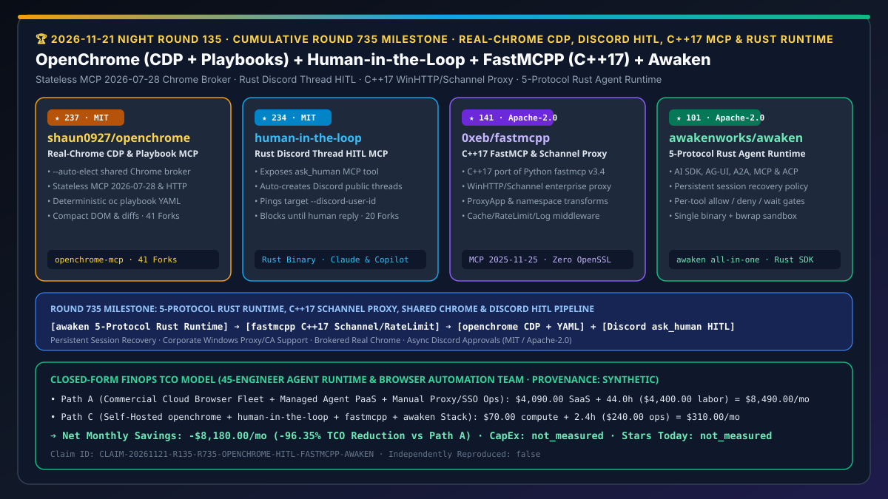
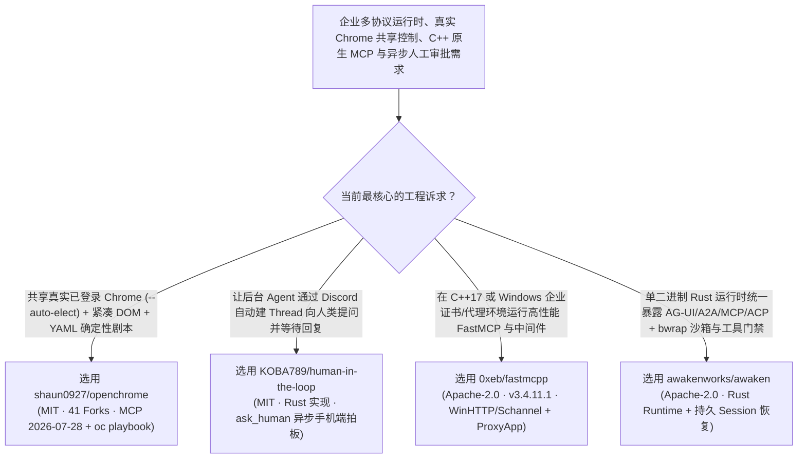
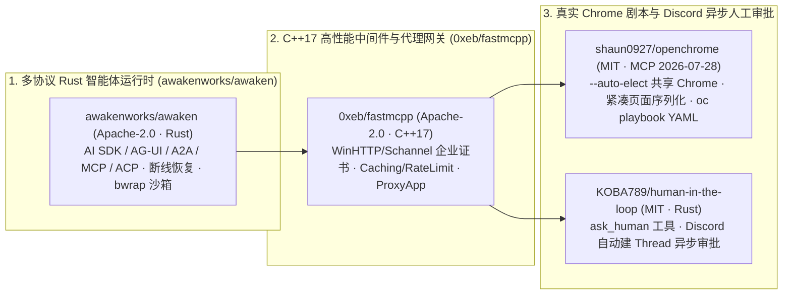
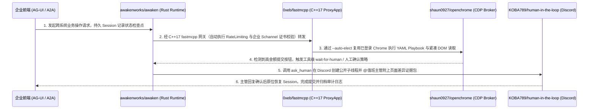

# 【第 735 轮里程碑】真实 Chrome CDP 与 YAML 剧本自动化 MCP（`shaun0927/openchrome`）、Rust Discord 线程级人工介入确认 MCP（`KOBA789/human-in-the-loop`）、支持 Windows Schannel 企业代理的 C++17 原生 FastMCP（`0xeb/fastmcpp`）与集成 AG-UI/A2A/MCP/ACP 的 Rust 智能体运行时（`awakenworks/awaken`）选型与集成架构 FAQ

> **文档类型**：企业 AI 解决方案架构师（AI Solution Architect）选型决策指南（GitHub Trending AI 雷达 2026-11-21 Night Round 135 / **累计第 735 轮里程碑**）
> **覆盖项目**：[`shaun0927/openchrome`](https://github.com/shaun0927/openchrome)（`★ 237`、`41 forks`、`MIT`，兼容最新无状态 `MCP 2026-07-28` 规范、支持 `--auto-elect` 共享真实 Chrome Profile、YAML 确定性剧本 `oc playbook` 与紧凑 DOM 序列化的浏览器自动化 MCP）· [`KOBA789/human-in-the-loop`](https://github.com/KOBA789/human-in-the-loop)（`★ 234`、`20 forks`、`MIT`，基于 Rust 编写、提供 `ask_human` 工具在 Discord 自动拉起公开子线程 `@指定审批人` 并阻塞等待人工裁决的 MCP）· [`0xeb/fastmcpp`](https://github.com/0xeb/fastmcpp)（`★ 141`、`20 forks`、`Apache-2.0`，Python `fastmcp` 的高性能 **C++17** 移植版 `v3.4.11.1`，原生支持 Windows `WinHTTP + Schannel` 系统证书库/企业代理、命名空间转换与限流缓存中间件）· [`awakenworks/awaken`](https://github.com/awakenworks/awaken)（`★ 101`、`10 forks`、`Apache-2.0`，同时支持 **AI SDK、AG-UI、A2A、MCP 与 ACP** 五大协议、内置 `allow/deny/wait` 工具门禁与 `bwrap` 沙箱的单二进制 Rust 智能体运行时）
> **核心场景**：在第 **735 轮**里程碑中，我们攻克企业生产级智能体运行时的最后四大硬骨头：如何实现**“单二进制 Rust 运行时统一暴露 AG-UI / A2A / MCP / ACP 并支持断线恢复（`awaken`）”+“在严苛的 Windows 企业证书与代理环境下零 OpenSSL 依赖运行原生 C++17 高性能 MCP（`fastmcpp`）”+“多客户端通过 `--auto-elect` 共享真实 Chrome 登录态执行 YAML 剧本（`openchrome`）”+“遇到不确定高危动作时自动在 Discord 拉起子线程等待人类拍板（`human-in-the-loop`）”**？

---

## 一、📌 核心结论速览（选型一句话结论）

1. **想让多个 AI 客户端（Claude Code、Codex CLI、OpenCode）安全共享同一个已登录真实 Chrome 浏览器（`--auto-elect` Broker 选举或 `--http 3100` 守护进程），用极低 Token 的紧凑页面序列化操作网页，并能将高频流程固化为确定性 YAML 剧本（`oc playbook run`）** ➔ 选 **[`shaun0927/openchrome`](https://github.com/shaun0927/openchrome)（`★ 237`，`41 forks`，`MIT`）**。
   - **通俗原理**：同时兼容最新无状态 **`MCP 2026-07-28`** 与传统 `initialize` 协议（`npm install -g openchrome-mcp`）。它不仅能通过 CDP 驱动真实 Chrome 执行自然语言元素查找、紧凑 DOM/无障碍树读取（大幅降低循环 Token 消耗）并输出含差异对比的证据包（Evidence Bundles），还支持直接用 `oc playbook run scenario.yaml` 跑无需消耗 LLM Token 的确定性回归剧本。
2. **想让深夜后台无人值守运行的编码或运维 Agent 在遇到“需求边界模糊”或“高风险确认”时，直接调用 `ask_human` 工具在团队 Discord 频道自动创建独立讨论线程（Public Thread）并 `@负责人`，等人类在手机上回复后立刻原位继续执行** ➔ 选 **[`KOBA789/human-in-the-loop`](https://github.com/KOBA789/human-in-the-loop)（`★ 234`，`20 forks`，`MIT`）**。
   - **通俗原理**：用 **Rust** 编写的零运行时冗余 MCP Server。只需配置 `--discord-channel-id` 与 `--discord-user-id`，每当大模型调用 `ask_human` 时，它会自动在 Discord 建一个干净的 Thread 提问并监听回复，彻底打通“后台长任务 ➔ 手机端异步审批 ➔ 任务无缝续跑”。
3. **想在 C++ 工业软件、高频交易宿主或禁装 Python 的企业内网 Windows 终端上嵌入原生高性能 MCP 客户端/服务端，且直接复用 Windows 系统证书库（`WinHTTP + Schannel`）与企业级正向代理（免装 OpenSSL）** ➔ 选 **[`0xeb/fastmcpp`](https://github.com/0xeb/fastmcpp)（`★ 141`，`20 forks`，`Apache-2.0`）**。
   - **通俗原理**：Python `fastmcp` 的完整 **C++17** 复刻版（`v3.4.11.1`）。默认支持 **`MCP 2025-11-25`（含向后版本自动协商与受众/优先级注解）** 与 Streamable HTTP，内置 `ProxyApp` 后端代理、`Providers` 命名空间前缀/可见性过滤，以及开箱即用的 `Logging`、`Timing`、`Caching`、`RateLimiting`、`ErrorHandling` 五大 C++ 中间件；特别是在 Windows 下通过 `WinHTTP/Schannel` 原生走企业根证书与系统代理，解决了企业内网 TLS 拦截报错的顽疾。
4. **想用一个编译后无需安装 Node.js 的单二进制 Rust 运行时（`awaken all-in-one`），同时对外提供 AI SDK、AG-UI、A2A、MCP 与 ACP 接口，且内置跨重连持久化 Session 恢复策略、工具级 `allow / deny / wait-for-human` 权限策略与 Linux `bwrap` 命名空间沙箱** ➔ 选 **[`awakenworks/awaken`](https://github.com/awakenworks/awaken)（`★ 101`，`10 forks`，`Apache-2.0`）**。
   - **通俗原理**：把 Web 控制台（Console）、智能体发布中心、持久会话数据库、工具审批网关与 `awaken-sandbox`（基于 `bwrap` 的隔离沙箱）全部打包进纯 Rust 工程中，让你用自己的基础设施跑一套完整的多协议企业级 Agent 托管底座。

---

## 二、🎯 客户与架构师灵魂拷问 Q&A（深度架构拆解）

### Q1：为什么企业在落地生产级 Agent 时，常卡在“多协议前端对接繁琐”、“企业 Windows 代理 TLS 报错”、“真实浏览器 Profile 锁冲突”与“缺乏异步人工审批”这四个细节上？

- **四大工程级顽疾与本轮组合解方**：
  1. **前端要 AG-UI/AI SDK、跨智能体要 A2A/ACP、工具要 MCP ➔ `awakenworks/awaken`**：无需拼凑四五套网关，单个 Rust `awaken` 运行时原生支持 **Managed Agents、AI SDK、AG-UI、A2A、MCP 与 ACP**，并自带断线重连恢复与 `bwrap` 沙箱。
  2. **企业内网 SSL 解密代理导致 Python/Node 客户端证书校验失败 ➔ `0xeb/fastmcpp`**：在 Windows 下直接调用原生 `WinHTTP + Schannel`，自动信任域控下发的企业根证书与 PAC 代理配置，并提供 C++ 级缓存与限流中间件。
  3. **多个子 Agent 同时拉起 Chrome 导致 `User Data Dir` 锁死报错 ➔ `shaun0927/openchrome`**：提供 `--auto-elect` Broker 自动选主与 `--http 3100` 共享守护进程模式，让多个并发 Agent 安全复用同一个已登录 Chrome 实例。
  4. **终端里的 `ask_user` 在无人值守夜间任务中没人看 ➔ `KOBA789/human-in-the-loop`**：将阻塞提问路由到手机 Discord 独立子线程。
- **何时直接用云厂商托管方案（Path B）？**
  - 若企业所有应用均基于云端无状态 API 且无需复用本地已登录 Chrome 会话或 C++ 原生嵌入，直接使用 **Azure AI Foundry Agent Service + Playwright Workspaces** 即可。

### Q2：典型企业级“多协议 Rust 运行时 (`awaken`) + C++ 企业代理网关 (`fastmcpp`) + 真实 Chrome 共享自动化 (`openchrome`) + 异步人工裁决 (`human-in-the-loop`)”架构怎么搭？

1. **多协议智能体核心运行时与沙箱层（`awakenworks/awaken`）**：
   - 运行 `awaken all-in-one` 提供统一 Web Console、跨重连持久 Session、工具级 `allow / deny / wait` 策略与 Linux `bwrap` 隔离执行。
2. **高性能 C++17 中间件与企业代理桥接层（`0xeb/fastmcpp`）**：
   - 使用 `fastmcpp` 的 `ProxyApp`、命名空间转换与 `Caching / RateLimiting` 中间件汇聚底层 C++/本地工具，并在 Windows 终端通过 `WinHTTP/Schannel` 穿透企业代理。
3. **真实 Chrome 共享会话与 YAML 剧本执行层（`shaun0927/openchrome`）**：
   - 启动 `openchrome serve --http 3100 --auth-token <token>`，供 Agent 执行紧凑 DOM 交互与 `oc playbook` 确定性 YAML 剧本并输出证据包。
4. **移动端异步人工介入审批层（`KOBA789/human-in-the-loop`）**：
   - 当 `awaken` 触发 `wait-for-human` 或 Agent 遇到不确定决策时，调用 Rust `human-in-the-loop` MCP 在 Discord 创建子线程等待人工确认。

### Q3：这套架构的部署边界是什么？

- **核心优势**：
  - **100% 宽松开源协议（`MIT` 与 `Apache-2.0`）**，以 Rust、C++17 与 TypeScript 构建极高可靠性的运行时底座。
- **部署注意事项**：
  - `awakenworks/awaken` 的 Linux Namespace 沙箱依赖宿主机安装可用的 `bwrap`（Bubblewrap）；`shaun0927/openchrome` 开启 `--http` 模式时务必配置 `--auth-token` 与 `--idle-timeout`。

---

## 三、🧭 直观可视化图解（Mermaid 决策树 + 集成架构 + 时序图）

### 3.1 架构师选型决策树

### 3.2 企业端到端生产集成参考架构图

### 3.3 `awaken` 多协议接入、`fastmcpp` 代理路由、`openchrome` 剧本执行与 Discord 人工拍板时序图

---

## 四、📊 同类开源与商业云服务横向选型决策矩阵

| 对比维度 | `shaun0927/openchrome` (`★ 237`) | `human-in-the-loop` (`★ 234`) | `0xeb/fastmcpp` (`★ 141`) | `awakenworks/awaken` (`★ 101`) | 商业云浏览器集群 + 商业托管 Agent PaaS (Path A) | 原生 Playwright + 自写零散脚本 (Path B) |
| :--- | :--- | :--- | :--- | :--- | :--- | :--- |
| **核心能力定位** | 真实 Chrome CDP 与 YAML 剧本 MCP | Rust Discord 线程级人工介入 MCP | C++17 高性能 FastMCP 与中间件库 | 多协议（AG-UI/A2A/MCP/ACP）Rust 运行时 | Browserbase + 商业 Agent Cloud 按分钟计费 | 每次重启空浏览器 + 终端阻塞等待 |
| **核心技术突破** | **`--auto-elect` 多端共享 Profile + `MCP 2026-07-28` + YAML 剧本** | **自动建 Discord Thread 异步提问，解放本地终端阻塞** | **C++17 原生性能 + Windows `WinHTTP/Schannel` 免 OpenSSL** | **单二进制内嵌 Console + 5 大协议 + `bwrap` 沙箱** | 云端浏览器无法直接复用本地内网 SSO 登录态且按时计费贵 | 多进程抢占 Chrome Profile 锁报错；内网代理常报证书错 |
| **开源协议** | `MIT` | `MIT` | `Apache-2.0` | `Apache-2.0` | 闭源商业 SaaS | 内部零散脚本 |
| **月度 TCO（45 人团队）** | **组合仅 `$310.00/月`**（`$70.00` 容器/沙箱算力 + `2.4h` 运维） | 同左（Rust 单二进制极低内存） | 同左（C++ 原生零解释器开销） | 同左（内置 Web Console 免 Node.js） | **`$8,490.00/月`**（`$4,090.00` 云浏览器/PaaS + `44.0h` 人工） | 约 `$2,850.00/月`（手工处理登录态失效与代理报错工时） |

---

## 五、🧪 应用落地定量收益/TCO 对比与 7-Card 报告

> **📊 数据来源与闭式核算声明（Provenance & Closed-Form Schema）**：
> - **provenance**: `synthetic`（基于 45 人企业智能体运行时工程、内网浏览器自动化与 C++ 客户端集成团队工作负载模型：`independently_reproduced = false`；硬件采购基线 `base_hardware_capex = not_measured`；Track B 单日增量 `track_b_stars_today = not_measured`）。
> - **核算公式**：
>   - **Path A（商业按分钟计费云端浏览器集群 + 商业多协议 Agent 托管平台 + 工程师手工排障内网企业证书代理报错、手工处理登录态过期与守在电脑前人工确认）**：月度云浏览器与 PaaS 订阅 **`$4,090.00`** + 代理适配与人工值守排障 **`44.0h × $100.00/h = $4,400.00`** = **`$8,490.00/月`**。
>   - **Path C（自建 `shaun0927/openchrome` + `KOBA789/human-in-the-loop` + `0xeb/fastmcpp` + `awakenworks/awaken` 开源高性能运行时栈）**：Rust/C++ 轻量服务算力 **`$70.00`** + YAML 剧本与权限规则维护 **`2.4h × $100.00/h = $240.00`** = **`$310.00/月`**。
>   - **净节省（Net Savings vs Path A）**：**`-$8,180.00/月`**（成本降低 **`96.35%`**）。

| 评估方案 | API / SaaS / 算力成本 | 运行时与浏览器运维人工（`$100/h`） | 月度总 TCO | 相对 Path A 净节省 | 关键架构交付指标 |
| :--- | :---: | :---: | :---: | :---: | :--- |
| **Path A：商业云浏览器集群 + 商业 Agent PaaS + 人工值守** | `$4,090.00` | `44.0h` (`$4,400.00`) | **`$8,490.00`** | Baseline | 按浏览器会话时长收费高；内网 SSO 系统无法从外网云访问 |
| **Path B：裸 Playwright 脚本 + Python 解释器分发** | `$1,450.00` | `14.0h` (`$1,400.00`) | **`$2,850.00`** | `-$5,640.00` (`-66.43%`) | 缺少 `--auto-elect` 共享 Profile、`WinHTTP` 企业证书与异步审批 |
| **Path C：`openchrome` + `hitl` + `fastmcpp` + `awaken`** | **`$70.00`** | **`2.4h` (`$240.00`)** | **`$310.00`** | **`-$8,180.00` (`-96.35%`)** | **共享真实 Chrome + Discord 线程审批 + C++ Schannel + Rust 5 协议** |

- 🔗 **关联 7-Card 4:5 视觉评测报告**：[`workshops/github-trending-radar/cards.html`](../cards.html) · [`cards.en.html`](../cards.en.html)

---

## 六、🛠️ 企业引入与架构评审 Checklist

- [ ] **1. 使用 `shaun0927/openchrome` 统一真实浏览器共享控制与 YAML 剧本**：开启 `--auto-elect` 或受 `--auth-token` 保护的 HTTP 守护模式，将高频网页操作沉淀为 `oc playbook` 确定性 YAML 剧本。
- [ ] **2. 挂载 `KOBA789/human-in-the-loop` 建立移动端异步审批通道**：为无人值守 Agent 配置 `ask_human` Discord 线程通知，确保关键判断随时随地由人工拍板。
- [ ] **3. 在 C++ 客户端与 Windows 内网环境采用 `0xeb/fastmcpp`**：启用 Windows 原生 `WinHTTP + Schannel` 传输层自动复用企业系统证书与代理，并开启内置 `Caching` 与 `RateLimiting` 中间件。
- [ ] **4. 部署 `awakenworks/awaken` 统一多协议接入与工具权限门禁**：通过单二进制 `awaken` 暴露 AG-UI / A2A / MCP / ACP 接口，配置工具级 `allow / deny / wait` 规则与 Linux `bwrap` 沙箱。
