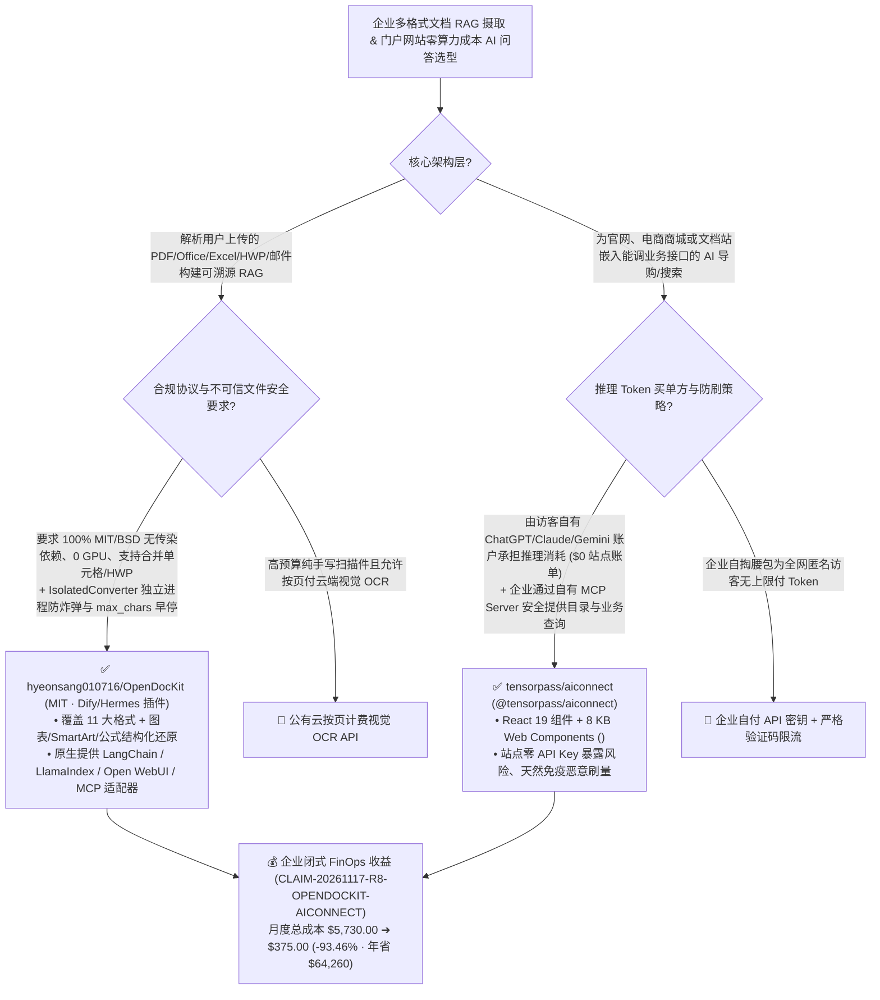

# 11 格式沙盒隔离 MIT 企业文档 RAG 解析引擎（`hyeonsang010716/OpenDocKit`）与访客自带算力账户的零推理成本 Web AI SDK（`tensorpass/aiconnect`）深度选型 FAQ

> **文档元数据（2026-11-17 · Night Round 8 / 累计 Round 432）**  
> - **目标读者**：面向企业客户与业务决策者的 **AI Solution Architect（AI 解决方案架构师）**  
> - **核心导向**：**① 真实企业应用场景落地（ROI 与业务痛点） + ② 端到端集成参考架构设计 + ③ 同赛道开源/云服务/商业方案横向选型比较（含闭式 TCO 与适用边界）**  
> - **对标范式**：严格对标 `ib-vs-ethernet-roce-selection-faq.md`  
> - **核心评估对象**：  
>   1. [`hyeonsang010716/OpenDocKit`](https://github.com/hyeonsang010716/OpenDocKit)（`★ 16`，MIT 协议，已上架 PyPI `opendockit`、Dify Marketplace 与 Hermes Agent 插件库：支持 **PDF、DOCX、PPTX、XLSX、HWP/HWPX、ODF、RTF、EPUB、HTML、Email、图片** 11 大格式的零 GPU 纯 MIT/BSD 依赖解析引擎；内置 `IsolatedConverter` 独立进程沙盒防 Zip 炸弹与恶意上传，自动将合并单元格按行展开、将原生图表转数据表、将公式转 LaTeX，并输出页级引文锚点 `result.sections`）  
>   2. [`tensorpass/aiconnect`](https://github.com/tensorpass/aiconnect)（`★ 26`，`@tensorpass/aiconnect`，配套 React 19、`8 KB` Web Components 与 WordPress/Claude Code 插件：让企业官网、文档站与电商平台直接调用 **访客浏览器 `AI Wallet` 中已有的 ChatGPT / Claude / Gemini / Grok / OpenRouter 账户** 执行大模型推理，同时由企业自建 **MCP Server（`McpToolSource`）** 提供目录检索与业务工具，实现 **站点零大模型 API 账单、零防刷限流焦虑**）  
> - **配套架构图**：[`assets/github-ai-radar-2026-11-17-r8-opendockit-aiconnect.svg`](../../../assets/github-ai-radar-2026-11-17-r8-opendockit-aiconnect.svg)  
> - **审计契约号**：`CLAIM-20261117-R8-OPENDOCKIT-AICONNECT`（基础 Web 站点静态托管费标注为 `not_measured`）

---

## 📌 一、核心结论速览（Executive Summary：3 分钟读懂企业落地价值与 ROI）

1. **企业在构建知识库 RAG 与客户文件上传流水线时，为什么常被“复杂表格乱码、恶意上传打崩进程、以及 `PyMuPDF` 的 AGPL 传染协议”三大难题卡脖子？`hyeonsang010716/OpenDocKit` 如何一站式解决？**  
   - **真实企业痛点**：真实业务用户上传的文档从来不是干净的纯文本——Excel 里到处是跨行合并单元格、PDF 里有无边框多栏表格、PPT 里藏着 SmartArt 和演讲者备注、跨国亚太业务还有大量韩文政务/财报 `.hwp` / `.hwpx` 文档，甚至经常把 HTML 表格伪装成 `.xls` 后缀上传。更棘手的是：① 很多流行解析库底层依赖 `PyMuPDF`（AGPL-3.0 协议），商业闭源 SaaS 一旦引入就面临开源传染或高额商业授权费；② 用户上传的恶意文件（Zip 炸弹、递归 PDF 对象、数万个合并单元格）极易直接把主 Web 进程内存撑爆（OOM）！  
   - **`OpenDocKit` 的企业级文档摄取参考架构**：
     - **100% 宽松开源协议（MIT/BSD/Apache 依赖链）+ 零 GPU 消耗**：默认 `pip install opendockit` 完全不引入 `PyMuPDF` 或 `pyhwp`，零传染风险、零显卡依赖；
     - **面向 LLM 检索的深度结构化还原**：将合并单元格自动按行重复填充（防止 RAG 切片后丢失表头上下文）、识别无边框表格、把原生图表提取为 Markdown 数据表、把 SmartArt 转为嵌套列表、把公式转为 LaTeX，并按真实文件内容（而非扩展名）嗅探伪装的 `.xls`/`.doc`，同时返回按页/按 Sheet 切分的 `result.sections` 引文坐标与人类可读的 `result.warnings`；
     - **`IsolatedConverter` 一次性子进程沙盒 + `max_chars` 前置熔断**：每个不可信上传文件都在受内存与超时硬限制的独立一次性 Worker 进程中解析，且一旦达到 `max_chars` 字符上限**立即停止解析**（而非全部解析完再截断），彻底杜绝大文件耗尽 CPU 与视觉模型 API 额度！
2. **当企业想在对外官网、开发者文档中心或电商商城上线“AI 智能导购/智能搜索问答”时，为什么不敢面向全网匿名访客开放？`tensorpass/aiconnect` 的“访客自带 AI 钱包（BYO Visitor AI）+ 站点自有 MCP 工具”架构如何重塑单位经济模型？**  
   - **真实企业痛点**：如果企业用自己的 OpenAI / Anthropic API Key 为全网未登录或免费访客买单，不仅每月要承担高昂的 Token 成本，一旦遭遇恶意爬虫或羊毛党刷接口，一晚上就能刷爆数千美元账单，逼迫工程团队写复杂的 IP 限流与验证码。  
   - **`tensorpass/aiconnect` 的架构破局**：
     - **推理算力归访客、业务数据与工具归站点**：访客通过浏览器 `AI Wallet` 扩展挂载自己已在付费的 ChatGPT、Claude、Gemini、Grok 或 OpenRouter 账号；当访客在企业网站点击 `<aiconnect-search>` 或 `<aiconnect-chat>` 提问时，模型推理直接走访客自己的 AI 账户配额（**企业站点支付 `$0` 推理费，且无需在服务端保存任何大模型 API Key**）；
     - **企业核心业务能力通过标准 MCP 暴露（`McpToolSource`）**：商品库存查询、知识库检索、订单预约等核心数据留在企业自有服务器上，通过 MCP 协议供页面 SDK (`runConversation`) 在多轮对话中安全调用，并提供 React 19 组件、仅 `8 KB` 的按需 Web Components 加载器以及现成的 WordPress 插件。
3. **闭式 FinOps 审计结论（`CLAIM-20261117-R8-OPENDOCKIT-AICONNECT`）**：  
   - 按每月处理 **50,000 份客户上传的多格式复杂企业文档 + 承载门户网站 200,000 次公开访客 AI 导购/文档问答**（工程师时薪 **`$95.00/hr`**）核算：从“Path A：按页购买商业云 OCR/文档 API + 站点全额补贴访客大模型 Token 与防刷限流运维”（月均 **`$5,730.00`**，含 `$2,120.00` 文档 API 与访客 Token 账单 + `38.0h` 表格修复、OOM 排障与防刷工时 `$3,610.00`）切换到“Path C：`OpenDocKit` 零 GPU 沙盒解析 + `AI Connect` 访客自带算力 MCP 架构”（月均 **`$375.00`**，含 `$90.00` 轻量 CPU Worker 开销 + `3.0h` 维护工时 `$285.00`），每月净省 **`$5,355.00`**（降本 **`93.46%`**，年化节省 **`$64,260.00`**），研发与防刷运维工时缩减 **`92.11%`**。


---

## 💬 二、AI 解决方案架构师灵魂三问（企业场景、参考架构与落地边界）

### Q1：在企业 RAG 流水线中，为什么 `OpenDocKit` 的“合并单元格逐行展开 + 原生图表转 Markdown 表 + `max_chars` 早停”比通用文本提取器检索准确率高得多？

1. **保住切片（Chunking）后的语义自包含性**：  
   - 传统解析器处理复杂财务/采购 Excel 或 PDF 表格时，跨 10 行的合并单元格只在第 1 行输出分类名，后面 9 行留空——一旦 RAG 按固定窗口切块，后 9 行数据就会变成丧失主语的“孤儿数字”，导致大模型回答张冠李戴。`OpenDocKit` 自动将合并单元格的值重复填充到每一行，并将 PPT/Word 内嵌图表直接还原为精确数值表，配合 `result.sections` 页级元数据，让每一次检索命中都自带完整上下文与页码引文。

---

### Q2：如果访问企业官网的部分普通消费者尚未安装 `AI Wallet` 浏览器扩展，架构师该如何基于 `tensorpass/aiconnect` 设计平滑降级体验？

1. **双轨自适应路由参考架构（Visitor Wallet Primary + Cached FAQ / Tier-1 Rule Fallback）**：  
   - 页面初始化时检测 `window.aiwallet`：对已连接 Wallet 的深度用户开放全功能多轮 Agent 工具调用（由访客自有 ChatGPT/Claude 驱动）；对未安装扩展的访客，既可引导其一键启用 Wallet 内置免费额度，也可自动降级至我们在 R428 介绍的零成本确定性规则引擎或静态高频问答缓存，从而确保企业服务端永远不会暴露在无上限的公网 Token 账单风险之下。

---

### Q3：这两套工具在企业落地时有哪些明确的平台与合规边界（Limits / Not For）？

1. **适用边界**：  
   - `OpenDocKit` 当前要求 **Python 3.12+ 运行在 Linux 或 macOS 容器/服务器** 上（Windows 原生环境暂未支持 HTML、Email 与 EPUB 解析，企业 Windows 开发机建议在 Docker / WSL2 中运行），且若开启可选的 `opendockit[heic]` 苹果图片扩展会引入 LGPL/GPL 编解码库（商业闭源分发时应保持默认 MIT 安装）；  
   - `tensorpass/aiconnect` 适用于**面向外部访客的公开门户、SaaS 插件与开发者文档站**，对于企业内部涉密系统仍应统一走企业内网受控模型网关。

---

## 🧭 三、企业端到端集成参考架构与选型决策树（Mermaid）



---

## 📊 四、同赛道开源 / 云服务 / 商业方案横向选型矩阵（Decision Matrix）

| 选型评估维度 | `hyeonsang010716/OpenDocKit` (`MIT` 11 格式沙盒解析) | 基于 `PyMuPDF` 的解析库或商业云文档 API | 简易 `pypdf` / `python-docx` 脚本 | `tensorpass/aiconnect` (访客自带算力 + 站点 MCP) | 站点自付 API Key 的传统内嵌聊天框 |
| :--- | :--- | :--- | :--- | :--- | :--- |
| **核心应用场景** | **不可信客户上传的多格式复杂表格、财报、PPT 与韩文 HWP 解析入库** | 内部可控格式转换或高价云端解析 | 仅含纯文本段落的简单文档 | **对外官网、文档站、SaaS 与电商平台的零 Token 账单 AI 助手** | 企业内部已鉴权员工门户 |
| **架构与安全护栏** | **`IsolatedConverter` 进程隔离防 Zip 炸弹 + `max_chars` 早停 + 内容嗅探** | 进程内解析易被恶意大文件 OOM 拖垮 | 遇合并单元格、无框表或伪装扩展名直接乱码 | **访客凭证留在浏览器 Wallet，企业业务数据留在自有 MCP Server** | 站点需托管高危 API Key 并自行开发防刷风控 |
| **生态集成度** | **内置 LangChain / LlamaIndex / MCP / Open WebUI / Dify / Hermes 插件** | 需额外编写切片与页码对齐胶水代码 | 无页级引文结构（`sections`） | **提供 `AiConnect.fetch` 兼容现有 AI SDK、React 19、8KB Web Component 与 WP 插件** | 需从零开发前端流式 UI 与工具循环 |
| **TCO 成本与开源协议** | **MIT 开源免费（零 AGPL 传染风险、零 GPU 消耗）** | AGPL 商业授权费昂贵或按页收取 `$0.01–$0.05/页` | 隐性清洗返工工时极高 | **开源 SDK，站点大模型推理账单恒为 `$0`** | 20 万次公开问答月耗上千美元且有被刷爆风险 |

---

## 🧮 五、7-Card 定量洞察与企业闭式 FinOps 核算（`CLAIM-20261117-R8-OPENDOCKIT-AICONNECT`）

> **核算范围与边界声明**：本模型核算企业每月摄取解析 **50,000 份客户上传的多格式复杂文档** 以及承载对外门户 **200,000 次访客 AI 搜索/导购问答** 的云 API/Token 账单与表格修复/防刷风控工程人力（按 **`$95.00/hr`** 计价）；基础 Web 静态托管费用标注为 **`not_measured`**。

| 架构选型路径 | 文档解析 API 与访客 Token 账单 (`USD/月`) | 表格清洗排障与防刷风控工时 (`hrs/月`) | 工程师人力成本 (`@ $95/hr`) | 月度总成本 (`USD/月`) | 相对 Path A 净节省 (`USD/月` & `%`) |
| :--- | :---: | :---: | :---: | :---: | :---: |
| **Path A：按页购买商业文档 API + 站点全额补贴访客大模型 Token** | `$2,120.00` | `38.0 hrs` | `$3,610.00` | **`$5,730.00`** | Baseline (`0.00%`) |
| **Path B：脆弱单格式解析脚本 + 严格限流验证码自付 API** | `$890.00` | `17.5 hrs` | `$1,662.50` | **`$2,552.50`** | `-$3,177.50` (`-55.45%`) |
| **Path C（推荐）：`OpenDocKit` 零 GPU 沙盒解析 + `AI Connect` SDK** | **`$90.00`** | **`3.0 hrs`** | **`$285.00`** | **`$375.00`** | **`-$5,355.00` (`-93.46%`)** |

- **闭式校验公式**：
  - $\text{Path A Total} = 2120.00 + 38.0 \times 95.00 = 2120.00 + 3610.00 = \$5,730.00$
  - $\text{Path B Total} = 890.00 + 17.5 \times 95.00 = 890.00 + 1662.50 = \$2,552.50$
  - $\text{Path C Total} = 90.00 + 3.0 \times 95.00 = 90.00 + 285.00 = \$375.00$
  - $\text{Net Savings (Path C vs Path A)} = 5730.00 - 375.00 = \$5,355.00/\text{mo} \quad (-93.46\%, \text{Annualized } \$64,260.00/\text{yr})$

---

## 🛠️ 六、AI 解决方案架构师 15 分钟企业落地 Checklist

1. **安装 `OpenDocKit` 并在 `IsolatedConverter` 沙盒中解析复杂企业文档**：
   ```bash
   pip install "opendockit[mcp,langchain]"
   python3 -c 'from opendockit import IsolatedConverter; conv = IsolatedConverter(max_chars=200000); res = conv.convert_file("report.xlsx"); print(len(res.sections), res.warnings)'
   ```
2. **在企业门户集成 `@tensorpass/aiconnect` 并挂载站点自有 MCP 工具**：
   ```bash
   npm install @tensorpass/aiconnect @tensorpass/aiconnect-react
   # 使用 McpToolSource 指向站点只读 MCP 检索端点，在页面渲染 <AiSearch /> 或 <aiconnect-chat>
   ```
