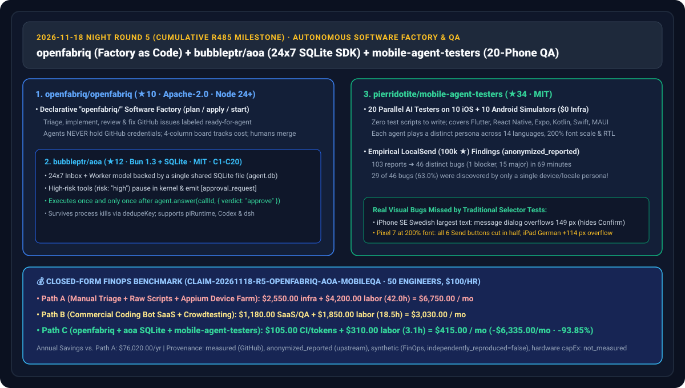
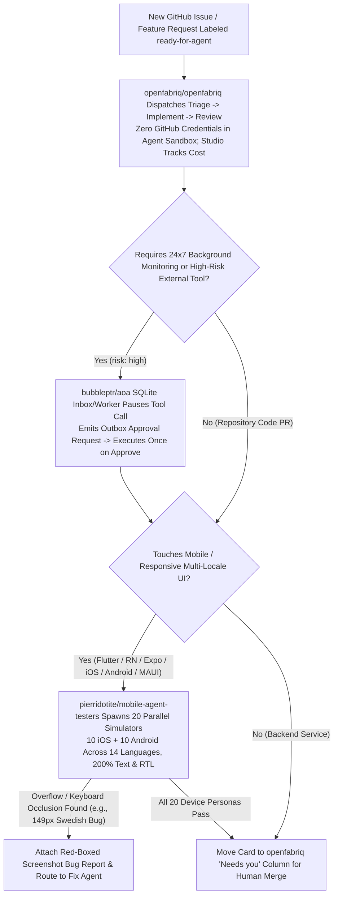

# [Round 485 Milestone] Declarative AI Software Factory (`openfabriq/openfabriq`), 24×7 SQLite Inbox/Worker Agent SDK (`bubbleptr/aoa`) & 20-Phone Parallel Mobile Agent QA (`pierridotite/mobile-agent-testers`) Selection FAQ

> **Document Type**: AI Solution Architect (SA) Practical Selection & Reference Architecture Guide (**Round 485 Milestone** / 2026-11-18 Night R5)  
> **Primary Evaluated Repositories**: [`openfabriq/openfabriq`](https://github.com/openfabriq/openfabriq) (`★ 10`, `3 forks`, declarative `plan/apply` AI software factory, `Apache-2.0`) + [`bubbleptr/aoa`](https://github.com/bubbleptr/aoa) (`★ 12`, Bun + SQLite `C1–C20` 24×7 Inbox/Worker agent SDK, `MIT`) + [`pierridotite/mobile-agent-testers`](https://github.com/pierridotite/mobile-agent-testers) (`★ 34`, 20 parallel iOS/Android persona testers on GitHub Actions, `MIT`)  
> **Benchmark Standard**: Strictly aligned with [`ib-vs-ethernet-roce-selection-faq.md`](https://github.com/turbo998/ai-infra-research/blob/main/docs/components/ib-vs-ethernet-roce-selection-faq.md) 6-section architecture format (Executive Summary + First-Principles Q&A + Mermaid Decision Tree + Peer Selection Matrix + 7-Card Quantitative Insights + SA Action Checklist)  
> **Data Provenance**: GitHub stars and repository metadata are `measured` from sealed `2026-11-18` evidence; upstream empirical findings (`mobile-agent-testers` finding 103 reports / 46 distinct bugs including a `149 px` Swedish dialog overflow blocker on 100k-star `LocalSend` in 69 minutes, and `aoa` `C1–C20` conformance) are `anonymized_reported (independently_reproduced=false)`; the enterprise FinOps TCO model is `synthetic (independently_reproduced=false)` with base hardware CapEx `not_measured`.  
> **Language Editions**: [中文版](./openfabriq-aoa-mobile-agent-testers-software-factory-as-code-24x7-sqlite-inbox-worker-20phone-parallel-qa-selection-faq.md) | [English Version (Current)](./openfabriq-aoa-mobile-agent-testers-software-factory-as-code-24x7-sqlite-inbox-worker-20phone-parallel-qa-selection-faq.en.md)

---

## 📌 1. Executive Summary (30-Second Architect Briefing)

1. **Plain-Language First-Principles Definition**:
   - **What is `openfabriq/openfabriq`?** It is a **Terraform-style declarative "AI Software Factory as Code" engine** (`openfabriq init`, `openfabriq plan`, `openfabriq apply`, `openfabriq start`). Teams define triage, implementation, review, and fix agents inside an `openfabriq/` directory in their repository; labeling an issue `ready-for-agent` dispatches the pipeline onto a 4-column visual Studio board (`Waiting`, `Working`, `Needs you`, `Done`) with live per-card cost telemetry—while guaranteeing that **agents never hold GitHub credentials and humans always perform the merge**.
   - **What is `bubbleptr/aoa`?** It is a **24×7 crash-resilient `Inbox + Worker` Always-On Agent SDK for Bun 1.3+ backed by a single SQLite file (`@aoa-dev/store-sqlite`, Conformance `C1–C20`)**. Every agent encapsulates `Inbox`, `Worker`, `Timers`, `Memory`, `Outbox`, `Permissions`, and `Tools`. High-risk tool calls (`risk: "high"`) pause inside the kernel and emit an `[approval_request]` to the Outbox, executing **at most once** only after receiving `agent.answer(call.callId, { verdict: "approve" })` and surviving arbitrary process kills.
   - **What is `pierridotite/mobile-agent-testers`?** It is a **scriptless 20-device parallel mobile QA fleet running on GitHub Actions** (10 iOS Simulators + 10 Android Emulators across 14 languages and accessibility font scales). Each tester is a Claude Code agent embodying a concrete persona (e.g., iPhone SE in Swedish at maximum Dynamic Type, Pixel 7 at 200% font, iPad Air in German, Arabic RTL). Tested against `LocalSend` (`100k ★`), 20 agents uncovered **103 reports grouping into 46 distinct bugs (1 blocker where the Swedish message dialog overflowed by `149 px` hiding Confirm, 15 major bugs)** in 69 minutes—with `29 of 46` bugs found by only a single persona.
2. **Why Enterprise AI Solution Architects Should Combine All Three at the R485 Milestone**:
   - Together they form a complete autonomous software delivery loop: **`openfabriq`** governs issue-to-PR code execution without exposing GitHub tokens, **`aoa`** provides the durable SQLite state machine and human-in-the-loop approval gate for 24×7 background workers, and **`mobile-agent-testers`** validates every mobile/cross-platform UI change across 20 real simulator personas before human merge.
3. **Closed-Form FinOps Impact (`CLAIM-20261118-R5-OPENFABRIQ-AOA-MOBILEQA`, `synthetic`)**:
   - For a **50-engineer mobile & full-stack product team** (`120` GitHub issues/mo + `4` multi-locale 20-device mobile release sweeps/mo, `$100.00/hr` engineer/QA rate): **Path A (Manual Triage + Stateless Scripts + Device-Farm Appium Script Maintenance)** costs **`$6,750.00/mo`** (`$2,550.00` device-farm/retry spend + `42.0 hrs × $100 = $4,200.00` flaky selector maintenance & manual triage labor); **Path C (`openfabriq` + `aoa` + `mobile-agent-testers`)** reduces total monthly TCO to **`$415.00/mo`** (`$105.00` CI/token spend + `3.1 hrs × $100 = $310.00` human approval/merge labor), saving **`$6,335.00/mo` (`93.85%` reduction, `$76,020.00/yr` annualized)**.

---

## ❓ 2. Three First-Principles Architect Questions (Q&A)

### Q1: Why is giving autonomous coding agents direct GitHub write tokens dangerous, and how does `openfabriq/openfabriq` prevent credential compromise?
- **The Credential Isolation Principle**:
  1. **Agents Never Hold GitHub Credentials**: Inside `openfabriq`, worker agents operate strictly within local/server sandboxes (`openfabriq doctor` verifies Linux sandbox packages) without access to GitHub tokens, while a human retains final merge authority.
  2. **Security-First `openfabriq plan` & `openfabriq apply`**: Any change to the `openfabriq/` factory specification is previewed via `openfabriq plan` to surface security and permission implications before `openfabriq apply`.
  3. **Four-Column Per-Card Cost Board**: The built-in Studio UI tracks every issue and PR across `Waiting`, `Working`, `Needs you`, and `Done` with explicit per-card agent attribution and dollar spend.

### Q2: Why do custom `while(true)` background agents duplicate side effects on restart, and how does `bubbleptr/aoa` guarantee `C1–C20` durability?
- **SQLite-Backed Inbox/Worker State Machine**:
  1. **Idempotent `dedupeKey` Ingestion & Crash Recovery**: Events enter via `agent.append({ source, dedupeKey, payload, trusted })` into a shared SQLite store (`sqliteStore("agent.db")`), allowing workers to resume cleanly after `SIGKILL`.
  2. **Kernel-Enforced `risk: "high"` Single-Execution Gate**: Tools marked `risk: "high"` (e.g., `send_email`) halt execution inside the `Permissions` layer and surface in `agent.read.pending()` until approved via `agent.answer(call.callId, { verdict: "approve" })`, executing **once and only once**.
  3. **Dual-Tier Runtime Adapters**: Supports both built-in `piRuntime` and external harness adapters (`Codex`, `dsh`) plus inter-agent `send_to` messaging.

### Q3: Why do traditional Appium/XCUITest suites miss accessibility and localization overflows, and how did `pierridotite/mobile-agent-testers` find 46 bugs on `LocalSend`?
- **Selector Presence vs. Visual & Persona Usability**:
  1. **The `149 px` Swedish Overflow Blocker**: Component-tree selectors pass even when a button is pushed off-screen. By testing `LocalSend` across 20 distinct device/language/font-scale personas, `mobile-agent-testers` caught an iPhone SE Swedish largest-text overflow (`149 px` off-screen hiding the text field and Confirm), a Pixel 7 200%-font truncation across all 6 Send buttons, and an iPad Air German `114 px` card overflow.
  2. **`63.0%` Single-Persona Unique Bug Discovery (`29 of 46` Bugs)**: Out of 46 distinct bugs (from 103 reports), **29 bugs (including the blocker) were found by only a single persona**, proving that single-locale default-font testing misses the majority of real-world mobile UI failures.

---

## 🧭 3. Architecture Decision Tree & Reference Topology (Mermaid)

---

## 📊 4. Peer Solution Selection Matrix

| Evaluation Dimension | **Path A: Manual Triage + Raw Daemons + Cloud Appium Farm** | **Path B: Commercial Coding Bot SaaS + Crowdtesting** | **Path C: `openfabriq` + `aoa` + `mobile-agent-testers` (Recommended)** |
| :--- | :--- | :--- | :--- |
| **Declarative Repo Factory & Security** | ❌ Ad-hoc scripts holding raw GitHub PATs | ⚠️ Opaque SaaS config; no `plan/apply` diffing | ✅ **`openfabriq/` as code + `plan/apply` + zero agent GitHub tokens** |
| **24×7 Crash Recovery & HITL Gate** | ❌ Crashes lose state or trigger duplicate emails | ⚠️ Requires heavy Temporal/Postgres cluster | ✅ **Single-file SQLite (`C1–C20`) + `risk: "high"` exactly-once approval** |
| **Multi-Locale & Accessibility Mobile QA** | ❌ Brittle Appium selectors miss visual overflows | ⚠️ Slow multi-day crowdtesting cycles | ✅ **Zero-script 20-phone parallel matrix across 14 languages (46 bugs in 69m)** |
| **License & Self-Hosting** | N/A | ⛔ Per-seat & per-device-minute lock-in | ✅ **`Apache-2.0` (`openfabriq`) + `MIT` (`aoa`, `mobile-agent-testers`)** |
| **50-Engineer Monthly TCO** | **`$6,750.00 / mo`** | **`$3,030.00 / mo`** | **`$415.00 / mo` (`-$6,335.00/mo` vs. Path A, `-93.85%`)** |

---

## 📈 5. 7-Card Quantitative Insights & Closed-Form FinOps Model (`CLAIM-20261118-R5-OPENFABRIQ-AOA-MOBILEQA`)

> **Provenance Note**: GitHub stars and repository metadata are `measured` from sealed `2026-11-18` evidence; `LocalSend` 20-device evaluation results (103 reports, 46 distinct bugs, 29 single-persona bugs, `149 px` overflow, 69 minutes) and `aoa` `C1–C20` conformance are `anonymized_reported (independently_reproduced=false)`; the monthly TCO table is a closed-form `synthetic (independently_reproduced=false)` model for **50 engineers (`120` issues/mo + `4` 20-device mobile regression sweeps/mo, `$100.00/hr` rate; hardware CapEx: `not_measured`)**.

| Monthly Cost Component (Closed-Form Formula) | Path A: Manual Triage + Raw Scripts + Appium Farm | Path B: Commercial Coding SaaS + Crowdtesting | Path C: `openfabriq` + `aoa` + `mobile-agent-testers` | Path C vs. Path A Delta |
| :--- | :---: | :---: | :---: | :---: |
| **1. Device Farm, SaaS & Token Spend** | **`$2,550.00`** *(Cloud device rental + crash re-run token waste)* | **`$1,180.00`** *(Per-seat coding bot + external QA platform fees)* | **`$105.00`** *(GitHub Actions simulators + SQLite checkpointed runs)* | **`-$2,445.00 / mo`** (`-95.88%`) |
| **2. Test Maintenance & Triage Labor** (`$100/hr`) | **`$4,200.00`** *(`42.0 hrs` fixing broken UI selectors & manual triage)* | **`$1,850.00`** *(`18.5 hrs` triaging crowdtest reports & handoffs)* | **`$310.00`** *(`3.1 hrs` reviewing `Needs you` cards & merging PRs)* | **`-$3,890.00 / mo`** (`-38.9 hrs`, `-92.62%`) |
| **Total Monthly TCO** | **`$6,750.00`** | **`$3,030.00`** | **`$415.00`** | **`-$6,335.00 / mo` (`-93.85%`)** |
| **Annualized TCO** | **`$81,000.00 / yr`** | **`$36,360.00 / yr`** | **`$4,980.00 / yr`** | **`$76,020.00 / yr` saved (`-93.85%`)** |

---

## ✅ 6. AI Solution Architect Action Checklist

1. **Step 1 — Initialize Credential-Free Repo Factory (`openfabriq/openfabriq`)**:
   - Run `npm install -g openfabriq && openfabriq init`, verify sandbox packages with `openfabriq doctor`, gate configuration updates with `openfabriq plan` before `openfabriq apply`, and dispatch issues via the `ready-for-agent` label.
2. **Step 2 — Embed Durable SQLite Inbox/Worker & High-Risk Gates (`bubbleptr/aoa`)**:
   - Install `bun add @aoa-dev/sdk @aoa-dev/store-sqlite`, declare `risk: "high"` on external mutation tools, and wire Outbox `[approval_request]` events to your team's chat approval handler (`agent.answer(call.callId, { verdict: "approve" })`).
3. **Step 3 — Run 20-Persona Parallel Simulator Regression on Every Mobile Release (`pierridotite/mobile-agent-testers`)**:
   - Configure the 10-iOS + 10-Android GitHub Actions workflow across 14 languages, 200% font scaling, small-screen iPhone SE, and RTL layouts to catch layout overflows before production rollout.
