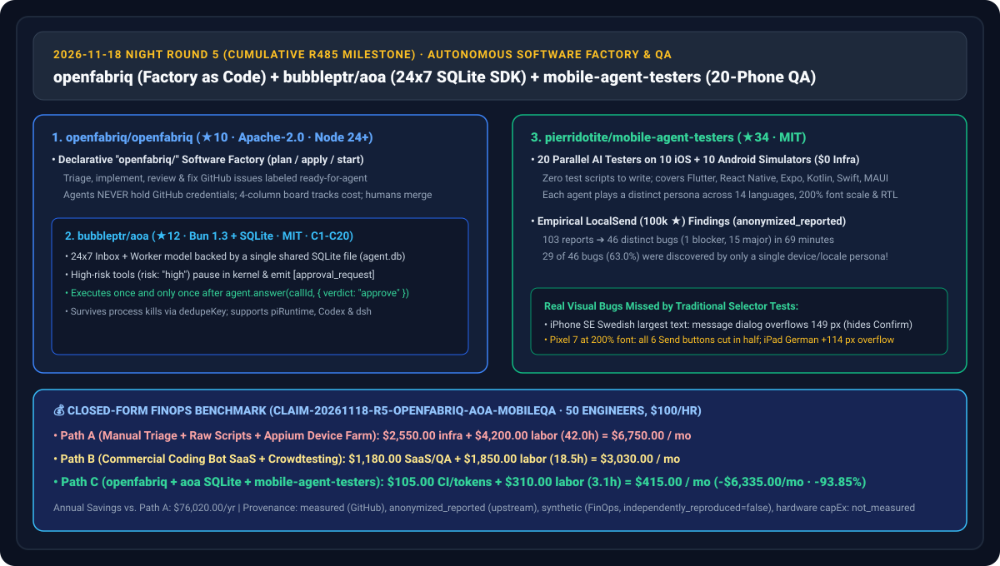
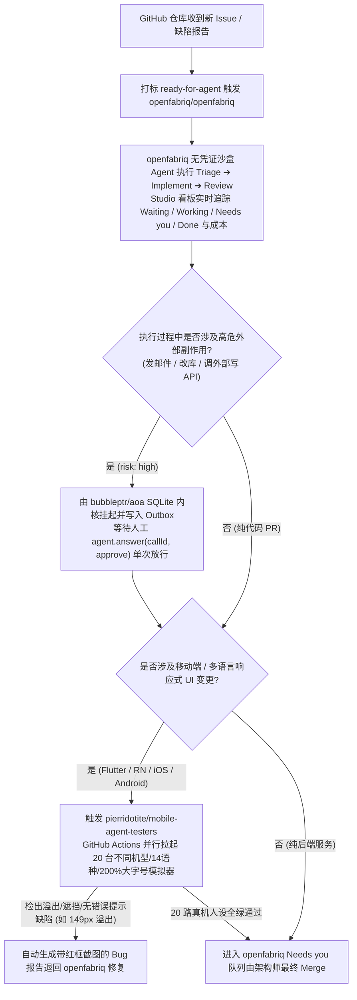

# 【第 485 轮里程碑】代码化 GitHub 软件工厂（`openfabriq/openfabriq`）、7×24 常驻 SQLite 审批内核（`bubbleptr/aoa`）与 20 路真机人设并行移动测试矩阵（`pierridotite/mobile-agent-testers`）选型 FAQ

> **文档类型**：AI Solution Architect (SA) 实战选型与参考架构指南（**Round 485 Milestone** / 2026-11-18 Night R5）  
> **核心评估对象**：[`openfabriq/openfabriq`](https://github.com/openfabriq/openfabriq)（`★ 10`，`3 forks`，Terraform 式 `plan/apply` 代码化软件工厂，`Apache-2.0`） + [`bubbleptr/aoa`](https://github.com/bubbleptr/aoa)（`★ 12`，Bun + SQLite `C1–C20` 24×7 常驻 Inbox/Worker Agent SDK，`MIT`） + [`pierridotite/mobile-agent-testers`](https://github.com/pierridotite/mobile-agent-testers)（`★ 34`，20 路 iOS/Android 模拟器 14 语言无脚本并行 AI 验收，`MIT`）  
> **对标范式**：严格遵循 [`ib-vs-ethernet-roce-selection-faq.md`](https://github.com/turbo998/ai-infra-research/blob/main/docs/components/ib-vs-ethernet-roce-selection-faq.md) 六段式结构（核心结论速览 + 三大灵魂拷问 + Mermaid 决策树 + 选型对比矩阵 + 7-Card 定量洞察 + SA 落地 Checklist）  
> **数据溯源分级（Provenance）**：GitHub 星标与目录元数据为 `measured`；上游基准实测（如 `mobile-agent-testers` 在 10 万星 `LocalSend` 上 69 分钟跑出 103 份报告、归并 46 个独立 Bug 含 `149 px` 瑞典语弹窗溢出阻断缺陷，以及 `aoa` `C1–C20` 一致性契约）标注为 `anonymized_reported (independently_reproduced=false)`；企业 FinOps 成本算例为 `synthetic (independently_reproduced=false)`，硬件折旧 `not_measured`。  
> **语言版本**：[中文版 (当前)](./openfabriq-aoa-mobile-agent-testers-software-factory-as-code-24x7-sqlite-inbox-worker-20phone-parallel-qa-selection-faq.md) | [English Version](./openfabriq-aoa-mobile-agent-testers-software-factory-as-code-24x7-sqlite-inbox-worker-20phone-parallel-qa-selection-faq.en.md)

---

## 📌 一、核心结论速览（Executive Summary — 30 秒看懂）

1. **大白话本质定义**：
   - **`openfabriq/openfabriq` 是什么？** 它是 **像写 Terraform 一样用仓库里的 `openfabriq/` 文件夹声明式定义整座“AI 软件工厂（AI Software Factory as Code）”的编排引擎**。只需给 GitHub Issue 打上 `ready-for-agent` 标签，工厂里的分诊（Triage）、实现（Implement）、审查（Review）与修复（Fix）Agent 就会自动接单，在四列可视化看板（`Waiting / Working / Needs you / Done`）上实时展示每张卡片的负责 Agent 与精确花费；最关键的是：**Agent 永远不持有 GitHub 写凭证，配置变更先跑 `openfabriq plan` 审查安全影响再 `openfabriq apply`，且最终合并权 100% 留给人类**。
   - **`bubbleptr/aoa` 是什么？** 它是基于 Bun 1.3 + 单文件 SQLite（`@aoa-dev/store-sqlite`）打造的 **7×24 小时防崩溃 `Inbox + Worker` 常驻 Agent 内核 SDK（通过 `C1–C20` 20 项一致性校验）**。每个 Agent 拥有独立的 `Inbox / Worker / Timers / Memory / Outbox / Permissions / Tools`；当模型调用高危工具（`risk: "high"`，如对外发邮件或改生产配置）时，内核自动挂起并向 `Outbox` 发出 `[approval_request]`，必须收到人类的 `agent.answer(call.callId, { verdict: "approve" })` 才会放行，且凭借 `dedupeKey` 保证即使进程被随时强杀重启也**绝不重复执行第二次**。
   - **`pierridotite/mobile-agent-testers` 是什么？** 它是 **0 测试脚本、在 GitHub Actions 上同时拉起 20 台不同型号/语言/字号手机（10 台 iOS 模拟器 + 10 台 Android 模拟器）并行捉虫的移动 QA 军团**。每个测试员是一个扮演特定极端人设的 Claude Code Agent（如“瑞典语最大字号的 iPhone SE”、“200% 放大字体的 Pixel 7”、“阿拉伯语 RTL 从右向左排版的 iPad”），在 `LocalSend`（10 万 Star Flutter 应用）实测中仅用 69 分钟便抓出 **46 个独立真机 UI/交互 Bug（含 1 个输入框被挤出屏幕 `149 px` 导致完全无法发送的 P0 级阻断故障）**。
2. **为什么企业 AI 解决方案架构师（SA）在第 485 轮里程碑必须把这三者合体？**
   - 这三者正好拼成了企业无人值守研发流水线的 **“接单制造（`openfabriq`）+ 持久状态与高危审批内核（`aoa`）+ 多端极端人设验收（`mobile-agent-testers`）”** 铁三角！
3. **闭式 FinOps 量化收益（`CLAIM-20261118-R5-OPENFABRIQ-AOA-MOBILEQA`，`synthetic`）**：
   - 以 **50 人企业移动与全栈产品研发团队**（月均处理 120 个 GitHub Issue + 4 轮 20 机多语种/无障碍发版回归测试，工程师/QA 时薪 `$100.00/hr`）计：**Path A（人工分诊 + 无状态后台脚本 + 商业真机云手写 Appium 脚本维护）** 月均总成本 **`$6,750.00`**（真机云与失败重跑算力 `$2,550.00` + 维护脆弱 UI 测试脚本与人工分诊 `42.0h × $100 = $4,200.00`）；**Path C（`openfabriq` + `aoa` + `mobile-agent-testers` 闭环）** 月均总成本降至 **`$415.00`**（CI/Token 支出 `$105.00` + 人工审批合并 `3.1h × $100 = $310.00`），**净省 `$6,335.00/月`（降幅 `93.85%`，年化节省 `$76,020.00`）**。

---

## ❓ 二、三大灵魂拷问（First-Principles Q&A）

### Q1：直接让后台 Agent 拿着 GitHub Personal Access Token (PAT) 自动改代码提 PR 有什么致命隐患？`openfabriq/openfabriq` 是怎么从架构上根治的？
- **凭证泄露与越权合并灾难**：如果把高权限 GitHub Token 直接塞进 Agent 运行容器，一旦遭遇提示词注入（如恶意 Issue 描述），Agent 就能篡改主干分支或窃取 Token。
- **`openfabriq` 的三大安全与可观测设计**：
  1. **Agent 零 GitHub 凭证（Zero Credential Possession）**：容器内的 Claude Agent 只负责读写本地工作区代码，所有与 GitHub API 的交互与 PR 提交均由宿主侧受控引擎代理，且强制保留人类最终 Merge 门禁。
  2. **Infrastructure-as-Code 式的 `plan / apply`**：修改 `openfabriq/` 目录下的工厂编排文件后，先运行 `openfabriq plan` 预览权限与安全变更，确认无误再 `openfabriq apply`，并用 `openfabriq doctor` 校验 Linux 沙盒依赖。
  3. **四列成本透明看板**：内置 Studio 面板将所有 Issue 与 PR 按 `Waiting`、`Working`、`Needs you`（等待人工拍板）、`Done` 分列，每张卡片直接标明当前执行的 Agent 与实时美元消耗。

### Q2：为什么自己用 `while(true)` 写的后台常驻 Agent 一遇到进程重启或人工审批就会出现“重复发邮件/重复扣款”？`bubbleptr/aoa` 的 SQLite 内核是怎么做到的？
- **第一性原理：把“事件接纳（Inbox）”、“模型推理（Worker）”与“高危副作用（Permissions/Outbox）”彻底状态机化**：
  1. **幂等入箱（`dedupeKey`）与崩溃恢复**：所有外部事件通过 `agent.append({ source, dedupeKey, payload, trusted })` 落盘至单文件 SQLite（`agent.db`）；即使 Worker 跑到一半遭遇 `kill -9`，重启后也能从精确断点续跑。
  2. **内核级 `risk: "high"` 拦截与单次执行保证（Exactly-Once Approval）**：工具定义中只要声明 `risk: "high"`，运行时发起的工具调用会被 `Permissions` 层强制拦截并转为 `agent.read.pending()` 待审项；直到收到人类调用 `agent.answer(call.callId, { verdict: "approve" })`，工具才会真正执行且保证只执行一次。
  3. **双层 Runtime 兼容**：既支持内置轻量 `piRuntime`（如对接 `deepseek-v4-pro`），也原生提供外部 `Codex` 与 `dsh` Harness 适配器。

### Q3：为什么传统的 Appium/XCUITest 自动化脚本抓不到多语言大字号截断 Bug？`pierridotite/mobile-agent-testers` 为什么能用 `$0` 跑出 46 个真缺陷？
- **选择器测试的盲区 vs 视觉人设 Agent 的真实体验**：
  1. **DOM 元素存在 ≠ 用户能看见/能点到**：在 `LocalSend` 实测中，按钮在组件树里依然存在（传统脚本测试 100% 绿灯通过），但在“瑞典语 + iOS 最大无障碍字号 + iPhone SE 小屏”组合下，消息弹窗溢出了 **`149 px`**，把输入框和确认按钮彻底顶出了屏幕外！
  2. **20 个正交人设（14 种语言 + 极端字号 + RTL）单次发现率高达 `63%`**：实测归并出的 46 个独立 Bug（含 1 个阻断级、15 个严重级）中，有 **29 个（占比 `63.0%`）仅被某 1 个特定人设发现**，证明单一默认语言/默认字号测试会漏掉绝大多数国际化与无障碍致命缺陷。
  3. **复用 GitHub Actions 免真机农场租赁费**：直接在 GitHub Actions 上并行调度 10 台 Android Emulator 与 10 台 iOS Simulator，覆盖 Flutter、React Native、Expo、Kotlin/Swift、Capacitor 与 .NET MAUI。

---

## 🧭 三、架构师选型决策树与端到端参考架构（Mermaid）

---

## 📊 四、同类方案横向选型对比矩阵（Peer Selection Matrix）

| 评估维度 | **Path A：人工分诊 + 裸跑脚本 + 商业真机云手写 Appium** | **Path B：商业 AI 研发 SaaS + 托管工作流 + 众包测试** | **Path C：`openfabriq` + `aoa` + `mobile-agent-testers`（推荐）** |
| :--- | :--- | :--- | :--- |
| **仓库级软件工厂配置化** | ❌ 靠零散 Prompt，无法版本化审计 | ⚠️ 黑盒 SaaS 后台配置，缺乏 `plan/apply` | ✅ **`openfabriq/` 代码化定义 + `plan/apply` + Agent 零 GitHub 凭证** |
| **7×24 常驻容灾与高危审批** | ❌ 进程挂掉即丢状态，重试易导致重复发信/扣款 | ⚠️ 需额外部署重型 Temporal/Postgres 集群 | ✅ **`aoa` 单文件 SQLite + `risk: "high"` 内核挂起单次放行 (`C1–C20`)** |
| **多语言/大字号/RTL 移动 UI 验收** | ❌ 手写 20 套 Appium 脚本维护成本极高，且查不出视觉溢出 | ⚠️ 众包测试周期长达数天且单次昂贵 | ✅ **零脚本 20 台 iOS/Android 模拟器 14 语言并行实测（69 分钟抓 46 Bug）** |
| **开源协议与私有化部署** | N/A | ⛔ 按席位与设备分钟高额计费 | ✅ **`Apache-2.0` (`openfabriq`) + `MIT` (`aoa` / `mobile-agent-testers`)** |
| **50 人团队月均总拥有成本 (TCO)** | **`$6,750.00 / 月`** | **`$3,030.00 / 月`** | **`$415.00 / 月`（较 Path A 净省 `$6,335.00/月`，`-93.85%`）** |

---

## 📈 五、7-Card 定量洞察与闭式 FinOps 算例（`CLAIM-20261118-R5-OPENFABRIQ-AOA-MOBILEQA`）

> **Provenance 声明**：GitHub 星标与目录元数据源自 `2026-11-18` 封存证据（`measured`）；`mobile-agent-testers` 在 `LocalSend` 上 20 设备 14 语言跑出 103 份报告 / 46 个独立 Bug（含 `149 px` 溢出阻断缺陷）及 `aoa` `C1–C20` 一致性测试源自上游报告（`anonymized_reported`, `independently_reproduced=false`）；月度 TCO 为面向 **50 人研发团队（月均 120 个 Issue + 4 轮 20 设备多语言回归测试）** 的闭式合成模型（`synthetic`, `independently_reproduced=false`；宿主机硬件折旧 CapEx：`not_measured`）。

| 成本构成项（月度闭式公式） | Path A：人工分诊 + 裸跑脚本 + Appium 真机云 | Path B：商业研发 Bot + 众包多语种测试 | Path C：`openfabriq` + `aoa` + `mobile-agent-testers` | Path C 对比 Path A 净变化 |
| :--- | :---: | :---: | :---: | :---: |
| **1. 设备农场、SaaS 订阅与 Token 支出** | **`$2,550.00`** *(商业真机云租用 + 崩溃重跑浪费)* | **`$1,180.00`** *(商业 Bot 席位费 + 外部测试平台费)* | **`$105.00`** *(GitHub Actions 模拟器 + SQLite 断点续跑零浪费)* | **`-$2,445.00 / 月`** (`-95.88%`) |
| **2. 自动化脚本维护与人工分诊审查成本** (`$100/hr`) | **`$4,200.00`** *(`42.0 hrs`：修补脆弱 UI 选择器脚本 + 人工分诊)* | **`$1,850.00`** *(`18.5 hrs`：整理众包报告与跨平台同步)* | **`$310.00`** *(`3.1 hrs`：在 Studio `Needs you` 列审批与最终 Merge)* | **`-$3,890.00 / 月`** (`-38.9 hrs`, `-92.62%`) |
| **月度总拥有成本 (Monthly Total TCO)** | **`$6,750.00`** | **`$3,030.00`** | **`$415.00`** | **`-$6,335.00 / 月` (`-93.85%`)** |
| **年化总拥有成本 (Annualized TCO)** | **`$81,000.00 / 年`** | **`$36,360.00 / 年`** | **`$4,980.00 / 年`** | **年省 `$76,020.00` (`-93.85%`)** |

---

## ✅ 六、AI 解决方案架构师（SA）实战落地 Checklist

1. **Step 1 — 用 `openfabriq/openfabriq` 初始化仓库级无凭证软件工厂**：
   - 执行 `npm install -g openfabriq && openfabriq init` 生成 `openfabriq/` 声明目录，运行 `openfabriq doctor` 安装 Linux 沙盒依赖，每次修改工厂策略先跑 `openfabriq plan` 再 `openfabriq apply`，通过 `ready-for-agent` 标签驱动 Issue 自动分诊与实现。
2. **Step 2 — 用 `bubbleptr/aoa` 承载 7×24 常驻后台 Agent 与高危操作审批**：
   - 执行 `bun add @aoa-dev/sdk @aoa-dev/store-sqlite`，将所有写数据库、发通知、调外部接口的工具标记为 `risk: "high"`，接入企业飞书/Slack 审批回调调用 `agent.answer(call.callId, { verdict: "approve" })`。
3. **Step 3 — 挂载 `pierridotite/mobile-agent-testers` 执行发版前 20 人设视觉与多语言验收**：
   - 在移动端/跨端应用仓库配置 20 路 iOS Simulator + Android Emulator 人设矩阵（覆盖极端小屏 iPhone SE、200% 无障碍大字号、德语/瑞典语长单词及阿拉伯语 RTL），自动拦截文本溢出与键盘遮挡缺陷。
