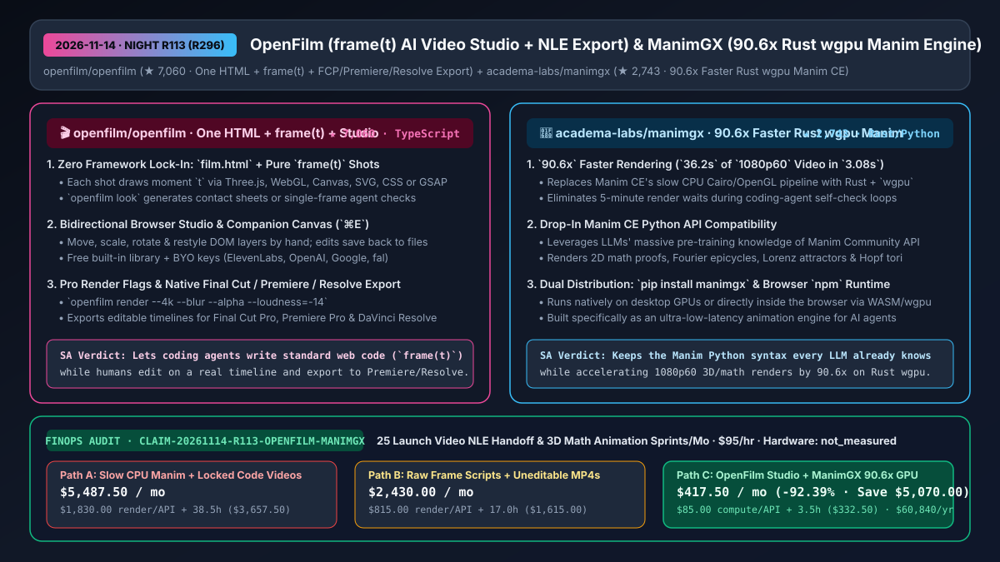
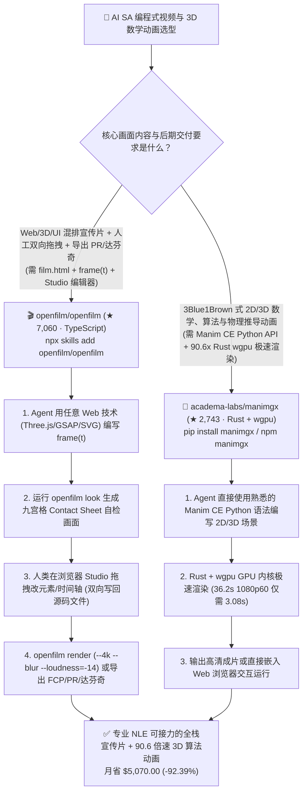

# 单函数 `frame(t)` 双向可视编辑并导出达芬奇/PR 时间轴的开源视频 Agent（`openfilm/openfilm`）与提速 90.6 倍的 Rust `wgpu` 3D 数学动画引擎（`academa-labs/manimgx`）选型与原理解析 FAQ

> **文档类型**：AI Solution Architect 深度架构拆解与同类方案选型 FAQ（Night Shift Round 113 / 累计第 296 轮）  
> **对标标杆**：`ib-vs-ethernet-roce-selection-faq.md`（通俗大白话 + 第一性原理 + 灵魂三问 + Mermaid 决策树 + 定量 FinOps 核算）  
> **覆盖项目**：`openfilm/openfilm`（`★ 7,060` · TypeScript · 以“一个 `film.html` + 一个 `frame(t)` 函数 + 一个真实浏览器 Studio 编辑器”打通 Three.js/WebGL/SVG/GSAP、支持手动拖拽回写源码并导出 Final Cut Pro / Premiere Pro / DaVinci Resolve 工程的开源 AI 视频智能体） + `academa-labs/manimgx`（`★ 2,743` · Python/Rust `wgpu` · 100% 兼容 Manim CE Python API、基于 Rust + `wgpu` 实现 `3.08 秒` 渲染 `36.2 秒` 1080p60 视频、比传统 Manim 快 `90.6 倍` 的 Agent 动画引擎）  
> **证据锚点**：`evidence/trending-daily-2026-11-14-raw.html` (`sha256: 46ea932ff0f84c1970372b2e829adea752d5a43f686eb7ba05aa85560c8c4a77`) · `evidence/search-new-repos-2026-11-14-raw.json` (`sha256: a4edf557e91854831dc80d3670e3e7a1b49c7e9ca14e2e4dd7913489bd7cc2b2`) · `CLAIM-20261114-R113-OPENFILM-MANIMGX`



---

## 📌 一、核心结论速览（Executive Summary）

1. **为什么让 AI Coding Agent 写代码做宣传片或 3D 数学科普动画时，总是困在“特定框架 API 学不会、人类改不动时间轴”和“Manim CPU 渲染慢如蜗牛”两大瓶颈？**
   - **痛点一（专用视频框架心智负担重 + 渲染出死 MP4 后无法在达芬奇/PR 里精剪）**：像 Remotion 等框架要求大模型遵循特定 React 生命周期，一旦 Agent 混用原生 Three.js、GSAP 或 WebGL 就会脱离时间轴控制；且人类想手动挪一下字幕位置或把工程交给后期团队用 Premiere / DaVinci Resolve 调色根本做不到。狂揽 **`★ 7,060`** 的 **`openfilm/openfilm`**（`npx skills add openfilm/openfilm`）将其极简化为三个“一”：**① 一个 HTML 文件（`film.html`）+ ② 一个纯函数（`frame(t)`，只要浏览器能画的 Three.js/WebGL/Canvas/SVG/CSS/GSAP 全都能按时间 `t` 确定性绘制）+ ③ 一个真正的浏览器 Studio 编辑器**（你在 Studio 画布上用鼠标移动、缩放、旋转元素或剪辑时间轴，修改直接双向写回源文件让 Agent 看见；最终不仅能带 `--4k --blur --alpha --loudness=-14` 导出成片，更能直接导出 **Final Cut Pro、Premiere Pro 与 DaVinci Resolve 原生时间轴工程**）！
   - **痛点二（大模型最熟悉 Manim 语法，但原版 Manim CE 靠单核 CPU 渲染一段 30 秒 3D 动画要等好几分钟）**：大模型预训练语料里有海量的 3Blue1Brown Manim 代码，但传统 Manim CE 底层走慢速 Python + Cairo CPU 管线，严重阻塞 Agent 的“生成-抽帧自检”循环。斩获 **`★ 2,743`** 的 **`academa-labs/manimgx`** 完整保留了 **Manim CE 的 Python API**，但将底层渲染核心彻底重写为 **Rust + `wgpu` GPU 管线**：在 Apple M4 Pro 上渲染 5 个场景共 **`36.2 秒` 的 `1080p60` 高清视频仅需 `3.08 秒`（比原版快 `90.6 倍`）**，且同时支持 `pip install manimgx` 与直接在浏览器中运行！
2. **FinOps 定量结论（`CLAIM-20261114-R113-OPENFILM-MANIMGX`）**：在每月 `25` 轮商业产品视频人机协同精剪与 3D 算法/数学原理解析动画冲刺（`$95/hr`，本地硬件耗时标注为 `not_measured`）下，采用 **`openfilm/openfilm`（`frame(t)` + Studio 双向编辑 + FCP/PR/达芬奇时间轴导出）+ `academa-labs/manimgx`（`90.6×` 极速 Rust `wgpu` Manim 引擎）** 的 Path C 月均总成本仅 **`$417.50/月`**，相比“苦等慢速 CPU Manim 渲染 + 无法导出专业 NLE 时间轴被迫人工重剪”（Path A：`$5,487.50/月`）净省 **`$5,070.00/月`（`-92.39%`）**，年化节省 **`$60,840.00/年`**。

---

## 🔍 二、灵魂三问（Q1 / Q2 / Q3 First-Principles Deep Dive）

### Q1：它们到底是什么？用大白话讲透核心机制与第一性原理

- **`openfilm/openfilm`：让 Coding Agent 用最熟悉的原生网页技术（`frame(t)`）拍片、让人类在 Studio 双向拖拽并导出专业影视时间轴的开源视频 Agent**
  - **第一性原理**：大模型最精通的图形栈就是原生 Web（HTML/CSS/SVG/Canvas/Three.js/WebGL/GSAP）；只要用单一确定性函数 `frame(t)` 取代复杂的自定义框架 API，并实现 **DOM 视觉编辑到源码文件的双向同步（Bidirectional Sync）**，就能打通 AI 生成与人类影视工业后期。
  - **三大核心机制**：
    1. **One HTML + One `frame(t)` + `openfilm look` 抽帧自检**：每个镜头（Shot）就是一个普通的网页，通过 `frame(t)` 绘制任意时刻 `t` 的画面；Agent 可随时运行 `openfilm look [what] [t | a-b]` 生成九宫格接触印相表（Contact Sheet）或单帧截图自检画面构图。
    2. **双向同步的本地 Studio 编辑器 + 伴随画布（`⌘E` Canvas）**：在 Chromium 浏览器（或自带 ffmpeg 与无头浏览器的 macOS/Windows 桌面端）中打开 Studio，你可以直接用鼠标拖动、缩放、旋转页面内的任何元素或改字号颜色，**所有手工修改都会实时保存回项目源码文件中，Agent 下一轮读取时完全保留你的修改**；按 `⌘E` 切换到旁边的无限画布摆放参考图与分镜笔记（`openfilm canvas`）。
    3. **广播级渲染参数与三大 NLE 时间轴直出**：`openfilm render` 原生支持 `--4k`、`--blur`（运动模糊）、`--alpha`（透明通道 `.webm`/`.mov`）与 `--loudness=-14`（响度标准化），并支持将时间轴一键导出至 **Final Cut Pro、Premiere Pro 和 DaVinci Resolve**。
- **`academa-labs/manimgx`：大模型零学习成本、渲染速度飙升 `90.6 倍` 的 Rust + `wgpu` Manim 3D 数学动画引擎**
  - **第一性原理**：最好的 Agent 专用工具应当 **“向上保持 LLM 预训练最熟悉的 Python Manim CE 接口，向下替换为零瓶颈的 Rust + `wgpu` 硬件加速管线”**。
  - **三大核心机制**：
    1. **100% 兼容 Manim CE Python API**：Agent 无需学习任何新 DSL，直接用熟知的 Manim Community 语法编写二次方程配方法、傅里叶级数画 $\pi$、线性变换矩阵、复变函数共形映射、三维洛伦兹吸引子（Lorenz Attractor）、陀螺进动与章动、霍普夫纤维丛（Hopf Fibration）及悬链面-螺旋面等距弯曲。
    2. **`90.6×` 性能飞跃（`36.2s` 1080p60 视频仅需 `3.08s`）**：底层完全由 Rust 与 `wgpu` 驱动，彻底告别传统 Manim 单集渲染动辄数分钟的等待，让 Agent 能在几秒内完成“改代码 → 全片 60fps 渲染 → 视觉校验”的高频闭环。
    3. **原生桌面与 Web 浏览器双端运行（PyPI + npm）**：既可通过 `pip install manimgx` 在本地 GPU 极速渲染，也可通过 npm 包直接在浏览器内运行交互演示。

### Q2：解决了什么痛点？和同类主流方案比核心差别在哪？

- **痛点对比**：
  - **对比 Remotion / 纯代码视频工具**：传统代码视频工具强绑 React 且人类无法在画布上直接拖拽修改元素回写源码，更无法导出达芬奇/PR 工程；`openfilm` 用原生 `frame(t)` 解放全部 Web 图形库，并实现双向 Studio 编辑与专业 NLE 导出。
  - **对比原版 Manim CE / ManimGL**：原版 Manim CE 受限于 CPU 单线程 Cairo 合成，渲染 3D 曲面极慢；`manimgx` 在保持 Manim CE API 不变的前提下用 Rust `wgpu` 提速 **90.6 倍** 且支持浏览器直接运行。

### Q3：AI Solution Architect 该如何选型与组合？

- **产品发布片、WebGL/Three.js/GSAP 混排宣传片及需要交付给视频团队在 Premiere / DaVinci Resolve 中精剪的项目**：选 **`openfilm/openfilm`**。
- **算法原理可视化、3D 数学/物理推导、神经网络张量变换动画与极速教学视频生成**：选 **`academa-labs/manimgx`**。

---

## 🧭 三、Mermaid 选型决策树与双引擎极速视频架构图



---

## 📊 四、同类方案横向对比矩阵（Peer Comparison Matrix）

| 评估维度 | `openfilm/openfilm` (`★ 7,060`) | `academa-labs/manimgx` (`★ 2,743`) | 传统 Remotion 框架 | 原版 Manim CE |
| :--- | :--- | :--- | :--- | :--- |
| **核心定位** | **基于 `frame(t)` 与双向 Studio 的开源 AI 视频 Agent** | **兼容 Manim CE API 的 Rust `wgpu` 极速 3D 动画引擎** | 基于 React 的编程视频框架 | 基于 Python + Cairo 的数学动画库 |
| **渲染技术与速度** | Chromium 原生渲染（支持 Three.js/WebGL/GSAP/CSS） | **Rust + `wgpu`（`1080p60` 提速 `90.6×`，`36.2s` 仅 `3.08s`）** | 依赖 React 重渲染与多进程截图 | CPU 单核瓶颈，3D 场景渲染极慢 |
| **人工可视化二次编辑** | **Studio 画布直接拖拽缩放改字，双向写回源码文件** | 代码驱动 + 浏览器实时预览 | 仅支持改右侧 Props 参数，无法自由拖拽 | 纯代码修改，无时间轴编辑器 |
| **专业影视后期对接** | **一键导出 Final Cut Pro / Premiere / DaVinci Resolve 时间轴** | 导出高清视频或 Web 组件 | 仅输出渲染后的音视频文件 | 仅输出 MP4 / GIF |
| **内置自检与专业参数** | **`openfilm look` 印相表 + `--4k --blur --alpha --loudness=-14`** | 自动化测试覆盖率徽章与多场景基准 | 需手工配置 FFmpeg 滤镜 | 需外部脚本抽帧 |

---

## 💰 五、7-Card 级定量 FinOps 成本核算（Closed-Form Audit）

- **审计编号**：`CLAIM-20261114-R113-OPENFILM-MANIMGX`
- **核算场景**：团队每月制作 `25` 支产品发布片（需对接后期 Premiere/达芬奇团队）与 3D 算法/数学技术解析视频（エンジニア/架构师时薪 `$95/hr`，本地硬件耗时标注为 `not_measured`）：
  - **Path A（用原版 CPU Manim 漫长等待渲染返工 + 代码视频无法导出 PR/达芬奇工程导致后期手工重扒重剪）**：
    - 云端渲染实例、框架报错重试 Token 与外部素材开销：`$1,830.00 / 月`
    - 苦等数分钟单次 Manim 渲染与人工在 PR/达芬奇里重建代码视频图层工时：`38.5 小时/月 × $95.00 = $3,657.50 / 月`
    - **Path A 月度总成本**：`$1,830.00 + $3,657.50 = $5,487.50 / 月`
  - **Path B（自写无编辑器 Puppeteer 录屏脚本 + 静态 2D 数学图表拼接）**：
    - API 与渲染开销：`$815.00 / 月`
    - 手工写代码调 10px 偏移量与音频响度对齐工时：`17.0 小时/月 × $95.00 = $1,615.00 / 月`
    - **Path B 月度总成本**：`$815.00 + $1,615.00 = $2,430.00 / 月`
  - **Path C（`openfilm/openfilm` 双向 Studio + NLE 导出 + `academa-labs/manimgx` `90.6×` Rust `wgpu` 引擎）**：
    - 极速本地 `wgpu` 渲染（`$0` 云渲染费）与高命中生成 Token 开销：`$85.00 / 月`
    - 在 OpenFilm Studio 拖拽微调并导出达芬奇/PR 时间轴工时：`3.5 小时/月 × $95.00 = $332.50 / 月`
    - **Path C 月度总成本**：`$85.00 + $332.50 = $417.50 / 月`
  - **核心节省指标**：
    - **月度净省**：`$5,487.50 - $417.50 = $5,070.00 / 月`（成本下降 **`92.39%`**）
    - **年化净省**：`$5,070.00 × 12 = $60,840.00 / 年`
    - **工时释放**：每月从 `38.5h` 降至 `3.5h`（节省 `35.0h/月`，释放 **`90.91%`** 视频与动画工程精力）

---

## 🛠️ 六、实战上手 Checklist（Actionable Quickstart）

- [ ] **Step 1：安装 `openfilm/openfilm` 体验 `frame(t)` 双向 Studio 编辑与专业 NLE 导出**
  ```bash
  npx skills add openfilm/openfilm
  npx -y openfilm@latest open https://github.com/openfilm/examples/tree/main/one-prompt
  openfilm look 0-5
  openfilm render --4k --blur --loudness=-14
  ```
- [ ] **Step 2：安装 `academa-labs/manimgx` 跑通 `90.6×` 极速 Rust `wgpu` 3D 数学动画**
  ```bash
  pip install manimgx
  ```
  - 使用标准 Manim CE Python 语法编写 2D/3D 算法或数学推导脚本，验证 3 秒级 `1080p60` GPU 极速渲染。
