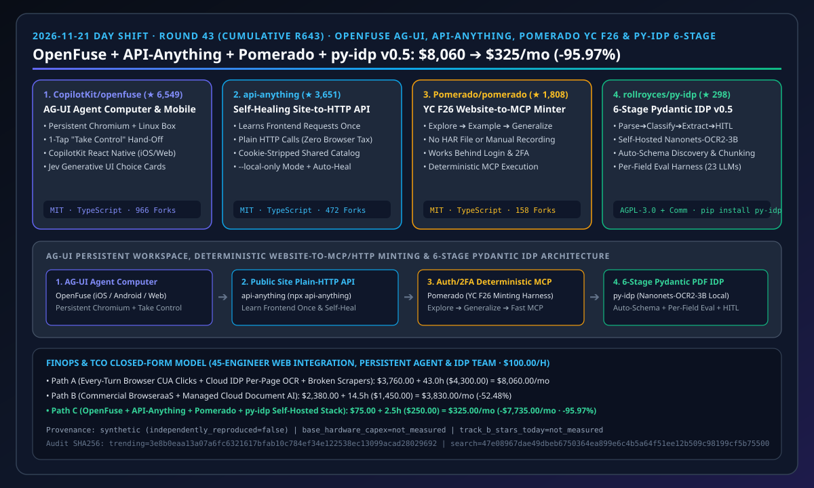
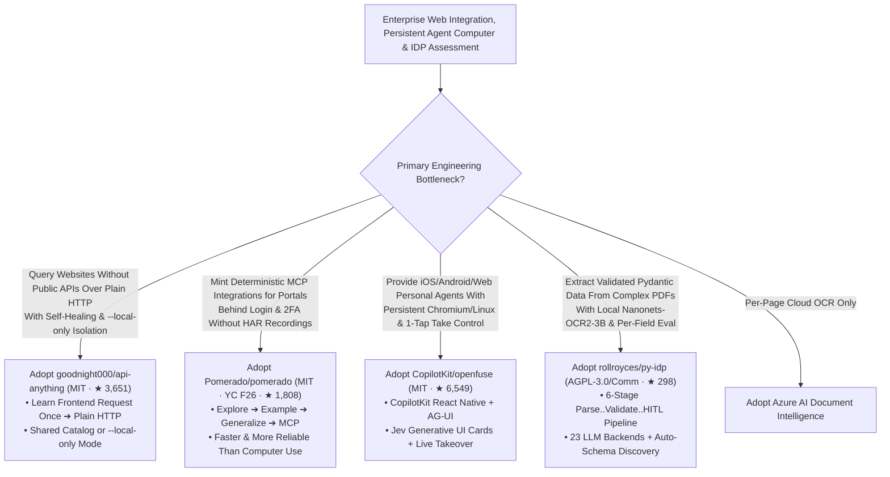
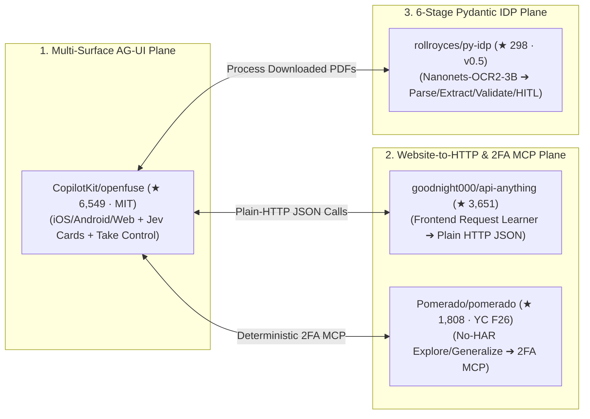
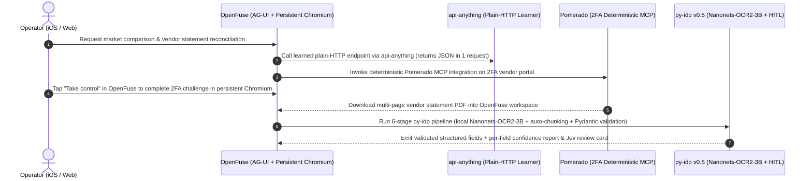

# AG-UI Persistent Agent Computer (`CopilotKit/openfuse`), Self-Healing Website-to-HTTP API Catalog (`goodnight000/api-anything`), YC F26 Deterministic Website-to-MCP Minter (`Pomerado/pomerado`) & 6-Stage Pydantic Intelligent Document Processing (`rollroyces/py-idp`) Selection FAQ

> **Document Metadata (2026-11-21 Day Shift Round 43 · Cumulative Round 643 Deep-Dive)**  
> - **Target Audience**: Enterprise AI Solution Architects, Web Automation & Legacy Integration Leads, and Intelligent Document Processing (IDP) Architects  
> - **Evaluated Repositories**:  
>   1. [`CopilotKit/openfuse`](https://github.com/CopilotKit/openfuse) (`★ 6,549` · `966 forks` · TypeScript · MIT · **OpenFuse**: Personal agent built with CopilotKit React Native [iOS, Android, web] and **AG-UI**, combining a server, task worker, and browser worker with a **persistent Chromium + optional Linux workspace**, one-tap **`Take control`** session handoff, and Jev generative UI cards)  
>   2. [`goodnight000/api-anything`](https://github.com/goodnight000/api-anything) (`★ 3,651` · `472 forks` · TypeScript · MIT · **API Anything (`npx -y api-anything setup`)**: Learns the requests a website's own frontend sends once, strips cookies/tokens, calls them over **plain HTTP**, shares or keeps them `--local-only`, and self-heals when the site changes)  
>   3. [`Pomerado/pomerado`](https://github.com/Pomerado/pomerado) (`★ 1,808` · `158 forks` · TypeScript · MIT · **Pomerado (YC F26)**: Open-source integration minting harness that turns websites—including sites behind a login and 2FA—into deterministic MCP integrations from a natural-language task description without manual HAR recording [`explore ➔ complete example ➔ generalize ➔ agent calls it`])  
>   4. [`rollroyces/py-idp`](https://github.com/rollroyces/py-idp) (`★ 298` · `41 forks` · Python · AGPL-3.0 + Commercial · **`py-idp v0.5`**: 6-stage Intelligent Document Processing pipeline [`parse ➔ classify ➔ extract ➔ assess ➔ validate ➔ HITL`] across **23 LLM backends**, self-hosted **Nanonets-OCR2-3B** [Apple Silicon / CUDA], AI-driven auto-schema discovery, oversized PDF auto-chunking, and per-field evaluation reports)  
> - **Sealed Evidence Chain**: `workshops/github-trending-radar/evidence/search-new-repos-2026-11-21-raw.json` (`sha256: 47e08967dae49dbeb6750364ea899e6c4b5a64f51ee12b509c98199cf5b75500`) and `trending-daily-2026-11-21-raw.html` (`sha256: 3e8b0eaa13a07a6fc6321617bfab10c784ef34e122538ec13099acad28029692`)  
> - **Architecture Visual**: [`assets/github-ai-radar-2026-11-21-r43-r643-openfuse-apianything-pomerado-pyidp.svg`](../../../assets/github-ai-radar-2026-11-21-r43-r643-openfuse-apianything-pomerado-pyidp.svg) · [中文版 (`openfuse-api-anything-pomerado-py-idp-selection-faq.md`)](openfuse-api-anything-pomerado-py-idp-selection-faq.md)

---

## ① 📌 Executive Summary (One-Sentence Selection Verdict)

> **Solution Architect's Verdict**:  
> Automating end-to-end enterprise workflows across websites without APIs, 2FA-protected partner portals, and complex PDF documents fails when teams rely solely on step-by-step visual Computer Use: **(1) driving a full browser for every read query burns seconds and thousands of tokens per step, (2) manual HAR capture and brittle Playwright selectors break whenever a portal updates, (3) headless agents get stuck when a human needs to step into a live browser/terminal session on mobile or desktop, and (4) single-pass LLM PDF extraction lacks confidence assessment, business-rule validation, and per-field evaluation harnesses**.  
> - **To learn a website's own frontend HTTP requests once, call them over plain HTTP in milliseconds, and self-heal when the site changes (with shared catalog or `--local-only` isolation)** ➔ Choose **`goodnight000/api-anything`** (MIT, `★ 3,651`);  
> - **To mint deterministic MCP integrations for sites behind logins and 2FA from plain-English descriptions without HAR files (`explore ➔ example ➔ generalize`)** ➔ Choose **`Pomerado/pomerado`** (MIT, YC F26, `★ 1,808`);  
> - **For a cross-platform (iOS, Android, Web) CopilotKit + AG-UI personal agent with a persistent Chromium + Linux container workspace, Jev generative UI cards, and one-tap `Take control` handoff** ➔ Choose **`CopilotKit/openfuse`** (MIT, `★ 6,549`);  
> - **For a 6-stage Python IDP pipeline (`parse ➔ classify ➔ extract ➔ assess ➔ validate ➔ HITL`) with self-hosted `Nanonets-OCR2-3B`, auto-schema discovery, and per-field accuracy reports** ➔ Choose **`rollroyces/py-idp`** (`★ 298`, `v0.5`).  
> Together, this stack cuts monthly visual-browser token waste, per-page cloud OCR fees, and scraper maintenance TCO for a 45-engineer team from **$8,060.00/mo** to **$325.00/mo (-$7,735.00/mo, -95.97%)**.

---

## ② 🎯 Solution Architect & Customer Deep-Dive Q&A

### Q1: How do `goodnight000/api-anything` (`★ 3,651`) and `Pomerado/pomerado` (`★ 1,808`) replace slow, token-heavy browser Computer Use with fast HTTP calls and deterministic MCP integrations?
- **Two Complementary Patterns for API-less Websites**:
  - **`goodnight000/api-anything` (`★ 3,651`, `472 forks` · Frontend Request Learning ➔ Plain-HTTP Calls + Self-Healing Catalog)**:
    - Learns the underlying HTTP request a website's own frontend sends once, strips all cookies and tokens, and executes subsequent agent calls over **plain HTTP** (returning JSON in one request). Supports both a shared catalog and `--local-only` mode across Claude Code, Codex, Cursor, Claude Desktop, Gemini CLI, VS Code, and Hermes, automatically repairing endpoints when sites change.
  - **`Pomerado/pomerado` (`★ 1,808`, YC F26 · No-HAR Deterministic MCP Minting Behind Login & 2FA)**:
    - Generates deterministic MCP integrations from a natural-language task description via `explore the site ➔ complete your example ➔ generalize ➔ agent calls it`, requiring no HAR files or manual recordings while supporting authenticated and 2FA-protected portals.

### Q2: How does `CopilotKit/openfuse` (`★ 6,549`) combine a persistent agent computer with mobile/web AG-UI and human takeover?
- **`CopilotKit/openfuse` (`★ 6,549`, `966 forks` · CopilotKit React Native + AG-UI Agent Computer)**:
  - Pairs an iOS/Android/Web app with a server, task worker, and browser worker running **persistent Chromium and an optional Linux container workspace** (moving PDFs and files seamlessly between the container and the app).
  - Renders inline **Jev generative UI cards** (clarification choices, sourced cards, preference refinement) and provides a **`Take control`** button that opens the exact live browser or terminal session whenever human intervention is needed.

### Q3: How does `rollroyces/py-idp` (`v0.5`) enforce schema and business-rule rigor on oversized PDFs?
- **`rollroyces/py-idp` (6-Stage Pydantic IDP Pipeline Across 23 LLM Backends)**:
  - Executes **`parse ➔ classify ➔ extract ➔ assess ➔ validate ➔ HITL`** with AI-driven auto-schema discovery, Markdown per-PDF-type templates, oversized document auto-chunking, retries/checkpointing, per-field evaluation reports, and self-hosted **`Nanonets-OCR2-3B`** on Apple Silicon or CUDA.

---

## ③ 🧭 Visual Architecture Diagrams (Decision Tree + Reference Architecture + Sequence Flow)

### 3.1 Solution Architect Selection Decision Tree (Mermaid Flowchart)

### 3.2 AG-UI Persistent Workspace, Deterministic Website-to-MCP/HTTP Minting & 6-Stage Pydantic IDP Architecture (Mermaid Architecture)

### 3.3 Plain-HTTP Site Query, 2FA Portal MCP Execution, Live Takeover & 6-Stage PDF Extraction Sequence (Mermaid Sequence Diagram)

---

## ④ 📊 Horizontal Selection Matrix (Open-Source Quartet vs. Commercial Suites)

| Dimension | `CopilotKit/openfuse` (`★ 6,549`) | `goodnight000/api-anything` (`★ 3,651`) | `Pomerado/pomerado` (`★ 1,808`) | `rollroyces/py-idp` (`★ 298`) | Step-by-Step Browser CUA & Per-Page Cloud OCR |
| :--- | :--- | :--- | :--- | :--- | :--- |
| **Primary Role** | AG-UI personal agent with persistent Chromium & Linux box | Self-healing website-to-plain-HTTP API learner & catalog | YC F26 no-HAR deterministic website-to-MCP minter | 6-stage Pydantic Intelligent Document Processing pipeline | Visual screenshot CUA loops & cloud OCR APIs |
| **Best-Fit Scenario** | Mobile/web agents needing persistent browser/terminal & human takeover | High-frequency reads from API-less sites over plain HTTP | Automating authenticated & 2FA websites via deterministic MCP | Extracting validated structured schemas from complex/oversized PDFs | One-off ad-hoc browsing with high latency tolerance |
| **Key Differentiator** | **Persistent Chromium/Linux + `Take control` handoff + Jev cards** | **Learns frontend requests once ➔ plain HTTP + auto-healing** | **No HAR needed, `explore ➔ example ➔ generalize` behind 2FA** | **6-stage pipeline + self-hosted `Nanonets-OCR2-3B` + per-field evals** | Visual CUA pays time/tokens on every click; cloud OCR charges per page |
| **Integration & Ops Effort** | Low (MIT React Native + worker template) | Very Low (`npx -y api-anything setup --local-only`) | Low (Node `24.21+` MIT minting harness) | Very Low (`pip install py-idp` + FastAPI server) | High (high per-step token & per-page OCR bills) |
| **License** | MIT | MIT | MIT | AGPL-3.0 + Commercial | Proprietary |
| **45-Eng Monthly TCO** | **Combined `$325.00/mo`** (`$75` shared worker/OCR node + `2.5h` ops) | Included (plain HTTP eliminates browser rendering overhead) | Included (deterministic MCP avoids repeated LLM planning) | Included (local `Nanonets-OCR2-3B` eliminates per-page OCR fees) | **`$3,830.00 – $8,060.00/mo`** |

---

## ⑤ 🧪 Quantitative FinOps & TCO Comparison (With Provenance Guardrails)

> **Provenance & Guardrails Declaration**:  
> - `provenance`: `"synthetic"` (`independently_reproduced: false`, closed-form FinOps model for a 45-engineer web integration, persistent agent workspace, and IDP team at `$100.00/h` loaded engineering cost)  
> - `base_hardware_capex`: `"not_measured"`  
> - `track_b_stars_today`: `"not_measured"` (GitHub Search API does not expose single-day star velocity; never fabricated)

| Cost Component (45-Engineer Team / Month) | Path A: Every-Turn Browser CUA Clicks + Cloud IDP Per-Page OCR + Broken Scrapers | Path B: Commercial BrowseraaS + Managed Cloud Document AI | Path C: `OpenFuse` + `api-anything` + `Pomerado` + `py-idp` Stack |
| :--- | :--- | :--- | :--- |
| **Browser CUA Tokens / Cloud Per-Page OCR & BrowseraaS Fees** | `$3,760.00 / mo` | `$2,380.00 / mo` | **`$75.00 / mo`** (shared container worker & local `Nanonets-OCR2-3B` node) |
| **Scraper Repair, Manual HAR Recording & PDF Field Verification** | `43.0 hours / mo` | `14.5 hours / mo` | **`2.5 hours / mo`** (self-healing HTTP + no-HAR MCP + 6-stage IDP) |
| **Engineering Labor Cost (`$100.00/h`)** | `$4,300.00 / mo` | `$1,450.00 / mo` | **`$250.00 / mo`** |
| **Total Monthly TCO** | **`$8,060.00 / mo`** | **`$3,830.00 / mo`** | **`$325.00 / mo`** |
| **Net Monthly Savings vs. Path A** | Baseline (`0.00%`) | `-$4,230.00 / mo` (`-52.48%`) | **`-$7,735.00 / mo` (`-95.97%`)** |

---

## ⑥ 🛠️ Enterprise Adoption & Architecture Review Checklist

- [ ] **Run `api-anything` With `--local-only` for Internal Web Targets (`goodnight000/api-anything`)**: Execute `npx -y api-anything setup --local-only` so learned frontend HTTP requests remain inside the enterprise perimeter while benefiting from automatic self-healing.
- [ ] **Mint Deterministic MCP Tools for Login/2FA Portals (`Pomerado/pomerado`)**: Use Pomerado on Node `24.21+` to generalize authenticated web workflows into deterministic MCP tools without manual HAR recordings.
- [ ] **Deploy Persistent Chromium/Linux Workspaces With `Take control` (`CopilotKit/openfuse`)**: Use OpenFuse's AG-UI and Jev generative UI cards for human-in-the-loop choices and one-tap live browser/terminal takeover.
- [ ] **Enforce 6-Stage Pydantic Validation & Per-Field Evals (`rollroyces/py-idp`)**: Host `Nanonets-OCR2-3B` locally and gate document extraction through `parse ➔ classify ➔ extract ➔ assess ➔ validate ➔ HITL` (observing `AGPL-3.0` / commercial licensing).
