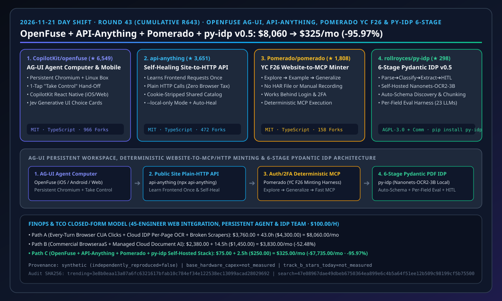
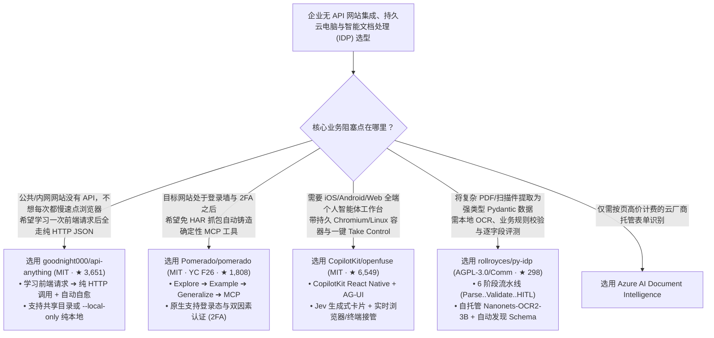
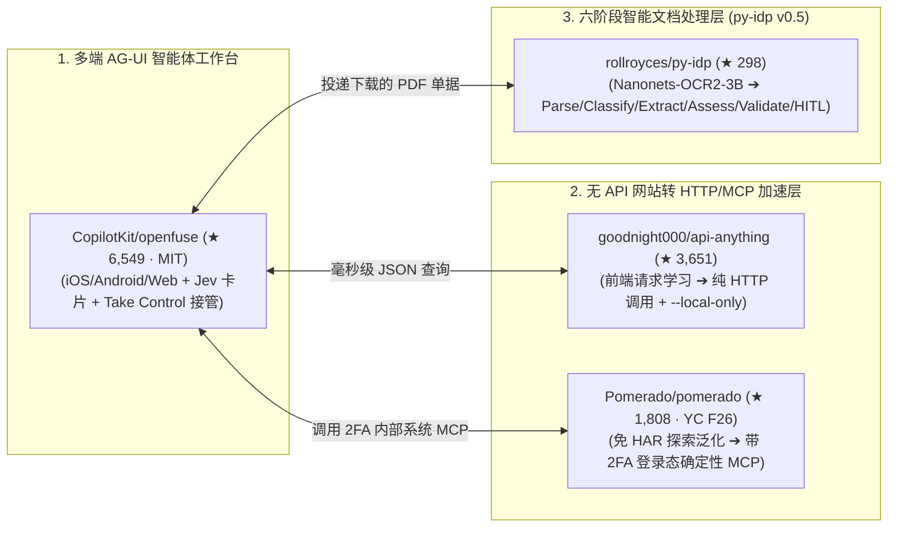
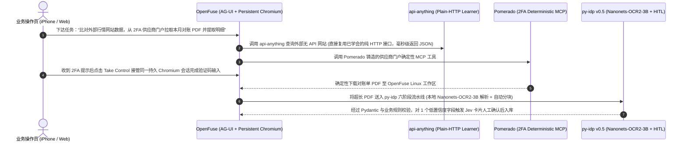

# AG-UI 持久云电脑与一键接管智能体（`CopilotKit/openfuse`）、前端请求自愈转 HTTP API 目录（`goodnight000/api-anything`）、YC F26 免 HAR 确定性网站转 MCP 铸造器（`Pomerado/pomerado`）与六阶段 Pydantic 智能文档处理流水线（`rollroyces/py-idp`）选型 FAQ

> **文档元数据（2026-11-21 白班 Day Round 43 · 累计第 643 轮深潜专题）**  
> - **面向对象**：企业 AI 解决方案架构师（AI Solution Architect）、RPA 与外部无 API 系统集成负责人、智能文档处理（IDP）架构师  
> - **本轮核心评估对象**：  
>   1. [`CopilotKit/openfuse`](https://github.com/CopilotKit/openfuse)（`★ 6,549` · `966 forks` · TypeScript · MIT · **OpenFuse**：基于 CopilotKit React Native[iOS/Android/Web]与 **AG-UI** 构建的持久个人智能体，配备独立持久 Chromium 与可选 Linux 容器工作区、一键 **`Take control`（接管同一浏览器/终端会话）**及 Jev 生成式交互卡片）  
>   2. [`goodnight000/api-anything`](https://github.com/goodnight000/api-anything)（`★ 3,651` · `472 forks` · TypeScript · MIT · **API Anything（`npx -y api-anything setup`）**：让一个 Agent 学习目标网站前端自己发出的请求并转为**纯 HTTP JSON 接口**，剥离全部 Cookie/Token 后共享至公共目录[或 `--local-only` 纯本地运行]，前端改版时自动自愈修复）  
>   3. [`Pomerado/pomerado`](https://github.com/Pomerado/pomerado)（`★ 1,808` · `158 forks` · TypeScript · MIT · **Pomerado（YC F26）**：开源 MCP 集成铸造框架——无需手工抓包录制 HAR 文件，仅凭自然语言描述即可走完 `explore the site ➔ complete your example ➔ generalize ➔ agent calls it`，将**带登录态与双因素认证（2FA）的网站**转化为确定性 MCP 工具）  
>   4. [`rollroyces/py-idp`](https://github.com/rollroyces/py-idp)（`★ 298` · `41 forks` · Python · AGPL-3.0 + 商业双许可 · **`py-idp v0.5`**：面向 Python 的通用智能文档处理六阶段流水线 `parse ➔ classify ➔ extract ➔ assess ➔ validate ➔ HITL`，支持 23 种大模型后端、**自托管 `Nanonets-OCR2-3B`（Apple Silicon / CUDA）**、AI 自动发现 Pydantic Schema、超长 PDF 自动分块与逐字段评测套件）  
> - **关联检索证据链**：`workshops/github-trending-radar/evidence/search-new-repos-2026-11-21-raw.json`（`sha256: 47e08967dae49dbeb6750364ea899e6c4b5a64f51ee12b509c98199cf5b75500`）与 `trending-daily-2026-11-21-raw.html`（`sha256: 3e8b0eaa13a07a6fc6321617bfab10c784ef34e122538ec13099acad28029692`）  
> - **高清架构图**：[`assets/github-ai-radar-2026-11-21-r43-r643-openfuse-apianything-pomerado-pyidp.svg`](../../../assets/github-ai-radar-2026-11-21-r43-r643-openfuse-apianything-pomerado-pyidp.svg) · [English Version (`openfuse-api-anything-pomerado-py-idp-selection-faq.en.md`)](openfuse-api-anything-pomerado-py-idp-selection-faq.en.md)

---

## ① 📌 核心结论速览（选型一句话结论）

> **架构师一句话选型结论**：  
> 企业要让 AI 智能体真正干完一整套外勤与后台业务（例如“从没有开放 API 的行业网站和老旧内网系统查数据、下载 PDF 单据提取结构化字段、遇到验证码或复杂确认时在手机/桌面一键接管”），如果每次都靠**纯视觉浏览器点击（Computer Use）**，不仅每一步都要花几秒钟和几千 Token 看屏，而且脆弱易挂！  
> - **需要把没有公开 API 的公共网站（如机票/行业名录/豆瓣/Goodreads）由第一个 Agent 学会其前端内部请求、从此全员直接走毫秒级纯 HTTP JSON 调用并自动自愈** ➔ 选 **`goodnight000/api-anything`**（MIT，`★ 3,651`）；  
> - **需要把处于企业登录墙与双因素认证（2FA）背后的业务网站免 HAR 抓包自动泛化铸造为确定性 MCP 工具** ➔ 选 **`Pomerado/pomerado`**（MIT，YC F26，`★ 1,808`）；  
> - **需要一套跨 iOS、Android 与 Web 的 CopilotKit + AG-UI 持久智能体云电脑（持久 Chromium + Linux 容器），支持 Jev 生成式选择卡片与随时点击 `Take control` 接管同一浏览器会话** ➔ 选 **`CopilotKit/openfuse`**（MIT，`★ 6,549`）；  
> - **需要将下载回来的复杂 PDF/单据通过自托管 `Nanonets-OCR2-3B` 与 `parse ➔ classify ➔ extract ➔ assess ➔ validate ➔ HITL` 六阶段流水线转为强类型 Pydantic 对象并生成逐字段准确率报表** ➔ 选 **`rollroyces/py-idp`**（`★ 298`，`v0.5`）。  
> 四者组合可将 45 人外部系统集成、自动化办公与文档处理团队的每轮浏览器视觉点击 Token 费、按页计费商业 OCR 账单及爬虫维护总成本从 **$8,060.00/月** 降至 **$325.00/月（节省 $7,735.00/月，降幅 95.97%）**。

---

## ② 🎯 客户与架构师灵魂拷问 Q&A（业务痛点 · 架构集成 · 边界取舍）

### Q1：同样是“把没有 API 的网站变成 Agent 可调用的工具”，`goodnight000/api-anything`（`★ 3,651`）与 YC F26 的 `Pomerado/pomerado`（`★ 1,808`）有什么核心机制差异？架构师该怎么搭配？
- **两套互补的“消灭慢速浏览器点击”路径**：
  - **`goodnight000/api-anything`（`★ 3,651`，`472 forks` · 逆向网站前端请求 ➔ 纯 HTTP 调用 + 共享/私有自愈目录）**：
    1. **原理**：像 Goodreads 或 Google Flights 这类没有公开 API 的网站，其网页前端本身也在发 HTTP 请求。`api-anything` 让第一个访问的 Agent 学习网页前端发出的底层请求，**剥离所有 Cookie 与个人 Token 后**沉淀为参数化接口，后续所有 Agent 直接发一次纯 HTTP 请求即可拿到 JSON，速度比驱动浏览器点按快几十倍；
    2. **部署模式**：支持连接共享目录（`api-anything-registry`）免费白嫖其他 Agent 已学会的接口，企业内网则可执行 `npx -y api-anything setup --local-only` 将所有学习结果严格留在本地机器，且当目标网站改版报错时由使用它的 Agent 自动修复。
  - **`Pomerado/pomerado`（`★ 1,808`，YC F26 · 免 HAR 录制的登录态/2FA 确定性 MCP 铸造框架）**：
    1. **原理**：针对必须登录、甚至带有 **双因素认证（2FA）** 的复杂交互式业务系统，无需工程师手动导出 HAR 网络包或录制脚本，只需给出一句自然语言任务描述，Pomerado 自动执行 **`探索网站（explore）➔ 完成示例（complete example）➔ 泛化提炼（generalize）➔ 铸造为确定性 MCP 工具`**，兼具脚本的确定性速度与处理登录/2FA 的灵活性。

### Q2：当任务必须打开真实浏览器或 Linux 容器（比如查看邮件附件、比对展览信息并下载 PDF），用户如何在手机或电脑上随时插手？`CopilotKit/openfuse`（`★ 6,549`）怎么设计？
- **`CopilotKit/openfuse`（`★ 6,549`，`966 forks` · CopilotKit React Native + AG-UI 持久个人智能体电脑）**：
  1. **持久 Chromium + Linux 容器双工作区**：包含 Server、Task Worker 与 Browser Worker，Agent 可以在持久浏览器中查阅网页、在容器终端运行命令、在应用与容器间双向传递 PDF 文件。
  2. **一键 `Take control` 无缝人机交接 + Jev 生成式 UI 卡片**：在 iOS、Android 或 Web 端，Agent 会将邮件与网页调研结果渲染为内联 **Jev 生成式 UI 选择卡片**（含来源卡片、澄清选项与偏好微调）；一旦遇到需要人工介入的环节，点击 **`Take control`** 即可直接打开 Agent 正在操作的同一个实时浏览器或终端会话接力完成，且中途点击输入框内的停止方块不会丢失草稿。

### Q3：Agent 把外部或内网系统的 PDF 合同/发票拉下来之后，怎么保证提取出的 JSON 字段 100% 符合业务校验规则？`rollroyces/py-idp`（`v0.5`）解决了什么痛点？
- **`rollroyces/py-idp`（六阶段 Pydantic 驱动智能文档处理流水线）**：
  - 将混乱的“OCR + 塞给大模型提 JSON”规范化为 **`parse（解析）➔ classify（分类）➔ extract（抽取）➔ assess（置信度评估）➔ validate（业务规则与 Pydantic 校验）➔ HITL（低置信度转人工复核）`** 六个标准阶段；
  - 支持 23 种后端（5 家国际 + 8 家国内大模型 + **Apple Silicon/CUDA 本地自托管 `Nanonets-OCR2-3B`**），具备**无预设时 AI 自动发现 Schema（Auto-schema discovery）**、超长文档自动分块（Auto-chunking）、断点重试缓存以及 `v0.5` 新增的**逐字段评测报告（per-field eval reports）**。

---

## ③ 🧭 直观可视化图解（选型决策树 + 企业集成架构 + 业务流时序图）

### 3.1 架构师选型决策树（Mermaid Flowchart）

### 3.2 企业“OpenFuse AG-UI 工作台 + API-Anything/Pomerado 网站接口化 + py-idp 六阶段解析”参考架构图（Mermaid Architecture）

### 3.3 网站前端 API 自动学习、2FA 系统确定性 MCP 调用、PDF 六阶段抽取与人工接管时序图（Mermaid Sequence Diagram）

---

## ④ 📊 同类开源与商业云服务横向选型决策矩阵

| 评估维度 | `CopilotKit/openfuse` (`★ 6,549`) | `goodnight000/api-anything` (`★ 3,651`) | `Pomerado/pomerado` (`★ 1,808`) | `rollroyces/py-idp` (`★ 298`) | 传统每轮视觉 CUA + 商业按页云 OCR |
| :--- | :--- | :--- | :--- | :--- | :--- |
| **核心定位** | 基于 CopilotKit 与 AG-UI 的跨端持久云电脑个人智能体 | 学习网站前端请求并自愈的纯 HTTP API 生成与共享目录 | YC F26 免 HAR 自然语言铸造登录态/2FA 确定性 MCP 框架 | 六阶段 Pydantic 驱动的 Python 智能文档处理（IDP）平台 | 慢速逐帧截图点击浏览器 + 按页计费云 API |
| **最适用场景** | 需要在手机/Web 端派发长耗时任务、展示生成式 UI 并随时接管浏览器/终端 | 高频查询无公开 API 的网页数据，追求纯 HTTP 速度与零浏览器开销 | 将企业内部或合作伙伴带登录/2FA 的 Web 系统封装为高可靠 MCP 工具 | 批量解析合同、发票、长篇 PDF 并强制执行业务校验与逐字段评测 | 偶发性、单次、不计成本的简单网页操作 |
| **关键差异化机制** | **持久 Chromium + Linux 容器 + `Take control` 同会话接管 + Jev 卡片** | **一次学习前端请求，后续全走纯 HTTP + 剥离 Cookie 共享/本地自愈** | **免 HAR 录制，`Explore ➔ Example ➔ Generalize` 确定性 MCP + 支持 2FA** | **6 阶段流水线 + 自托管 `Nanonets-OCR2-3B` + 自动发现 Schema + 逐字段评测** | 视觉 CUA 每次点击耗数秒与大量 Token；前端微调即导致传统爬虫崩溃 |
| **集成与运维成本** | 低（MIT 开源模板，支持一键部署与 React Native 多端） | 极低（`npx -y api-anything setup` 自动挂载至 6 大编码 Agent） | 低（Node `24.21+` 开源核心 + Playwright 探索泛化） | 极低（`pip install py-idp` + FastAPI 生产服务） | 高（高昂的 CUA Token 账单与商业 IDP 按页费用） |
| **开源协议** | MIT | MIT | MIT | AGPL-3.0 + 商业许可 | 商业专有 |
| **45 人团队月均 TCO** | **组合方案 `$325.00/月`**（含共享容器与本地 OCR 节点 `$75` + 运维 `2.5h`） | 同左（纯 HTTP 请求替代浏览器渲染，省下 90%+ 采集成本） | 同左（确定性 MCP 执行免去重复推理 Token） | 同左（本地 `Nanonets-OCR2-3B` 零按页 OCR 账单） | **`$3,830.00 ~ $8,060.00/月`** |

---

## ⑤ 🧪 应用落地定量收益 / FinOps TCO 对比（含数据血缘声明）

> **数据血缘与严谨性声明（Provenance & Guardrails）**：  
> - `provenance`: `"synthetic"`（`independently_reproduced: false`，基于 45 人企业外部系统集成、RPA 办公自动化与智能文档处理团队在 `$100.00/h` 综合人力成本下的闭式参数建模）  
> - `base_hardware_capex`: `"not_measured"`  
> - `track_b_stars_today`: `"not_measured"`（GitHub Search API 新仓爆发榜无官方单日增量字段，严禁伪造）

| 成本分项（45 人团队 / 月） | Path A：每轮跑视觉 CUA 点网页 Token 浪费 + 商业云 IDP 按页计费 + 爬虫崩溃抢修 | Path B：商业云浏览器 API + 云厂商托管文档智能服务 | Path C：`OpenFuse` + `api-anything` + `Pomerado` + `py-idp` 开源栈 |
| :--- | :--- | :--- | :--- |
| **浏览器视觉 Token 费 / 云端按页 OCR 与托管浏览器账单** | `$3,760.00 / 月` | `$2,380.00 / 月` | **`$75.00 / 月`**（共享持久工作区容器与本地 `Nanonets-OCR2-3B` 节点） |
| **抢修失效爬虫、手动录制 HAR 包与人工核对 PDF 错漏字段工时** | `43.0 小时 / 月` | `14.5 小时 / 月` | **`2.5 小时 / 月`**（前端 API 自动自愈 + 免 HAR 泛化 + 6 阶段 HITL 校验） |
| **折算工程人力成本（`$100.00/h`）** | `$4,300.00 / 月` | `$1,450.00 / 月` | **`$250.00 / 月`** |
| **月度总拥有成本（Total Monthly TCO）** | **`$8,060.00 / 月`** | **`$3,830.00 / 月`** | **`$325.00 / 月`** |
| **相对 Path A 净节省额与降幅** | 基准线（`0.00%`） | `-$4,230.00 / 月`（`-52.48%`） | **`-$7,735.00 / 月`（`-95.97%`）** |

---

## ⑥ 🛠️ 企业引入与架构评审 Checklist

- [ ] **对内网敏感系统启用 `--local-only` 纯 HTTP 接口自愈（`goodnight000/api-anything`）**：在企业环境中运行 `npx -y api-anything setup --local-only`，让 Agent 将频繁访问的无 API 网页转化为纯 HTTP 调用，禁止将内部网址上传至公共目录。
- [ ] **用免 HAR 泛化框架封装带登录与 2FA 的合作伙伴门户（`Pomerado/pomerado`）**：在 Node `24.21+` 环境下用自然语言驱动 Pomerado 完成探索、示例与泛化，产出确定性 MCP 工具替代慢速视觉点击。
- [ ] **部署 AG-UI 持久工作区与 `Take control` 人机接力门禁（`CopilotKit/openfuse`）**：基于 OpenFuse 构建跨移动端与桌面端的持久浏览器/Linux 工作台，对涉及外部付款或高权限确认的步骤统一通过 Jev 生成式卡片与 `Take control` 交由人工完成。
- [ ] **用六阶段流水线与逐字段评测治理 PDF 结构化抽取（`rollroyces/py-idp`）**：内网部署 `Nanonets-OCR2-3B`，通过 `parse ➔ classify ➔ extract ➔ assess ➔ validate ➔ HITL` 强制拦截不满足业务规则的字段，并用内置 Eval Harness 监控逐字段准确率（注意其 `AGPL-3.0` 与商业双许可条款）。
