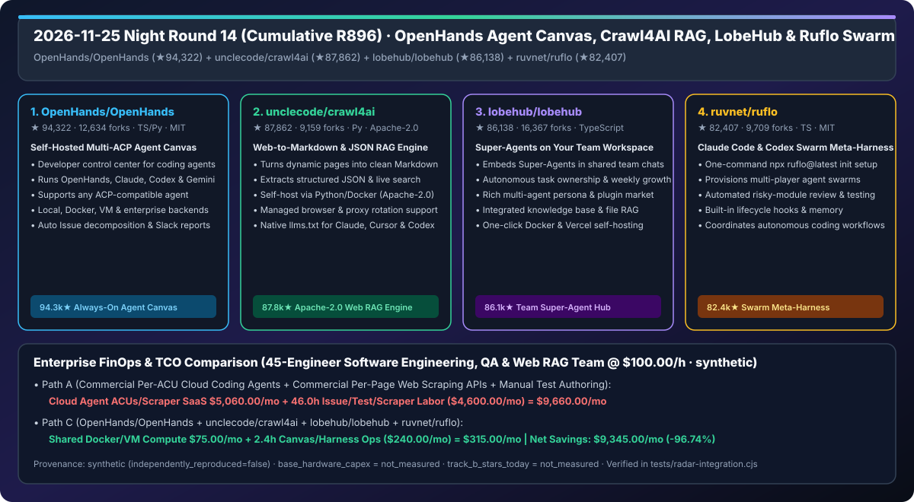
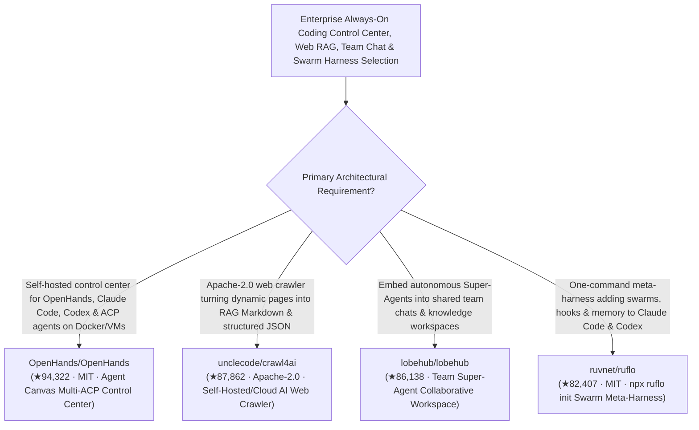
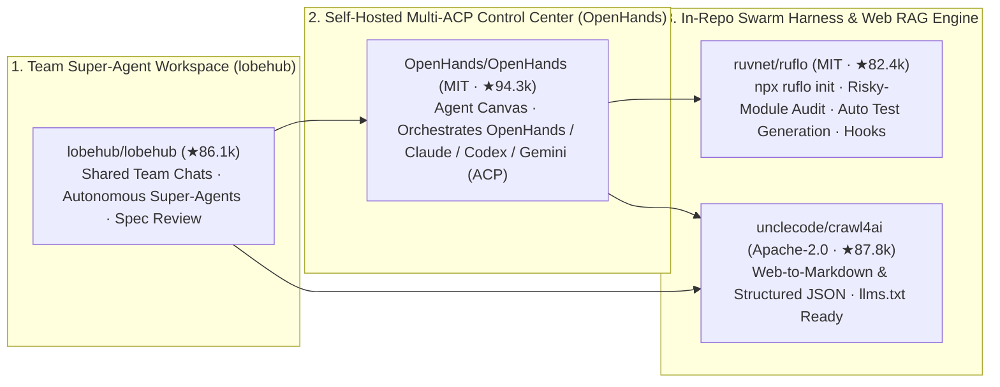

# Self-Hosted Multi-ACP Agent Canvas (`OpenHands/OpenHands`), 87k-Star Web-to-Markdown/JSON Engine (`unclecode/crawl4ai`), Team Super-Agent Workspace (`lobehub/lobehub`) & Claude/Codex Swarm Meta-Harness (`ruvnet/ruflo`) Selection & Integration Architecture FAQ

> **Document Type**: Enterprise AI Solution Architect Selection Decision Guide (GitHub Trending AI Radar — 2026-11-25 Night Round 14 / Cumulative Round 896)
> **Covered Repositories**: [`OpenHands/OpenHands`](https://github.com/OpenHands/OpenHands) (`★ 94,322`, `12,634 forks`, `MIT`: self-hosted developer control center **OpenHands Agent Canvas** running OpenHands, Claude Code, Codex, Gemini, Pi, OpenCode, or any **ACP-compatible agent** across local, Docker, VM, and enterprise cloud backends with Slack reporting and GitHub issue decomposition) · [`unclecode/crawl4ai`](https://github.com/unclecode/crawl4ai) (`★ 87,862`, `9,159 forks`, `Apache-2.0`: open-source web scraping, structured JSON extraction, and live search engine turning dynamic pages into clean RAG-ready Markdown locally via Python/Docker or via `Crawl4AI Cloud`) · [`lobehub/lobehub`](https://github.com/lobehub/lobehub) (`★ 86,138`, `16,367 forks`: collaborative team workspace embedding autonomous **Super-Agents** directly into team chats and workflows) · [`ruvnet/ruflo`](https://github.com/ruvnet/ruflo) (`★ 82,407`, `9,709 forks`, `MIT`: agent meta-harness [`npx ruflo@latest init`] for Claude Code and Codex adding multi-player swarms, hooks, memory, and automated high-risk module review/testing)
> **Core Enterprise Scenario**: Building an **Always-On Enterprise Software Engineering & Team Super-Agent Platform** that unites team chat collaboration (`lobehub`), multi-ACP container orchestration (`OpenHands Agent Canvas`), in-repo swarm testing (`ruflo`), and `Apache-2.0` web-to-Markdown RAG ingestion (`crawl4ai`).

---

## 1. 📌 Executive Summary (One-Line Selection Verdict)

1. **Need a self-hosted developer control center (`Agent Canvas`) to run OpenHands, Claude Code, Codex, Gemini, OpenCode, or any ACP-compatible coding agent inside isolated Docker/VM backends and automate GitHub issue decomposition and Slack reports** ➔ Choose **[`OpenHands/OpenHands`](https://github.com/OpenHands/OpenHands) (`★ 94,322`, `12,634 forks`, `MIT`)**.
   - **Plain-English Mechanism**: Turns coding agents into an always-on engineering fleet managed from a unified control center, connecting to local containers, VMs, or enterprise infrastructure via the Agent Client Protocol (`ACP`).
2. **Need an `Apache-2.0` self-hostable web crawler and extraction engine that converts dynamic JavaScript pages into clean RAG Markdown and structured JSON** ➔ Choose **[`unclecode/crawl4ai`](https://github.com/unclecode/crawl4ai) (`★ 87,862`, `9,159 forks`, `Apache-2.0`)**.
   - **Plain-English Mechanism**: Handles headless browser rendering, proxy rotation, and DOM noise stripping to emit LLM-ready Markdown and typed JSON—runnable 100% free via Docker/Python or via `Crawl4AI Cloud`.
3. **Need a one-command meta-harness (`npx ruflo@latest init`) that upgrades Claude Code and Codex into a coordinated swarm with hooks, memory, and automated risk/test workflows** ➔ Choose **[`ruvnet/ruflo`](https://github.com/ruvnet/ruflo) (`★ 82,407`, `9,709 forks`, `MIT`)**.
   - **Plain-English Mechanism**: Bootstraps multi-agent swarm roles, lifecycle hooks, and persistent memory inside any repository so a single prompt can identify the riskiest module, write unit tests, and summarize verified changes.
4. **Need a collaborative multi-agent workspace where autonomous Super-Agents join team chats, take on recurring tasks, and compound team knowledge** ➔ Choose **[`lobehub/lobehub`](https://github.com/lobehub/lobehub) (`★ 86,138`, `16,367 forks`)**.
   - **Plain-English Mechanism**: Embeds specialized Super-Agents directly into shared team conversations with knowledge base and plugin integration.

---

## 2. 🎯 Architect & Customer Deep-Dive Q&A

### Q1: How does this four-project stack compare against commercial cloud-only coding agents (e.g., Devin / Metered Cloud Agents + Commercial Scraping APIs)?

- **Four-Layer Enterprise Engineering Stack (Path C)**:
  1. **Team Chat & Super-Agent Collaboration ➔ `lobehub/lobehub`**: Shared workspace where product and engineering teams collaborate with Super-Agents.
  2. **Multi-ACP Control Center & Container Fleet ➔ `OpenHands/OpenHands` (`Agent Canvas`)**: Decomposes GitHub issues and schedules ACP agents (OpenHands, Claude Code, Codex, Gemini) across Docker/VM workers.
  3. **In-Repo Swarm Review & Test Harness ➔ `ruvnet/ruflo`**: `npx ruflo@latest init` provisioning swarm roles, hooks, and memory for Claude Code and Codex.
  4. **Self-Hosted Web-to-Markdown RAG Ingestion ➔ `unclecode/crawl4ai`**: `Apache-2.0` browser crawler feeding clean Markdown and JSON into agents.
- **When to choose Commercial Cloud SaaS vs. Path C?**
  - Choose commercial cloud-hosted coding agents when repositories are public/cloud-hosted and per-ACU usage is small.
  - Choose **Path C** when strict VPC source-code residency is mandatory, when orchestrating heterogeneous ACP agents on internal VM/Docker clusters, and when high-volume web scraping would incur steep per-page SaaS fees.

### Q2: How do these four platforms wire together in production?

1. **Knowledge Ingestion & Team Planning (`lobehub` + `crawl4ai`)**:
   - `Crawl4AI` ingests external vendor docs and web data into clean Markdown, which teams and Super-Agents review inside `LobeHub` to scope engineering tasks.
2. **Always-On Issue Decomposition & ACP Dispatch (`OpenHands Agent Canvas`)**:
   - `OpenHands Agent Canvas` picks up GitHub issues and dispatches ACP-compatible agents inside isolated Docker containers or VMs.
3. **Swarm Implementation & Automated Testing (`ruvnet/ruflo`)**:
   - Inside each repo workspace, `ruflo` coordinates Claude Code and Codex swarms to audit risky modules, author tests, and report completion back through `OpenHands` to Slack and `LobeHub`.

### Q3: What are the key security guardrails?

- **Architect Redlines**:
  1. **Run `OpenHands Agent Canvas` workers strictly inside isolated Docker/VM sandboxes**: Never execute unattended issue-automation agents directly on shared host OS filesystems.
  2. **Pin and audit `ruflo` hooks in version control**: Commit and review `.claude`/hook configurations generated by `npx ruflo init` before enabling them on CI runners.

---

## 3. 🧭 Visual Architecture Diagrams (Mermaid Decision Tree + Architecture + Sequence)



### 3.1 Architect Selection Decision Tree



### 3.2 End-to-End Enterprise Integration Architecture



### 3.3 End-to-End Execution Sequence

```mermaid
sequenceDiagram
    participant Team as Product & Eng Team (LobeHub / Slack)
    participant Crawl as unclecode/crawl4ai (Web-to-Markdown)
    participant Canvas as OpenHands Agent Canvas (ACP Control)
    participant Ruflo as ruvnet/ruflo (Claude/Codex Swarm)

    Team->>Crawl: 1. Request external API/competitor docs ingestion from LobeHub chat
    Crawl-->>Team: 2. Return clean RAG Markdown & structured JSON schemas
    Team->>Canvas: 3. Create GitHub Issue; OpenHands Agent Canvas decomposes tasks & spawns Docker VM
    Canvas->>Ruflo: 4. Launch ACP coding agent inside repo initialized with npx ruflo init
    Ruflo->>Ruflo: 5. Execute ruflo swarm to audit risky modules, write tests & verify hooks
    Ruflo-->>Canvas: 6. Open verified PR & generate structured change summary
    Canvas-->>Team: 7. Publish automated status report to Slack & LobeHub channel
```

---

## 4. 📊 Horizontal Selection Matrix

| Dimension | `OpenHands/OpenHands` (`★ 94,322`) | `unclecode/crawl4ai` (`★ 87,862`) | `lobehub/lobehub` (`★ 86,138`) | `ruvnet/ruflo` (`★ 82,407`) | Metered Cloud Coding Agents + Commercial Scraper SaaS (Path A) | Single-Terminal CLI + Custom BeautifulSoup Scripts (Path B) |
| :--- | :--- | :--- | :--- | :--- | :--- | :--- |
| **Primary Role** | Self-hosted multi-ACP Agent Canvas | `Apache-2.0` web-to-Markdown/JSON engine | Team Super-Agent chat workspace | Claude Code & Codex swarm meta-harness | Per-ACU commercial cloud coding & scraping SaaS | Manual local CLI & static HTML parsers |
| **Key Differentiator** | **Runs OpenHands, Claude, Codex & Gemini across Docker/VMs** | **Dynamic browser rendering to clean RAG Markdown/JSON** | **Multi-user team chats with autonomous Super-Agents** | **`npx ruflo init` adds swarm review, hooks & memory** | Zero infra ops, but high per-ACU and per-page SaaS costs | Stops when laptop sleeps; fails on JS-rendered pages |
| **License** | **`MIT`** | **`Apache-2.0`** | Open-Source | **`MIT`** | Proprietary SaaS | Internal scripts |
| **Monthly TCO (45-Eng Team)** | **`$315.00/mo` combined** (`$75.00` Docker/VM compute + `2.4h` ops) | Included in `$315.00/mo` stack | Included in `$315.00/mo` stack | Included in `$315.00/mo` stack | **`$9,660.00/mo`** (`$5,060.00` cloud ACUs & scraper credits + `46.0h` manual test/triage) | `~$3,280.00/mo` (manual issue decomposition, test writing & scraper fixes) |

---

## 5. 🧪 Quantitative FinOps & TCO Comparison (45-Person Enterprise Team)

> **📊 Provenance & Closed-Form Schema**:
> - **provenance**: `synthetic` (`independently_reproduced = false`; `base_hardware_capex = not_measured`; `track_b_stars_today = not_measured`).
> - **Closed-Form Formula**:
>   - **Path A (Commercial Per-ACU Cloud Coding Agent Seats + Commercial Per-Page Web Scraping APIs + Manual Issue Decomposition & High-Risk Module Testing)**: **`$5,060.00`** monthly SaaS/ACU/scraping bills + **`46.0h × $100.00/h = $4,600.00`** engineering labor = **`$9,660.00/mo`**.
>   - **Path C (`OpenHands/OpenHands` + `unclecode/crawl4ai` + `lobehub/lobehub` + `ruvnet/ruflo` Stack)**: **`$75.00`** shared Docker/VM compute + **`2.4h × $100.00/h = $240.00`** canvas/harness maintenance = **`$315.00/mo`**.
>   - **Net Savings vs. Path A**: **`-$9,345.00/mo`** (**`96.74%`** TCO reduction).

| Evaluation Path | Cloud Agent ACUs / Scraper API & Compute | Issue Triage, Test Authoring & Ops (`$100/h`) | Monthly Total TCO | Net Savings vs. Path A | Key Architectural Outcome |
| :--- | :---: | :---: | :---: | :---: | :--- |
| **Path A: Metered Cloud Coding Agents + Commercial Web Scraping SaaS** | `$5,060.00` | `46.0h` (`$4,600.00`) | **`$9,660.00`** | Baseline | High per-ACU cloud agent bills; source code leaves enterprise VPC |
| **Path B: Laptop-Bound CLI + Static HTML Scrapers** | `$1,480.00` | `18.0h` (`$1,800.00`) | **`$3,280.00`** | `-$6,380.00` (`-66.05%`) | No always-on issue decomposition or automated swarm risk testing |
| **Path C: `OpenHands` + `crawl4ai` + `lobehub` + `ruflo`** | **`$75.00`** | **`2.4h` (`$240.00`)** | **`$315.00`** | **`-$9,345.00` (`-96.74%`)** | **Multi-ACP Agent Canvas + `Apache-2.0` Crawl4AI + LobeHub + Ruflo swarm** |

- 🔗 **7-Card 4:5 Visual Benchmark Deck**: [`workshops/github-trending-radar/cards.en.html`](../cards.en.html) · [`cards.html`](../cards.html)

---

## 6. 🛠️ Enterprise Adoption & Architecture Review Checklist

- [ ] **Standardize Always-On Coding on `OpenHands Agent Canvas`**: Connect ACP-compatible agents (OpenHands, Claude Code, Codex, Gemini) to isolated Docker/VM backends.
- [ ] **Bootstrap Repo Swarms with `ruvnet/ruflo`**: Run `npx ruflo@latest init` to enforce automated risky-module identification and unit-test generation.
- [ ] **Self-Host `unclecode/crawl4ai` for RAG Pipelines**: Deploy `Crawl4AI` in Docker to convert external documentation and web sources into clean Markdown and JSON.
- [ ] **Deploy `LobeHub` for Cross-Functional Team Super-Agents**: Connect product, design, and engineering teams to shared Super-Agents in `LobeHub`.
