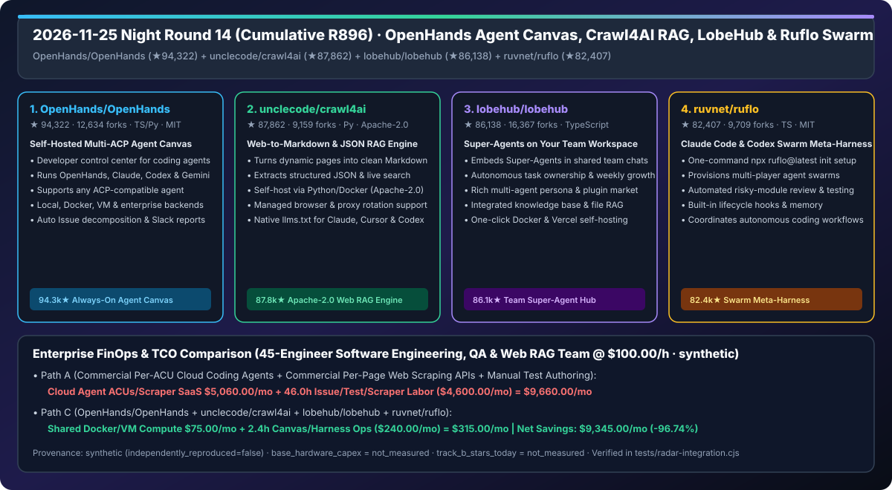
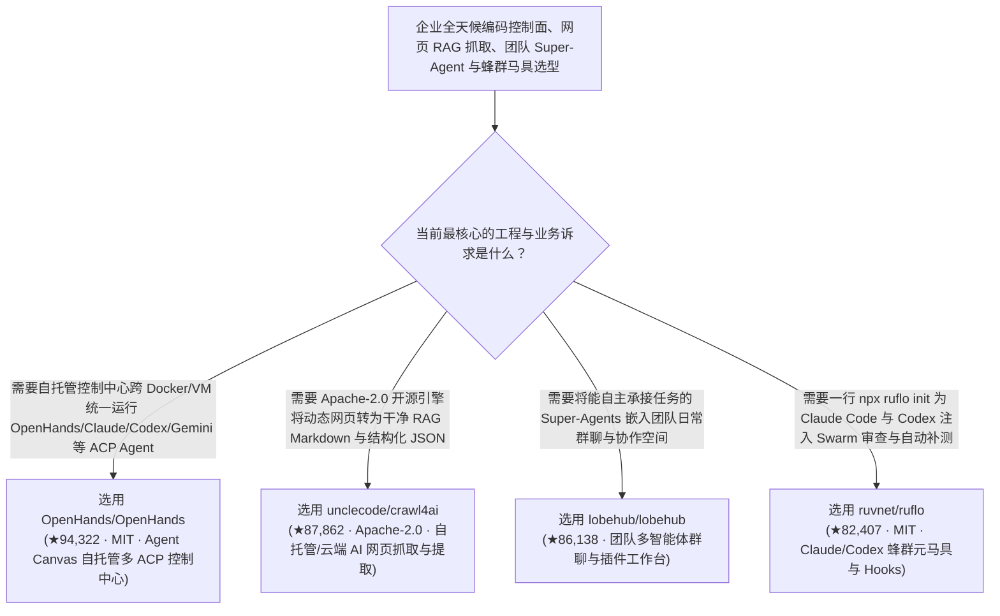
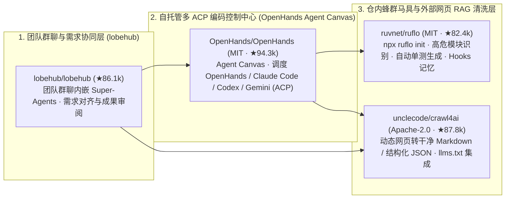
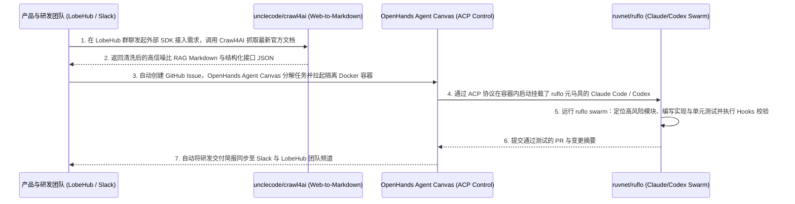

# 自托管多 ACP 编码智能体控制中心（`OpenHands/OpenHands`）、8.7 万星 RAG 网页转 Markdown/JSON 引擎（`unclecode/crawl4ai`）、嵌入式团队超级智能体协作空间（`lobehub/lobehub`）与 Claude/Codex 多智能体群智元马具（`ruvnet/ruflo`）选型与集成架构 FAQ

> **文档类型**：企业 AI 解决方案架构师（AI Solution Architect）选型决策指南（GitHub Trending AI 雷达 2026-11-25 Night Round 14 / 累计第 896 轮）
> **覆盖项目**：[`OpenHands/OpenHands`](https://github.com/OpenHands/OpenHands)（`★ 94,322`、`12,634 forks`、`MIT`：9.4 万星 AI 驱动软件研发平台，全新推出 **OpenHands Agent Canvas** 自托管开发者控制中心，跨本机、Docker 容器、VM 与企业内网统一调度 OpenHands、Claude Code、Codex、Gemini、Pi、OpenCode 及任意 **ACP 兼容智能体**）· [`unclecode/crawl4ai`](https://github.com/unclecode/crawl4ai)（`★ 87,862`、`9,159 forks`、`Apache-2.0`：8.7 万星专为 AI Agent 与 RAG 数据管线打造的开源网页抓取、结构化 JSON 提取与实时搜索框架，支持 Python/Docker 完全自托管或连接 `Crawl4AI Cloud`）· [`lobehub/lobehub`](https://github.com/lobehub/lobehub)（`★ 86,138`、`16,367 forks`：8.6 万星团队级超级智能体工作空间 [“Super-Agents on Your Team”]，将能自主承接任务并按周持续进化的超级智能体嵌入团队日常聊天与知识协同流）· [`ruvnet/ruflo`](https://github.com/ruvnet/ruflo)（`★ 82,407`、`9,709 forks`、`MIT`：8.2 万星面向 Claude Code 与 Codex 的智能体元马具 [`npx ruflo@latest init`]，一键为项目注入多智能体蜂群（Swarm）、生命周期 Hooks、持久化记忆与高风险模块自动化审查/补测工作流）
> **核心场景**：当企业研发与产品团队推进“全天候无人值守软件研发（Always-On Agentic Engineering）与团队群聊内嵌数字同事”时，架构师面临四个核心选型问题：**“如何把多个不同品牌的 ACP 编码 Agent 放进一套自托管控制画布（Agent Canvas）里跑日常巡检、拆解 GitHub Issue 并往 Slack 发周报（`OpenHands`）？如何在打开 Claude Code / Codex 前用一条命令初始化好蜂群分工、Hooks 与记忆规则（`ruflo`）？如何为这些 Agent 提供免费的 `Apache-2.0` 网页转 RAG Markdown 与结构化 JSON 清洗底座（`crawl4ai`）？非研发业务团队又该如何把 Super-Agent 拉进日常群聊里一起干活（`lobehub`）？”** 本文拆解这四大 8 万–9 万星头部开源项目的端到端组合架构。

---

## 一、📌 核心结论速览（选型一句话结论）

1. **需要一套 `MIT` 协议自托管的“研发智能体控制中心（Agent Canvas）”，在 Docker/VM/内网集群中常驻运行 OpenHands、Claude Code、Codex、Gemini、OpenCode 等任意 ACP 兼容智能体，并自动把 GitHub Issue 拆解为代码任务或定时往 Slack 发研发简报** ➔ 选 **[`OpenHands/OpenHands`](https://github.com/OpenHands/OpenHands)（`★ 94,322`，`12,634 forks`，`MIT`）**。
   - **通俗原理**：从单点编码 Agent 升级为多后端的 **Agent Canvas 控制中心**——开发者不用一直守着本地终端，可以在画布中启动常驻研发会话与自动化任务，后端执行体既可以是开源 OpenHands Agent，也可以通过 Agent Client Protocol (`ACP`) 直接挂载 Claude Code、Codex 或 Gemini。
2. **需要一套 `Apache-2.0` 完全开源、可本地 Docker 自托管的网页抓取与清洗引擎，把复杂动态网页一键转为干净的 RAG Markdown 或结构化 JSON** ➔ 选 **[`unclecode/crawl4ai`](https://github.com/unclecode/crawl4ai)（`★ 87,862`，`9,159 forks`，`Apache-2.0`）**。
   - **通俗原理**：专为大模型上下文设计，自动过滤网页噪音标签、处理无头浏览器渲染与代理轮换，输出极高信噪比的 Markdown 与 Schema 约束 JSON；既可在企业内网零费用自建，也提供兼容 Claude Code / Cursor / Codex (`llms.txt`) 的云端 API。
3. **希望在进入任何新老代码仓库时，只跑一行 `npx ruflo@latest init` 就为 Claude Code 和 Codex 装配好预设多角色 Swarm（如找出最高危模块 → 自动补齐单测 → 输出变更摘要）、Hooks 与记忆层** ➔ 选 **[`ruvnet/ruflo`](https://github.com/ruvnet/ruflo)（`★ 82,407`，`9,709 forks`，`MIT`）**。
   - **通俗原理**：作为架在 Claude Code 与 Codex 之上的 **Meta-Harness（元马具）**，把繁琐的多子 Agent 角色定义、钩子脚本与上下文记忆封装成开箱即用的工程脚手架，让单个编码 CLI 瞬间拥有多角色蜂群审查与测试生成能力。
4. **需要为全公司产品、设计、运营与研发团队提供一套美观易用的多智能体协同工作台，让“超级智能体（Super-Agents）”直接进驻团队群聊主动承接工作** ➔ 选 **[`lobehub/lobehub`](https://github.com/lobehub/lobehub)（`★ 86,138`，`16,367 forks`）**。
   - **通俗原理**：将传统的“一对一 AI 聊天”升级为“团队群聊中的数字同事”，支持丰富的插件生态、知识库挂载与多智能体角色市场，让业务与研发在同一对话空间内协同。

---

## 二、🎯 客户与架构师灵魂拷问 Q&A（深度架构拆解）

### Q1：在企业构建“全天候 AI 研发与团队协作平台”时，这四个开源项目 vs 商业云端编码 Agent（如 Devin / GitHub Copilot Coding Agent + 商业爬虫 API）怎么选？

- **四层协同参考架构（Path C）**：
  1. **跨职能团队群聊与超级智能体入口 ➔ `lobehub/lobehub`**：业务与产品团队在群聊中协同定义需求并唤醒专属 Super-Agent。
  2. **自托管多 ACP 研发控制中心与容器后端 ➔ `OpenHands/OpenHands` (Agent Canvas)**：接收 GitHub Issues 与定时自动化任务，在隔离 Docker/VM 中调度 OpenHands、Claude Code、Codex 与 Gemini。
  3. **仓库级 Claude/Codex 蜂群元马具 ➔ `ruvnet/ruflo`**：在每个代码仓通过 `npx ruflo@latest init` 注入高危模块识别、自动补测与 Hooks 护栏。
  4. **外部技术文档与网页 RAG 清洗底座 ➔ `unclecode/crawl4ai`**：为研发与业务 Agent 实时抓取并清洗外部 API 文档、竞品网页与行业数据。
- **何时选云厂商托管方案（GitHub Copilot Coding Agent + Azure AI） vs 自建本轮开源四件套（Path C）？**
  - 若企业代码 100% 托管在 GitHub Cloud 且希望免容器运维直接把 Issue 分配给云端 Copilot，官方 **GitHub Copilot Coding Agent** 最省心。
  - **何时采用本轮开源四件套（Path C）？** 当企业需要**在内网自托管虚拟机/Docker 集群上混合调度多种 ACP 编码智能体（OpenHands + Claude Code + Codex + Gemini + OpenCode）**、需要 `Apache-2.0` 本地大规模网页抓取清洗管线（`crawl4ai`）、并希望通过 `ruflo` 标准化每个仓库的蜂群测试护栏时，Path C 可节省 **96%+** 的商业云端沙箱与爬虫 API 费用。

### Q2：如何将这四个项目端到端集成进企业生产流水线？

1. **需求协同与外部知识抓取（`lobehub/lobehub` + `unclecode/crawl4ai`）**：
   - 产品与架构师在 `LobeHub` 团队空间讨论方案，调用自托管 `Crawl4AI` 容器将外部第三方 SDK 文档与行业标准网页实时转换为干净 Markdown 存入知识库。
2. **Issue 自动拆解与多 ACP 容器调度（`OpenHands Agent Canvas`）**：
   - 确认的需求转化为 GitHub Issues，`OpenHands Agent Canvas` 自动触发分解流程，在企业内网 Docker/VM 后端拉起对应的 ACP 编码智能体。
3. **仓内蜂群审查与测试闭环（`ruvnet/ruflo`）**：
   - 容器内的 Claude Code / Codex 通过 `ruflo` 元马具启动 Swarm：自动定位改动涉及的高风险模块、编写单元测试、执行 Hooks 校验，并将最终总结报告通过 `OpenHands Agent Canvas` 推送回团队 Slack / LobeHub 频道。

### Q3：生产落地的安全与隔离红线是什么？

- **架构师避坑红线**：
  1. **`OpenHands Agent Canvas` 强制使用隔离 Docker/VM 后端**：在企业生产环境中运行无人值守编码任务时，务必将 `OpenHands` 配置为连接容器化或独立 VM 后端，严禁让常驻自动化任务直接在宿主机裸跑。
  2. **`ruflo` Hooks 与外部包版本锁定**：在企业代码仓运行 `npx ruflo` 初始化时，应将生成的 `.claude` / Hooks 脚本纳入代码审查并锁定内部私有 npm 镜像源版本。

---

## 三、🧭 直观可视化图解（Mermaid 决策树 + 集成架构 + 时序图）

### 3.1 架构师选型决策树

### 3.2 企业端到端生产集成参考架构图

### 3.3 团队群聊立项、Crawl4AI 抓取文档、OpenHands 容器调度与 Ruflo 蜂群补测时序图

---

## 四、📊 同类开源与商业云服务横向选型决策矩阵

| 对比维度 | `OpenHands/OpenHands` (`★ 94,322`) | `unclecode/crawl4ai` (`★ 87,862`) | `lobehub/lobehub` (`★ 86,138`) | `ruvnet/ruflo` (`★ 82,407`) | 按席位/按 ACU 计费的商业云端编码 Agent 与爬虫 SaaS (Path A) | 本地单终端手动盯跑 + 手写 BeautifulSoup 爬虫 (Path B) |
| :--- | :--- | :--- | :--- | :--- | :--- | :--- |
| **核心能力定位** | 自托管多 ACP 编码智能体控制中心 | `Apache-2.0` 网页转 Markdown/JSON 引擎 | 团队群聊内嵌 Super-Agent 工作台 | Claude Code / Codex 蜂群元马具 | 高价按算力单元计费的闭源云端软件工程 SaaS | 单人本机串行跑 CLI + 手写静态 HTML 解析 |
| **差异化杀手锏** | **Agent Canvas 统管任意 ACP 智能体与 Docker/VM 后端** | **专为 RAG 优化的动态网页清洗 + 自托管零按次费** | **把多个 Super-Agent 拉进同一个团队聊天室协作** | **一条 `npx ruflo init` 注入 Swarm 风险审查与补测** | 免基础设施维护，但商业云端编码按小时/ACU 计费极贵 | 关机即断；静态爬虫抓不到现代 SPA 动态渲染网页 |
| **开源协议** | **`MIT`** | **`Apache-2.0`** | Open-Source | **`MIT`** | 闭源商业 SaaS | 内部脚本 |
| **月度 TCO（45 人团队）** | **四件套合建仅 `$315.00/月`**（`$75.00` 容器/无头浏览器算力 + `2.4h` 维护） | 同左（`Apache-2.0` 自建免按页抓取费） | 同左（私有化团队空间零人头税） | 同左（`MIT` 免费升级仓内多 Agent 蜂群） | **`$9,660.00/月`**（`$5,060.00` 商业云端编码 ACU 与商业爬虫 API + `46.0h` 人工补测排障） | 约 `$3,280.00/月`（人工拆解 Issue、补写漏测与维护爬虫工时） |

---

## 五、🧪 应用落地定量收益/TCO 对比与 7-Card 报告

> **📊 数据来源与闭式核算声明（Provenance & Closed-Form Schema）**：
> - **provenance**: `synthetic`（基于 45 人企业全栈软件工程、外部技术情报 RAG 与自动化 QA 团队月度工作负载模型：`independently_reproduced = false`；硬件采购基线 `base_hardware_capex = not_measured`；Track B 单日增量 `track_b_stars_today = not_measured`）。
> - **核算公式**：
>   - **Path A（采购按算力单元高价计费的商业云端无人值守编码 SaaS + 按页计费商业网页提取 API + 缺乏高危模块自动补测导致线上缺陷返工）**：月度商业云端编码席位/ACU 与爬虫 API 账单 **`$5,060.00`** + 手工拆解 Issue、补写高危模块单测与网页清洗排障人工 **`46.0h × $100.00/h = $4,600.00`** = **`$9,660.00/月`**。
>   - **Path C（自建 `OpenHands/OpenHands` + `unclecode/crawl4ai` + `lobehub/lobehub` + `ruvnet/ruflo` 企业级全天候研发与协同底座）**：内网 Docker/VM 容器算力分摊 **`$75.00`** + 画布与马具配置维护人工 **`2.4h × $100.00/h = $240.00`** = **`$315.00/月`**。
>   - **净节省（Net Savings vs Path A）**：**`-$9,345.00/月`**（成本降低 **`96.74%`**）。

| 评估方案 | 云端编码 SaaS / 爬虫 API 与算力成本 | Issue 拆解、高危补测与清洗人工（`$100/h`） | 月度总 TCO | 相对 Path A 净节省 | 核心架构交付收益 |
| :--- | :---: | :---: | :---: | :---: | :--- |
| **Path A：商业按量云端编码 Agent + 商业按页爬虫 SaaS** | `$5,060.00` | `46.0h` (`$4,600.00`) | **`$9,660.00`** | Baseline | 商业云端编码 ACU 账单高昂；内网代码库不便出域 |
| **Path B：本机单窗口串行 CLI + 手写静态爬虫脚本** | `$1,480.00` | `18.0h` (`$1,800.00`) | **`$3,280.00`** | `-$6,380.00` (`-66.05%`) | 无法全天候后台自动分解 Issue；缺乏 `ruflo` 蜂群自动补测 |
| **Path C：`OpenHands` + `crawl4ai` + `lobehub` + `ruflo`** | **`$75.00`** | **`2.4h` (`$240.00`)** | **`$315.00`** | **`-$9,345.00` (`-96.74%`)** | **多 ACP 控制画布 + `Apache-2.0` 网页清洗 + 团队群聊 + 蜂群补测** |

- 🔗 **关联 7-Card 4:5 视觉评测报告**：[`workshops/github-trending-radar/cards.html`](../cards.html) · [`cards.en.html`](../cards.en.html)

---

## 六、🛠️ 企业引入与架构评审 Checklist

- [ ] **通过 `OpenHands Agent Canvas` 统一纳管多 ACP 编码后端**：将团队使用的 OpenHands、Claude Code、Codex 与 OpenCode 统一注册到自托管 Agent Canvas，并绑定隔离 Docker 容器池。
- [ ] **在核心代码仓初始化 `ruvnet/ruflo` 风险模块补测流**：对每个微服务仓库运行 `npx ruflo@latest init`，要求 PR 合并前由 Ruflo Swarm 自动识别高风险模块并补齐边界单测。
- [ ] **内网容器化部署 `unclecode/crawl4ai`**：用自托管 `Crawl4AI` Docker 服务统一承接企业外部网页转 Markdown 与 JSON 抽取需求，并在编码 IDE 中挂载其 `llms.txt` 规范。
- [ ] **在 `LobeHub` 中按部门配置专属 Super-Agent 角色与知识库权限**：实现业务需求讨论、文档检索与研发任务派发的同群闭环。
