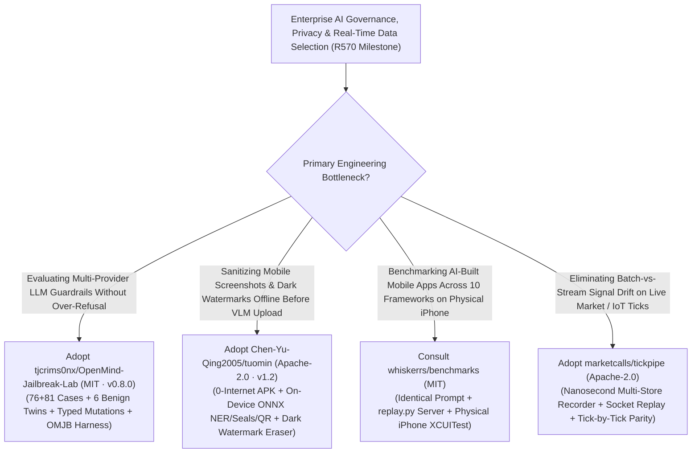
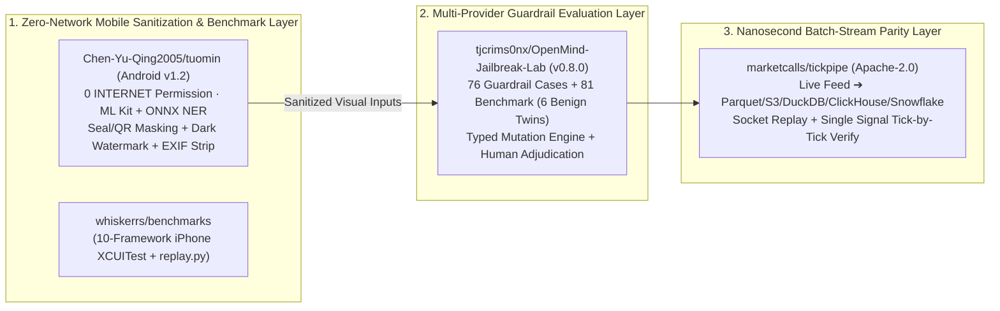
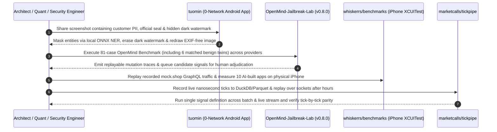

# [Round 570 Milestone] Benign-Twin Guardrail Evaluation Lab (`tjcrims0nx/OpenMind-Jailbreak-Lab`), Zero-Network Android Screenshot & Dark-Watermark Sanitizer (`Chen-Yu-Qing2005/tuomin`), 10-Framework iPhone AI App Benchmark (`whiskerrs/benchmarks`) & Nanosecond Batch-Stream Parity Engine (`marketcalls/tickpipe`) Selection FAQ

> **Document Type**: AI Solution Architect (SA) Practical Selection & Reference Architecture Guide (2026-11-20 Night Shift · Round 11 / Cumulative Round 570 Milestone)  
> **Benchmark Standard**: `docs/components/ib-vs-ethernet-roce-selection-faq.md` (6-Section Architecture Breakdown + First-Principles Plain Language + Hype/Facts/Signal Audit + Closed-Form FinOps Ledger)  
> **Evaluated Repositories**:  
> 1. **`tjcrims0nx/OpenMind-Jailbreak-Lab`** (`★ 42`, `5 forks`, Python 3.10+, `MIT`, `v0.8.0`): Provider-neutral AI security and guardrail evaluation workbench—shipping **76 runnable Guardrail Lab cases**, **81 versioned OpenMind Benchmark cases (including 6 matched benign twins to measure false-positive over-refusals)**, a typed replayable mutation engine, and the `OMJB harness` CLI & human-adjudicated evidence store  
> 2. **`Chen-Yu-Qing2005/tuomin`** (`★ 124`, `16 forks`, Kotlin + Jetpack Compose + ML Kit + ONNX Runtime Mobile, `Apache-2.0`, `v1.2`): **Zero-network Android local screenshot privacy sanitizer (`0` `INTERNET` or `ACCESS_NETWORK_STATE` permissions in APK)**—detecting phone numbers, WeChat ID variants, names, addresses, official seals, and QR/barcodes on-device, **inspecting and erasing hidden dark watermarks**, and redrawing the image on Android Canvas to strip all EXIF/GPS metadata  
> 3. **`whiskerrs/benchmarks`** (`★ 16`, `3 forks`, Swift / Python, `MIT`): **10-framework AI mobile app benchmark measured on a physical iPhone**—building the exact same Shopify storefront app from one identical prompt across React Native, Flutter, Whisker, Native Shell, NativeScript, Exact, UIKit, SwiftUI, NativePHP, and DartNative, and measuring real device performance against a deterministic `replay.py` server via `XCUITest`  
> 4. **`marketcalls/tickpipe`** (`★ 16`, `4 forks`, Python, `Apache-2.0`): Nanosecond-exact live tick recorder, 10+ store sink (`Parquet`, `S3`, `DuckDB`, `SQLite`, `PostgreSQL`, `QuestDB`, `ClickHouse`, `Snowflake`, `kdb+`), socket replayer, and **tick-by-tick batch-vs-stream parity verifier**—running a single signal definition (`as-of join`, window sums) over both historical stores and live socket streams to eliminate rewrite drift  
> **Accounting Note**: This report models software compute, SaaS subscriptions, and engineering labor TCO only; underlying server and workstation hardware purchases (`base hardware capEx`) are explicitly marked `not_measured`, and Track B 24h delta (`stars_today`) is marked `not_measured`.

---

## 📌 1. Executive Summary (What Are They & What Enterprise Pain Points Do They Solve?)

In **Cumulative Round 570 Milestone (2026-11-20 Night Round 11)**, we tackle four high-stakes enterprise engineering challenges across LLM guardrail verification, mobile visual privacy, AI-generated mobile framework selection, and streaming data parity:

1. **Pain Point A (Enterprise safety teams tuning LLM guardrails either miss mutated prompt injections or set filters so aggressively that legitimate developer/customer queries are falsely refused—while automated regex judges misclassify safe explanations as jailbreaks)**: Guardrail benchmarks must pair adversarial prompts with **matched benign twins** and require human adjudication. **`tjcrims0nx/OpenMind-Jailbreak-Lab` (`★ 42`, MIT, `v0.8.0`)** provides a 76-case Guardrail Lab and an 81-case versioned benchmark (`v0.8.0` with **6 matched benign twins**), a typed replayable mutation engine, and the `OMJB harness` enforcing the rule that *"a suspicious response is a candidate signal, not proof—automated heuristics never replace human adjudication."*
2. **Pain Point B (Field staff and support engineers sharing mobile screenshots into multimodal LLMs or external chats inadvertently leak customer names, WeChat IDs, official red seals, invisible employee-ID dark watermarks, and EXIF GPS coordinates—while cloud redaction tools require uploading the raw unredacted image first)**: A screenshot redaction tool must have zero network permissions. **`Chen-Yu-Qing2005/tuomin` (`★ 124`, `16 forks`, Apache-2.0, `v1.2`)** ships an Android APK with **zero `INTERNET` or `ACCESS_NETWORK_STATE` permissions** (verified at build time along with local NER model hashes)—combining Google ML Kit OCR, quantized Chinese ONNX NER, QR/barcode/seal detection, **dark-watermark visual inspection and erasure**, and full Canvas redrawing that strips all EXIF/device metadata.
3. **Pain Point C (Architects choosing a cross-platform mobile framework for AI-assisted app development lack apples-to-apples physical-device measurements comparing how well coding agents build identical apps across React Native, Flutter, SwiftUI, and newer frameworks)**: Benchmark the full "Prompt → AI Build → Physical iPhone XCUITest" loop against recorded network traffic. **`whiskerrs/benchmarks` (`★ 16`, MIT)** builds the exact same Shopify storefront (`mock.shop` GraphQL) across **10 mobile frameworks**, locks network variance with `tools/replay/replay.py`, and captures reproducible traces on a physical iPhone via `XCUITest` (`tools/bench.py`).
4. **Pain Point D (Quantitative finance, risk, and real-time IoT teams write feature/signal logic twice—once in batch SQL/Pandas for backtesting and again in streaming code for production—introducing window-edge drops, lookahead quote joins, and floating-point running-sum drift)**: Write the signal once and prove tick-by-tick parity across batch and stream. **`marketcalls/tickpipe` (`★ 16`, Apache-2.0)** records live ticks with nanosecond precision into 10+ backends (`Parquet`, `S3`, `DuckDB`, `ClickHouse`, `QuestDB`, `Snowflake`, `kdb+`), replays recorded sessions over sockets after hours at any speed, and executes the **exact same signal code over stored ticks and live socket streams to verify tick-by-tick numerical identity**.

---

## 💬 2. Architect & Customer First-Principles Q&A (Q1–Q3)

### Q1: Why are `OpenMind-Jailbreak-Lab`'s "Matched Benign Twins" and human adjudication gate essential before deploying enterprise AI guardrails?
* **Balancing Security Recall Against Business Precision**:
  Evaluating a guardrail solely on adversarial attack prompts rewards trivial "refuse everything" filters. By pairing adversarial test cases with **6 matched benign twins** (prompts that share vocabulary or structure with attacks but represent benign enterprise tasks) and routing candidate signals to human adjudication inside `OMJB harness`, architects measure both security efficacy and false-positive business disruption.

### Q2: How does `Chen-Yu-Qing2005/tuomin` protect enterprise mobile workflows from multimodal PII and watermark leaks?
* **Three-Layer On-Device Defense**:
  1. **Build-Time Zero-Network Guarantee**: Strips `INTERNET` and `ACCESS_NETWORK_STATE` permissions from the merged Android manifest and verifies ONNX model hashes at build time.
  2. **Multimodal Entity & Seal Detection**: Runs ML Kit + quantized ONNX NER on-device to mask phone numbers, emails, IDs, WeChat handles, QR codes, and official corporate seals.
  3. **Dark Watermark Erasure & Canvas Re-Render**: Exposes faint background watermarks for removal and redraws the final bitmap onto a fresh Canvas to eliminate EXIF/GPS metadata.

### Q3: What causes "Batch-Stream Skew" in real-time AI/quant pipelines, and how does `marketcalls/tickpipe` eliminate it?
* **Four Sources of Rewrite Drift Eliminated by `tickpipe`**:
  - Boundary conditions (a tick sitting on a window edge kept in batch but dropped in stream);
  - Lookahead bias (matching a trade to a quote that had not yet arrived on the wire);
  - Floating-point drift (running incremental sums vs. batch summation);
  - Unnoticed wire drops. `tickpipe` runs one shared signal definition (`as-of join`, features, window sums) against both stored nanosecond ticks and socket-replayed streams, asserting exact tick-by-tick equality.

---

## 🧭 3. Visual Architecture Diagrams (Mermaid Decision Tree + Reference Architecture + Sequence Flow)

### 3.1 Enterprise Guardrail Eval, Mobile Privacy, App Benchmarking & Stream Parity Decision Tree

### 3.2 End-to-End Enterprise Mobile Sanitization, Guardrail Lab & Stream Parity Architecture

### 3.3 End-to-End Mobile Screenshot Redaction, Guardrail Twin Eval & Tick-Parity Verification Sequence

---

## 📊 4. Comparative Selection Matrix (Open Source vs. Cloud SaaS & Dual-Rewrite Pipelines)

| Evaluation Dimension | Path A: Attack-Only Eval Prompts + Cloud Image Redaction + Unmeasured Framework Picks + Dual Batch/Stream Code | Path B: Static Red-Team Lists + Manual Image Blurring + Simulator-Only Builds + Manual Log Spot-Checks | **Path C (Recommended): `OpenMind-Jailbreak-Lab` + `tuomin` + `whiskerrs/benchmarks` + `tickpipe`** |
| :--- | :--- | :--- | :--- |
| **Guardrail Robustness & False-Positive Control** | ❌ Attack-only tests cause over-refusal of legitimate enterprise prompts | ⚠️ Automated regex judges misclassify safe explanations without human review | ✅ **76+81 cases + 6 matched benign twins + typed mutations + human adjudication** |
| **Mobile Screenshot & Watermark Privacy** | ❌ Uploading raw screenshots to cloud DLP leaks PII before redaction | ⚠️ Manual brush blurring misses faint dark watermarks and retains EXIF GPS tags | ✅ **Zero-internet APK + local ONNX NER/seals/QR + dark-watermark erasure + Canvas redraw** |
| **Cross-Platform AI Mobile Framework Selection** | ❌ Subjective framework debates without physical-device AI build telemetry | ⚠️ Simulator-only checks miss real iPhone thermal/frame-rate and network replay parity | ✅ **10 frameworks built from 1 prompt, tested against `replay.py` on a physical iPhone** |
| **Batch-vs-Stream Feature/Signal Parity** | ❌ Rewriting research code for streaming causes window-edge and lookahead drift | ⚠️ Cannot test live tick pipelines after market hours | ✅ **Nanosecond recording to 10+ stores + socket replay + tick-by-tick parity verification** |
| **Open-Source Licensing** | Proprietary SaaS | Mixed scripts | **`MIT` (`OpenMind-Jailbreak-Lab`, `whiskerrs/benchmarks`) & `Apache-2.0` (`tuomin`, `tickpipe`)** |
| **45-Engineer Team Monthly Total TCO** | **`$7,320.00 / mo`** (`$3,220.00` over-refusal retries, cloud DLP & drift losses + `41.0h / $4,100.00` rework) | **`$2,790.00 / mo`** (`$1,240.00` cloud eval/storage + `15.5h / $1,550.00` dual-code maintenance) | **`$330.00 / mo`** (`$80.00` bounded eval/local compute + `2.5h / $250.00` adjudication, **saving `-95.49%`**) |

---

## 🧪 5. Quantitative ROI / FinOps TCO Ledger & Hype / Facts / Signal Audit

### 5.1 Hype vs. Facts vs. Strategic Signal Audit Table

| Repository (`owner/repo`) | Hype (Market Claim) | Measured Facts (Primary Source Verification) | Strategic Signal (SA Verdict) |
| :--- | :--- | :--- | :--- |
| **`tjcrims0nx/OpenMind-Jailbreak-Lab`** | "Probe the boundary, measure the response, preserve the evidence across multiple model providers" | `★ 42` (`created=2026-11-14`, `5 forks`, Python 3.10+, MIT, `v0.8.0`): 76 Guardrail Lab cases + 81 OpenMind Benchmark cases (6 matched benign twins), `OMJB harness`, typed mutation engine, and browser/HF Spaces dashboard. | **🔥 P0 Adopt (Standard Multi-Provider Guardrail Regression Suite)**: Matched benign twins prevent security teams from breaking normal business usability. |
| **`Chen-Yu-Qing2005/tuomin`** | "Zero-internet Android local screenshot privacy sanitizer with dark-watermark removal" | `★ 124` (`created=2026-11-16`, `16 forks`, Kotlin, Apache-2.0, `v1.2`): APK strips `INTERNET` and `ACCESS_NETWORK_STATE`; runs ML Kit + quantized ONNX Chinese NER + seal/QR detection + dark-watermark erasure + EXIF-stripping Canvas redraw. | **🔥 P0 Adopt (On-Device Visual Privacy Firewall)**: Mandatory pre-upload sanitizer before mobile screenshots enter multimodal LLM workflows. |
| **`whiskerrs/benchmarks`** | "The same shop app built by an AI in 10 cross-platform frameworks, measured on a physical iPhone" | `★ 16` (`3 forks`, Swift/Python, MIT): Evaluates React Native, Flutter, Whisker, Native Shell, NativeScript, Exact, UIKit, SwiftUI, NativePHP, and DartNative using `prompt/`, `tools/replay/replay.py`, and `XCUITest`. | **🔥 P0 Borrow Methodology (Reproducible AI Framework Benchmarking)**: Use `replay.py` + `XCUITest` to benchmark AI-generated mobile apps deterministically. |
| **`marketcalls/tickpipe`** | "Record live ticks, replay them as a market simulator, and prove tick-by-tick parity between backtest and live stream" | `★ 16` (`created=2026-11-19`, `4 forks`, Python, Apache-2.0): Nanosecond recording across Parquet, S3, DuckDB, SQLite, PG, QuestDB, ClickHouse, SQL Server, Snowflake, and kdb+; socket replay and single-codebase tick-by-tick parity check. | **🔥 P0 Adopt (Zero-Drift Streaming Feature & Signal Verifier)**: Eliminates the costly rewrite gap between research backtests and live streaming production. |

### 5.2 Closed-Form FinOps TCO Ledger (`CLAIM-20261120-R11-R570-OPENMINDLAB-TUOMIN-WHISKERRS-TICKPIPE`)

* **Scope (`synthetic`, `independently_reproduced=false`)**: 45-engineer enterprise AI governance, mobile privacy, cross-platform mobile, and real-time data engineering team (`$100.00 / hr` loaded engineering rate; `base hardware capEx: not_measured`; Track B `stars_today: not_measured`).
* **Path A (Unbounded Red-Team Prompts + Cloud Image DLP + Unbenchmarked Mobile Framework Rewrites + Dual-Codebase Batch/Stream Drift)**:
  - Unbounded eval API burn, cloud image DLP seats, and batch-stream skew incidents: **`$3,220.00 / mo`**
  - False-positive guardrail debugging, manual screenshot scrubbing, and dual batch/stream code reconciliation labor: `41.0 hrs / mo × $100.00 / hr` = **`$4,100.00 / mo`**
  - **Path A Monthly Total**: `$3,220.00 + $4,100.00` = **`$7,320.00 / mo`** (**`$87,840.00 / yr`**)
* **Path B (Cloud Eval SaaS + Manual Image Blur + Separate Batch/Stream Codebases)**:
  - Cloud eval subscriptions and data storage spend: **`$1,240.00 / mo`**
  - Manual adjudication and window-edge drift debugging labor: `15.5 hrs / mo × $100.00 / hr` = **`$1,550.00 / mo`**
  - **Path B Monthly Total**: `$1,240.00 + $1,550.00` = **`$2,790.00 / mo`**
* **Path C (Recommended: `OpenMind-Jailbreak-Lab` + `tuomin` + `whiskerrs/benchmarks` + `tickpipe`)**:
  - Bounded 81-case guardrail campaigns, zero-cost on-device `tuomin` redaction, and single-codebase `tickpipe` replay compute: **`$80.00 / mo`**
  - Human candidate-signal adjudication and tick-by-tick parity sign-off labor: `2.5 hrs / mo × $100.00 / hr` = **`$250.00 / mo`**
  - **Path C Monthly Total**: `$80.00 + $250.00` = **`$330.00 / mo`** (**`$3,960.00 / yr`**)
* **Net Savings (Path C vs. Path A)**:
  - Monthly Net Savings: **`$7,320.00 - $330.00 = $6,990.00 / mo`** (**`-95.49%`** cost reduction, **`$83,880.00 / yr`** annual savings, freeing **`38.5 hrs / mo`** of engineering time).

---

## 🛠️ 6. Enterprise Architecture Review & Adoption Checklist

- [ ] **Benign-Twin Guardrail Gate (`OpenMind-Jailbreak-Lab`)**: Run the 81-case OpenMind Benchmark (`v0.8.0`) on every model or system-prompt change, verifying zero regressions on the 6 matched benign twins and requiring human adjudication on flagged candidate signals.
- [ ] **Zero-Network Screenshot Sanitization (`Chen-Yu-Qing2005/tuomin`)**: Verify in CI that `tuomin` APK builds contain zero `INTERNET` permissions and valid NER model hashes; require dark-watermark erasure and Canvas re-export before sharing internal mobile screenshots.
- [ ] **Deterministic Replay Mobile Benchmarks (`whiskerrs/benchmarks`)**: Freeze GraphQL/REST backend responses with `tools/replay/replay.py` and run `XCUITest` on physical devices when evaluating AI-generated mobile apps across frameworks.
- [ ] **Tick-by-Tick Batch-Stream Parity (`marketcalls/tickpipe`)**: Record production feed sessions at nanosecond precision and assert `0` tick-by-tick divergence between stored batch runs and socket-replayed streaming runs before deploying signal changes.
