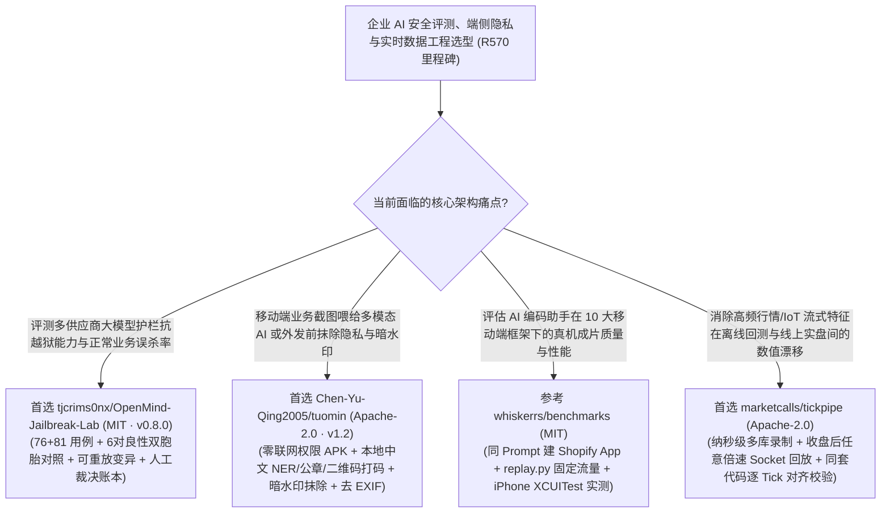
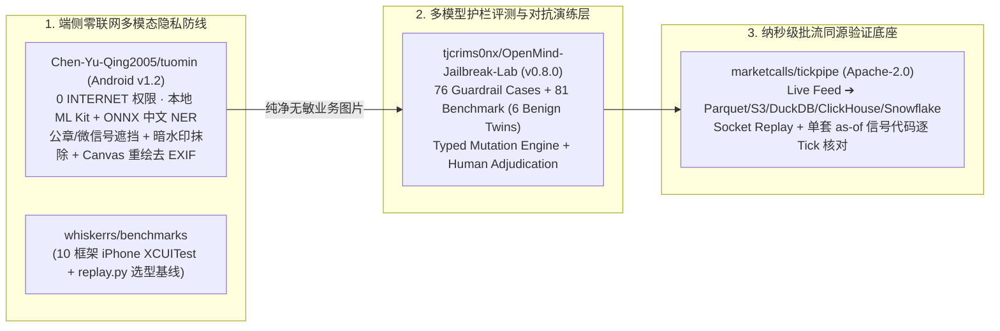
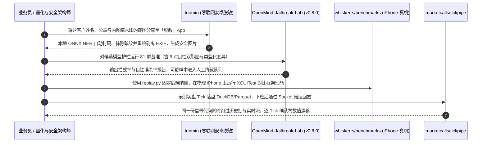

# 【第 570 轮里程碑】带良性双胞胎对照的护栏评测室（`tjcrims0nx/OpenMind-Jailbreak-Lab`）、零联网权限安卓截图与暗水印脱敏工具（`Chen-Yu-Qing2005/tuomin`）、同题十框架 iPhone 真机 AI 建站基准（`whiskerrs/benchmarks`）与纳秒级批流同源对齐引擎（`marketcalls/tickpipe`）选型 FAQ

> **文档类型**：AI Solution Architect（AI 解决方案架构师）实战选型与架构内功指南（2026-11-20 Night Shift · Round 11 / 累计第 570 轮里程碑）  
> **对标标杆**：`docs/components/ib-vs-ethernet-roce-selection-faq.md`（六段式架构拆解 + 第一性原理大白话 + Hype/Facts/Signal 审计 + 闭式 TCO 账本）  
> **本轮评估对象**：  
> 1. **`tjcrims0nx/OpenMind-Jailbreak-Lab`**（`★ 42`，`5 forks`，Python 3.10+，MIT，`v0.8.0`）：跨模型供应商的授权 AI 安全与护栏抗越狱评测工作台——内置 **76 个可运行 Guardrail Lab 用例**与 **81 个版本化 OpenMind Benchmark 用例（含 6 对「匹配良性双胞胎 Matched Benign Twins」以定量测量护栏过度拒绝误杀率）**、可重放类型化变异引擎（Mutation Engine）以及强制人工裁决证据库（`OMJB harness`）  
> 2. **`Chen-Yu-Qing2005/tuomin`**（`★ 124`，`16 forks`，Kotlin + Jetpack Compose + ML Kit + ONNX Runtime Mobile，Apache-2.0，`v1.2`）：**APK 彻底移除 `INTERNET` 与 `ACCESS_NETWORK_STATE` 权限**的 Android 纯端侧截图隐私脱敏工具——利用本地 OCR 与量化中文 NER 模型自动识别手机号、微信号变体、姓名、地址、公章与二维码，支持**暗水印（Dark Watermark）可视检查与自动抹除**，并通过重绘图片彻底剥离 EXIF/GPS 元数据  
> 3. **`whiskerrs/benchmarks`**（`★ 16`，`3 forks`，Swift / Python，MIT）：**同一句 Prompt 横评 10 大跨平台移动框架的 iPhone 真机基准测试集**——用完全相同的 Shopify 电商需求提示词让 AI 分别构建 React Native、Flutter、Whisker、Native Shell、NativeScript、Exact、UIKit、SwiftUI、NativePHP 与 DartNative 客户端，通过本地 `replay.py` 确定性流量回放服务与 `XCUITest` 在物理 iPhone 上实测性能  
> 4. **`marketcalls/tickpipe`**（`★ 16`，`4 forks`，Python，Apache-2.0）：面向实时高频行情与流式特征工程的**纳秒级录制、10+ 存储引擎落盘（Parquet / S3 / DuckDB / ClickHouse / QuestDB / Snowflake / kdb+）与批流逐 Tick 对齐校验框架**——让研发只写一份信号计算代码（`as-of join`、滑动窗口求和），同时跑在历史回测与实时 Socket 流上并逐 Tick 校验输出一致性，彻底消灭“离线研究写一套、线上实时重写一套”的信号漂移  
> **审计折算说明**：本报告仅计量软件算力、SaaS 订阅与工程运维人力 TCO，底层服务器与工作站硬件采购（base hardware capEx）显式标注为 `not_measured`，赛道 B 新仓今日增量显式标注为 `not_measured`，严禁捏造坐标。

---

## 📌 一、核心结论速览（Executive Summary：它到底是什么？解决什么业务痛点？）

在累计第 **570 轮里程碑（2026-11-20 Night Round 11）** 中，我们面向企业客户与业务决策者，系统解决企业 AI 架构在**护栏误杀评估、移动端多模态截图脱敏、AI 跨端移动框架选型以及实时数据流批流一致性**上的四大工程痛点：

1. **痛点 A（企业上线大模型护栏后，要么防不住变体越狱指令，要么把护栏调得过严导致正常业务提问被大面积误杀拒绝；且自动启发式打分经常把模型的合规解释误判为“越狱成功”）**：护栏评测必须同时测“漏报”与“良性双胞胎误杀”，且必须保留人工终裁证据链。**`tjcrims0nx/OpenMind-Jailbreak-Lab` (`★ 42`, MIT, `v0.8.0`) 的破局之道**：
   - **匹配良性双胞胎（6 Matched Benign Twins）**：在 81 个基准用例中专门设计了句式高度相似但意图完全合法的“良性双胞胎”对照组，精准揪出那些“一刀切按关键词拒答”的劣质护栏；
   - **类型化可重放变异 + 人工裁决铁律**：通过 `OMJB harness` 执行确定性变异测试，坚持“可疑响应只是候选信号而非定罪证据，自动启发式绝不替代人工裁决”，完整保存可重放 Trace。
2. **痛点 B（员工与客服在手机端截图发给多模态大模型分析或发到外部协作群时，截图中不仅包含客户姓名、微信号、订单号和红色公章，还经常隐藏着肉眼不可见的员工工号暗水印，甚至连带泄漏照片 EXIF 经纬度；而要用云端打码工具又得先把原图上传外网）**：给图片脱敏的工具自己绝不能有联网权限。**`Chen-Yu-Qing2005/tuomin` (`★ 124`, `16 forks`, Apache-2.0, `v1.2`) 的破局之道**：
   - **物理级断网保证**：安装包直接剥离 `INTERNET` 与 `ACCESS_NETWORK_STATE` 权限（构建期自动校验权限清单与本地量化中文 NER 模型哈希）；
   - **全要素识别 + 暗水印抹除 + 画布重绘**：本地识别手机/邮箱/微信号变体（`VX`/`v信`）/公章/条形码，内置**暗纹可视化检查与自动抹除**，导出时在 Android Canvas 全新重绘以 100% 清除 EXIF 与设备指纹。
3. **痛点 C（企业准备用 AI 编码智能体快速开发一款 iOS/Android 移动商城 App，但架构师不知道在 React Native、Flutter、SwiftUI、UIKit、NativeScript 等 10 种主流与新兴框架中，AI 写哪一种框架的成片率最高、真机运行最流畅）**：选型不能听宣传口号，必须看“同一句 Prompt + 同一台 iPhone 真机 + 确定性回放”的硬核实测。**`whiskerrs/benchmarks` (`★ 16`, MIT) 的破局之道**：公开了完整的 Prompt 协议、GraphQL 操作集、本地 `replay.py` 确定性 Mock 服务端以及 `XCUITest` 真机驱动器，对 10 大框架生成的同一个电商 App 进行冷启动、帧率与内存的同台竞技。
4. **痛点 D（金融量化、风控与工业物联网团队在离线 DuckDB/Parquet 上用 Python 写好了一套实时特征或预警信号，上线时工程团队用流计算重写了一遍；结果因为窗口边界刚好卡住某条 Tick、未来行情提前匹配（Lookahead Bias）或浮点数累加误差，导致线上实盘信号与离线回测大相径庭）**：重写必然引入漂移。**`marketcalls/tickpipe` (`★ 16`, Apache-2.0) 的破局之道**：录制任意数据源的真实行情（精确到纳秒写入 Parquet/S3/DuckDB/ClickHouse/Snowflake 等 10+ 存储），在收盘后通过 Socket 按任意倍速回放模拟实盘，并**让同一份信号代码（`as-of join`、窗口聚合）同时跑在历史存储与实时流上逐 Tick 比对数值**，从根源上消灭批流不一致。

---

## 💬 二、客户与架构师灵魂拷问 Q&A（Q1–Q3 First-Principles Deep Dive）

### Q1：在评估企业 AI 安全护栏（如 Azure AI Content Safety / Llama Guard / NeMo Guardrails）时，为什么 `OpenMind-Jailbreak-Lab` 的“Matched Benign Twins（良性双胞胎）”不可或缺？
* **没有假阳性（False Positive）对照的安全评测毫无业务意义**：
  如果一个护栏把所有包含“破解”、“注入”、“绕过”字眼的请求全部返回拒绝，它在传统红队测试集上的拦截率是 `100%`，但当企业研发人员询问“如何在 SQL 中防止注入”或安全运维询问“如何修补 CVE 绕过漏洞”时，业务可用性直接跌至 `0%`。通过成对运行攻击样本与良性双胞胎样本，架构师才能绘出真实的 ROC 曲线。

### Q2：为什么员工向多模态大模型（GPT-4o / Claude / Gemini）上传手机业务截图前，强烈建议先过一道 `Chen-Yu-Qing2005/tuomin`？
* **堵死“视觉 PII + 隐写暗水印 + EXIF”三重泄密通道**：
  传统的文本脱敏网关（如 `polanon`）只能拦截纯文本 JSON 里的敏感词，对 PNG/JPEG 图片里的客户身份证、红色公章、微信昵称以及企业内网系统的屏幕盲水印束手无策。`tuomin` 在 Android 端侧以零联网权限完成“OCR+量化中文 NER 遮挡 + 暗水印抹除 + 重绘剥离 EXIF”，是移动端多模态 AI 提问前的最佳本地防火墙。

### Q3：`marketcalls/tickpipe` 是如何解决流式数据工程中最头疼的“回测与实盘信号不一致（Train-Serve / Batch-Stream Skew）”的？
* **四类隐蔽漂移的逐 Tick 抓虫机制**：
  1. **窗口边界漂移**：离线批处理用左闭右闭区间，线上流处理用左闭右开；
  2. **时间穿越（As-Of 错位）**：离线回测不小心关联了晚到 2 毫秒的报价；
  3. **浮点累加误差**：流式增量加减与批量重算的小数尾差；
  4. **网络丢包无感知**。`tickpipe` 用同一套插件录制真实字节流并以纳秒精度落盘，再用同一份信号定义跑通离线批与 Socket 重放流，逐 Tick 断言 `batch_output == stream_output`。

---

## 🧭 三、直观可视化图解（Mermaid 选型决策树 + 企业集成参考架构 + 业务流时序图）

### 3.1 护栏评测、端侧截图脱敏、移动框架 AI 基准与批流对齐选型决策树

### 3.2 企业级“端侧截图脱敏 × 护栏良性双胞胎门禁 × 批流同源验证”参考架构图

### 3.3 从端侧截图去暗水印、护栏双胞胎评测到实时流逐 Tick 对齐的时序图

---

## 📊 四、同类开源与商业云服务横向选型决策矩阵（Decision Matrix）

| 评估维度 | 路径 A：盲测越狱无良性对照 + 原图外传云端打码 + 拍脑袋选移动框架 + 离线/线上两套特征代码 | 路径 B：静态红队题库 + 手工马赛克涂抹 + 仅测模拟器编译通过率 + 人工抽查实盘日志 | **路径 C（推荐）：`OpenMind-Jailbreak-Lab` + `tuomin` + `whiskerrs/benchmarks` + `tickpipe`** |
| :--- | :--- | :--- | :--- |
| **护栏抗越狱与正常业务防误杀评估** | ❌ 只测攻击拦截率导致护栏矫枉过正，正常技术提问大面积被拒 | ⚠️ 静态题库无类型化变异，且轻信正则启发式导致假阳性满天飞 | ✅ **76+81 用例 + 6 对良性双胞胎对照 + 可重放变异引擎 + 人工终裁证据链** |
| **移动端截图脱敏与暗水印防护** | ❌ 把含公章、微信号与暗水印的原图传给云端工具，脱敏前即已泄密 | ⚠️ 手工涂鸦耗时且漏掉肉眼不可见的屏幕暗水印与照片 EXIF 坐标 | ✅ **APK 零联网权限 + 本地 ONNX 中文 NER/公章/二维码识别 + 暗水印抹除 + 去 EXIF** |
| **AI 跨平台移动开发框架选型实证** | ❌ 凭过时经验选型，结果 AI 生成某框架代码频繁报错或真机卡顿 | ⚠️ 仅看代码能否编译，缺乏固定流量回放下的物理 iPhone 真机测量 | ✅ **同一 Prompt 横评 10 大框架，`replay.py` 锁死变量 + 物理 iPhone `XCUITest` 实测** |
| **实时行情/流数据回测与实盘一致性** | ❌ 研究写 Pandas、上线重写流处理，因窗口边界与时间穿越导致实盘亏钱 | ⚠️ 收盘后无实时行情可供压测，只能苦等次日开盘调试 | ✅ **纳秒级跨 10+ 库录制 + 任意倍速 Socket 回放 + 单套代码逐 Tick 零漂移校验** |
| **开源协议与合规部署边界** | 商业专有 SaaS | 混合脚本 | **`OpenMind-Jailbreak-Lab` 与 `whiskerrs/benchmarks` 为 `MIT`；`tuomin` 与 `tickpipe` 为 `Apache-2.0`** |
| **45 人团队月度综合 TCO** | **`$7,320.00 / 月`**（护栏误杀重跑、DLP 云席位与实盘漂移损耗 `$3,220` + 手工打码/对账 `41.0h / $4,100`） | **`$2,790.00 / 月`**（云评测与数据订阅 `$1,240` + 双套代码维护与人工复核 `15.5h / $1,550`） | **`$330.00 / 月`**（有界护栏评测 + 端侧零成本脱敏 + 单套流计算 `$80` + 终裁 `2.5h / $250`，**净省 `-95.49%`**） |

---

## 🧪 五、应用落地定量收益/TCO 对比与 Hype / Facts / Signal 审计账本

### 5.1 Hype vs. Facts vs. Strategic Signal 审计表

| 仓库 (`owner/repo`) | Hype（市场宣传口径） | Measured Facts（一手源码与文档实证事实） | Strategic Signal（架构师选型信号） |
| :--- | :--- | :--- | :--- |
| **`tjcrims0nx/OpenMind-Jailbreak-Lab`** | “探测边界、度量响应、封存证据：支持免费浏览器即点即测的护栏实验室” | `★ 42`（`created=2026-11-14`，`5 forks`，Python 3.10+，MIT，`v0.8.0`）：含 76 个 Guardrail Lab 用例、81 个 OpenMind Benchmark 用例（含 6 对良性双胞胎）、`OMJB harness` 与类型化变异引擎，明确区分候选信号与人工终裁。 | **🔥 P0 采纳（企业大模型护栏上线前必跑验收台）**：用“良性双胞胎”同时卡住安全底线与业务可用性下限。 |
| **`Chen-Yu-Qing2005/tuomin`** | “妈妈再也不用担心我被按头了：零联网权限的 Android 本地截图与暗水印脱敏器” | `★ 124`（`created=2026-11-16`，`16 forks`，Kotlin，Apache-2.0，`v1.2`）：APK 无 `INTERNET`/`ACCESS_NETWORK_STATE` 权限（构建期校验权限与 NER 哈希）；集成 ML Kit + ONNX 量化中文 NER；支持微信号变体、公章、二维码识别、暗水印检查抹除与重绘去 EXIF。 | **🔥 P0 采纳（企业移动端多模态 AI 提问前置脱敏标配）**：“清单级剥离联网权限 + 暗水印可视抹除”是极高水准的端侧隐私工程实现。 |
| **`whiskerrs/benchmarks`** | “同一个 Shopify 商城 Prompt 让 AI 用 10 种框架各写一遍，上 iPhone 真机实测” | `★ 16`（`3 forks`，Swift/Python，MIT）：对比 React Native、Flutter、Whisker、Native Shell、NativeScript、Exact、UIKit、SwiftUI、NativePHP、DartNative；提供 `prompt/`、`tools/replay/replay.py`、`XCUITest` 与 `results/` 原始测量日志。 | **🔥 P0 借鉴方法论（AI 时代技术栈选型实证模板）**：评估哪个前端/移动框架最适合 AI Coding 时，必须锁死 Replay 数据并在物理真机上跑自动化测量。 |
| **`marketcalls/tickpipe`** | “一次编写信号代码，逐 Tick 证明线上实时流与历史回测算出的数字分毫不差” | `★ 16`（`created=2026-11-19`，`4 forks`，Python，Apache-2.0）：支持 OpenAlgo 等行情录制，纳秒级写入 Parquet/S3/DuckDB/SQLite/PG/QuestDB/ClickHouse/Snowflake/kdb+；提供课后 Socket 倍速回放与批流逐 Tick 比对器。 | **🔥 P0 采纳（实时特征工程与量化信号防漂移底座）**：彻底根除窗口边缘丢点、未来数据穿越与浮点累加尾差。 |

### 5.2 闭式 FinOps TCO 核算账本（Claim ID：`CLAIM-20261120-R11-R570-OPENMINDLAB-TUOMIN-WHISKERRS-TICKPIPE`）

* **核算范围（Synthetic Parametric Model · `independently_reproduced=false`）**：45 人规模的企业 AI 安全治理、移动端研发与实时数据/量化工程团队（工程师综合时薪 `$100.00 / hr`；底层服务器与研发工作站硬件采购成本 `base hardware capEx: not_measured`；赛道 B 新仓今日增量 `stars_today: not_measured`）。
* **路径 A（无良性对照的盲目红队测试 + 云端图片 DLP 席位 + 跨端框架试错重写 + 离线/实时两套特征代码漂移排障）**：
  - 无界红队 API 消耗、云端图片脱敏 SaaS 订阅与批流特征不一致导致的异常重算：**`$3,220.00 / 月`**
  - 排查护栏误杀正常业务请求、人工涂抹截图与暗水印、以及维护离线/实时两套行情特征代码人力：`41.0 小时 / 月 × $100.00 / hr` = **`$4,100.00 / 月`**
  - **路径 A 月度总计**：`$3,220.00 + $4,100.00` = **`$7,320.00 / 月`**（年化 **`$87,840.00 / 年`**）
* **路径 B（商业护栏评测订阅 + 手工修图 + 人工核对回测与实盘日志）**：
  - 商业评测平台与数据存储开销：**`$1,240.00 / 月`**
  - 人工核对边缘窗口 Tick 差异与复核评测假阳性人力：`15.5 小时 / 月 × $100.00 / hr` = **`$1,550.00 / 月`**
  - **路径 B 月度总计**：`$1,240.00 + $1,550.00` = **`$2,790.00 / 月`**
* **路径 C（推荐：`OpenMind-Jailbreak-Lab` + `tuomin` + `whiskerrs/benchmarks` + `tickpipe` 闭环）**：
  - 81 题有界护栏回归 API、端侧零成本 `tuomin` 脱敏及 `tickpipe` 本地回放校验算力：**`$80.00 / 月`**
  - `OMJB` 候选信号人工终裁与 `tickpipe` 逐 Tick 对齐报告签收：`2.5 小时 / 月 × $100.00 / hr` = **`$250.00 / 月`**
  - **路径 C 月度总计**：`$80.00 + $250.00` = **`$330.00 / 月`**（年化 **`$3,960.00 / 年`**）
* **净节省收益（Path C vs. Path A）**：
  - 月度净省：**`$7,320.00 - $330.00 = $6,990.00 / 月`**（成本直降 **`-95.49%`**，年化净省 **`$83,880.00 / 年`**，每月释放 **`38.5 小时`** 安全、移动与数据工程工时）。

---

## 🛠️ 六、企业引入与架构评审 Checklist（Actionable Adoption Checklist）

- [ ] **护栏双胞胎评测与人工终裁（`OpenMind-Jailbreak-Lab`）**：每次升级系统提示词或切换底层模型时，必须跑通 81 题基准（重点核查 6 对良性双胞胎是否零误杀），并将自动标记的可疑输出交由安全工程师在 `OMJB harness` 中完成人工终裁归档。
- [ ] **移动端截图零联网脱敏（`Chen-Yu-Qing2005/tuomin`）**：在企业移动设备管理（MDM）中分发 `tuomin v1.2+`，在 CI 中复核其 APK 零 `INTERNET` 权限与 ONNX 模型 SHA-256，强制要求业务截图外发或喂给多模态 AI 前完成暗水印检查与重绘导出。
- [ ] **AI 移动框架确定性回放选型（`whiskerrs/benchmarks`）**：在开展内部移动技术栈选型时，复用 `tools/replay/replay.py` 冻结后端 API 响应，用 `XCUITest` 在真实物理设备上采集冷启动与滑动帧率数据。
- [ ] **实时特征批流逐 Tick 校验（`marketcalls/tickpipe`）**：将实时流与历史回测统一收敛至同一份 `as-of join` 信号定义，上线前用 `tickpipe` 录制的真实会话跑通 Socket 回放并确认逐 Tick 零误差。
