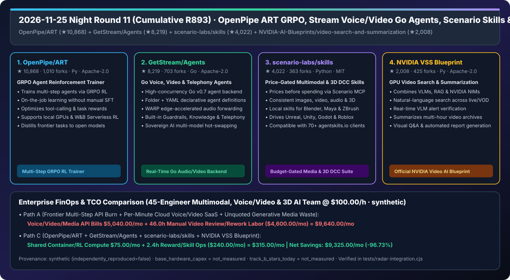
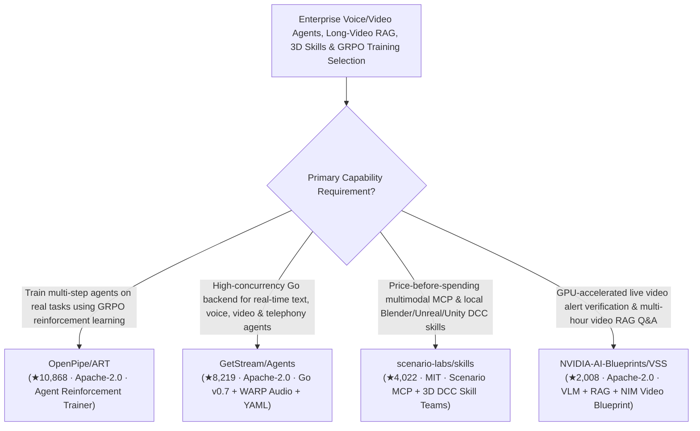
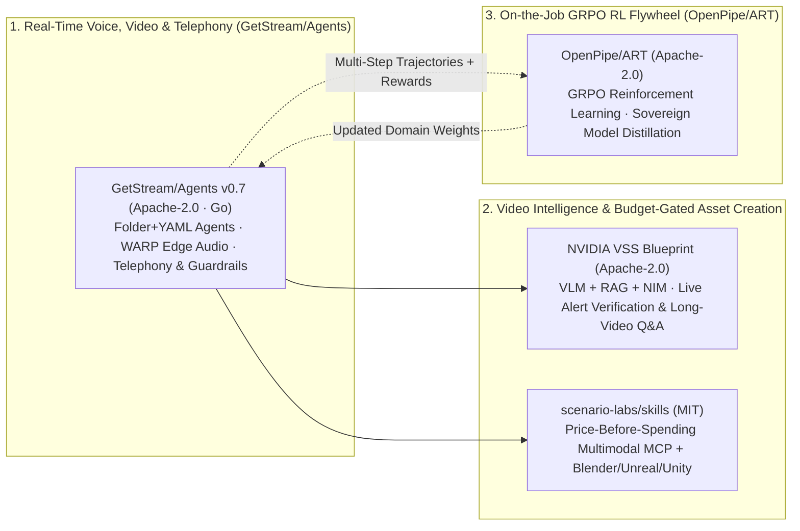
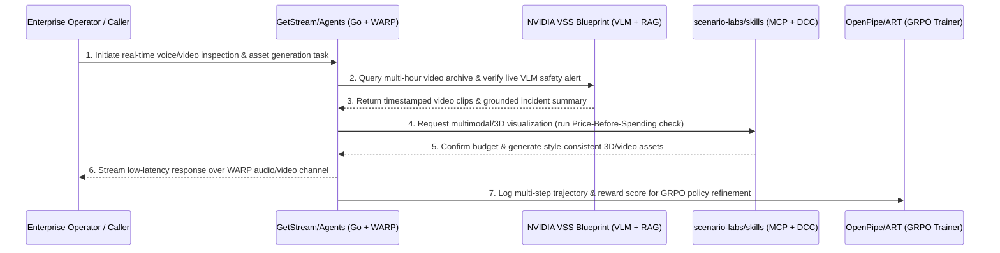

# On-the-Job GRPO Agent Trainer (`OpenPipe/ART`), Go Real-Time Voice/Video/Telephony Agent Backend (`GetStream/Agents`), Price-Before-Spending Multimodal & 3D DCC Skills (`scenario-labs/skills`) & NVIDIA Video Search and Summarization Blueprint (`NVIDIA-AI-Blueprints/video-search-and-summarization`) Selection & Integration Architecture FAQ

> **Document Type**: Enterprise AI Solution Architect Selection Decision Guide (GitHub Trending AI Radar — 2026-11-25 Night Round 11 / Cumulative Round 893)
> **Covered Repositories**: [`OpenPipe/ART`](https://github.com/OpenPipe/ART) (`★ 10,868`, `1,010 forks`, `Apache-2.0`: **Agent Reinforcement Trainer (`openpipe-art`)** for training multi-step agents on real-world tasks using **GRPO** reinforcement learning locally or via W&B Serverless RL) · [`GetStream/Agents`](https://github.com/GetStream/Agents) (`★ 8,219`, `703 forks`, `Apache-2.0`: Go-native `v0.7` backend for building real-time text, voice, video, and telephony agents with folder+YAML definitions, WARP audio acceleration, and built-in guardrails, knowledge, routing, connectors, and sandboxes) · [`scenario-labs/skills`](https://github.com/scenario-labs/skills) (`★ 4,022`, `363 forks`, `MIT`: production-ready `agentskills.io` multimodal and 3D DCC skills that pick the right model, **price before spending**, maintain character/style consistency via Scenario MCP, and drive local Blender, Maya, ZBrush, Unreal Engine, Unity, Godot, and Roblox Studio) · [`NVIDIA-AI-Blueprints/video-search-and-summarization`](https://github.com/NVIDIA-AI-Blueprints/video-search-and-summarization) (`★ 2,008`, `425 forks`, `Apache-2.0`: official **NVIDIA AI Blueprint (`VSS`)** combining VLMs, RAG, and NVIDIA NIM microservices for real-time video search, alert verification, and multi-hour video summarization)
> **Core Enterprise Scenario**: Building **real-time voice/video/telephony customer agents, GPU-accelerated long-video surveillance/media intelligence, budget-gated 3D/multimodal asset pipelines, and GRPO reinforcement-learning flywheels that distill frontier reasoning into sovereign open-weight models**.

---

## 1. 📌 Executive Summary (One-Line Selection Verdict)

1. **Need to train open-weight models on your company's multi-step tool-calling workflows using GRPO reinforcement learning so they match frontier model accuracy at a fraction of the cost** ➔ Choose **[`OpenPipe/ART`](https://github.com/OpenPipe/ART) (`★ 10,868`, `1,010 forks`, `Apache-2.0`)**.
   - **Plain-English Mechanism**: Instead of requiring thousands of hand-labeled SFT demonstrations, `OpenPipe ART` rolls out multi-step agent trajectories against your task environment, scores outcomes with a programmatic reward function, and updates model weights via GRPO.
2. **Need a high-concurrency Go backend to ship low-latency voice, video, and telephony agents with YAML configuration and WARP audio acceleration** ➔ Choose **[`GetStream/Agents`](https://github.com/GetStream/Agents) (`★ 8,219`, `703 forks`, `Apache-2.0`)**.
   - **Plain-English Mechanism**: Replaces bottlenecked Python audio servers with a concurrent Go `v0.7` runtime where agents are defined in folders + YAML, audio is edge-accelerated via WARP, and guardrails, telephony, knowledge, and model routing are built in.
3. **Need 70+ coding agents to generate style-consistent images, video, audio, and 3D assets with pre-execution cost quotes (`price before spending`) or drive local Unreal/Unity/Blender DCC apps** ➔ Choose **[`scenario-labs/skills`](https://github.com/scenario-labs/skills) (`★ 4,022`, `363 forks`, `MIT`)**.
   - **Plain-English Mechanism**: Combines cloud Scenario MCP skills (which select the optimal generative model, quote exact prices before spending, and preserve character consistency) with offline-verified DCC skill teams for Blender, Maya, ZBrush, Unreal Engine, and Unity.
4. **Need GPU-accelerated natural-language search, VLM alert verification, and automated summarization across live video streams and multi-hour recordings** ➔ Choose **[`NVIDIA-AI-Blueprints/video-search-and-summarization`](https://github.com/NVIDIA-AI-Blueprints/video-search-and-summarization) (`★ 2,008`, `425 forks`, `Apache-2.0`)**.
   - **Plain-English Mechanism**: Orchestrates Vision-Language Models, vector/graph RAG, and NVIDIA NIM microservices so operators can query hours of video in natural language and verify real-time safety or operational alerts.

---

## 2. 🎯 Architect & Customer Deep-Dive Q&A

### Q1: How does this open-source stack compare against managed cloud multimodal APIs (e.g., Azure OpenAI Realtime API + Azure AI Video Indexer)?

- **Four-Pillar Multimodal & RL Architecture (Path C)**:
  1. **Real-Time Voice/Video/Telephony Ingress ➔ `GetStream/Agents`**: Go `v0.7` backend with WARP audio forwarding and sovereign model routing.
  2. **Long-Video Search & VLM Alert Verification ➔ `NVIDIA VSS Blueprint`**: VLM + RAG + NIM pipeline for live streams and multi-hour archives.
  3. **Budget-Gated Multimodal & 3D DCC Creation ➔ `scenario-labs/skills`**: Price-before-spending Scenario MCP + local Unreal/Unity/Blender automation.
  4. **On-the-Job GRPO Model Distillation ➔ `OpenPipe/ART`**: Trains compact open-weight models on production multi-step agent trajectories.
- **When to choose Managed Cloud APIs vs. Path C?**
  - Choose **Azure OpenAI Realtime API + Azure AI Video Indexer** for low-volume video archives and rapid serverless prototypes without GPU management.
  - Choose **Path C** when operating continuous multi-camera video streams, high-concurrency voice/telephony lines, budget-enforced 3D/media pipelines, or distilling high-volume workflows into sovereign open-weight models via GRPO.

### Q2: How do these four components integrate end-to-end?

1. **Low-Latency Voice & Video Interaction (`GetStream/Agents`)**:
   - Users connect over WebRTC, mobile SDKs, or PSTN telephony into `GetStream/Agents`, which enforces guardrails and routes turns.
2. **Video Intelligence & Asset Synthesis (`NVIDIA VSS` + `scenario-labs/skills`)**:
   - Video inspection queries route to `NVIDIA VSS` while creative/3D requests invoke `scenario-labs/skills` (enforcing pre-spend cost checks before calling Scenario MCP or local DCC engines).
3. **Continuous GRPO Improvement Loop (`OpenPipe/ART`)**:
   - Multi-step execution traces and reward signals feed into `OpenPipe/ART` to continuously fine-tune domain-specialized open-weight models.

### Q3: What are the critical FinOps and safety guardrails?

- **Architect Redlines**:
  1. **Enforce `price before spending` gates on generative media**: Require `scenario-labs/skills` to output cost quotes and check campaign budgets before executing batch video or 3D generation.
  2. **Harden GRPO reward functions against reward hacking**: Validate both final state correctness and tool-call parsimony in `OpenPipe/ART` reward functions.

---

## 3. 🧭 Visual Architecture Diagrams (Mermaid Decision Tree + Architecture + Sequence)

### 3.1 Architect Selection Decision Tree

### 3.2 End-to-End Enterprise Integration Architecture

### 3.3 End-to-End Execution Sequence

---

## 4. 📊 Horizontal Selection Matrix

| Dimension | `OpenPipe/ART` (`★ 10,868`) | `GetStream/Agents` (`★ 8,219`) | `scenario-labs/skills` (`★ 4,022`) | `NVIDIA VSS Blueprint` (`★ 2,008`) | Metered Cloud Realtime/Video APIs + Unpriced Media Gen (Path A) | Single-Thread Python Audio + Manual Video Scrubbing (Path B) |
| :--- | :--- | :--- | :--- | :--- | :--- | :--- |
| **Primary Role** | Multi-step GRPO RL agent trainer | Go real-time voice/video/telephony backend | Price-gated multimodal & 3D DCC skills | GPU-accelerated video search & VLM RAG | Per-minute commercial cloud multimodal APIs | Custom Python scripts & manual video review |
| **Key Differentiator** | **On-the-job GRPO training without manual SFT labels** | **Go concurrency + WARP audio + Sovereign AI routing** | **Prices before spending + drives Unreal/Blender/Unity** | **VLM + RAG + NIM for hours-long video & live alerts** | Zero infra setup, but costly per-minute 24/7 video & voice charges | High audio jitter under load; unquoted media API retries burn budget |
| **License** | `Apache-2.0` | `Apache-2.0` | `MIT` | `Apache-2.0` | Proprietary SaaS | Internal scripts |
| **Monthly TCO (45-Eng Team)** | **`$315.00/mo` combined** (`$75.00` compute + `2.4h` ops) | Included in `$315.00/mo` stack | Included in `$315.00/mo` stack | Included in `$315.00/mo` stack | **`$9,640.00/mo`** (`$5,040.00` metered voice/video/media APIs + `46.0h` manual review) | `~$3,290.00/mo` (manual video scrubbing & failed asset reruns) |

---

## 5. 🧪 Quantitative FinOps & TCO Comparison (45-Person Enterprise Team)

> **📊 Provenance & Closed-Form Schema**:
> - **provenance**: `synthetic` (`independently_reproduced = false`; `base_hardware_capex = not_measured`; `track_b_stars_today = not_measured`).
> - **Closed-Form Formula**:
>   - **Path A (Frontier-Only Multi-Step API Spend + Per-Minute Cloud Video/Voice SaaS + Unquoted Generative Media Waste & Manual Video Scrubbing)**: **`$5,040.00`** monthly API/media bills + **`46.0h × $100.00/h = $4,600.00`** manual video review and asset rework labor = **`$9,640.00/mo`**.
>   - **Path C (`OpenPipe/ART` + `GetStream/Agents` + `scenario-labs/skills` + `NVIDIA VSS Blueprint` Stack)**: **`$75.00`** shared container/RL compute + **`2.4h × $100.00/h = $240.00`** reward/skill maintenance = **`$315.00/mo`**.
>   - **Net Savings vs. Path A**: **`-$9,325.00/mo`** (**`96.73%`** TCO reduction).

| Evaluation Path | Voice / Video / Generative API & Compute | Video Review, Asset Rework & Ops (`$100/h`) | Monthly Total TCO | Net Savings vs. Path A | Key Architectural Outcome |
| :--- | :---: | :---: | :---: | :---: | :--- |
| **Path A: Frontier APIs + Metered Video SaaS + Unquoted Media Generation** | `$5,040.00` | `46.0h` (`$4,600.00`) | **`$9,640.00`** | Baseline | Expensive 24/7 video metering; unquoted generative asset waste |
| **Path B: Python Audio Scripts + Manual Video Frame Sampling** | `$1,490.00` | `18.0h` (`$1,800.00`) | **`$3,290.00`** | `-$6,350.00` (`-65.87%`) | High voice latency; untuned small models fail multi-step tool tasks |
| **Path C: `OpenPipe/ART` + `GetStream/Agents` + `scenario-skills` + `VSS`** | **`$75.00`** | **`2.4h` (`$240.00`)** | **`$315.00`** | **`-$9,325.00` (`-96.73%`)** | **GRPO RL distillation + Go WARP voice + pre-spend quotes + NVIDIA VSS** |

- 🔗 **7-Card 4:5 Visual Benchmark Deck**: [`workshops/github-trending-radar/cards.en.html`](../cards.en.html) · [`cards.html`](../cards.html)

---

## 6. 🛠️ Enterprise Adoption & Architecture Review Checklist

- [ ] **Distill High-Volume Multi-Step Flows via `OpenPipe/ART`**: Train compact open-weight models with GRPO against deterministic task reward functions.
- [ ] **Deploy `GetStream/Agents` Go `v0.7` for Voice/Telephony**: Standardize real-time audio/video agents on YAML definitions and WARP edge forwarding.
- [ ] **Enforce `Price-Before-Spending` in `scenario-labs/skills`**: Require pre-execution cost quotes before running batch multimodal or 3D generation jobs.
- [ ] **Event-Gated VLM Inspection in `NVIDIA VSS`**: Use lightweight CV triggers to invoke heavy VLM reasoning only on candidate alert windows.
