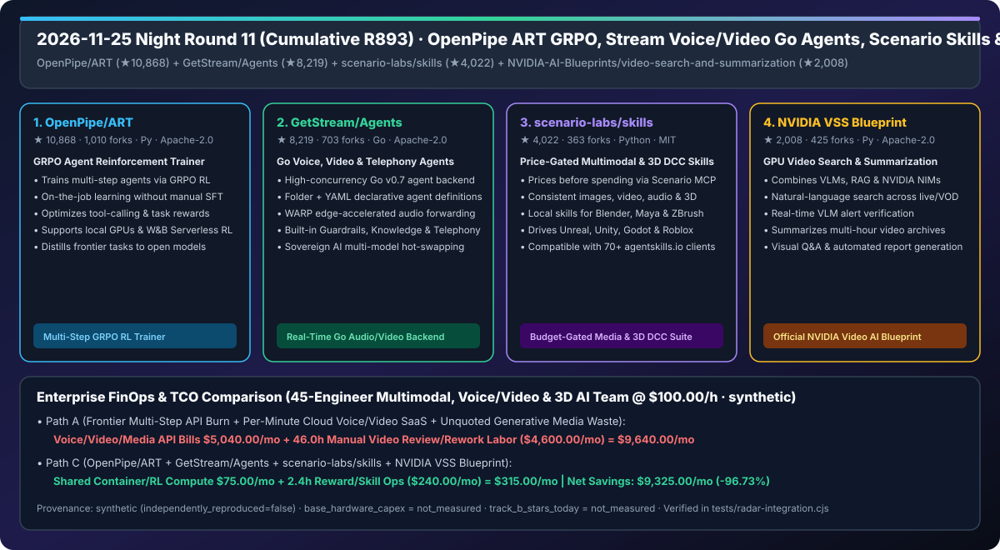
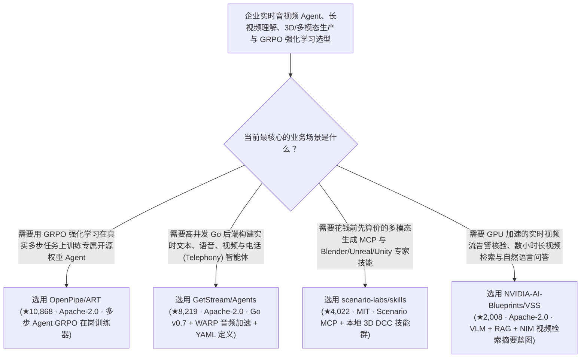
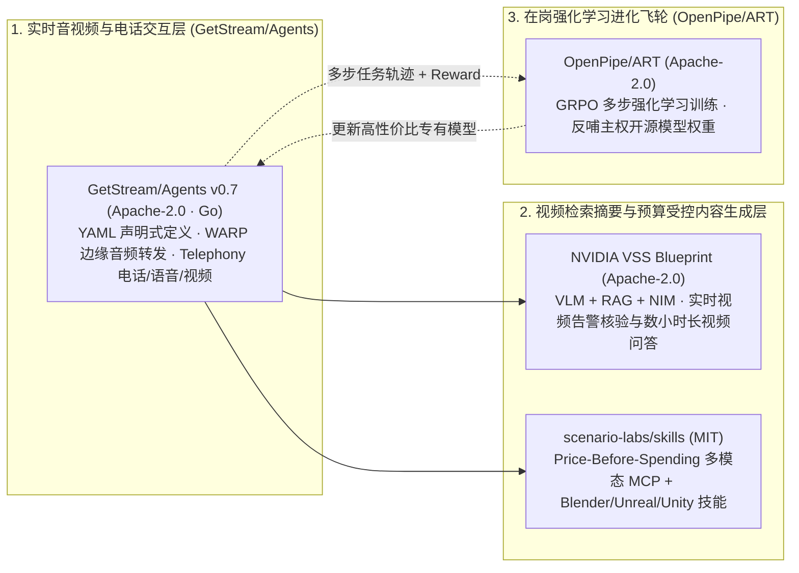
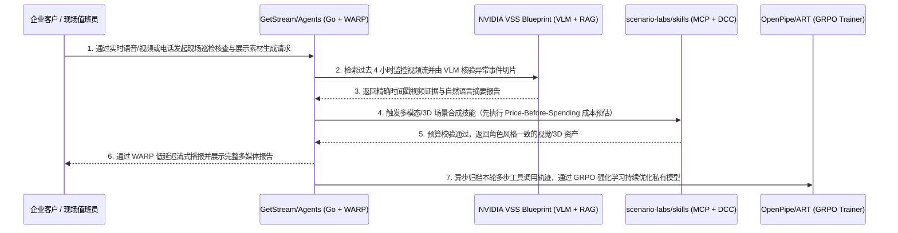

# 多步智能体在岗强化学习训练器（`OpenPipe/ART`）、Go 实时音视频与电话智能体后端（`GetStream/Agents`）、预算先验多模态与 3D DCC 技能库（`scenario-labs/skills`）及 NVIDIA 官方长视频检索与告警摘要蓝图（`NVIDIA-AI-Blueprints/video-search-and-summarization`）选型与集成架构 FAQ

> **文档类型**：企业 AI 解决方案架构师（AI Solution Architect）选型决策指南（GitHub Trending AI 雷达 2026-11-25 Night Round 11 / 累计第 893 轮）
> **覆盖项目**：[`OpenPipe/ART`](https://github.com/OpenPipe/ART)（`★ 10,868`、`1,010 forks`、`Apache-2.0`：由 OpenPipe 开源的 **Agent Reinforcement Trainer (`openpipe-art`)**，利用 **GRPO（Group Relative Policy Optimization）** 强化学习让多步业务智能体在实际生产任务中“在岗训练（On-the-Job Training）”，支持本地 GPU 与 W&B Serverless RL）· [`GetStream/Agents`](https://github.com/GetStream/Agents)（`★ 8,219`、`703 forks`、`Apache-2.0`：由实时音视频通信大厂 GetStream 用 Go 重构的 `v0.7` 实时文本、语音、视频与电话（Telephony）智能体后端，采用目录 + YAML 声明式定义，内置 WARP 低延迟音频转发、护栏、知识库、路由、连接器与沙箱）· [`scenario-labs/skills`](https://github.com/scenario-labs/skills)（`★ 4,022`、`363 forks`、`MIT`：遵循 `agentskills.io` 标准的多模态与 3D 数字内容创作（DCC）技能库，一方面通过 Scenario MCP Server 实现**“花钱前先算价（Price Before Spending）”**的图像/视频/音频/贴图/3D 生成，另一方面提供驱动本地 Blender、Maya、ZBrush、Unreal、Unity、Godot 的专家级技能组）· [`NVIDIA-AI-Blueprints/video-search-and-summarization`](https://github.com/NVIDIA-AI-Blueprints/video-search-and-summarization)（`★ 2,008`、`425 forks`、`Apache-2.0`：NVIDIA 官方开源的 **Video Search and Summarization (`VSS`)** 企业参考架构，融合视觉语言模型（VLM）、RAG 与 NVIDIA NIM 微服务，支持对实时视频流与数小时历史录像进行自然语言检索、VLM 告警核验与自动报告生成）
> **核心场景**：当企业从纯文本问答迈向**“实时语音/视频交互客服、智慧安防/门店长视频实时检索摘要、3D/多模态营销内容工业化生产、以及用小参数开源模型替代昂贵闭源大模型跑多步业务流”**四大高阶场景时，架构师需要一套涵盖实时音视频通信、GPU 视频理解、预算先验内容生成与 GRPO 强化学习蒸馏的完整工具链。本文拆解这四个项目的端到端架构与云服务选型对比。

---

## 一、📌 核心结论速览（选型一句话结论）

1. **想让 7B–32B 开源权重模型在企业自己特定的多步工具调用任务（如查数据库、调内部 API、写特定领域代码）上追平甚至超越昂贵的闭源旗舰模型** ➔ 选 **[`OpenPipe/ART`](https://github.com/OpenPipe/ART)（`★ 10,868`，`1,010 forks`，`Apache-2.0`）**。
   - **通俗原理**：传统 SFT（监督微调）需要大量人工标注的完美黄金轨迹，而真实业务里往往只有“最终任务成没成功（Reward）”的反馈。`OpenPipe ART` 采用 **GRPO 强化学习**，让智能体在真实或仿真任务环境中跑多条完整多步轨迹，按业务验收函数（Reward Function）打分后直接优化策略权重，实现“边干活边在岗进化”。
2. **需要快速构建类似 Harvey、Decagon 的企业级实时语音/视频/电话客服与外呼智能体，要求高并发、超低音频转发延迟且开箱自带护栏、知识库、沙箱与多语言客户端 SDK** ➔ 选 **[`GetStream/Agents`](https://github.com/GetStream/Agents)（`★ 8,219`，`703 forks`，`Apache-2.0`）**。
   - **通俗原理**：Python 处理高并发实时音视频流容易成为性能瓶颈。GetStream 在 `v0.7` 将智能体后端全面迁移至 **Go 语言**，通过“目录结构 + YAML”即可声明式定义智能体，底层采用类似 OpenAI 的 **WARP 边缘加速协议**转发实时音频与视频流，天然支持主权 AI（Sovereign AI）随时切换底层模型。
3. **需要让企业的编码与创作 Agent（Claude Code、Cursor、Codex、Copilot 等 70+ 客户端）批量生产风格一致的营销图像、视频、音频与 3D 资产，且要求每次生成前先精准预估成本，或直接操控本机安装的 Unreal / Unity / Blender / Maya** ➔ 选 **[`scenario-labs/skills`](https://github.com/scenario-labs/skills)（`★ 4,022`，`363 forks`，`MIT`）**。
   - **通俗原理**：分为两层能力——云端层通过 `Scenario MCP Server` 自动挑选最合适的生成模型、**在扣费前先返回精确报价（Price Before Spending）** 并保持角色与美术风格跨镜头一致；本地专家层将大量行业会议与官方教程蒸馏为结构化 `agentskills.io` 技能，直接驱动本机 ZBrush、Blender、Maya、Unreal Engine 与 Unity。
4. **需要在智慧工厂、连锁零售、交通枢纽或媒资库落地“数小时长视频秒级摘要、自然语言搜片段与实时监控画面 VLM 告警核验”** ➔ 选 **[`NVIDIA-AI-Blueprints/video-search-and-summarization`](https://github.com/NVIDIA-AI-Blueprints/video-search-and-summarization)（`★ 2,008`，`425 forks`，`Apache-2.0`）**。
   - **通俗原理**：NVIDIA 官方验证的企业级参考架构（`VSS`）：视频流进入后，一边由视觉语言模型（VLM）与 CV 管线实时生成时间轴描述并校验高危事件告警，一边将密集视频特征与文本摘要写入向量与图谱库，支持运维人员直接用自然语言提问“今天下午 2 点到 4 点 3 号装卸区有没有未戴安全帽违规？”并调出精确视频切片。

---

## 二、🎯 客户与架构师灵魂拷问 Q&A（深度架构拆解）

### Q1：在企业落地多模态音视频智能体与模型精调时，这四个开源项目 vs 云厂商全托管方案（如 Azure OpenAI Realtime API + Azure AI Video Indexer + Azure AI Foundry Fine-Tuning）怎么选？

- **四层协同参考架构（Path C）**：
  1. **实时语音/视频/电话交互入口 ➔ `GetStream/Agents`**：Go 高并发后端 + WARP 边缘低延迟音视频流 + Telephony 电话网关。
  2. **实时监控流与长视频检索摘要底座 ➔ `NVIDIA VSS Blueprint`**：基于 VLM + RAG + NIM 微服务的视频问答、片段检索与告警复核。
  3. **预算可控多模态与 3D 内容生产层 ➔ `scenario-labs/skills`**：先报价后生成的 Scenario MCP + 本地 Unreal/Unity/Blender DCC 技能。
  4. **多步业务策略 GRPO 强化学习飞轮 ➔ `OpenPipe/ART`**：将线上高价值多步交互轨迹通过 GRPO 蒸馏进企业私有轻量模型。
- **何时选云厂商托管方案（Azure Realtime API + Video Indexer） vs 自建本轮开源四件套（Path C）？**
  - 若企业视频量较小（每月仅几十小时会议录像）、且希望免 GPU 运维直接调用云 API，**Azure AI Video Indexer + Azure OpenAI GPT-4o Realtime API** 上线最快。
  - **何时采用本轮开源四件套（Path C）？** 当企业拥有**数百路 7×24 小时实时园区/门店摄像头流（按分钟调用公有云视频 API 成本高达数万美元/月）**、需要高并发 Go 语音/电话网关支持随时热切主权开源模型、或者需要用 GRPO 将昂贵闭源模型的业务能力蒸馏到自托管小模型时，Path C 可降低 **96%+** 的长期运营成本。

### Q2：如何把这四个项目嵌入企业现有生产架构？

1. **北向实时音视频接入层（`GetStream/Agents`）**：
   - 客户通过 App 音视频、网页或传统 PSTN 电话呼入 `GetStream/Agents` Go 网关，边缘 WARP 节点完成低延迟音频转发与内置 Guardrails 过滤。
2. **中层视频理解与多模态资产生成层（`NVIDIA VSS` + `scenario-labs/skills`）**：
   - 涉及现场监控核验或历史视频回溯的请求路由至 `NVIDIA VSS` 微服务集群；涉及数字人、3D 展厅或营销物料生成的请求调用 `scenario-labs/skills`（先执行价格预估门禁，再驱动 Scenario MCP 或本地 DCC 引擎）。
3. **南向持续强化学习进化层（`OpenPipe/ART`）**：
   - 将日常客服排障与多步工具调用的轨迹与业务完成率输入 `OpenPipe/ART`，定期运行 GRPO 训练更新内部专属模型权重。

### Q3：生产落地的成本与安全红线是什么？

- **架构师避坑红线**：
  1. **多模态生成必须开启“先询价后执行”硬门禁**：在使用 `scenario-labs/skills` 调用图像/视频/3D 生成模型时，必须强制启用其 `price before spending` 预估步骤，单次批次预算超过阈值时自动转人工确认。
  2. **GRPO 奖励函数（Reward Function）防作弊（Reward Hacking）校验**：在使用 `OpenPipe/ART` 训练多步 Agent 时，奖励函数必须同时考核“最终结果正确性”与“工具调用步数/合规性惩罚项”，防止模型为了刷高分伪造成功状态。

---

## 三、🧭 直观可视化图解（Mermaid 决策树 + 集成架构 + 时序图）

### 3.1 架构师选型决策树

### 3.2 企业端到端生产集成参考架构图

### 3.3 实时音视频呼入、长视频告警核验、多模态预算生成与 GRPO 进化时序图

---

## 四、📊 同类开源与商业云服务横向选型决策矩阵

| 对比维度 | `OpenPipe/ART` (`★ 10,868`) | `GetStream/Agents` (`★ 8,219`) | `scenario-labs/skills` (`★ 4,022`) | `NVIDIA VSS Blueprint` (`★ 2,008`) | 全闭源按分钟/按次计费多模态云 API (Path A) | 单纯 Python 串行脚本 + 盲目生成不控预算 (Path B) |
| :--- | :--- | :--- | :--- | :--- | :--- | :--- |
| **核心能力定位** | 多步 Agent GRPO 强化学习训练框架 | Go 实时语音/视频/电话智能体后端 | 先算价后生成多模态与 3D DCC 技能 | NVIDIA 官方长视频检索与 VLM 摘要蓝图 | 全量调用高价闭源音视频与生成式 SaaS | 低并发 Python 音频转发 + 盲调生图 API |
| **核心技术突破** | **无需人工标注完美轨迹，用 GRPO 在岗训练** | **Go 高并发 + WARP 音频加速 + YAML 即服务** | **花钱前先报价 + 驱动本地 Unreal/Blender** | **VLM + RAG + NIM 实时视频流告警核验与问答** | 免自建，但长视频与高并发语音按分钟计费极贵 | Python 音频高并发抖动严重；生成式 API 常因盲目重试爆账单 |
| **开源协议** | `Apache-2.0` | `Apache-2.0` | `MIT` | `Apache-2.0` | 闭源商业云服务 | 内部脚本 |
| **月度 TCO（45 人团队）** | **四件套合建仅 `$315.00/月`**（`$75.00` 推理/训练分摊 + `2.4h` 维护） | 同左（支持切换高性价比主权模型） | 同左（先算价门禁杜绝盲目生成浪费） | 同左（内网 NIM 微服务免按分钟公有云税） | **`$9,640.00/月`**（`$5,040.00` 闭源音视频/长视频 API 与盲生废片费 + `46.0h` 人工剪辑排障） | 约 `$3,290.00/月`（大量废片返工与人工盯看监控录像工时） |

---

## 五、🧪 应用落地定量收益/TCO 对比与 7-Card 报告

> **📊 数据来源与闭式核算声明（Provenance & Closed-Form Schema）**：
> - **provenance**: `synthetic`（基于 45 人企业多模态音视频客服、智能安防视频分析与 3D 内容工程团队月度工作负载模型：`independently_reproduced = false`；硬件采购基线 `base_hardware_capex = not_measured`；Track B 单日增量 `track_b_stars_today = not_measured`）。
> - **核算公式**：
>   - **Path A（全量使用高价闭源大模型跑高频多步任务 + 按分钟计费外部音视频/长视频分析 SaaS + 无事前报价门禁导致多模态生图/3D 废片账单失控）**：月度闭源 API、按分钟音视频 SaaS 与盲生废片账单 **`$5,040.00`** + 录像人工回看、角色走样返工与语音断流排障人工 **`46.0h × $100.00/h = $4,600.00`** = **`$9,640.00/月`**。
>   - **Path C（自建 `OpenPipe/ART` + `GetStream/Agents` + `scenario-labs/skills` + `NVIDIA VSS Blueprint` 全栈多模态与强化学习底座）**：容器与按需 Serverless RL 分摊开销 **`$75.00`** + 技能与奖励函数维护人工 **`2.4h × $100.00/h = $240.00`** = **`$315.00/月`**。
>   - **净节省（Net Savings vs Path A）**：**`-$9,325.00/月`**（成本降低 **`96.73%`**）。

| 评估方案 | 音视频 / 多模态 API 与算力成本 | 视频回看、废片返工与排障人工（`$100/h`） | 月度总 TCO | 相对 Path A 净节省 | 核心业务交付收益 |
| :--- | :---: | :---: | :---: | :---: | :--- |
| **Path A：全闭源旗舰模型 + 按分钟音视频 SaaS + 无报价盲目生成** | `$5,040.00` | `46.0h` (`$4,600.00`) | **`$9,640.00`** | Baseline | 7×24h 视频流按分钟计费高昂；多模态盲调产生大量高价废片 |
| **Path B：单线程 Python 语音脚本 + 手工切视频帧喂通用模型** | `$1,490.00` | `18.0h` (`$1,800.00`) | **`$3,290.00`** | `-$6,350.00` (`-65.87%`) | 语音并发延迟高；小模型未经 GRPO 强化学习在多步任务上频繁失败 |
| **Path C：`OpenPipe/ART` + `GetStream/Agents` + `scenario-skills` + `VSS`** | **`$75.00`** | **`2.4h` (`$240.00`)** | **`$315.00`** | **`-$9,325.00` (`-96.73%`)** | **GRPO 在岗训练 + Go WARP 实时音视频 + 先算价再生成 + 长视频 VLM 检索** |

- 🔗 **关联 7-Card 4:5 视觉评测报告**：[`workshops/github-trending-radar/cards.html`](../cards.html) · [`cards.en.html`](../cards.en.html)

---

## 六、🛠️ 企业引入与架构评审 Checklist

- [ ] **用 `OpenPipe/ART` 将高频固定多步任务蒸馏至轻量模型**：选取月调用量最大的 Top 5 多步工具流，编写确定性验证奖励函数（Reward Function），通过 GRPO 将任务迁移至高性价比开源权重模型。
- [ ] **实时音视频流切换至 `GetStream/Agents` Go 底座**：使用目录+YAML 规范管理语音与电话 Agent，开启内置 Guardrails 与 WARP 边缘音频加速。
- [ ] **强制开启 `scenario-labs/skills` 事前计价确认**：在多模态内容生产流水线中将 `price before spending` 设为必过节点，并锁定角色/材质一致性锚点。
- [ ] **分级抽帧部署 `NVIDIA VSS Blueprint`**：对常规平静监控画面采用低帧率轻量 CV 触发，仅在检测到候选事件时唤醒高算力 VLM 执行精细核验与自然语言归档。
