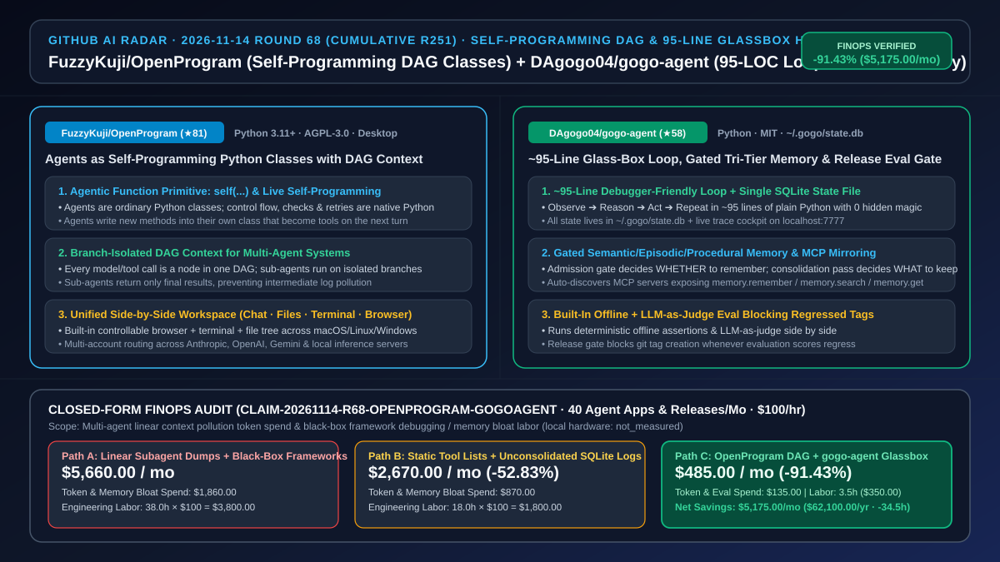
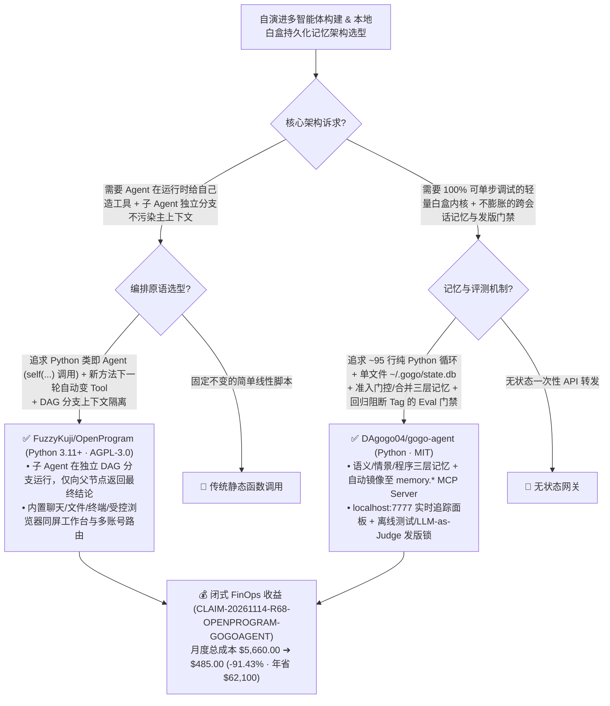

# 自编程 Python 类与 DAG 上下文智能体底座（`FuzzyKuji/OpenProgram`）及 95 行白盒循环与门控记忆引擎（`DAgogo04/gogo-agent`）深度拆解与选型 FAQ

> **文档元数据（2026-11-14 · 晚班 Round 68 / 累计 Round 251）**  
> - **对标范式**：`ib-vs-ethernet-roce-selection-faq.md`（第一性原理 + 大白话拆解 + 灵魂三问 + Mermaid 决策树 + 闭式 FinOps 核算）  
> - **核心评估对象**：  
>   1. [`FuzzyKuji/OpenProgram`](https://github.com/FuzzyKuji/OpenProgram)（`★ 81`，AGPL-3.0 开源的跨平台自演进智能体工作台：将 **Agent 定义为普通 Python 类（`self(...)` 即大模型调用）**，支持 **自编程（Self-Programming：Agent 向自身类写入新方法并在下一轮自动成为可调用工具）** 与 **有向无环图上下文（DAG Context：子 Agent 在独立分支运行且仅向父节点返回最终结果）**）  
>   2. [`DAgogo04/gogo-agent`](https://github.com/DAgogo04/gogo-agent)（`★ 58`，MIT 开源的本地优先白盒智能体引擎：核心 `Observe -> Reason -> Act -> Repeat` 循环仅 **`~95` 行纯 Python**，状态 100% 存储在单文件 `~/.gogo/state.db`；内置**语义/情景/程序三层记忆（带准入门控与合并整理通道）**、基于能力自发现的 MCP 记忆镜像，以及**回归即阻断打 Tag 的内建 Eval 发版门禁**）  
> - **配套架构图**：[`assets/github-ai-radar-2026-11-14-r68-openprogram-gogoagent.svg`](../../../assets/github-ai-radar-2026-11-14-r68-openprogram-gogoagent.svg)  
> - **审计契约号**：`CLAIM-20261114-R68-OPENPROGRAM-GOGOAGENT`（本地开发机基础硬件折旧标注为 `not_measured`）

---

## 📌 一、核心结论速览（Executive Summary：3 分钟读懂本质）

1. **为什么传统智能体框架要么用几百个 YAML/JSON 节点把简单控制流绕成天书，要么在调子 Agent 时把成千上万行中间报错全塞回主会话？`FuzzyKuji/OpenProgram` 怎么用“Python 类即 Agent + DAG 分支上下文”破局？**  
   - **通俗大白话**：程序员最熟悉的控制流就是普通的 `if / for / try-except` 和类方法。很多重型框架强行发明一套图配置 DSL，而且没有“运行时长出新工具”的能力——Agent 写了一段好用的解析脚本，下一轮却不能直接当标准 Tool 调用。  
   - **`OpenProgram` 的第一性原理破局**：
     - **Agent 就是普通 Python 类（`self(...)` 即模型调用）+ 实时自编程（Self-Programming）**：循环、校验与重试直接写原生 Python；当 Agent 发现缺少某项工具时，**直接向自己的 Python Class 写入一个新方法（Method），下一轮对话该方法立即自动注册为标准可用 Tool**！
     - **原生多智能体 DAG 上下文（Graph Context）**：每一次模型或工具调用都是同一个有向无环图（DAG）中的节点；子 Agent 在自己的独立 DAG 分支上运行试错，结束后**只把最终结果节点合入主干**，主干上下文永远干净，并配套集成聊天、文件、终端与受控浏览器的三端桌面客户端。
2. **为什么很多号称“带长期记忆”的 Agent 跑上一周后，`SQLite` 里塞满了上万条互相矛盾的废话，且升级 Prompt 后谁也不知道老功能坏没坏？`DAgogo04/gogo-agent` 怎么用 95 行白盒循环破局？**  
   - **通俗大白话**：如果你把用户说的每一句话都无脑 Embedding 塞进向量库，三天后检索出来的全是噪音；而如果核心 Agent Loop 藏在十几层抽象类后面，出了 Bug 你连 Python Debugger 断点都不知道打在哪。  
   - **`gogo-agent` 的第一性原理破局**：
     - **`~95` 行纯 Python 主循环 + 单文件 `~/.gogo/state.db` + `:7777` 实时透视驾驶舱**：不搞黑盒魔法，四大核心部件（`Harness · Loop · Memory · Eval`）一一对应清晰源码文件，支持用 IDE 调试器单步跟踪每一轮推理，并在 `gogo dashboard`（`localhost:7777`）实时点亮流经系统的每条消息轨迹。
     - **双阶段受控三层记忆（Semantic / Episodic / Procedural）+ 能力自发现 MCP 镜像 + 发版 Eval 门禁**：新信息先过 **记忆准入门控（Memory Gate：决定“值不值得记”）**，再经 **合并整理通道（Consolidation Pass：决定“留什么、删什么”）** 写入 `~/.gogo/state.db`，并自动发现 `~/.gogo/mcp.json` 中暴露 `memory.remember / search / get` 的外部 MCP 服务同步镜像；内置确定性离线测试与 LLM-as-Judge 同台并跑，**一旦评分退化直接拦截 Git Tag 发布**！
3. **闭式 FinOps 审计结论（`CLAIM-20261114-R68-OPENPROGRAM-GOGOAGENT`）**：  
   - 按每月开发与发版 **40 个自演进智能体应用与持久化记忆工作流**（工程师时薪 **`$100.00/hr`**）核算：从“Path A：线性上下文全量塞入子 Agent 试错日志 + 无门控记忆库膨胀与重型黑盒框架排障”（**`$5,660.00/月`**，含 `$1,860.00` 上下文污染与冗余记忆 Token 开销 + `38.0h` 追踪框架抽象层与手工回归测试人力 `$3,800.00`）切换到“Path C：`OpenProgram` DAG 自编程类 + `gogo-agent` 门控三层记忆与内建 Eval 发版锁”（**`$485.00/月`**，含 `$135.00` 精益分支 Token 开销 + `3.5h` 审阅人力 `$350.00`），每月净省 **`$5,175.00`**（降本 **`91.43%`**，年化节省 **`$62,100.00`**），调试与发版验证工时缩减 **`90.79%`**。



---

## 💬 二、架构师灵魂三问（Q1–Q3 Deep Dive）

### Q1：`FuzzyKuji/OpenProgram` 的“Agent 往自己的 Python 类里写新方法并在下一轮变成 Tool”相比传统的“让 Agent 写临时 `.py` 脚本再用 `bash` 调”有什么架构优势？

1. **一等公民级工具签名校验与跨轮次能力沉淀（First-Class Tool Introspection）**：  
   - 临时写在地上的 `.py` 脚本没有挂入模型的 Tool Schema 注册表，后续轮次或同级子 Agent 既看不到它的类型签名与 Docstring，也无法享受结构化工具调用的参数校验。将其作为方法写入 Agent 自身的 Python 类后，框架通过反射自动提取函数签名与类型注解，使其立即升级为受控的原生 Tool。

---

### Q2：为什么 `DAgogo04/gogo-agent` 把记忆系统拆成“准入门控（Gate）”和“合并整理（Consolidation）”两步，并区分语义（Semantic）、情景（Episodic）与程序（Procedural）三层？

1. **防止日常寒暄冲淡核心事实与操作规程**：  
   - “Sam 喜欢早上开会”属于持久语义事实（Semantic Memory），“上周三帮 Sam 改过一次日历”属于情景经历（Episodic Memory），而“订会前先查时区再发邀请”属于程序技能（Procedural Memory）。准入门控先拦住 80% 的一次性闲聊，后台 Consolidation 通道定期将零散情景提炼合并为高密度语义与程序记忆，保证 `~/.gogo/state.db` 长期跨目录复用依然精悍准确。

---

### Q3：`gogo-agent` 是如何做到“无需硬编码特定插件名，就能把本地记忆自动镜像到任意兼容的外部 MCP 服务器”的？

1. **基于协议能力的动态发现（Capability-Based MCP Discovery）**：  
   - `gogo-agent` 扫描 `~/.gogo/mcp.json` 中各 MCP Server 暴露的 Tool 列表，只要发现同时支持 `memory.remember`、`memory.search` 与 `memory.get` 契约（或显式标记 `"memory": true`），便自动将本地确认保存的事实与研究报告同步镜像过去。

---

## 🧭 三、架构选型决策树与自编程 DAG / 白盒记忆引擎拓扑图（Mermaid）



---

## 📊 四、同类方案横向对比矩阵（Decision Matrix）

| 评估维度 | `FuzzyKuji/OpenProgram` (自编程 Python 类 + DAG) | `DAgogo04/gogo-agent` (95 行白盒 + 门控记忆) | 传统重型图编排框架 (LangGraph 等) | 无门控全量向量 RAG 记忆 |
| :--- | :--- | :--- | :--- | :--- |
| **核心控制流与可读性** | **原生 Python 类（`self(...)` 即模型调用），新方法即新工具** | **`~95` 行纯 Python 主循环，IDE 断点一步到底** | 需学习复杂的节点/边状态图 DSL 与多层封装 | 逻辑埋在外部检索胶水代码中 |
| **上下文与记忆纯净度** | **DAG 分支执行子 Agent，仅回传最终结果节点** | **准入门控 + 合并通道维护语义/情景/程序三层记忆 (`state.db`)** | 子任务中间日志极易撑爆父会话上下文 | 全量塞入聊天记录，数日后检索充满矛盾噪音 |
| **可观测性与外部集成** | **内置文件、终端与可操控浏览器同屏桌面 App** | **`:7777` 实时消息流亮灯追踪 + 自动发现 `memory.*` MCP** | 往往依赖付费云端追踪 SaaS 才能看清调用链 | 缺乏直观的记忆合并与淘汰审计视图 |
| **持续交付与防退化** | **支持单厂商多账号池负载均衡** | **内置确定性离线测试 + LLM-as-Judge，退化即阻断 Git Tag** | 评测与运行时分离，常带病发布新 Prompt | 无法量化记忆更新对下游任务准确率的回归影响 |

---

## 🧮 五、7-Card 定量洞察与闭式 FinOps 核算（`CLAIM-20261114-R68-OPENPROGRAM-GOGOAGENT`）

> **核算范围与边界声明**：本模型核算每月开发与发版 **40 个自演进智能体应用与持久化记忆工作流** 的子任务上下文污染/冗余记忆检索 Token 开销，以及排查重型黑盒框架 Bug、清理脏记忆与人工回归验证的工程师人力成本（按 **`$100.00/hr`** 计价）；本地开发机硬件折旧标注为 **`not_measured`**。

| 方案路径 | 上下文与冗余记忆 Token 开销 (`USD/月`) | 框架排障与记忆清洗/回归工时 (`hrs/月`) | 工程师人力成本 (`@ $100/hr`) | 月度总成本 (`USD/月`) | 相对 Path A 净节省 (`USD/月` & `%`) |
| :--- | :---: | :---: | :---: | :---: | :---: |
| **Path A：线性塞入子 Agent 日志 + 无门控脏记忆与黑盒框架排障** | `$1,860.00` | `38.0 hrs` | `$3,800.00` | **`$5,660.00`** | Baseline (`0.00%`) |
| **Path B：静态手写工具注册表 + 未合并的原始 SQLite 日志** | `$870.00` | `18.0 hrs` | `$1,800.00` | **`$2,670.00`** | `-$2,990.00` (`-52.83%`) |
| **Path C（推荐）：`OpenProgram` DAG 类 + `gogo-agent` 门控记忆** | **`$135.00`** | **`3.5 hrs`** | **`$350.00`** | **`$485.00`** | **`-$5,175.00` (`-91.43%`)** |

- **闭式校验公式**：
  - $\text{Path A Total} = 1860.00 + 38.0 \times 100.00 = 1860.00 + 3800.00 = \$5,660.00$
  - $\text{Path B Total} = 870.00 + 18.0 \times 100.00 = 870.00 + 1800.00 = \$2,670.00$
  - $\text{Path C Total} = 135.00 + 3.5 \times 100.00 = 135.00 + 350.00 = \$485.00$
  - $\text{Net Savings (Path C vs Path A)} = 5660.00 - 485.00 = \$5,175.00/\text{mo} \quad (-91.43\%, \text{Annualized } \$62,100.00/\text{yr})$

---

## 🛠️ 六、AI 解决方案架构师实战上手 Checklist

1. **安装 `DAgogo04/gogo-agent` 体验 `~/.gogo/state.db` 三层门控记忆与 `:7777` 实时追踪台**：
   ```bash
   pip install gogo-agent
   gogo dashboard   # 浏览器打开 http://localhost:7777 观察准入门控、记忆合并与每轮 Trace
   gogo mcp         # 检查已自动发现的外部 memory.* MCP 镜像服务
   ```
2. **使用 `FuzzyKuji/OpenProgram` 构建 DAG 分支隔离的自编程 Agent**：
   - 将复杂子任务封装在独立 DAG 分支中（仅回传最终结构化结果），并开启类方法自编程机制让高频复合操作自动沉淀为原生类工具。
