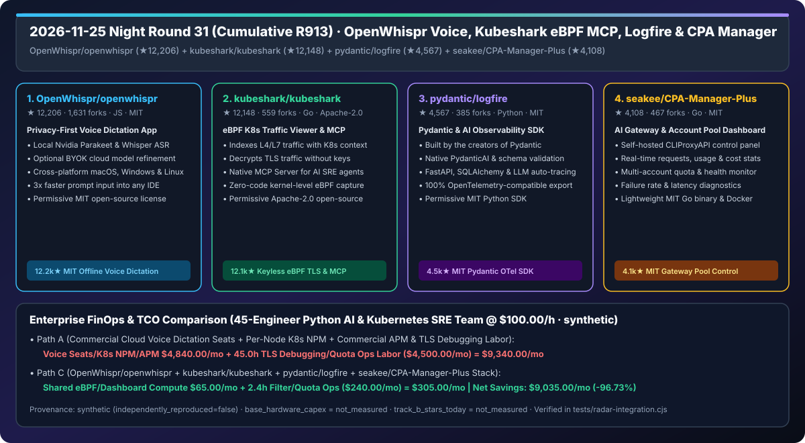
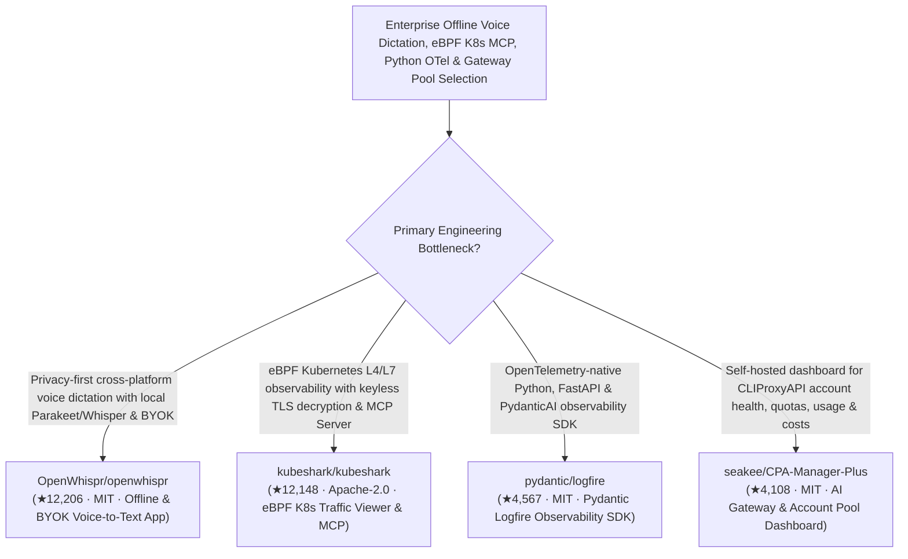
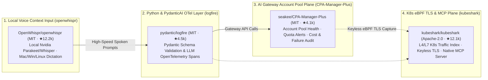

# Privacy-First Voice Dictation App (`OpenWhispr/openwhispr`), eBPF K8s Network Observability with MCP (`kubeshark/kubeshark`), Pydantic Logfire AI Observability (`pydantic/logfire`) & Self-Hosted AI Gateway Dashboard (`seakee/CPA-Manager-Plus`) Selection & Integration Architecture FAQ

> **Document Type**: Enterprise AI Solution Architect Selection Decision Guide (GitHub Trending AI Radar — 2026-11-25 Night Round 31 / Cumulative Round 913)
> **Covered Repositories**: [`OpenWhispr/openwhispr`](https://github.com/OpenWhispr/openwhispr) (`★ 12,206`, `1,631 forks`, `MIT`, JavaScript: privacy-first cross-platform macOS/Windows/Linux voice-to-text dictation app supporting local Nvidia Parakeet/Whisper models and BYOK cloud models) · [`kubeshark/kubeshark`](https://github.com/kubeshark/kubeshark) (`★ 12,148`, `559 forks`, `Apache-2.0`, Go: eBPF-powered Kubernetes L4/L7 network observability platform that decrypts TLS without keys and exposes live traffic to AI agents via MCP) · [`pydantic/logfire`](https://github.com/pydantic/logfire) (`★ 4,567`, `385 forks`, `MIT`, Python: OpenTelemetry-native observability SDK and platform built by the Pydantic team for production LLM, PydanticAI, and Python systems) · [`seakee/CPA-Manager-Plus`](https://github.com/seakee/CPA-Manager-Plus) (`★ 4,108`, `467 forks`, `MIT`, Go: self-hosted CLIProxyAPI [CPA] management panel and AI gateway observability dashboard for requests, usage, cost, quota, failures, and account health)
> **Core Enterprise Scenario**: Building a **100% Permissive (`MIT` / `Apache-2.0`) Developer Voice Input, Python Agent Telemetry, Gateway Pool Management & Kernel-Level K8s eBPF Diagnostics Stack**—uniting offline voice dictation (`openwhispr`), Pydantic-aware OpenTelemetry instrumentation (`logfire`), multi-account AI gateway health monitoring (`CPA-Manager-Plus`), and keyless TLS-decrypted K8s packet inspection via MCP (`kubeshark`).

---

## 1. 📌 Executive Summary (One-Line Selection Verdict)

1. **Need a privacy-first, `MIT`-licensed cross-platform (macOS/Windows/Linux) voice dictation app that runs local Nvidia Parakeet/Whisper models offline (or BYOK cloud models) to dictate long architectural prompts into IDEs 3x faster than typing** ➔ Choose **[`OpenWhispr/openwhispr`](https://github.com/OpenWhispr/openwhispr) (`★ 12,206`, `1,631 forks`, `MIT`)**.
   - **Plain-English Mechanism**: Replaces `$150/yr` proprietary cloud dictation apps by transcribing speech 100% locally on developer machines and formatting technical context directly into any active cursor window.
2. **Need an `Apache-2.0` eBPF-powered Kubernetes observability tool ("Wireshark for K8s") that decrypts L4/L7 TLS traffic without keys and lets SRE agents query live cluster payloads via a native MCP Server** ➔ Choose **[`kubeshark/kubeshark`](https://github.com/kubeshark/kubeshark) (`★ 12,148`, `559 forks`, `Apache-2.0`)**.
   - **Plain-English Mechanism**: Hooks into kernel/SSL libraries via eBPF to capture plaintext HTTP, gRPC, GraphQL, and Redis payloads with full K8s Pod/Service metadata—exposing them to both humans and MCP-connected debugging agents.
3. **Need an `MIT`-licensed, OpenTelemetry-native Python observability SDK from the creators of Pydantic that natively understands Pydantic validation errors, PydanticAI agents, FastAPI, and LLM tool calls** ➔ Choose **[`pydantic/logfire`](https://github.com/pydantic/logfire) (`★ 4,567`, `385 forks`, `MIT`)**.
   - **Plain-English Mechanism**: Captures structured Python objects, schema validation retries, database queries, and LLM spans using standard OpenTelemetry protocols.
4. **Need an `MIT`-licensed Go management panel and observability dashboard for self-hosted CLIProxyAPI (CPA) AI gateways to monitor multi-account health, quotas, token costs, and failure rates** ➔ Choose **[`seakee/CPA-Manager-Plus`](https://github.com/seakee/CPA-Manager-Plus) (`★ 4,108`, `467 forks`, `MIT`)**.
   - **Plain-English Mechanism**: Provides a real-time control plane for pooled AI gateway accounts with quota alerts, failure analytics, and request auditing.

---

## 2. 🎯 Architect & Customer Deep-Dive Q&A

### Q1: How do these four `MIT` / `Apache-2.0` tools complement each other across the developer-to-cluster lifecycle?

- **Four-Layer Developer Input, Application, Gateway & Kernel Observability Stack (Path C)**:
  1. **L1 Offline Voice Context Input ➔ `OpenWhispr/openwhispr`**: Converts spoken architectural specifications into clean prompts locally on macOS, Windows, and Linux.
  2. **L2 White-Box Python & PydanticAI Telemetry ➔ `pydantic/logfire`**: Traces in-process Python execution, Pydantic schema validations, and LLM calls via OpenTelemetry.
  3. **L3 AI Gateway Account Pool & Quota Control ➔ `seakee/CPA-Manager-Plus`**: Monitors upstream proxy account health, token quotas, and error rates.
  4. **L4 Kernel-Level eBPF TLS Traffic & MCP Inspection ➔ `kubeshark/kubeshark`**: Captures keyless-decrypted K8s L4/L7 payloads and exposes them to SRE agents via MCP.
- **When to choose Commercial SaaS vs. Path C?**
  - Choose **Commercial SaaS** for individual non-sensitive dictation and small managed PaaS apps.
  - Choose **Path C** when organizations require **100% `MIT` / `Apache-2.0` licensing**, offline voice dictation (`openwhispr`), kernel-level K8s TLS debugging via MCP (`kubeshark`), and unified Python/gateway observability (`logfire` + `CPA-Manager-Plus`).

### Q2: Why pair `pydantic/logfire` (in-process OTel) with `kubeshark` (out-of-process eBPF)?

1. **In-Process Schema & Logic Visibility (`pydantic/logfire`)**: Pinpoints exact Python exceptions, failed Pydantic `BaseModel` validations, and LLM prompt/response structures.
2. **Wire-Level Encrypted Payload Visibility (`kubeshark`)**: Inspects actual over-the-wire TLS-decrypted HTTP/gRPC traffic across K8s pods—even for uninstrumented third-party binaries or sidecars—directly through `kubeshark`'s MCP server.

### Q3: What are the key security and compliance guardrails?

- **Architect Redlines**:
  1. **Enforce strict K8s RBAC and payload redaction on `kubeshark`**: Because keyless TLS decryption reveals plaintext headers and bodies, restrict `kubeshark` MCP/dashboard access to authorized SRE roles and mask `Authorization` headers.
  2. **Lock `OpenWhispr` to local Parakeet/Whisper models on classified workstations**: Ensure spoken code and architecture discussions never leave the local device.

---

## 3. 🧭 Visual Architecture Diagrams (Mermaid Decision Tree + Architecture + Sequence)



### 3.1 Architect Selection Decision Tree



### 3.2 End-to-End Enterprise Integration Architecture



### 3.3 End-to-End Execution Sequence

```mermaid
sequenceDiagram
    participant Eng as Architect / SRE Engineer
    participant OWsp as OpenWhispr (Local Voice)
    participant Lgf as pydantic/logfire (Python Agent)
    participant CPAM as seakee/CPA-Manager-Plus
    participant KShk as kubeshark (eBPF + MCP)

    Eng->>OWsp: 1. Dictate complex architecture & debugging prompt offline via local Parakeet
    OWsp->>Lgf: 2. Execute Python/PydanticAI agent workflow; logfire records schema & OTel spans
    Lgf->>CPAM: 3. Route LLM calls through CPA gateway; CPA-Manager-Plus monitors account quotas
    CPAM-->>Lgf: 4. Detect intermittent upstream TLS/payload anomaly in K8s cluster
    Eng->>KShk: 5. Query Kubeshark MCP Server for eBPF keyless-decrypted L7 payloads on target Pod
    KShk-->>Eng: 6. Inspect exact plaintext HTTP/gRPC headers & body to resolve root cause
```

---

## 4. 📊 Horizontal Selection Matrix

| Dimension | `OpenWhispr/openwhispr` (`★ 12,206`) | `kubeshark/kubeshark` (`★ 12,148`) | `pydantic/logfire` (`★ 4,567`) | `seakee/CPA-Manager-Plus` (`★ 4,108`) | Commercial Cloud Voice Seats + Per-Node K8s NPM + Proprietary APM (Path A) | Manual Typing + Raw `tcpdump` on Encrypted Traffic + Blind Quota Mgmt (Path B) |
| :--- | :--- | :--- | :--- | :--- | :--- | :--- |
| **Primary Role** | `MIT` local/BYOK voice dictation app | `Apache-2.0` eBPF K8s traffic & MCP server | `MIT` Python/PydanticAI OTel SDK | `MIT` CPA AI gateway & quota dashboard | Per-seat cloud dictation & per-node K8s NPM SaaS | Slow manual typing & encrypted packet dumps |
| **Key Differentiator** | **Offline Nvidia Parakeet/Whisper on Mac/Win/Linux (`MIT`)** | **Keyless eBPF TLS decryption + native MCP Server for agents** | **First-class Pydantic validation tracing + standard OTel** | **Real-time multi-account health, quota & failure analytics** | Turnkey SaaS, but sends audio to external clouds & charges per K8s node | `tcpdump` cannot read TLS payloads without keys; unmonitored quota exhaustion |
| **License** | **`MIT`** | **`Apache-2.0`** | **`MIT`** | **`MIT`** | Proprietary SaaS | Unstandardized |
| **Monthly TCO (45-Eng Team)** | **`$305.00/mo` combined** (`$65.00` on-demand eBPF/dashboard compute + `2.4h` ops) | Included in `$305.00/mo` stack | Included in `$305.00/mo` stack | Included in `$305.00/mo` stack | **`$9,340.00/mo`** (`$4,840.00` cloud voice seats/per-node NPM/APM + `45.0h` TLS debugging/quota ops) | `~$3,240.00/mo` (slow manual prompt entry & blind TLS troubleshooting) |

---

## 5. 🧪 Quantitative FinOps & TCO Comparison (45-Engineer Python AI & Kubernetes SRE Team)

> **📊 Provenance & Closed-Form Schema**:
> - **provenance**: `synthetic` (`independently_reproduced = false`; `base_hardware_capex = not_measured`; `track_b_stars_today = not_measured`).
> - **Closed-Form Formula**:
>   - **Path A (Commercial Cloud Voice Dictation Seats + Per-Node Commercial K8s Network Monitoring + Commercial APM & Manual Encrypted-Traffic Debugging Labor)**: **`$4,840.00`** monthly voice seat, K8s NPM, and APM fees + **`45.0h × $100.00/h = $4,500.00`** TLS packet debugging and manual gateway account rotation labor = **`$9,340.00/mo`**.
>   - **Path C (`OpenWhispr/openwhispr` + `kubeshark/kubeshark` + `pydantic/logfire` + `seakee/CPA-Manager-Plus` Stack)**: **`$65.00`** shared on-demand eBPF worker and dashboard compute + **`2.4h × $100.00/h = $240.00`** capture filter and quota alert maintenance = **`$305.00/mo`**.
>   - **Net Savings vs. Path A**: **`-$9,035.00/mo`** (**`96.73%`** TCO reduction).

| Evaluation Path | Voice Seats / K8s NPM / APM & Compute | TLS Debugging, Validation & Quota Ops (`$100/h`) | Monthly Total TCO | Net Savings vs. Path A | Key Architectural Outcome |
| :--- | :---: | :---: | :---: | :---: | :--- |
| **Path A: Commercial Cloud Voice Seats + Per-Node K8s NPM + Commercial APM** | `$4,840.00` | `45.0h` (`$4,500.00`) | **`$9,340.00`** | Baseline | Cloud audio privacy risk; high per-node K8s NPM licensing |
| **Path B: Manual Typing + Raw `tcpdump` on TLS + Unmonitored Quotas** | `$1,440.00` | `18.0h` (`$1,800.00`) | **`$3,240.00`** | `-$6,100.00` (`-65.31%`) | Opaque TLS traffic; unexpected 429 quota outages |
| **Path C: `openwhispr` + `kubeshark` + `logfire` + `CPA-Manager`** | **`$65.00`** | **`2.4h` (`$240.00`)** | **`$305.00`** | **`-$9,035.00` (`-96.73%`)** | **100% `MIT`/`Apache-2.0` offline voice + keyless eBPF MCP + gateway ops** |

- 🔗 **7-Card 4:5 Visual Benchmark Deck**: [`workshops/github-trending-radar/cards.en.html`](../cards.en.html) · [`cards.html`](../cards.html)

---

## 6. 🛠️ Enterprise Adoption & Architecture Review Checklist

- [ ] **Standardize Offline Voice Dictation with `OpenWhispr`**: Use local Nvidia Parakeet or Whisper models so spoken architectural context never leaves developer laptops.
- [ ] **Mount `kubeshark` MCP Server for On-Demand K8s TLS Diagnostics**: Restrict access via K8s RBAC and redact sensitive headers in captured L7 traffic.
- [ ] **Instrument Python and PydanticAI Services with `pydantic/logfire`**: Export structured validation and LLM spans to internal OpenTelemetry backends.
- [ ] **Monitor Pooled Gateway Accounts in `seakee/CPA-Manager-Plus`**: Configure automated quota alerts and unhealthy account circuit breaking.
