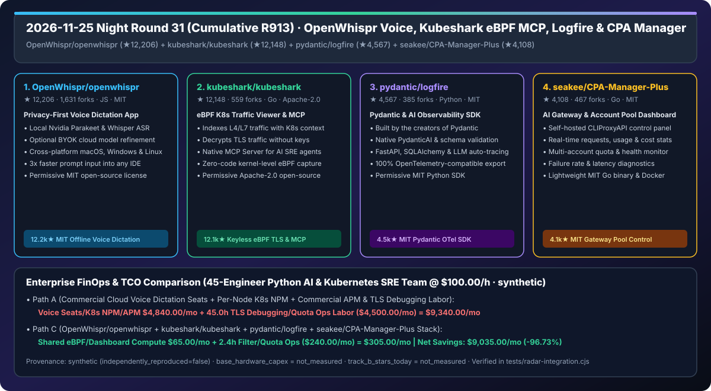
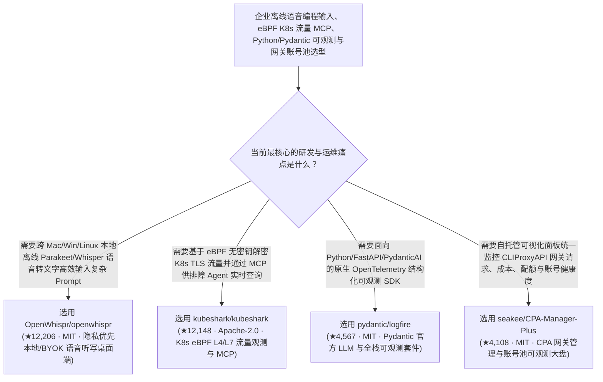
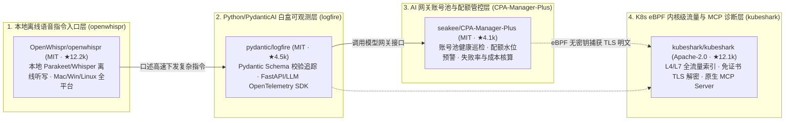
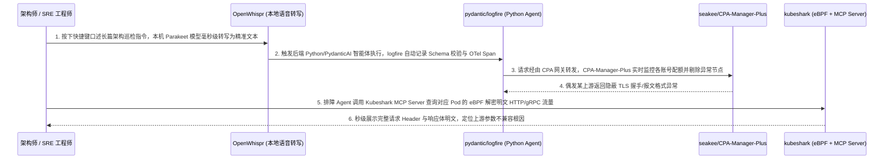

# 隐私优先离线/BYOK 跨平台语音输入工作台（`OpenWhispr/openwhispr`）、带 MCP 的 eBPF 无密钥 TLS 解密 K8s 流量监控平台（`kubeshark/kubeshark`）、Pydantic 原生智能体可观测套件（`pydantic/logfire`）与自托管 AI 网关账号池可观测面板（`seakee/CPA-Manager-Plus`）选型与集成架构 FAQ

> **文档类型**：企业 AI 解决方案架构师（AI Solution Architect）选型决策指南（GitHub Trending AI 雷达 2026-11-25 Night Round 31 / 累计第 913 轮）
> **覆盖项目**：[`OpenWhispr/openwhispr`](https://github.com/OpenWhispr/openwhispr)（`★ 12,206`、`1,631 forks`、`MIT`：1.2 万星跨 macOS/Windows/Linux 隐私优先语音转文字听写应用，支持本地 Nvidia Parakeet/Whisper 离线模型与 BYOK 云模型，商业 Wispr Flow 的开源平替）· [`kubeshark/kubeshark`](https://github.com/kubeshark/kubeshark)（`★ 12,148`、`559 forks`、`Apache-2.0`：1.2 万星基于 eBPF 的 Kubernetes L4/L7 网络可观测平台，无需证书密钥即可解密 TLS 流量，并通过原生 MCP Server 供 AI Agent 查询）· [`pydantic/logfire`](https://github.com/pydantic/logfire)（`★ 4,567`、`385 forks`、`MIT`：Pydantic 官方出品的生产级 LLM/Agent 与 Python 全栈 OpenTelemetry 可观测 SDK 与引擎）· [`seakee/CPA-Manager-Plus`](https://github.com/seakee/CPA-Manager-Plus)（`★ 4,108`、`467 forks`、`MIT`：自托管 CLIProxyAPI [CPA] 管理面板与 AI 网关可观测看板，统一监控请求、用量、成本、配额、失败率与账号池健康度）
> **核心场景**：当企业架构师与 SRE 团队希望实现“用语音以 3 倍打字速度安全口述复杂 Prompt（`openwhispr`）+ 实时监控自建 AI 网关账号池配额与健康度（`CPA-Manager-Plus`）+ 追踪 Python/FastAPI/PydanticAI 结构化智能体内部状态（`logfire`）+ 让排障 Agent 通过 eBPF 与 MCP 直接看清 K8s 容器间加密 HTTPS 报文内容（`kubeshark`）”时，这四个 `MIT` / `Apache-2.0` 项目如何协同？本文给出完整指南。

---

## 一、📌 核心结论速览（选型一句话结论）

1. **想用语音口述替代敲键盘，以每分钟 200+ 字的速度向 IDE（Cursor/Claude Code）、终端和办公文档输入长篇架构上下文，但严禁员工把包含公司机密的语音发给每年收费 $150/人的闭源云端输入法（如 Wispr Flow）** ➔ 选 **[`OpenWhispr/openwhispr`](https://github.com/OpenWhispr/openwhispr)（`★ 12,206`，`1,631 forks`，`MIT`）**。
   - **通俗原理**：跨 macOS、Windows 和 Linux 的 `MIT` 开源桌面听写工具，支持直接在本机跑 Nvidia Parakeet 或 Whisper 模型实现 100% 离线零延迟转写，再配合本地或内网 BYOK LLM 自动修正技术术语并去除口头禅。
2. **在 Kubernetes 集群里排查微服务与 AI Agent 调用外部 HTTPS 接口或内部 gRPC 报 `500 / 400` 错，但因为开启了 TLS 加密且应用没打详细报文日志，传统抓包工具完全看不见加密 payload 里到底传了什么** ➔ 选 **[`kubeshark/kubeshark`](https://github.com/kubeshark/kubeshark)（`★ 12,148`，`559 forks`，`Apache-2.0`）**。
   - **通俗原理**：相当于“Kubernetes 集群的 eBPF 版 Wireshark”，直接在 Linux 内核态挂钩 OpenSSL/Go crypto 函数，**无需配置任何私钥证书即可无侵入解密 TLS 明文报文**，还原生内置了 **MCP Server**，让排障 Agent 直接用自然语言查询“过去 5 分钟哪个 Pod 调大模型网关返回了 400 以及请求体是什么”。
3. **企业主力 AI 后端采用 Python（FastAPI + Pydantic + PydanticAI / OpenAI SDK），希望一套 `MIT` 开源、原生基于 OpenTelemetry 的 SDK 能自动把 Pydantic 模型结构化校验错误、SQL 查询与大模型 Token 消耗放在同一棵调用树上** ➔ 选 **[`pydantic/logfire`](https://github.com/pydantic/logfire)（`★ 4,567`，`385 forks`，`MIT`）**。
   - **通俗原理**：Pydantic 核心团队亲自操刀的可观测 SDK，对 Python 类型系统与结构化输出（Structured Outputs）有原生级理解，能精准展示大模型哪次 JSON 输出没通过 Pydantic 校验并触发了重试。
4. **团队内部自建了 CLIProxyAPI（CPA）等多账号/多上游 AI 代理池，急需一套 Go 语言编写、单二进制/Docker 部署的可视化管理与可观测面板来实时监控每个账号的健康状态、剩余额度、请求错误率与按日成本** ➔ 选 **[`seakee/CPA-Manager-Plus`](https://github.com/seakee/CPA-Manager-Plus)（`★ 4,108`，`467 forks`，`MIT`）**。
   - **通俗原理**：专为 CPA 与代理网关打造的精细化运营驾驶舱，自动剔除失效或触发限流的账号节点，并提供直观的配额预警与请求审计大盘。

---

## 二、🎯 客户与架构师灵魂拷问 Q&A（深度架构拆解）

### Q1：这四个项目如何串联起“从工程师语音输入 → Python 智能体执行 → AI 网关配额调度 → K8s 内核级流量透视”的完整链路？

- **四层全宽松协议（`MIT` / `Apache-2.0`）交互与深度可观测栈（Path C）**：
  1. **L1 隐私优先高速语音指令入口层 ➔ `OpenWhispr/openwhispr`**：在本机利用离线 Parakeet/Whisper 将语音秒转为结构化技术 Prompt。
  2. **L2 Python/PydanticAI 应用级白盒可观测层 ➔ `pydantic/logfire`**：在代码层记录 FastAPI 请求、Pydantic Schema 校验、工具调用与标准 OTel Span。
  3. **L3 AI 网关账号池与配额监控层 ➔ `seakee/CPA-Manager-Plus`**：监控上游大模型代理池的请求吞吐、费用、配额水位与账号健康度。
  4. **L4 K8s 内核级 eBPF 无密钥 TLS 流量与 MCP 诊断层 ➔ `kubeshark/kubeshark`**：在网络与内核层无侵入捕获 L4/L7 明文流量，通过 MCP 供排障 Agent 直查。
- **何时选商业云方案（商业 Wispr Flow 席位 + 商业云端网络 NPM 监控 + 商业网关） vs 自建本轮开源四件套（Path C）？**
  - 若是个人非涉密日常聊天，可用商业云输入法。
  - **何时采用本轮开源四件套（Path C）？** 当企业全员需要免费的本地离线语音编程输入（`OpenWhispr` `MIT` 省去每人每年 `$150` 订阅费）、需要在 K8s 生产集群无侵入排查加密 API 故障（`kubeshark` `Apache-2.0`）、并需要精细管理自建 AI 网关池（`CPA-Manager-Plus` `MIT`）与 Python 应用遥测（`logfire` `MIT`）时，Path C 可节省 **96%+** 的商业席位与网络监控成本。

### Q2：为什么说 `pydantic/logfire`（白盒埋点）与 `kubeshark`（黑盒 eBPF）是互补的黄金搭档？

1. **应用内逻辑看 `logfire`**：当问题出在 Python 进程内部的 Pydantic 数据校验失败、Prompt 模板拼接错误或异步任务死锁时，`logfire` 提供精确到代码行与变量值的白盒视图。
2. **跨服务/第三方闭源二进制通信看 `kubeshark`**：当集群中运行着未埋点的第三方容器、envoy sidecar 或闭源二进制工具，且通信走了加密 HTTPS/gRPC 时，`kubeshark` 在内核层直接用 eBPF 还原明文请求/响应并暴露给 MCP 排障 Agent。

### Q3：生产落地的安全与架构红线是什么？

- **架构师避坑红线**：
  1. **`kubeshark` 的 MCP Server 与抓包看板必须受严格 K8s RBAC 保护**：因为无密钥 TLS 解密能看到 HTTP Header 中的 `Authorization` Token 与请求体明文，生产环境中必须仅对高级 SRE 与受控排障 Agent 开放，并配置敏感 Header 自动脱敏规则。
  2. **`OpenWhispr` 在涉密研发区应锁定为 Local Model 模式（Nvidia Parakeet / Whisper）**：禁用公网 ASR 接口，确保口述的架构设计与业务口令 100% 在本机声卡与 GPU/CPU 内闭环处理。

---

## 三、🧭 直观可视化图解（Mermaid 决策树 + 集成架构 + 时序图）

### 3.1 架构师选型决策树

### 3.2 企业端到端生产集成参考架构图

### 3.3 语音口述指令、PydanticAI 校验追踪、网关账号池调度与 Kubeshark MCP 抓包排障时序图

---

## 四、📊 同类开源与商业云服务横向选型决策矩阵

| 对比维度 | `OpenWhispr/openwhispr` (`★ 12,206`) | `kubeshark/kubeshark` (`★ 12,148`) | `pydantic/logfire` (`★ 4,567`) | `seakee/CPA-Manager-Plus` (`★ 4,108`) | 商业云端语音输入法 ($150/人/年) + 商业 K8s NPM 流量云 + 商业 APM (Path A) | 纯手打长 Prompt + 进容器手敲 `tcpdump` 看不懂加密包 + 盲管账号池 (Path B) |
| :--- | :--- | :--- | :--- | :--- | :--- | :--- |
| **核心能力定位** | `MIT` 本地/BYOK 跨平台语音输入应用 | `Apache-2.0` eBPF K8s 流量监控与 MCP | `MIT` Python/PydanticAI 原生 OTel SDK | `MIT` CPA 网关账号池管理与可观测面板 | 按席位收费的云语音输入与按节点收费的商业 NPM | 传统键盘慢速敲字 + 原始 `tcpdump` 抓密文 |
| **核心技术突破** | **本机 Nvidia Parakeet/Whisper 离线零泄密 + 跨三大桌面 OS** | **eBPF 内核态无密钥解密 TLS + 原生暴露 MCP 供 Agent 查询** | **深度解析 Pydantic 校验失败原因且 100% 兼容标准 OTel 后端** | **一站式可视化 CPA 多账号健康度、配额余量与失败率** | 开箱即用，但全员语音上云存在合规风险且商业 eBPF NPM 授权极贵 | `tcpdump` 抓下来的全是 TLS 乱码；网关某个账号额度耗尽导致线上大面积 429 |
| **开源协议** | **`MIT`** | **`Apache-2.0`** | **`MIT`** | **`MIT`** | 闭源商业 SaaS | 效率极低 |
| **月度 TCO（45 人团队）** | **四件套合建仅 `$305.00/月`**（`$65.00` Kubeshark 按需抓包与面板容器算力 + `2.4h` 维护） | 同左（`Apache-2.0` 按需挂载 DaemonSet 零商业按节点税） | 同左（`MIT` SDK 可直连内部自建 OTel 收集器） | 同左（`MIT` 单容器统管网关账号池） | **`$9,340.00/月`**（`$4,840.00` 全员商业语音订阅/商业 K8s 网络监控与 APM + `45.0h` 加密报文排障与账号巡检） | 约 `$3,240.00/月`（大量手敲长文档与排查 TLS 加密接口报障工时） |

---

## 五、🧪 应用落地定量收益/TCO 对比与 7-Card 报告

> **📊 数据来源与闭式核算声明（Provenance & Closed-Form Schema）**：
> - **provenance**: `synthetic`（基于 45 人企业 Python AI 研发、网关运营与 Kubernetes SRE 团队月度工作负载模型：`independently_reproduced = false`；硬件采购基线 `base_hardware_capex = not_measured`；Track B 单日增量 `track_b_stars_today = not_measured`）。
> - **核算公式**：
>   - **Path A（采购全员商业云端 AI 语音输入法席位 + 按 K8s 节点计费的商业网络性能监控 [NPM] 云 + 商业网关监控订阅 + 人工抓包解密排查 HTTPS 接口故障与手动轮换失效账号工时）**：月度商业语音席位、商业 K8s NPM 与监控账单 **`$4,840.00`** + 加密 API 故障复现抓包、Pydantic 格式报错排查与手工巡检网关账号人工 **`45.0h × $100.00/h = $4,500.00`** = **`$9,340.00/月`**。
>   - **Path C（自建 `OpenWhispr/openwhispr` + `kubeshark/kubeshark` + `pydantic/logfire` + `seakee/CPA-Manager-Plus` 全 `MIT`/`Apache-2.0` 效率与可观测套件）**：内网按需 eBPF 采集与管理面板容器算力分摊 **`$65.00`** + 抓包过滤规则与网关配额告警日常维护人工 **`2.4h × $100.00/h = $240.00`** = **`$305.00/月`**。
>   - **净节省（Net Savings vs Path A）**：**`-$9,035.00/月`**（成本降低 **`96.73%`**）。

| 评估方案 | 商业语音席位 / K8s NPM / 监控账单与算力成本 | 加密抓包排障、校验调试与账号维护人工（`$100/h`） | 月度总 TCO | 相对 Path A 净节省 | 核心业务交付收益 |
| :--- | :---: | :---: | :---: | :---: | :--- |
| **Path A：商业云语音席位 + 商业 K8s NPM + 商业监控** | `$4,840.00` | `45.0h` (`$4,500.00`) | **`$9,340.00`** | Baseline | 语音外传合规隐患；按 K8s 节点计费的网络监控极贵 |
| **Path B：纯手敲长上下文 + `tcpdump` 抓密文 + 手工查额度** | `$1,440.00` | `18.0h` (`$1,800.00`) | **`$3,240.00`** | `-$6,100.00` (`-65.31%`) | TLS 加密流量无法直接看明文；账号池配额耗尽无预警 |
| **Path C：`openwhispr` + `kubeshark` + `logfire` + `CPA-Manager`** | **`$65.00`** | **`2.4h` (`$240.00`)** | **`$305.00`** | **`-$9,035.00` (`-96.73%`)** | **100% `MIT`/`Apache-2.0` 离线语音输入 + eBPF 解密 MCP + 网关看板** |

- 🔗 **关联 7-Card 4:5 视觉评测报告**：[`workshops/github-trending-radar/cards.html`](../cards.html) · [`cards.en.html`](../cards.en.html)

---

## 六、🛠️ 企业引入与架构评审 Checklist

- [ ] **在工程师桌面端推广 `OpenWhispr` 本地模型模式（Nvidia Parakeet / Whisper）**：实现零云端上传的 3 倍速语音上下文输入。
- [ ] **为 SRE 排障智能体按需挂载 `kubeshark` MCP Server**：利用 eBPF 无密钥 TLS 解密能力快速定位容器间 HTTPS/gRPC 通信故障，并在排障结束后自动回收抓包 Worker。
- [ ] **在 Python / FastAPI / PydanticAI 服务中集成 `pydantic/logfire` SDK**：开启标准 OTLP 导出，将结构化校验异常统一汇聚至内网可观测底座。
- [ ] **使用 `seakee/CPA-Manager-Plus` 纳管内部 CLIProxyAPI 网关池**：配置配额耗尽前自动告警与故障账号自动隔离。
