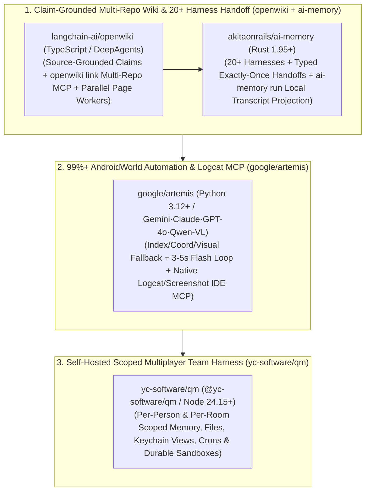

# Claim-Grounded Multi-Repo Living Wiki (`langchain-ai/openwiki`), Google `99%+` AndroidWorld & Logcat MCP (`google/artemis`), 20+ Harness Session-Projecting Memory (`akitaonrails/ai-memory`) & Y Combinator Multiplayer Team Harness (`yc-software/qm`) Selection FAQ

> **Document Type**: Practical Selection & Architecture Guide for AI Solution Architects (2026-11-18 Night Shift · Round 38 / Cumulative Round 518)  
> **Benchmark Standard**: `docs/components/ib-vs-ethernet-roce-selection-faq.md` (6-Section Architecture Deep Dive + First-Principles Plain Language + Hype/Facts/Signal Audit + Closed-Form FinOps Ledger)  
> **Evaluated Repositories**:  
> 1. **`langchain-ai/openwiki`** (`★ 18,016`, `1,324 forks`, TypeScript, MIT, built with `langchain-ai/deepagentsjs`): Turns codebases into a linked Markdown wiki with **source-evidence-grounded Claims**, `openwiki link` multi-repo workspaces, parallel page workers with resumable checkpoints, and MCP integrations for 9 coding agents  
> 2. **`google/artemis`** (`★ 17,705`, `1,974 forks`, Python `3.12+`, Apache-2.0): Google's official Android automation & testing suite achieving **`99%+` SOTA task completion on AndroidWorld**, featuring Multimodal Targeting, `3–5s/step` Flash execution, Pro recovery handoffs, and a native **Logcat + screenshot MCP server** for Antigravity, Claude Code, and Windsurf  
> 3. **`akitaonrails/ai-memory`** (`★ 16,114`, `1,206 forks`, Rust `1.95+`, MIT): Cross-vendor long-term memory across **20+ harnesses** with **typed Exactly-Once handoffs** and **`ai-memory run` local native session projection** (keeping raw transcripts strictly local)  
> 4. **`yc-software/qm`** (`★ 15,740`, `1,964 forks`, TypeScript Node `24.15+` `@yc-software/qm`, MIT): Y Combinator's open-source multiplayer agent harness for Slack and Web where **each person and each room gets scoped memory, files, keychain views, permissions, crons, web apps, and a durable sandbox**  
> **Accounting Note**: Only software compute, SaaS, and engineering labor TCO are metered; workstation and test-phone base hardware capEx is explicitly labeled `not_measured` with zero fabricated depreciation coordinates.

---

## 📌 1. Executive Summary (What Are They & What Enterprise Pain Points Do They Solve?)

When enterprise engineering teams maintain multi-repo documentation, run Android cross-app regression suites, switch between coding CLIs mid-task, and deploy shared team agents in Slack, four recurring bottlenecks emerge:
1. **Pain Point A (Static Architecture Wikis Drift Within Days of Code Changes, and Full-Repo LLM Re-Generation Wastes Massive Token Budgets)**: Unanchored Markdown docs cannot tell which paragraph was invalidated by a commit. **`langchain-ai/openwiki` (`★ 18,016`)'s Solution**: Built on `langchain-ai/deepagentsjs`, `OpenWiki` compiles repositories into a linked Markdown wiki and interactive graph where every fact is tracked back to **source-evidence-grounded Claims** so incremental updates only regenerate affected sections. It supports **parallel page workers** with page-by-page resumable checkpoints, **`openwiki link` multi-repo workspaces**, and native MCP access across Codex, Claude Code, OpenCode, GitHub Copilot, Cursor, Oh My Pi, Antigravity, IBM Bob, and Kiro.
2. **Pain Point B (Traditional Android Appium/XPath Tests Break on Custom Views, and IDE Coding Agents Cannot Inspect Live Device Logcat Crashes)**: Brittle UI selectors fail on real-world cross-app mobile workflows. **`google/artemis` (`★ 17,705`)'s Solution**: Google's official mobile agent achieves **`99%+` task completion on Google Research's AndroidWorld benchmark** (100+ multi-step tasks). It combines **Multimodal Targeting** (element indices first, with coordinate and visual locating fallbacks), **Flash Execution** (`3–5s per step` reactive loop with async history summaries), **Pro Exploration** (pre-action target checks returning blocked actions to an Operator), and a **native MCP server** that lets **Antigravity, Claude Code, and Windsurf** drive real Android devices while capturing **Logcat** output and screenshots.
3. **Pain Point C (Switching from Claude Code to OpenAI Codex Mid-Task Loses Failed Approaches and Detailed Context, Forcing Developers to Re-Explain Everything)**: Built-in agent memories are siloed per tool, and lossy summaries drop crucial debugging history. **`akitaonrails/ai-memory` (`★ 16,114`)'s Solution**: Written in Rust `1.95+`, `ai-memory` unifies **20+ harnesses** (Claude Code, Codex, Cursor, Gemini CLI, OpenCode, Grok, Devin, Kimi, Kiro, etc.) via **typed Exactly-Once handoffs** (recording where you left off, what failed, and open questions) and **`ai-memory run` local session projection**—when you quit Claude Code and run `ai-memory run codex`, Codex receives a private, temporary local projection of Claude's native history without ever uploading raw transcripts to a remote server.
4. **Pain Point D (Sharing a Single-User Agent in Team Slack Channels Exposes Shared API Keys/Secrets Across Rooms and Locks Teams into Vendor Clouds)**: Personal agents lack multi-user room isolation. **`yc-software/qm` (`★ 15,740`)'s Solution**: Y Combinator's open-source multiplayer agent harness runs in your own cloud (DigitalOcean, E2B, Render) on `Pi` multi-provider models and gives **each person and each Slack channel/room its own scoped memory, files, keychain view, permissions, crons, web apps, and durable sandbox**.

---

## 💬 2. Three First-Principles Deep-Dive Questions (Q1–Q3)

### Q1: How do `langchain-ai/openwiki`'s grounded Claims and `openwiki link` workspaces solve multi-repo documentation drift?
* **First-Principles Breakdown**:
  - **Evidence-Linked Incremental Invalidation & Cross-Repo Graph Traversal**: By binding wiki claims to source code evidence and saving progress page-by-page across parallel workers, `OpenWiki` updates only what changed and links related microservice wikis into a single MCP-queryable graph.

### Q2: How does `google/artemis` reach `99%+` on AndroidWorld at `3–5s per step` while integrating into IDE coding workflows?
* **First-Principles Breakdown**:
  - **Index-First Multimodal Fallback + Flash/Pro Dual Loops + Native Logcat MCP**: Using fast element indices with visual/coordinate fallbacks and asynchronous history summaries keeps routine steps at `3–5s`, while exposing device control, screenshots, and **Logcat** streams over MCP lets IDE agents diagnose and patch mobile bugs autonomously.

### Q3: How do `akitaonrails/ai-memory` and `yc-software/qm` protect transcript privacy and secret boundaries in multi-agent, multi-user teams?
* **First-Principles Breakdown**:
  - **Zero-Transcript-Upload Local Projection (`ai-memory run`)**: Projecting the prior CLI's full native history locally on disk while sending only session identity metadata to the sync server preserves full context fidelity with zero cloud transcript leakage.
  - **Per-Person & Per-Room Scoped Keychains (`yc-software/qm`)**: Isolating memory, files, keychain views, crons, and durable sandboxes per user and per Slack channel prevents cross-channel privilege escalation.

---

## 🧭 3. Architecture Decision Tree & Reference Topology (Mermaid)

---

## 📊 4. Peer Solution Comparison Matrix (Decision Matrix)

| Evaluation Dimension | Path A: Stale Confluence Docs + Flaky Appium Scripts + Manual Context Re-Briefing + Shared-Key Slack Bots | Path B: Commercial Code-Wiki SaaS + Cloud Mobile Testing SaaS + Vendor-Locked Hosted Team Bots (ChatGPT Dots) | **Path C (Recommended): `openwiki` + `artemis` + `ai-memory` + `yc-software/qm`** |
| :--- | :--- | :--- | :--- |
| **Multi-Repo Codebase Documentation** | ❌ Hand-written docs rot immediately; full-repo LLM rescans waste tokens | ⚠️ Per-seat SaaS lock-in without local Markdown ownership | ✅ **`OpenWiki` tracks source-grounded Claims, runs parallel page workers & links repos via MCP** |
| **Android Cross-App QA & IDE Debugging** | ❌ XPath scripts break on custom UIs; manual Logcat copy-pasting | ⚠️ Cloud device black boxes lack live IDE MCP Logcat integration | ✅ **`ARTEMIS` hits `99%+` on AndroidWorld (`3–5s/step`) with native IDE + Logcat MCP** |
| **Cross-CLI Task Handoff (Claude ➔ Codex)** | ❌ Switching CLIs mid-task loses failed attempts and open questions | ⚠️ Siloed vendor memories or cloud uploads of sensitive local transcripts | ✅ **`ai-memory` links 20+ harnesses with typed handoffs & local-only `ai-memory run` projection** |
| **Multiplayer Team Slack/Web Isolation** | ❌ Shared bot environment variables expose secrets across channels | ⚠️ Hosted bots (ChatGPT Dots / Grok Bot) lock teams to vendor clouds/models | ✅ **`yc-software/qm` isolates memory, files, keychain views, crons & sandboxes per user/room** |
| **45-Seat Team Monthly TCO** | **`$6,780.00 / mo`** (`$2,680` seats/retries + `41.0h / $4,100` manual labor) | **`$2,740.00 / mo`** (`$1,090` SaaS + `16.5h / $1,650` ops labor) | **`$355.00 / mo`** (`$85` incremental compute + `2.7h / $270` labor, **`-94.76%` savings**) |

---

## 📈 5. 7-Card Quantitative Insights & Hype / Facts / Signal Ledger

### 5.1 Hype vs. Facts vs. Strategic Signal Audit Table

| Repository (`owner/repo`) | Hype (Market Claim) | Measured Facts (Verified Repo & Artifact Evidence) | Strategic Signal (Architect Verdict) |
| :--- | :--- | :--- | :--- |
| **`langchain-ai/openwiki`** | "A living wiki for your code, your agents, and you." | `★ 18,016` (`1,324 forks`, TypeScript, MIT, built with `deepagentsjs`): Tracks facts to **grounded source-evidence Claims** for incremental updates; supports `openwiki link` multi-repo workspaces, parallel page workers, and MCP across 9 coding agents. | **P0 Adopt (Source-Grounded Multi-Repo Knowledge Layer)**: Eliminates documentation drift with claim-level incremental updates and cross-repo MCP search. |
| **`google/artemis`** | "Let AI assistants and test suites use real phones like a human." | `★ 17,705` (`1,974 forks`, Python `3.12+`, Apache-2.0): Google official release achieving **`99%+` SOTA on AndroidWorld** (100+ multi-step tasks); `3–5s/step` Flash loop, Pro operator recovery, and native **Logcat + screenshot MCP** for Antigravity/Claude Code/Windsurf. | **P0 Adopt (Enterprise Android QA & IDE Diagnostics Standard)**: Combines `99%+` AndroidWorld reliability with direct IDE Logcat MCP debugging. |
| **`akitaonrails/ai-memory`** | "Quit Claude Code mid-task, start OpenAI Codex in the same directory, continue without re-explaining" | `★ 16,114` (`1,206 forks`, Rust `1.95+`, MIT): Connects **20+ harnesses** via **typed Exactly-Once handoffs**, cross-project developer profiles, and `ai-memory run` local native transcript projection (never sending raw transcripts to remote servers). | **P0 Adopt (Privacy-Preserving Cross-Vendor Session Handoff Bus)**: Enables seamless mid-task switching across 20+ coding CLIs with zero cloud transcript exposure. |
| **`yc-software/qm`** | "A multiplayer agent harness for teams. In Slack and on the web." | `★ 15,740` (`1,964 forks`, TypeScript Node `24.15+`, MIT): Y Combinator open-source multiplayer harness giving **each person and room scoped memory, files, keychain views, permissions, crons, web apps, and durable sandboxes** across multi-provider `Pi` models. | **P0 Adopt (Self-Hosted Multiplayer Enterprise Slack/Web Harness)**: Enforces strict per-user and per-room keychain and sandbox isolation. |

### 5.2 Closed-Form FinOps TCO Ledger (Claim ID: `CLAIM-20261118-R38-OPENWIKI-ARTEMIS-AIMEMORY-YCQM`)

* **Scope**: 45-seat enterprise engineering & mobile QA organization (`$100.00 / hr` blended engineering rate; workstation and mobile test device base hardware capEx: `not_measured`).
* **Path A (Stale Confluence Docs + Flaky Appium Scripts + Manual Context Re-Briefing on CLI Switch + Vendor-Locked Team Bots)**:
  - Hosted wiki/bot seat fees, full-repo re-indexing tokens & cloud device farm retries: **`$2,680.00 / mo`**
  - Manual doc updates, broken mobile script maintenance, context re-explanation & bot secret triage: **`41.0 hrs / mo`** × `$100.00 / hr` = **`$4,100.00 / mo`**
  - **Path A Total Monthly TCO**: `$2,680.00 + $4,100.00` = **`$6,780.00 / mo`**
* **Path B (Commercial Code-Doc SaaS + Cloud AI Mobile Testing SaaS + Hosted Team Agent SaaS)**:
  - Compute & SaaS subscriptions: **`$1,090.00 / mo`**
  - Engineering integration & QA review labor: **`16.5 hrs / mo`** × `$100.00 / hr` = **`$1,650.00 / mo`**
  - **Path B Total Monthly TCO**: `$1,090.00 + $1,650.00` = **`$2,740.00 / mo`**
* **Path C (`openwiki` Grounded Multi-Repo Wiki + `artemis` `99%+` Android MCP + `ai-memory` 20+ Harness Handoff + `yc-software/qm` Multiplayer Harness)**:
  - Incremental `openwiki` page worker, `ARTEMIS` `3–5s` Flash step & self-hosted `QM` sandbox spend: **`$85.00 / mo`**
  - Cross-repo wiki review & Android test sign-off labor: **`2.7 hrs / mo`** × `$100.00 / hr` = **`$270.00 / mo`**
  - **Path C Total Monthly TCO**: `$85.00 + $270.00` = **`$355.00 / mo`**
  - **Net Monthly Savings vs. Path A**: `$6,780.00 - $355.00` = **`$6,425.00 / mo`** (**`-94.76%`**, **`$77,100.00 / yr`** annual savings, **`38.3 hrs / mo`** saved).

---

## 🛠️ 6. AI Solution Architect Actionable Checklist (SA Action Items)

- [ ] **1. Link Microservice Repositories with `langchain-ai/openwiki` (`openwiki link`)**: Expose claim-grounded Markdown wikis to coding agents over MCP and run parallel page workers for incremental updates.
- [ ] **2. Connect `google/artemis` MCP to Antigravity, Claude Code & Windsurf**: Automate multi-step Android regression suites at `99%+` reliability with live Logcat and screenshot feedback.
- [ ] **3. Wrap Coding CLI Launches in `akitaonrails/ai-memory` (`ai-memory run`)**: Enable typed Exactly-Once handoffs and local native session projection across Claude Code, Codex, and Cursor.
- [ ] **4. Deploy `yc-software/qm` in Your Private Cloud for Team Slack Channels**: Enforce per-person and per-room scoped keychains, crons, and durable sandboxes on multi-provider `Pi` models.
