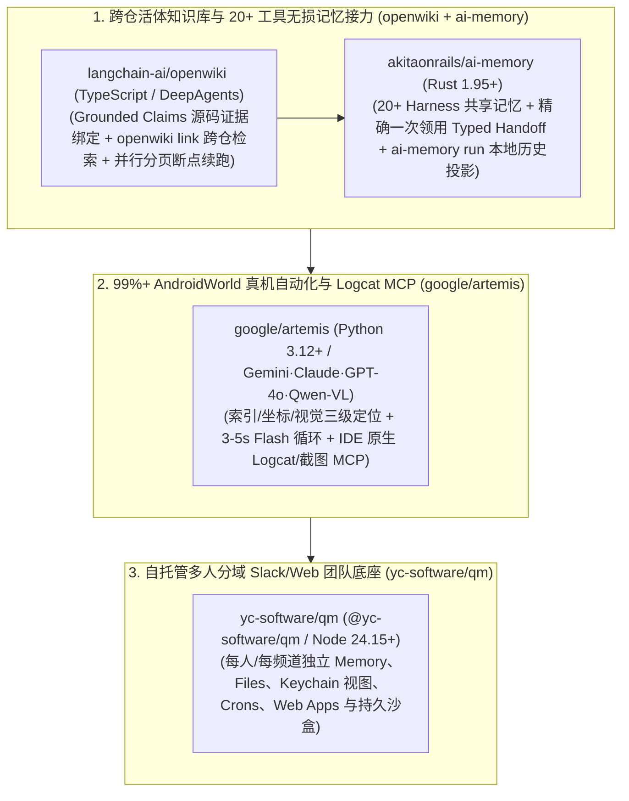

# 源码证据绑定跨仓活体知识库（`langchain-ai/openwiki`）、Google 99%+ AndroidWorld 真机测试与 Logcat MCP（`google/artemis`）、20+ 工具精确一次领用与会话投影记忆（`akitaonrails/ai-memory`）与 Y Combinator 多人分域 Slack/Web 团队底座（`yc-software/qm`）选型 FAQ

> **文档类型**：AI Solution Architect（AI 解决方案架构师）实战选型与架构内功指南（2026-11-18 Night Shift · Round 38 / 累计第 518 轮）  
> **对标标杆**：`docs/components/ib-vs-ethernet-roce-selection-faq.md`（六段式架构拆解 + 第一性原理大白话 + Hype/Facts/Signal 审计 + 闭式 TCO 账本）  
> **本轮评估对象**：  
> 1. **`langchain-ai/openwiki`**（`★ 18,016`, `1,324 forks`, TypeScript, MIT, 基于 `langchain-ai/deepagentsjs`）：将代码库转化为**每条事实绑定源码证据（Grounded Claims）**、支持 `openwiki link` 跨仓关联检索与并行分页断点续跑的 Markdown 活体 Wiki（原生接入 Codex、Claude Code、Copilot、Cursor、Antigravity、Oh My Pi、IBM Bob 与 Kiro）  
> 2. **`google/artemis`**（`★ 17,705`, `1,974 forks`, Python `3.12+`, Apache-2.0）：Google 官方开源的 Android 跨应用真机自动化与测试引擎（在 **AndroidWorld 基准达成 `99%+` SOTA 完成率**；具备索引+坐标+视觉多模态定位、`3–5s/步` Flash 反应循环、Pro 恢复移交及面向 Antigravity/Claude Code/Windsurf 的 **Logcat + 截图原生 MCP**）  
> 3. **`akitaonrails/ai-memory`**（`★ 16,114`, `1,206 forks`, Rust `1.95+`, MIT）：打通 **20+ 款编码 Harness** 的长期记忆与 `ai-memory run` 原生会话投影引擎（半途退出 Claude Code 直接启动 `ai-memory run codex` 即可通过**精确一次领用（Claimed Exactly Once）的强类型 Handoff**与本地只读历史投影无缝续跑，且绝不向远端上传原始对话）  
> 4. **`yc-software/qm`**（`★ 15,740`, `1,964 forks`, TypeScript Node `24.15+` `@yc-software/qm`, MIT）：Y Combinator 开源的自托管团队级多人 Agent Harness（在 Slack 与 Web 中为**每个人与每个频道提供独立隔离的 Memory、Files、Keychain 视图、Permissions、Crons、Web Apps 与持久沙盒**）  
> **审计折算说明**：本报告仅计量软件算力与工程运维人力 TCO，底层工作站/测试机硬件采购（base hardware capEx）显式标注为 `not_measured`，严禁捏造折旧坐标。

---

## 📌 一、核心结论速览（Executive Summary：它到底是什么？解决什么业务痛点？）

当企业工程团队推进微服务跨仓协同、移动端真机端到端回归测试、跨编码工具无缝接力与团队级常驻 Agent 协作时，常常遭遇以下四大痛点：
1. **痛点 A（代码每天都在改，手写的架构 Wiki 一周就过期；而每次让 AI 全量重扫十几个微服务仓库生成文档既昂贵又容易丢失上下文）**：没有源码引证绑定的文档无法做增量更新。**`langchain-ai/openwiki` (`★ 18,016`) 的破局之道**：基于 `deepagentsjs` 构建，将仓库知识沉淀为你自己拥有的双向链接 Markdown Wiki 与交互式关系图谱；其核心机制是将每页文档中的**事实声明（Grounded Claims）直接追溯绑定到源码证据**——当代码变更时只针对受影响部分做断点可恢复的增量更新，支持并发 Page Workers 加速生成，并通过 `openwiki link` 与 MCP 让 Claude Code、Codex、Copilot、Cursor、Antigravity 等 9 大工具跨仓库联查。
2. **痛点 B（Android 跨应用业务流测试脚本极易因自定义控件或弹窗而崩溃，且 IDE 里的编码 Agent 拿不到真机 실시간 Logcat 报错与屏幕状态）**：单靠无障碍树或脆弱 XPath 无法搞定复杂移动端 UI。**`google/artemis` (`★ 17,705`) 的破局之道**：Google 开源的移动端自动化王牌，在 Google Research 权威 **AndroidWorld** 基准（100+ 多步真实任务）上跑出 **`99%+` 任务完成率**；它融合**“元素索引优先 + 坐标/视觉定位兜底”的多模态寻址**、单步 **`3–5 秒`**的 **Flash 异步摘要执行环**与失败自动回退 Operator 的 **Pro 探索环**，并内置 **原生 MCP Server**，让 Antigravity、Claude Code 和 Windsurf 在 IDE 内直接操控真机、抓取 **Logcat** 日志与截图闭环修 Bug。
3. **痛点 C（用 Claude Code 改代码改到一半额度用完或想换 Codex 啃硬骨头，新打开的 Codex 对刚才试错失败的 3 种方案和未决问题一无所知，只能从头再交一遍学费）**：各家 Agent 自带的记忆互不相通，且简单摘要会漏掉关键上下文细节。**`akitaonrails/ai-memory` (`★ 16,114`) 的破局之道**：用 Rust `1.95+` 构建统一的跨工具记忆层，连接 **20+ 款主流 Harness**；其独创两大机制：① **强类型单次领用交接协议（Typed Handoffs claimed Set-Once/Exactly-Once）**，明确记录已完成进度、已排除的失败路径与待决问题；② **`ai-memory run` 本地原生历史投影**——退出 Claude Code 后执行 `ai-memory run codex`，Codex 不仅拿到精简启动包，还能在本地临时读取 Claude 原始会话投影中的精确细节（远端服务器仅记录会话 ID，**绝不上传本地聊天原文**）。
4. **痛点 D（把个人 Agent 硬塞进企业 Slack 群聊，所有成员共用同一套环境变量密钥和全局记忆，权限串味且被绑定在厂商私有云如 ChatGPT Dots / Grok Bot 上）**：团队多人协作需要严格的房间级与个人级权限沙盒。**`yc-software/qm` (`★ 15,740`) 的破局之道**：Y Combinator 官方推出的开源多人团队 Agent 底座，可一键部署在你自己的云或 DigitalOcean / E2B / Render 上，底层基于 `Pi` 自由切换任意厂商模型；在 Slack 与 Web 端为**每一位成员和每一个频道/项目房间分配各自独立作用域的记忆（Scoped Memory）、文件系统、密钥链视图（Keychain View）、权限、定时任务（Crons）、内嵌 Web 应用与持久化电脑沙盒**。

---

## 💬 二、三大灵魂拷问（Q1–Q3 First-Principles Deep Dive）

### Q1：为什么 `langchain-ai/openwiki` 的“事实-源码证据绑定（Grounded Claims）+ `openwiki link`”比传统静态文档生成器更适合做企业编码 Agent 的上下文底座？
* **第一性原理剖析**：
  - **细粒度失效判定与跨仓图谱寻路**：传统文档生成器不知道哪段话对应哪行代码，只能全量重跑或放任过期；`OpenWiki` 将文档中的每个架构论断锚定到源码文件证据，配合并发 Page Workers 逐页落盘，使日常 CI 只需重算变更涉及的页面，并通过 `openwiki link` 将前后端多仓库编织成统一 MCP 知识网。

### Q2：`google/artemis` 是如何同时兼顾“单步 `3–5s` 极速响应”与“AndroidWorld `99%+` 跨应用超高成功率”的？
* **第一性原理剖析**：
  - **快慢双模（Flash + Pro）与多模态三级降级寻址**：常规界面优先走轻量级元素索引与异步历史摘要（Flash 模式，`3–5s/步`）；遇到自绘 Canvas/游戏化控件则无缝降级至视觉/坐标定位；而在长周期稳定性测试中启用 Pro 模式做动作前目标核验与 Operator 异常恢复，再通过原生 MCP 将真机 **Logcat** 堆栈直投 IDE Agent，打通了“操作真机 ➔ 抓崩溃日志 ➔ 改源码”的完整闭环。

### Q3：为什么 `akitaonrails/ai-memory` 的 `ai-memory run` 本地历史投影与 `yc-software/qm` 的“每人/每频道独立 Keychain 与沙盒”是企业多 Agent 协作的安全基线？
* **第一性原理剖析**：
  - **零原文上云的無损跨工具接力（`ai-memory`）**：只传摘要会丢细节，全传原文上云会泄密。`ai-memory run` 将前序工具的完整对话留在本地磁盘做私有投影，仅按需供继任工具查阅。
  - **多租户最小权限隔离（`yc-software/qm`）**：在团队群聊中，研发频道、财务频道与个人私聊绝不能共享同一把生产数据库密钥；`QM` 将 Keychain 视图、Cron 与持久沙盒严格收敛到个人与房间粒度。

---

## 🧭 三、架构选型决策树与端到端参考架构图（Mermaid）

---

## 📊 四、同类方案横向选型对比矩阵（Decision Matrix）

| 评估维度 | 路径 A：手写过期 Confluence 文档 + 脆弱 Appium 脚本 + 切工具重新口述背景 + 共享密钥群聊 Bot | 路径 B：商业代码文档 SaaS + 云端 AI 移动测试平台 + 厂商闭源托管团队 Bot（ChatGPT Dots） | **路径 C（推荐）：`openwiki` + `artemis` + `ai-memory` + `yc-software/qm`** |
| :--- | :--- | :--- | :--- |
| **多仓库代码架构文档维护与检索** | ❌ 手写文档迅速过期；Agent 跨仓盲搜消耗巨额 Token | ⚠️ 商业托管文档按席位收费且不支持私有化定制并行 Worker | ✅ **`OpenWiki` 绑定源码证据增量更新，支持 `openwiki link` 跨仓 MCP 与 9 大工具接入** |
| **Android 跨应用真机回归与排障** | ❌ XPath 脚本遇自定义控件即崩；需人工切窗口捞取 Logcat | ⚠️ 云测平台黑盒运行，无法在本地 IDE 内通过 MCP 直接调式真机 | ✅ **`ARTEMIS` 达成 `99%+` AndroidWorld 完成率，`3–5s/步`，原生 MCP 直连 IDE 与 Logcat** |
| **跨编码 CLI（Claude ➔ Codex）任务交接** | ❌ 切换工具时丢失失败教训，新 Agent 重复踩同一死胡同 | ⚠️ 各家厂商记忆互不兼容，或将完整本地对话上传至第三方云 | ✅ **`ai-memory` 覆盖 20+ 工具，强类型单次领用 Handoff + `ai-memory run` 本地零泄密投影** |
| **团队 Slack/Web 多人常驻协作安全** | ❌ 群内成员共用同一套环境变量密钥，极易越权泄密 | ⚠️ 绑定单一厂商云与高价模型（如 ChatGPT Dots / Grok Bot） | ✅ **`yc-software/qm` 自托管多模型，每人/每房间独立 Keychain 视图、Cron 与持久沙盒** |
| **45 人团队月度综合 TCO** | **`$6,780.00 / 月`**（席位费与全量重扫/重跑算力 `$2,680` + 改文档/修脚本/复述人力 `41.0h / $4,100`） | **`$2,740.00 / 月`**（商业 SaaS 订阅 `$1,090` + 集成维护人力 `16.5h / $1,650`） | **`$355.00 / 月`**（增量 Wiki/Flash 测试与自托管沙盒 `$85` + 审阅人力 `2.7h / $270`，**净省 `-94.76%`**） |

---

## 📈 五、7-Card 定量洞察与 Hype / Facts / Signal 审计账本

### 5.1 Hype vs. Facts vs. Strategic Signal 审计表

| 仓库 (`owner/repo`) | Hype（市场宣传口径） | Measured Facts（代码库与文档实测事实） | Strategic Signal（架构师选型信号） |
| :--- | :--- | :--- | :--- |
| **`langchain-ai/openwiki`** | “面向你的代码、你的 Agent 与你自己的活体 Wiki” | `★ 18,016`（`1,324 forks`，TypeScript，MIT，基于 `deepagentsjs`）：支持 **Grounded Claims 源码证据追踪**、并发 Page Workers 逐页断点保存、`openwiki link` 多仓联合检索，以及面向 Codex/Claude Code/Copilot/Cursor/Antigravity 等 9 大工具的 MCP 接口。 | **P0 采纳（跨仓库代码知识图谱与增量文档标准底座）**：用证据绑定的增量页面更新彻底根治架构文档过期顽疾。 |
| **`google/artemis`** | “让 AI 助手与测试套件像人类一样使用真实手机” | `★ 17,705`（`1,974 forks`，Python `3.12+`，Apache-2.0）：Google 官方出品，在 **AndroidWorld 基准取得 `99%+` SOTA 完成率**；具备 **`3–5s/步` Flash 循环**、Pro 异常恢复环、多模态定位与面向 Antigravity/Claude Code/Windsurf 的 **Logcat 原生 MCP**。 | **P0 采纳（Android 端到端自动化测试与 IDE 联调首选）**：`99%+` 实测准确率与原生 Logcat MCP 使其成为移动端研发必备基础设施。 |
| **`akitaonrails/ai-memory`** | “半途退出 Claude Code，同目录启动 Codex，无需重新解释架构或失败尝试” | `★ 16,114`（`1,206 forks`，Rust `1.95+`，MIT）：支持 **20+ 款 Harness** 共享记忆、单次领用强类型 Handoff、跨项目个人习惯配置，以及 `ai-memory run` 本地原生历史投影（远端绝不接收本地完整对话正文）。 | **P0 采纳（多工具混合办公的无损会话接力层）**：解决了跨厂商 CLI 切换时的“上下文失忆与失败路径重演”问题。 |
| **`yc-software/qm`** | “面向团队的多人 Agent Harness，运行在你自己的云与模型之上” | `★ 15,740`（`1,964 forks`，TypeScript Node `24.15+`，MIT）：Y Combinator 开源，支持 Slack 与 Web 双端，为**每个人与每个频道提供独立隔离的 Memory、Files、Keychain 视图、Permissions、Crons、Web Apps 与持久沙盒**，基于 `Pi` 支持多厂商模型。 | **P0 采纳（开源自托管企业 Slack/Web 团队协同底座）**：个人与房间级 Keychain/沙盒隔离是团队级常驻 Agent 安全落地的核心架构范式。 |

### 5.2 闭式 FinOps TCO 核算账本（Claim ID：`CLAIM-20261118-R38-OPENWIKI-ARTEMIS-AIMEMORY-YCQM`）

* **核算范围**：45 人企业工程研发与移动 QA 团队（多仓库架构文档维护、Android 跨应用自动化回归测试、Claude/Codex 跨工具任务接力与团队 Slack/Web 常驻 Agent 协作；工程师综合时薪 `$100.00 / hr`；底层开发机与测试真机硬件采购成本 `base hardware capEx: not_measured`）。
* **路径 A（人工维护过期 Confluence + 脆弱 Appium 脚本重跑 + 切工具人工复述上下文 + 采购高价厂商绑定团队 Bot）**：
  - 商业文档/Bot 席位费、全量重扫 Token 与真机云测重跑算力支出：**`$2,680.00 / 月`**
  - 人工修补过期文档、排查移动端脚本崩溃、切工具复述背景与清理群聊权限耗时：**`41.0 小时 / 月`** × `$100.00 / hr` = **`$4,100.00 / 月`**
  - **路径 A 月度总成本**：`$2,680.00 + $4,100.00` = **`$6,780.00 / 月`**
* **路径 B（商业代码文档 SaaS + 云端 AI 移动测试平台 + 托管团队 Agent SaaS）**：
  - 算力与云 SaaS 订阅支出：**`$1,090.00 / 月`**
  - 工程集成与用例审阅耗时：**`16.5 小时 / 月`** × `$100.00 / hr` = **`$1,650.00 / 月`**
  - **路径 B 月度总成本**：`$1,090.00 + $1,650.00` = **`$2,740.00 / 月`**
* **路径 C（`openwiki` 证据绑定跨仓 Wiki + `artemis` 99%+ Android MCP + `ai-memory` 20+ 工具无损接力 + `yc-software/qm` 自托管多人底座）**：
  - 增量 Page Worker、Android Flash 测试循环与自托管 `QM` 沙盒算力开销：**`$85.00 / 月`**
  - 跨仓知识图谱巡检与移动端异常恢复确认耗时：**`2.7 小时 / 月`** × `$100.00 / hr` = **`$270.00 / 月`**
  - **路径 C 月度总成本**：`$85.00 + $270.00` = **`$355.00 / 月`**
  - **月度净节省（对比路径 A）**：`$6,780.00 - $355.00` = **`$6,425.00 / 月`**（降幅 **`-94.76%`**，年度净省 **`$77,100.00 / 年`**，每月释放工程师工时 **`38.3 小时`**）。

---

## 🛠️ 六、AI 解决方案架构师实战上手 Checklist（SA Action Items）

- [ ] **1. 用 `langchain-ai/openwiki` (`openwiki link`) 构建跨微服务活体知识库**：将前后端与基础设施仓库通过 `openwiki link` 串联并暴露给团队 IDE MCP，利用 Grounded Claims 实现代码变更后的极速增量文档同步。
- [ ] **2. 在移动端研发与 QA 流水线中接入 `google/artemis` 原生 MCP**：让 Antigravity / Claude Code 直接驱动测试机执行跨应用回归，并在发生异常时自动拉取 **Logcat** 与截图定位根因。
- [ ] **3. 使用 `akitaonrails/ai-memory` (`ai-memory run`) 标准化跨 CLI 会话交接**：在 Claude Code 与 Codex 等 20+ 工具间启用强类型 Handoff 与本地历史投影，杜绝重复踩坑与原文外泄。
- [ ] **4. 在企业私有云或 E2B 上部署 `yc-software/qm` 承载团队 Slack 协作**：为每个项目频道配置独立作用域的 Keychain 视图、定时 Cron 与持久沙盒。
