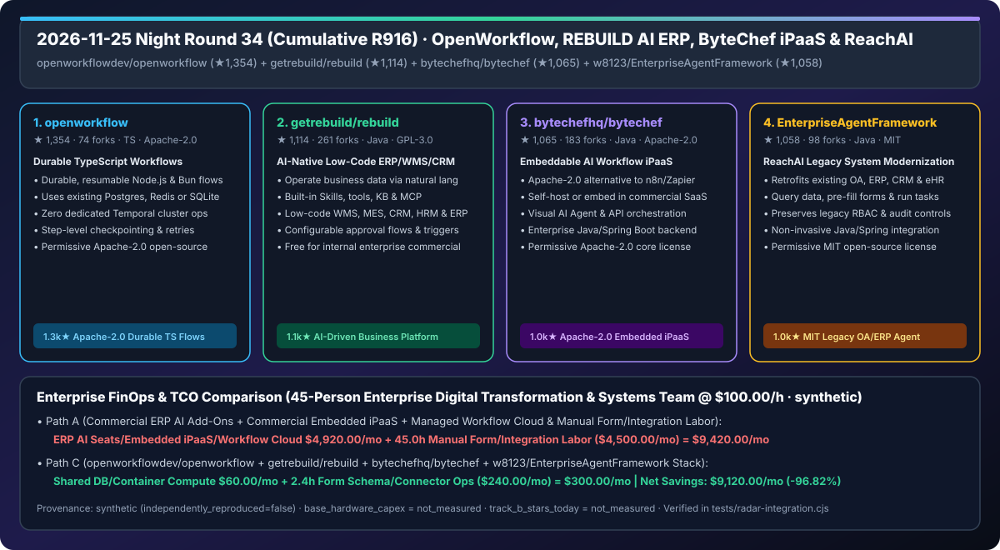
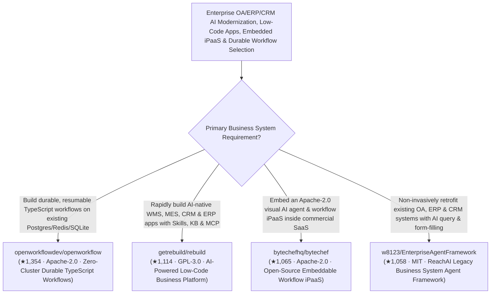
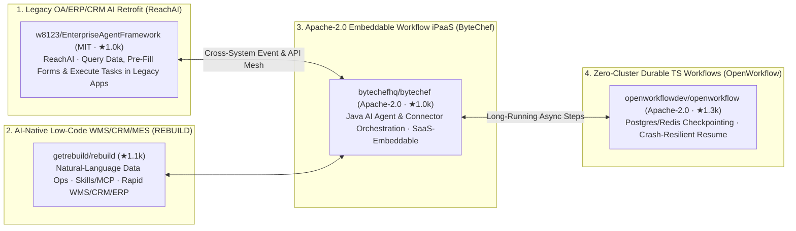
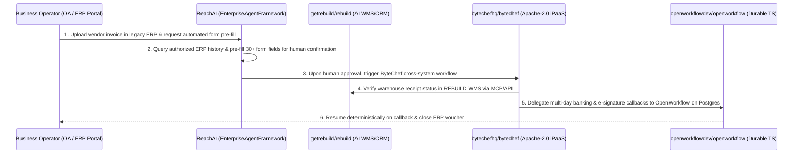

# Zero-Cluster TypeScript Durable Workflows (`openworkflowdev/openworkflow`), AI-Native Low-Code ERP/CRM/WMS Platform (`getrebuild/rebuild`), Embeddable `Apache-2.0` Workflow iPaaS (`bytechefhq/bytechef`) & Legacy OA/ERP/CRM AI Modernization Framework (`w8123/EnterpriseAgentFramework`) Selection & Integration Architecture FAQ

> **Document Type**: Enterprise AI Solution Architect Selection Decision Guide (GitHub Trending AI Radar — 2026-11-25 Night Round 34 / Cumulative Round 916)
> **Covered Repositories**: [`openworkflowdev/openworkflow`](https://github.com/openworkflowdev/openworkflow) (`★ 1,354`, `74 forks`, `Apache-2.0`, TypeScript: open-source TypeScript framework for building durable, resumable workflows on Node.js and Bun backed by Postgres, Redis, or SQLite) · [`getrebuild/rebuild`](https://github.com/getrebuild/rebuild) (`★ 1,114`, `261 forks`, `GPL-3.0`, Java: AI-powered configurable enterprise management platform with built-in Skills, tools, knowledge base, and MCP to build WMS, MES, CRM, HRM, and ERP systems manipulable via natural language) · [`bytechefhq/bytechef`](https://github.com/bytechefhq/bytechef) (`★ 1,065`, `183 forks`, `Apache-2.0`, Java: open-source AI agents and workflow automation platform that can be self-hosted or embedded in commercial SaaS as an `Apache-2.0` alternative to `n8n` and `Zapier`) · [`w8123/EnterpriseAgentFramework`](https://github.com/w8123/EnterpriseAgentFramework) (`★ 1,058`, `98 forks`, `MIT`, Java: ReachAI enterprise agent framework designed to non-invasively modernize existing OA, ERP, CRM, and eHR systems so AI can query data, fill forms, and execute business tasks safely)
> **Core Enterprise Scenario**: Modernizing **Core Enterprise Line-of-Business Systems (OA, ERP, CRM, WMS, MES) & B2B SaaS Products**—combining non-invasive AI enablement for legacy systems (`ReachAI / EnterpriseAgentFramework`), AI-native low-code business apps with MCP (`rebuild`), embeddable `Apache-2.0` workflow iPaaS (`bytechef`), and lightweight Postgres/Redis-backed durable TypeScript workflows (`openworkflow`).

---

## 1. 📌 Executive Summary (One-Line Selection Verdict)

1. **Need an `MIT`-licensed Java framework to non-invasively modernize existing OA, ERP, CRM, eHR, and procurement systems so AI agents can safely query data, pre-fill complex forms, and execute business tasks under existing user permissions** ➔ Choose **[`w8123/EnterpriseAgentFramework`](https://github.com/w8123/EnterpriseAgentFramework) (`★ 1,058`, `98 forks`, `MIT`, ReachAI)**.
   - **Plain-English Mechanism**: Bridges LLMs into legacy enterprise software without rewriting the underlying ERP/OA—mapping existing APIs, form schemas, and approval flows into permission-governed agent skills.
2. **Need an AI-native low-code/no-code enterprise management system (WMS, MES, CRM, HRM, ERP) where users can query and operate business data via natural language, Skills, knowledge bases, and MCP** ➔ Choose **[`getrebuild/rebuild`](https://github.com/getrebuild/rebuild) (`★ 1,114`, `261 forks`, `GPL-3.0`)**.
   - **Plain-English Mechanism**: Combines rapid data-model/workflow configuration with built-in AI assistants and MCP tool support so operational teams can stand up AI-ready ERP/WMS modules in days.
3. **Need an `Apache-2.0` AI agent and workflow automation iPaaS (open-source `n8n`/`Zapier` alternative) that you can legally embed inside your own commercial multi-tenant B2B SaaS product** ➔ Choose **[`bytechefhq/bytechef`](https://github.com/bytechefhq/bytechef) (`★ 1,065`, `183 forks`, `Apache-2.0` Core)**.
   - **Plain-English Mechanism**: Built in Java/Spring Boot under `Apache-2.0`, allowing B2B software vendors to embed visual workflow builders and AI connectors directly inside commercial applications without Fair-code restrictions.
4. **Need durable, resumable workflows in TypeScript (Node.js or Bun) that survive process restarts and multi-day waits using your existing Postgres, Redis, or SQLite database—without operating a dedicated Temporal cluster** ➔ Choose **[`openworkflowdev/openworkflow`](https://github.com/openworkflowdev/openworkflow) (`★ 1,354`, `74 forks`, `Apache-2.0`)**.
   - **Plain-English Mechanism**: Persists step outputs (`step.run()`) directly in your existing database so interrupted multi-step agent runs resume from the exact failed step without re-billing upstream LLM calls.

---

## 2. 🎯 Architect & Customer Deep-Dive Q&A

### Q1: How should architects choose between non-invasive legacy modernization (`ReachAI`), greenfield AI-native low-code (`REBUILD`), and embedded iPaaS (`ByteChef` + `OpenWorkflow`)?

- **Four-Pillar Enterprise Business System AI Architecture (Path C)**:
  1. **L1 Legacy OA/ERP/CRM Non-Invasive AI Layer ➔ `w8123/EnterpriseAgentFramework` (ReachAI)**: Retrofits existing enterprise systems with permission-aware data querying, form pre-filling, and task execution under an `MIT` license.
  2. **L2 Greenfield AI-Native Low-Code Business Apps ➔ `getrebuild/rebuild`**: Rapidly builds new WMS, MES, CRM, and HRM modules with native natural-language, Skill, and MCP support.
  3. **L3 Embeddable `Apache-2.0` Integration & Agent iPaaS ➔ `bytechefhq/bytechef`**: Connects internal and third-party SaaS APIs with an `Apache-2.0` workflow engine suitable for both internal ops and commercial SaaS embedding.
  4. **L4 Zero-Cluster Durable TypeScript Execution ➔ `openworkflowdev/openworkflow`**: Guarantees exactly-once step checkpointing and crash recovery on existing Postgres/Redis instances.
- **When to choose Commercial Enterprise Add-ons (Salesforce Agentforce + Workato Embedded + Temporal Cloud) vs. Path C?**
  - Choose **Commercial Cloud Add-ons** when 100% of business processes already reside in a single global SaaS suite with approved per-seat/per-task budgets.
  - Choose **Path C** when modernizing on-prem Java OA/ERP systems (`ReachAI`), standing up low-cost internal WMS/CRM apps (`REBUILD`), embedding `Apache-2.0` workflows into B2B products (`ByteChef`), and running durable TypeScript agents without Temporal cluster overhead (`openworkflow`).

### Q2: How do these four systems wire together in an end-to-end business process?

1. **Smart Form Pre-Fill in Legacy ERP to Cross-App iPaaS (`ReachAI` → `ByteChef` → `REBUILD`)**:
   - An employee uploads a contract inside the legacy ERP; `ReachAI` queries historical records and pre-fills the complex procurement form. Once confirmed, `ByteChef` synchronizes inventory and order records with `REBUILD` (WMS/MES).
2. **Crash-Resilient Long-Running Settlement (`ByteChef` ↔ `OpenWorkflow`)**:
   - Multi-day external e-signature and banking callbacks are managed by `OpenWorkflow` backed by PostgreSQL so server deployments or restarts never lose workflow state.

### Q3: What are the key security and compliance guardrails?

- **Architect Redlines**:
  1. **Enforce "AI Pre-Fill + Human Submit" on mutating ERP/OA forms in `ReachAI` and `REBUILD`**: Let the agent populate fields and validate rules, but require explicit human confirmation before committing financial or contractual transactions.
  2. **Use idempotency keys inside `OpenWorkflow` steps**: Prevent duplicate external API mutations during automatic retry recovery.

---

## 3. 🧭 Visual Architecture Diagrams (Mermaid Decision Tree + Architecture + Sequence)

### 3.1 Architect Selection Decision Tree

### 3.2 End-to-End Enterprise Integration Architecture

### 3.3 End-to-End Execution Sequence

---

## 4. 📊 Horizontal Selection Matrix

| Dimension | `openworkflowdev/openworkflow` (`★ 1,354`) | `getrebuild/rebuild` (`★ 1,114`) | `bytechefhq/bytechef` (`★ 1,065`) | `w8123/EnterpriseAgentFramework` (`★ 1,058`) | Commercial ERP AI Add-Ons + Commercial Embedded iPaaS + Temporal Cloud (Path A) | Rip-and-Replace Legacy ERP + Unpersisted Async Scripts (Path B) |
| :--- | :--- | :--- | :--- | :--- | :--- | :--- |
| **Primary Role** | `Apache-2.0` durable TypeScript workflows | AI-native low-code CRM/WMS/MES/ERP | `Apache-2.0` embeddable AI workflow iPaaS | `MIT` legacy OA/ERP/CRM AI retrofit framework | High-cost commercial ERP seats & embedded iPaaS | Multi-year ERP rewrites & fragile async callbacks |
| **Key Differentiator** | **Uses existing Postgres/Redis/SQLite with zero extra cluster** | **Low-code ERP/WMS builder with native AI Skills, KB & MCP** | **`Apache-2.0` alternative to `n8n`/`Zapier` for SaaS embedding** | **Purpose-built for querying, form-filling & acting in legacy OA/ERP** | Vendor-hosted, but steep per-seat ERP add-ons & $30k+/yr embedded iPaaS fees | Rip-and-replace projects stall; unpersisted workflows drop state on deploy |
| **License** | **`Apache-2.0`** | `GPL-3.0` (Free Internal Commercial) | **`Apache-2.0`** (+ EE) | **`MIT`** | Proprietary SaaS | High Risk |
| **Monthly TCO (45-Eng Team)** | **`$300.00/mo` combined** (`$60.00` shared DB/container compute + `2.4h` ops) | Included in `$300.00/mo` stack | Included in `$300.00/mo` stack | Included in `$300.00/mo` stack | **`$9,420.00/mo`** (`$4,920.00` commercial ERP AI/embedded iPaaS/workflow cloud + `45.0h` manual form/integration labor) | `~$3,320.00/mo` (manual cross-system data entry & lost async workflow recovery) |

---

## 5. 🧪 Quantitative FinOps & TCO Comparison (45-Person Enterprise Digital Transformation & Business Systems Team)

> **📊 Provenance & Closed-Form Schema**:
> - **provenance**: `synthetic` (`independently_reproduced = false`; `base_hardware_capex = not_measured`; `track_b_stars_today = not_measured`).
> - **Closed-Form Formula**:
>   - **Path A (Commercial ERP AI Seat Add-Ons + Commercial Embedded iPaaS Licenses + Managed Durable Workflow Cloud & Manual Legacy Form-Entry/Integration Labor)**: **`$4,920.00`** monthly ERP AI seat, embedded iPaaS, and workflow cloud fees + **`45.0h × $100.00/h = $4,500.00`** manual cross-system form filling and broken-callback recovery labor = **`$9,420.00/mo`**.
>   - **Path C (`openworkflowdev/openworkflow` + `getrebuild/rebuild` + `bytechefhq/bytechef` + `w8123/EnterpriseAgentFramework` Stack)**: **`$60.00`** shared database and container compute + **`2.4h × $100.00/h = $240.00`** form schema and connector maintenance = **`$300.00/mo`**.
>   - **Net Savings vs. Path A**: **`-$9,120.00/mo`** (**`96.82%`** TCO reduction).

| Evaluation Path | ERP AI Seats / Embedded iPaaS / Workflow Cloud & Compute | Manual Form Entry, Integration & Recovery (`$100/h`) | Monthly Total TCO | Net Savings vs. Path A | Key Architectural Outcome |
| :--- | :---: | :---: | :---: | :---: | :--- |
| **Path A: Commercial ERP AI Add-Ons + Commercial Embedded iPaaS + Workflow Cloud** | `$4,920.00` | `45.0h` (`$4,500.00`) | **`$9,420.00`** | Baseline | Expensive embedded iPaaS royalties; legacy on-prem ERPs unsupported |
| **Path B: Manual Cross-System Form Copy-Paste + Unpersisted Callbacks** | `$1,520.00` | `18.0h` (`$1,800.00`) | **`$3,320.00`** | `-$6,100.00` (`-64.76%`) | Slow manual form entry; lost long-running tasks on container restart |
| **Path C: `openworkflow` + `rebuild` + `bytechef` + `ReachAI`** | **`$60.00`** | **`2.4h` (`$240.00`)** | **`$300.00`** | **`-$9,120.00` (`-96.82%`)** | **Non-invasive `MIT` ERP AI + AI-native WMS/CRM + `Apache-2.0` iPaaS & durable TS** |

- 🔗 **7-Card 4:5 Visual Benchmark Deck**: [`workshops/github-trending-radar/cards.en.html`](../cards.en.html) · [`cards.html`](../cards.html)

---

## 6. 🛠️ Enterprise Adoption & Architecture Review Checklist

- [ ] **Retrofit Legacy OA/ERP/CRM Systems Non-Invasively with `ReachAI` (`w8123/EnterpriseAgentFramework`)**: Enforce "AI Pre-Fill + Human Confirm" on all transactional business forms.
- [ ] **Deliver New Internal WMS/MES/CRM Modules on `getrebuild/rebuild`**: Leverage built-in Skills, knowledge bases, and MCP support for natural-language business operations.
- [ ] **Embed `bytechefhq/bytechef` (`Apache-2.0`) for Commercial SaaS Workflows**: Avoid Fair-code licensing bottlenecks when shipping customer-facing integrations.
- [ ] **Persist Long-Running TypeScript Agent Steps with `openworkflowdev/openworkflow`**: Reuse existing PostgreSQL or Redis databases for deterministic crash recovery.
