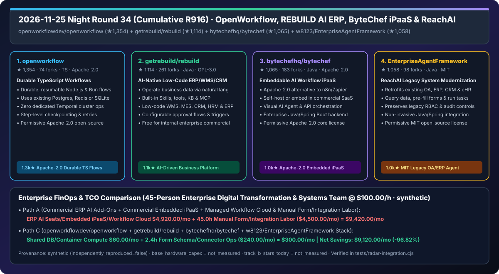
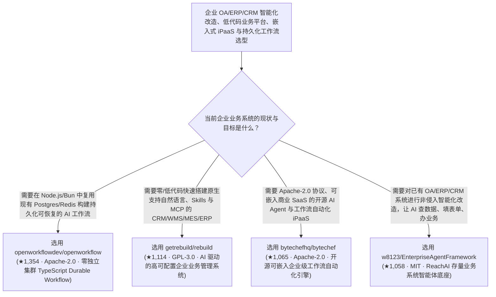
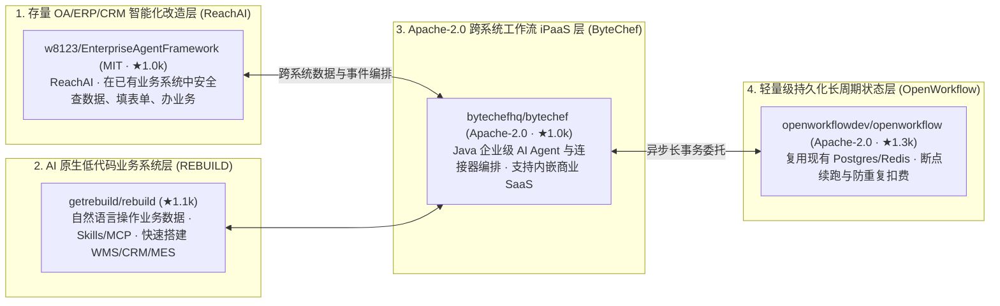
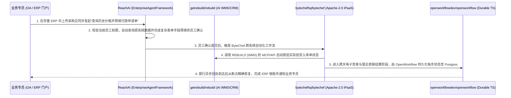

# 零独立集群 TypeScript 持久化工作流（`openworkflowdev/openworkflow`）、AI 原生低代码 ERP/CRM/WMS 业务平台（`getrebuild/rebuild`）、可嵌入 SaaS 的 `Apache-2.0` 工作流 iPaaS（`bytechefhq/bytechef`）与存量 OA/ERP/CRM 智能化改造框架 ReachAI（`w8123/EnterpriseAgentFramework`）选型与集成架构 FAQ

> **文档类型**：企业 AI 解决方案架构师（AI Solution Architect）选型决策指南（GitHub Trending AI 雷达 2026-11-25 Night Round 34 / 累计第 916 轮）
> **覆盖项目**：[`openworkflowdev/openworkflow`](https://github.com/openworkflowdev/openworkflow)（`★ 1,354`、`74 forks`、`Apache-2.0`：面向 Node.js 与 Bun 的开源 TypeScript 持久化可恢复工作流框架 [Durable Workflows]，复用现有 Postgres/Redis/SQLite 即可实现跨进程重启与长周期休眠恢复）· [`getrebuild/rebuild`](https://github.com/getrebuild/rebuild)（`★ 1,114`、`261 forks`、`GPL-3.0`：内置 AI 助手、Skills、知识库与 MCP 的国产高可配置企业管理系统，零/低代码快速搭建 CRM、WMS、MES、ERP 与 HRM）· [`bytechefhq/bytechef`](https://github.com/bytechefhq/bytechef)（`★ 1,065`、`183 forks`、`Apache-2.0`：Java 构建的开源 AI Agent 与工作流自动化 iPaaS，作为 `n8n`/`Zapier` 的 `Apache-2.0` 替代方案，支持直接内嵌进商业 SaaS）· [`w8123/EnterpriseAgentFramework`](https://github.com/w8123/EnterpriseAgentFramework)（`★ 1,058`、`98 forks`、`MIT`：ReachAI 企业级智能体开发平台，专为已有 OA、ERP、CRM、采购与工单系统的智能化改造设计，让 AI 安全查数据、填表单、办业务）
> **核心场景**：当传统企业与 ToB 软件厂商推进“核心业务系统（OA/ERP/CRM/WMS）智能化”时，架构师常面临四种截然不同的落地路径选型：**“如果客户已经有跑了十年的老旧 Java OA/ERP/CRM 且不准推倒重写，怎么用一套 `MIT` 框架最快让 AI 在原系统里帮员工查数据、预填表单、跑审批（`ReachAI / EnterpriseAgentFramework`）？如果客户想直接新上一套自带 AI Skills 和 MCP、支持自然语言操作业务数据的国产开源 CRM/WMS/ERP 选谁（`rebuild`）？如果我们是 ToB SaaS 厂商，想在自己的商业软件里内嵌一套连接几百个第三方系统的 AI 自动化引擎，而 `n8n` 的 Fair-code 协议不允许商业内嵌，选哪个 `Apache-2.0` 替代品（`bytechef`）？在 TypeScript 后端写长周期 AI 任务不想运维重量级 Temporal 集群选谁（`openworkflow`）？”** 本文给出完整选型坐标。

---

## 一、📌 核心结论速览（选型一句话结论）

1. **企业已经有现成的 OA、ERP、CRM、eHR、采购或合同管理系统，不想推倒重建，只希望能“快速、安全地给老系统外挂一层企业级智能体，让员工用一句话就能在原系统里查数据、自动预填复杂业务表单并提交办理”** ➔ 选 **[`w8123/EnterpriseAgentFramework`](https://github.com/w8123/EnterpriseAgentFramework)（`★ 1,058`，`98 forks`，`MIT`，ReachAI）**。
   - **通俗原理**：采用宽松的 `MIT` 协议与 Java/Spring 生态，专门解决“AI 怎么接进企业存量业务系统最后一公里”的痛点——把原系统的查询接口、表单 Schema 与业务办理流程映射为受权限约束的智能体动作，做到“查数准、填表快、办业务稳”。
2. **中大型制造、贸易或服务企业打算新建或替换老旧的 WMS（库存）、MES（生产报工）、CRM（客户）、HRM（人事）或 ERP 系统，希望新系统从底层数据模型起就原生支持通过自然语言、AI Skills、知识库与 MCP 操作业务数据** ➔ 选 **[`getrebuild/rebuild`](https://github.com/getrebuild/rebuild)（`★ 1,114`，`261 forks`，`GPL-3.0`，企业内部免费商用）**。
   - **通俗原理**：把低代码实体建模（表单、审批流、报表、触发器）与 AI 智能体深度融合；业务人员不仅能用拖拉拽搭出进销存和生产管理模块，还能直接通过对话让内置 AI 助手查询库存并生成出库单。
3. **你是开发商业 ToB SaaS 的架构师，需要一套像 `n8n` 或 `Zapier` 一样的可视化 AI Agent 与 API 集成工作流引擎，但因为要嵌入自有商业产品对外售卖，必须采用宽松的 `Apache-2.0` 协议** ➔ 选 **[`bytechefhq/bytechef`](https://github.com/bytechefhq/bytechef)（`★ 1,065`，`183 forks`，`Apache-2.0` Core）**。
   - **通俗原理**：基于 Java / Spring Boot 构建的企业级自动化与嵌入式 iPaaS（Embedded iPaaS）引擎，弥补了 `n8n`（Fair-code 限制外部商业化托管）在商业软件内嵌场景的许可空白。
4. **在 Node.js 或 Bun（TypeScript）后端开发需要跨天等待回调、失败自动重试、进程重启后从断点继续执行的 Durable AI Agent 工作流，但团队不想额外部署和维护拥有十几个组件的 Temporal / Cassandra 重型集群** ➔ 选 **[`openworkflowdev/openworkflow`](https://github.com/openworkflowdev/openworkflow)（`★ 1,354`，`74 forks`，`Apache-2.0`）**。
   - **通俗原理**：直接复用项目里现成的 PostgreSQL、Redis 或 SQLite 表来持久化每一个 `step.run()` 的返回值；代码写起来就是普通的 `async/await` TypeScript 函数，即使容器半途重启，已完成的 LLM 调用步骤绝不重复执行、绝不重复扣 Token。

---

## 二、🎯 客户与架构师灵魂拷问 Q&A（深度架构拆解）

### Q1：面对企业核心业务系统（OA/ERP/CRM）的 AI 转型，“存量外挂改造（`ReachAI`）” vs “新建 AI 原生低代码系统（`REBUILD`）” vs “嵌入式 iPaaS 连接（`ByteChef`）”该如何决策？

- **四大企业业务系统智能化路径（Path C）**：
  1. **存量核心系统不动刀、非侵入赋能 ➔ `w8123/EnterpriseAgentFramework` (ReachAI)**：适用于银行、央国企已稳定运行多年的存量 ERP/OA，通过 `MIT` 智能体底座对接原系统接口完成“查数据、填表单、办业务”。
  2. **新业务敏捷构建 AI 原生 CRM/WMS/MES ➔ `getrebuild/rebuild`**：适用于缺少现成数字化系统的新业务线或急需替换老旧电子表格的制造/贸易部门，企业内部免费商用开箱即得。
  3. **跨异构 SaaS 集成与商业产品内嵌 iPaaS ➔ `bytechefhq/bytechef`**：以 `Apache-2.0` 协议打通企业内外部异构 API 与 AI Agent 编排。
  4. **TypeScript BFF 层轻量级持久化长周期编排 ➔ `openworkflowdev/openworkflow`**：在 Node.js/Bun 应用层以零独立集群成本保障多步 AI 任务的幂等恢复。
- **何时选商业云方案（Salesforce Agentforce + 商业 Embedded iPaaS 如 Workato + Temporal Cloud） vs 自建本轮开源四件套（Path C）？**
  - 若企业全线运行在海外 Salesforce Cloud 且预算充裕，可直接买 Agentforce。
  - **何时采用本轮开源四件套（Path C）？** 当国内或跨国企业的核心业务跑在内网自建 Java ERP/OA 上（用 `ReachAI` 或 `REBUILD` 内网落地）、ToB 产品需要免版税内嵌 `Apache-2.0` 工作流引擎（`ByteChef`）、且希望免除每月数千美元的商业 Embedded iPaaS 与 Temporal Cloud 账单（`openworkflow`）时，Path C 可节省 **96%+** 的许可与改造费用。

### Q2：这四个项目如何协同支撑一个集团企业的“采购到付款（Procure-to-Pay）”全流程？

1. **新供应商准入与仓库管理（`getrebuild/rebuild`）**：
   - 使用 `REBUILD` 快速搭建供应商评估与 WMS 入库管理模块，仓管员通过自然语言与 MCP 直接查询实时库存并生成入库记录。
2. **存量财务 ERP 填单与跨系统协同（`ReachAI` + `ByteChef` + `OpenWorkflow`）**：
   - 采购员在存量 ERP 中唤起 `ReachAI` 自动完成复杂付款申请表单预填；跨外部税务、电子签章与银行回单的长周期异步回调交由 `OpenWorkflow`（持久化在 Postgres 中）与 `ByteChef` 连接器幂等推进。

### Q3：生产落地的安全与合规红线是什么？

- **架构师避坑红线**：
  1. **`ReachAI` / `REBUILD` 中的“办业务/写表单”动作必须实施“AI 预填 + 人类点击确认提交”机制**：涉及财务付款、合同用印与采购下单的表单，AI 仅负责填充草稿并高亮待核对字段，最终提交动作必须由当前登录员工触发。
  2. **在 `OpenWorkflow` 中确保每个 `step.run()` 具备幂等键（Idempotency Key）**：防止网络抖动重试时对下游 ERP 产生重复扣款或重复建单。

---

## 三、🧭 直观可视化图解（Mermaid 决策树 + 集成架构 + 时序图）

### 3.1 架构师选型决策树

### 3.2 企业端到端生产集成参考架构图

### 3.3 存量 ERP 智能填单、跨系统 iPaaS 流转、WMS 库存核验与持久化长周期结算时序图

---

## 四、📊 同类开源与商业云服务横向选型决策矩阵

| 对比维度 | `openworkflowdev/openworkflow` (`★ 1,354`) | `getrebuild/rebuild` (`★ 1,114`) | `bytechefhq/bytechef` (`★ 1,065`) | `w8123/EnterpriseAgentFramework` (`★ 1,058`) | 商业 ERP AI 插件席位 + 商业 Embedded iPaaS (Workato) + Temporal Cloud (Path A) | 推倒重写老 ERP + 裸写无持久化的 Node 异步回调脚本 (Path B) |
| :--- | :--- | :--- | :--- | :--- | :--- | :--- |
| **核心能力定位** | `Apache-2.0` TypeScript 持久化工作流 | AI 原生高可配置 CRM/WMS/MES/ERP | `Apache-2.0` 可内嵌 AI 工作流 iPaaS | `MIT` ReachAI 存量业务系统智能体底座 | 昂贵商业套件 AI 附加包与按连接器收费云 | 耗资百万的推倒重构 + 脆弱内存异步脚本 |
| **核心技术突破** | **无需独立 Temporal 集群，复用现有 Postgres/Redis 断点续跑** | **零/低代码搭 ERP/WMS + 原生内置自然语言操作、Skills 与 MCP** | **`Apache-2.0` 协议允许合法白标内嵌进商业 ToB SaaS** | **专为存量 OA/ERP/CRM 打造“查数据、填表单、办业务”闭环** | 品牌成熟，但商业 Embedded iPaaS 起售价每年数万美元且老系统改造周期极长 | 推倒重写老 ERP 极易烂尾；无持久化长任务一旦发版重启全部丢失 |
| **开源协议** | **`Apache-2.0`** | `GPL-3.0` (内部免费商用) | **`Apache-2.0`** (+ EE) | **`MIT`** | 闭源商业授权 | 高烂尾风险 |
| **月度 TCO（45 人团队）** | **四件套合建仅 `$300.00/月`**（`$60.00` 复用现有 Postgres 与 Java/TS 容器算力 + `2.4h` 维护） | 同左（企业内部免费商用替代高价商业低代码按人头席位） | 同左（`Apache-2.0` 免除昂贵商业嵌入式 iPaaS 授权费） | 同左（`MIT` 非侵入外挂改造，节省 80% 存量系统对接工期） | **`$9,420.00/月`**（`$4,920.00` 商业 ERP AI 席位/商业 Embedded iPaaS/Temporal 云 + `45.0h` 老系统手工填单与排障） | 约 `$3,320.00/月`（大量人工在多个老系统间搬运数据填表与修复中断任务工时） |

---

## 五、🧪 应用落地定量收益/TCO 对比与 7-Card 报告

> **📊 数据来源与闭式核算声明（Provenance & Closed-Form Schema）**：
> - **provenance**: `synthetic`（基于 45 人企业数字化转型、OA/ERP/WMS 业务系统研发与集成团队月度工作负载模型：`independently_reproduced = false`；硬件采购基线 `base_hardware_capex = not_measured`；Track B 单日增量 `track_b_stars_today = not_measured`）。
> - **核算公式**：
>   - **Path A（采购商业 ERP/CRM 原厂高价 AI 附加席位 + 商业嵌入式 iPaaS 平台年费分摊 + 托管持久化工作流云账单 + 业务人员跨老旧系统手工查数填表与长任务中断人工重跑工时）**：月度商业 ERP AI 席位、商业 iPaaS 与工作流云账单 **`$4,920.00`** + 跨系统手工填表、老系统接口定制与中断任务重跑人工 **`45.0h × $100.00/h = $4,500.00`** = **`$9,420.00/月`**。
>   - **Path C（自建 `openworkflowdev/openworkflow` + `getrebuild/rebuild` + `bytechefhq/bytechef` + `w8123/EnterpriseAgentFramework` 企业业务系统智能化与持久化编排栈）**：内网复用数据库与轻量容器算力分摊 **`$60.00`** + 表单 Schema 映射与连接器日常维护人工 **`2.4h × $100.00/h = $240.00`** = **`$300.00/月`**。
>   - **净节省（Net Savings vs Path A）**：**`-$9,120.00/月`**（成本降低 **`96.82%`**）。

| 评估方案 | 商业 ERP AI 席位 / 商业 iPaaS / 工作流云与算力 | 手工查数填表、接口定制与中断修复人工（`$100/h`） | 月度总 TCO | 相对 Path A 净节省 | 核心业务交付收益 |
| :--- | :---: | :---: | :---: | :---: | :--- |
| **Path A：商业 ERP AI 席位 + 商业 Embedded iPaaS + 工作流云** | `$4,920.00` | `45.0h` (`$4,500.00`) | **`$9,420.00`** | Baseline | 商业嵌入式 iPaaS 极贵；国产老旧自研系统无法直接用海外 SaaS |
| **Path B：人工在多套老系统间复制粘贴填表 + 裸写异步脚本** | `$1,520.00` | `18.0h` (`$1,800.00`) | **`$3,320.00`** | `-$6,100.00` (`-64.76%`) | 员工每天耗费数小时填表；发版重启导致进行中的长任务丢失 |
| **Path C：`openworkflow` + `rebuild` + `bytechef` + `ReachAI`** | **`$60.00`** | **`2.4h` (`$240.00`)** | **`$300.00`** | **`-$9,120.00` (`-96.82%`)** | **存量 OA/ERP 智能填单 + AI 原生 WMS/CRM + `Apache-2.0` 持久化编排** |

- 🔗 **关联 7-Card 4:5 视觉评测报告**：[`workshops/github-trending-radar/cards.html`](../cards.html) · [`cards.en.html`](../cards.en.html)

---

## 六、🛠️ 企业引入与架构评审 Checklist

- [ ] **对存量 OA/ERP/CRM 优先采用 `ReachAI` (`w8123/EnterpriseAgentFramework`) 非侵入改造**：复用原系统登录态与权限矩阵，实现“AI 自动查数填表 + 员工一键确认办结”。
- [ ] **对新建内部管理模块（WMS/MES/CRM）采用 `getrebuild/rebuild`**：利用其内置的 Skills / 知识库 / MCP 能力快速交付支持自然语言操作的业务系统。
- [ ] **在需要对外商业化交付的 ToB 产品中采用 `Apache-2.0` 的 `bytechefhq/bytechef`**：规避 `AGPL`/`Fair-code` 自动化工具的商业内嵌合规风险。
- [ ] **在 TypeScript/Node.js 服务中使用 `openworkflowdev/openworkflow` 包装所有多步 LLM 与外部回调流程**：直接基于现有 Postgres/Redis 实现零成本断点续跑。
