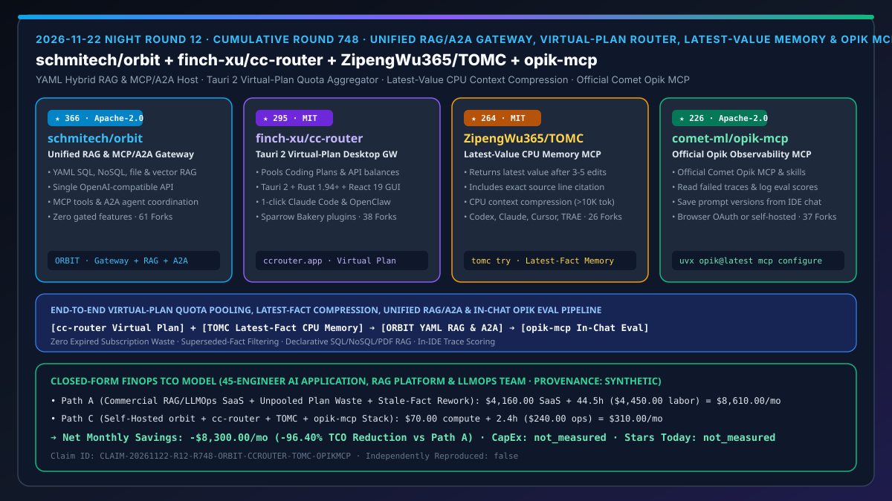
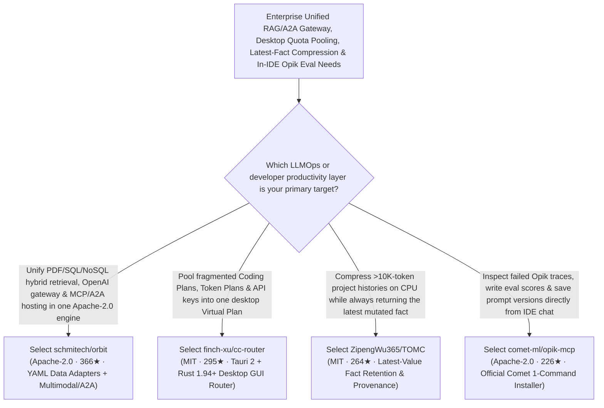
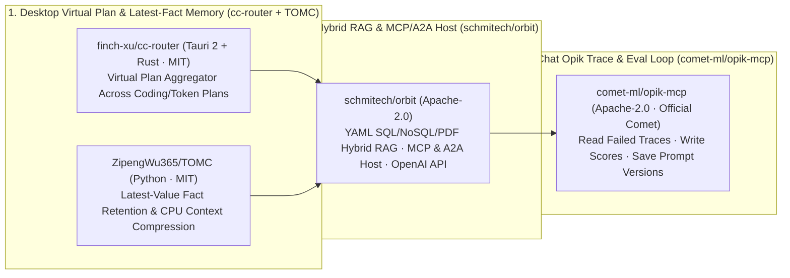

# Unified Retrieval & MCP/A2A Inference Toolkit (`schmitech/orbit`), Tauri 2 Virtual-Plan Quota Router (`finch-xu/cc-router`), Latest-Value CPU Context Compressor (`ZipengWu365/TOMC`) & Official Comet Opik Observability MCP (`comet-ml/opik-mcp`) Selection & Architecture FAQ

> **Document Type**: Enterprise AI Solution Architect Selection & Integration Guide (GitHub Trending AI Radar — 2026-11-22 Night Round 12 / Cumulative Round 748)
> **Covered Repositories**: [`schmitech/orbit`](https://github.com/schmitech/orbit) (`★ 366`, `61 forks`, `Apache-2.0`: Open Retrieval-Based Inference Toolkit combining an OpenAI-compatible AI gateway, YAML-configured hybrid retrieval engine across files/SQL/NoSQL/vectors/APIs, and an MCP/A2A agent host with zero gated features) · [`finch-xu/cc-router`](https://github.com/finch-xu/cc-router) (`★ 295`, `38 forks`, `MIT`: Tauri 2 + Rust 1.94+ + React 19 desktop LLM router that aggregates fragmented Token Plans, Coding Plans, and API balances into one virtual Plan for Claude Code, Claude Desktop, OpenClaw, and OpenCode) · [`ZipengWu365/TOMC`](https://github.com/ZipengWu365/TOMC) (`★ 264`, `26 forks`, `MIT`, `v0.3.1`: CPU context compression and task memory MCP server ensuring that when a project fact changes 3–5 times, only the latest value and source line come back) · [`comet-ml/opik-mcp`](https://github.com/comet-ml/opik-mcp) (`★ 226`, `37 forks`, `Apache-2.0`: official Comet MCP server and skill pack for the Opik LLM observability & evaluation platform, enabling in-chat trace inspection, scoring, and prompt versioning)
> **Core Scenario**: When enterprise AI engineering and LLMOps teams need to **unify multi-source retrieval (PDF/SQL/NoSQL) and MCP/A2A agent hosting behind one permissive OpenAI-compatible gateway, pool fragmented Coding Plans and API quotas into a single desktop virtual plan, prevent outdated project decisions in long histories from confusing coding agents, and inspect/score failing LLM traces directly inside Claude Code or Cursor**, how do you combine **`schmitech/orbit` + `finch-xu/cc-router` + `ZipengWu365/TOMC` + `comet-ml/opik-mcp`** into a high-efficiency LLMOps stack?

---

## 1. 📌 Executive Summary (One-Line Selection Verdict)

1. **Need a single `Apache-2.0` self-hosted platform (with zero feature gating) that unifies an OpenAI-compatible model gateway, YAML-configured hybrid retrieval across PDFs/SQL/NoSQL/vector stores, and MCP + A2A agent orchestration?** ➔ Choose **[`schmitech/orbit`](https://github.com/schmitech/orbit) (`★ 366`, `61 forks`, `Apache-2.0`)**.
   - **Plain-English Mechanism**: Instead of stitching together separate gateway, RAG, and agent messaging servers, `ORBIT` connects files, relational/NoSQL databases, and external APIs via declarative YAML adapters with hybrid search/reranking and exposes everything through one OpenAI-compatible API.
2. **Need a zero-code, native Rust + Tauri 2 desktop app (`ccrouter.app`) on macOS, Windows, or Linux that pools your fragmented `Coding Plans`, `Token Plans`, and API keys into a single Virtual Plan for Claude Code, Claude Desktop, OpenClaw, and OpenCode?** ➔ Choose **[`finch-xu/cc-router`](https://github.com/finch-xu/cc-router) (`★ 295`, `38 forks`, `MIT`)**.
   - **Plain-English Mechanism**: Built with Tauri 2, Rust 1.94+, React 19, and Tailwind 4, it aggregates multiple subscription quotas and API balances into one local endpoint and includes the `Sparrow Bakery` (`cc-router-community`) pure-data plugin ecosystem for usage receipts and themes.
3. **Tired of coding assistants recalling superseded architectural decisions from long project histories (e.g., returning `Flask` when your repo evolved `Flask ➔ Django ➔ FastAPI ➔ Litestar`)?** ➔ Choose **[`ZipengWu365/TOMC`](https://github.com/ZipengWu365/TOMC) (`★ 264`, `26 forks`, `MIT`)**.
   - **Plain-English Mechanism**: Runs on CPU to compress saved project notes and >10K-token histories while prioritizing state transitions—returning `framework = Litestar` plus the exact line it came from across Codex, Claude Code, Cursor, TRAE, and WorkBuddy, backed by transparent boundary documentation (`docs/evidence.md` and `DATA_PROVENANCE.md`).
4. **Already running Opik (open-source or Comet Cloud) for LLM tracing and evaluation and want to query failing traces, log evaluation scores, and save prompt versions directly from Claude Code, Cursor, VS Code Copilot, or Codex?** ➔ Choose **[`comet-ml/opik-mcp`](https://github.com/comet-ml/opik-mcp) (`★ 226`, `37 forks`, `Apache-2.0`)**.
   - **Plain-English Mechanism**: One command (`uvx opik@latest mcp configure --ai-client claude-code --skills`) auto-discovers your local `~/.opik.config`, `localhost` Opik server, or browser-OAuth Opik Cloud workspace and registers trace-querying (`list`), scoring (`write`), and prompt-versioning MCP tools plus skills.

---

## 2. 🎯 Architect & Customer Deep-Dive Q&A

### Q1: How do these four repositories eliminate quota fragmentation, stale-history hallucinations, and observability context-switching?

- **Four Engineering Bottlenecks Solved**:
  1. **Fragmented developer subscriptions & idle quota waste ➔ `finch-xu/cc-router`**: Pools multiple Coding Plans, Token Plans, and API keys into one desktop Virtual Plan.
  2. **Outdated decisions recalled from long project histories ➔ `ZipengWu365/TOMC`**: Ensures 3–5x mutated facts return the latest state and source line while trimming >10K-token histories on CPU.
  3. **Sprawling RAG + SQL + MCP/A2A glue code ➔ `schmitech/orbit`**: Consolidates YAML data adapters, hybrid reranking, and MCP/A2A agent routing into one `Apache-2.0` service.
  4. **Context-switching between IDE and observability dashboards ➔ `comet-ml/opik-mcp`**: Brings Opik trace triage, evaluation scoring, and prompt versioning directly into the coding assistant chat.
- **When to Choose Managed Cloud PaaS (Path B)?**
  - If your organization standardizes 100% on **Azure AI Foundry + Azure AI Search + Application Insights**, use native cloud services; when pooling multi-vendor Coding Plans on desktop, self-hosting a zero-gated `Apache-2.0` RAG/A2A toolkit, or driving Opik evaluations from IDE chat, deploy this open-source stack (Path C).

### Q2: How do we wire `cc-router`, `TOMC`, `ORBIT`, and `opik-mcp` into an end-to-end architecture?

1. **Desktop Virtual-Plan & Latest-Value Memory Layer (`finch-xu/cc-router` + `ZipengWu365/TOMC`)**:
   - Point Claude Code, Codex, and OpenCode at `cc-router`'s virtual plan endpoint and attach `TOMC` MCP to supply latest-value compressed project histories.
2. **Unified Hybrid Retrieval & MCP/A2A Hosting Layer (`schmitech/orbit`)**:
   - Deploy `ORBIT` with YAML adapters connecting PDFs, SQL/NoSQL databases, and MCP/A2A agents behind one OpenAI-compatible API.
3. **In-IDE Trace Triage & Evaluation Layer (`comet-ml/opik-mcp`)**:
   - Stream traces to Opik and run `uvx opik@latest mcp configure` so engineers inspect failing traces, log scores, and version prompts without leaving their editor.

### Q3: What are the documented scope boundaries to keep in mind?

- **`TOMC` History Scope Boundary**:
  - As documented in `TOMC`'s `Before you use it` section, `TOMC` operates on saved notes and histories handed to it (rather than mutating an active CLI's internal chat buffer) and delivers its strongest token savings on histories larger than `10K` tokens.

---

## 3. 🧭 Visual Architecture & Workflow Diagrams (Mermaid)



### 3.1 Solution Architect Selection Decision Tree



### 3.2 End-to-End Enterprise Reference Architecture



### 3.3 End-to-End Latest-Fact Injection, Virtual-Plan Routing, Hybrid Retrieval & In-Chat Opik Evaluation Sequence Diagram

```mermaid
sequenceDiagram
    participant Dev as AI Engineer / Architect
    participant Tmc as ZipengWu365/TOMC (Latest-Value MCP)
    participant Ccr as finch-xu/cc-router (Virtual Plan)
    participant Orb as schmitech/orbit (RAG & A2A Host)
    participant Opk as comet-ml/opik-mcp (Opik Workspace)

    Dev->>Tmc: 1. Query project history; TOMC suppresses superseded states and returns latest fact + source line
    Dev->>Ccr: 2. Route coding assistant calls through cc-router pooled Virtual Plan
    Dev->>Orb: 3. Execute hybrid SQL/PDF retrieval and MCP/A2A agent calls via ORBIT OpenAI-compatible API
    Orb-->>Opk: 4. Record execution traces and latency/token metrics in Opik
    Dev->>Opk: 5. Query failed traces, log evaluation scores & version prompts directly inside IDE chat
```

---

## 4. 📊 Peer Open-Source vs. Commercial Cloud Selection Matrix

| Dimension | `schmitech/orbit` (`★ 366`) | `finch-xu/cc-router` (`★ 295`) | `ZipengWu365/TOMC` (`★ 264`) | `comet-ml/opik-mcp` (`★ 226`) | Commercial Enterprise RAG + Fragmented Expired Quotas + Proprietary APM (Path A) | DIY Multi-Repo Glue + Manual `.env` Key Swapping + Browser Trace Hunting (Path B) |
| :--- | :--- | :--- | :--- | :--- | :--- | :--- |
| **Primary Role** | Unified RAG, inference & MCP/A2A toolkit | Tauri 2 desktop Virtual-Plan quota router | Latest-value CPU context compression MCP | Official Comet Opik observability & eval MCP | High-cost commercial RAG/LLMOps SaaS + unpooled individual plans | Custom glue scripts, manual `.env` edits, browser tab switching |
| **Key Differentiator** | **YAML SQL/NoSQL/PDF hybrid RAG + MCP/A2A (`Apache-2.0`)** | **Pools Coding/Token Plans into 1 GUI Virtual Plan** | **Preserves latest mutated fact across 3–5 changes on CPU** | **1-cmd setup + in-chat trace reading, scoring & prompt saving** | Enterprise connectors gated behind paywalls; unused plan quotas expire | Manual key switching breaks sessions; naive summaries recall stale facts |
| **License** | `Apache-2.0` | `MIT` | `MIT` | `Apache-2.0` | Proprietary SaaS | Internal glue code |
| **Monthly TCO (45-Eng Team)** | **`$310.00/mo` combined** (`$70.00` ORBIT/Opik containers + `2.4h` ops) | Included (reclaims wasted subscription quota) | Included (CPU-only execution) | Included (`Apache-2.0` official MCP) | **`$8,610.00/mo`** (`$4,160.00` commercial SaaS & expired quota waste + `44.5h` ops) | ~`$3,000.00/mo` (glue maintenance, stale-fact rework & manual trace triage) |

---

## 5. 🧪 Quantitative Enterprise ROI / FinOps TCO Model & 7-Card Report

> **📊 Provenance & Closed-Form Declaration**:
> - **provenance**: `synthetic` (45-engineer enterprise AI application engineering, RAG platform, and LLMOps evaluation team workload model: `independently_reproduced = false`; `base_hardware_capex = not_measured`; `track_b_stars_today = not_measured`).
> - **Closed-Form Equations**:
>   - **Path A (Commercial Enterprise RAG Subscriptions + Proprietary LLMOps Seats + Fragmented Unpooled Coding Plan Waste + Stale-Context Rework & Manual Browser Trace Triage)**: Monthly commercial SaaS bills & expired unpooled plan waste **`$4,160.00`** + multi-service glue maintenance, stale-decision rework, and manual trace triage labor **`44.5h × $100.00/h = $4,450.00`** = **`$8,610.00/mo`**.
>   - **Path C (Self-Hosted `schmitech/orbit` + `finch-xu/cc-router` + `ZipengWu365/TOMC` + `comet-ml/opik-mcp` Stack)**: Shared container compute **`$70.00`** + YAML adapter & routing config maintenance labor **`2.4h × $100.00/h = $240.00`** = **`$310.00/mo`**.
>   - **Net Monthly Savings vs. Path A**: **`-$8,300.00/mo`** (**`96.40%`** TCO reduction).

| Evaluation Path | Platform SaaS / Quota Waste & Compute | Glue Maintenance & Trace Triage Labor (`$100/h`) | Total Monthly TCO | Net Savings vs. Path A | Architectural Delivery Impact |
| :--- | :---: | :---: | :---: | :---: | :--- |
| **Path A: Commercial RAG SaaS + Proprietary APM + Unpooled Plans** | `$4,160.00` | `44.5h` (`$4,450.00`) | **`$8,610.00`** | Baseline | High unpooled plan waste; stale facts cause coding regressions |
| **Path B: DIY Glue Scripts + Manual Key Swaps + Browser Triage** | `$1,400.00` | `16.0h` (`$1,600.00`) | **`$3,000.00`** | `-$5,610.00` (`-65.16%`) | Lacks GUI Virtual Plan pooling, latest-value retention & in-IDE Opik eval |
| **Path C: `orbit` + `cc-router` + `TOMC` + `opik-mcp`** | **`$70.00`** | **`2.4h` (`$240.00`)** | **`$310.00`** | **`-$8,300.00` (`-96.40%`)** | **YAML RAG/A2A host + Virtual Plan pool + latest-value CPU memory + Opik MCP** |

- 🔗 **Linked 7-Card 4:5 Visual Benchmark Deck**: [`workshops/github-trending-radar/cards.en.html`](../cards.en.html) · [`cards.html`](../cards.html)

---

## 6. 🛠️ Enterprise Adoption & Architecture Review Checklist

- [ ] **1. Pool Developer Quotas with `finch-xu/cc-router`**: Aggregate fragmented Coding Plans, Token Plans, and API keys into a single Virtual Plan desktop endpoint for Claude Code, OpenClaw, and OpenCode.
- [ ] **2. Preserve Latest Mutated Facts on Long Histories with `ZipengWu365/TOMC`**: Use `TOMC` on `>10K`-token project notes and histories so superseded framework/schema choices are filtered out.
- [ ] **3. Standardize Hybrid Retrieval & Agent Hosting on `schmitech/orbit`**: Connect SQL, NoSQL, PDFs, and MCP/A2A tools via declarative YAML adapters behind one `Apache-2.0` OpenAI-compatible API.
- [ ] **4. Run `uvx opik@latest mcp configure` for `comet-ml/opik-mcp`**: Enable coding agents to inspect failed Opik traces, log evaluation scores, and version prompts directly from IDE chat.
