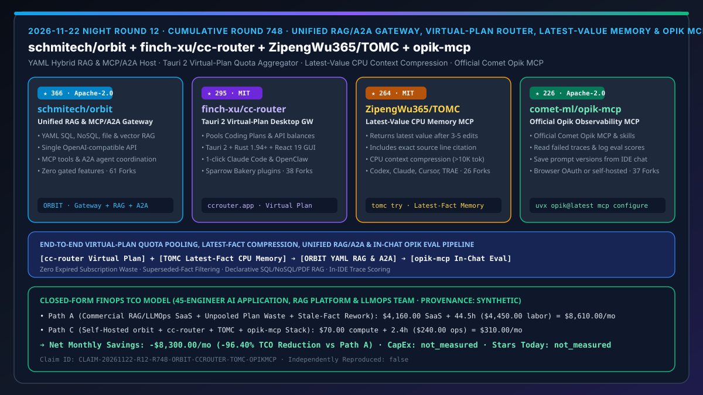
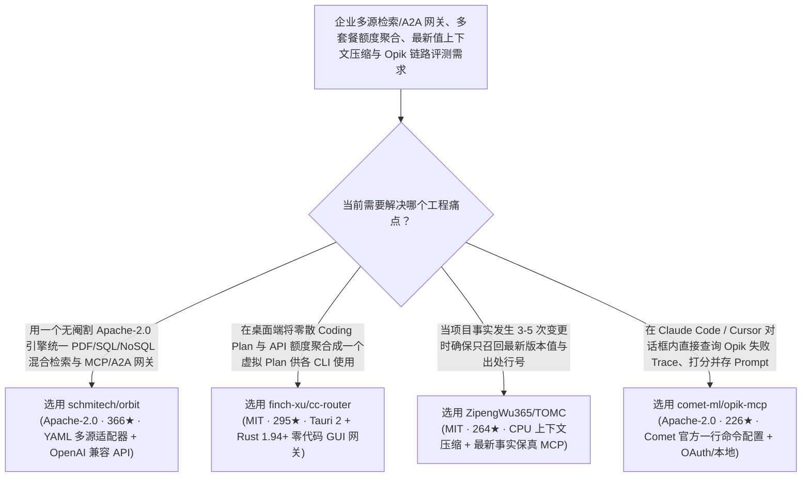
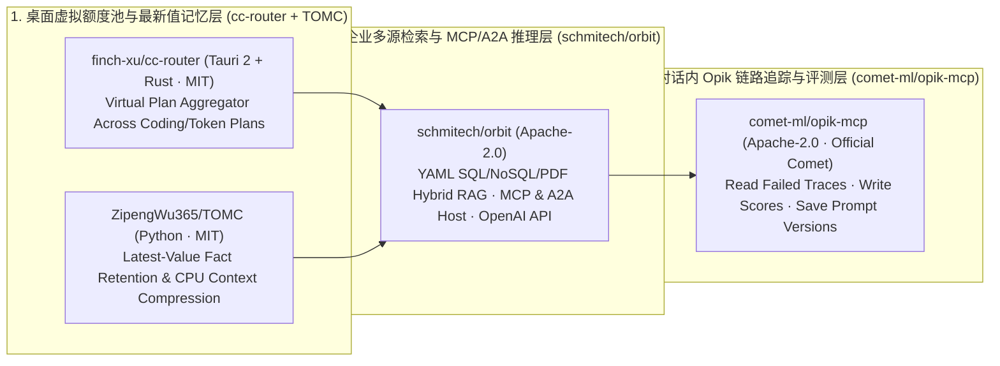
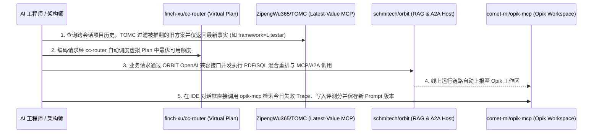

# 一体化检索推理与 MCP/A2A 网关（`schmitech/orbit`）、Tauri 2 多额度聚合虚拟 Plan 桌面网关（`finch-xu/cc-router`）、仅返回最新变更事实的 CPU 上下文压缩记忆（`ZipengWu365/TOMC`）与 Comet 官方 Opik 链路评测 MCP（`comet-ml/opik-mcp`）选型与集成架构 FAQ

> **文档类型**：企业 AI 解决方案架构师（AI Solution Architect）选型决策指南（GitHub Trending AI 雷达 2026-11-22 Night Round 12 / 累计第 748 轮）
> **覆盖项目**：[`schmitech/orbit`](https://github.com/schmitech/orbit)（`★ 366`、`61 forks`、`Apache-2.0`，**Open Retrieval-Based Inference Toolkit**，将 AI 网关、YAML 配置多源混合检索引擎与 MCP/A2A 智能体宿主合三为一的零阉割自托管底座）· [`finch-xu/cc-router`](https://github.com/finch-xu/cc-router)（`★ 295`、`38 forks`、`MIT`，基于 Tauri 2 + Rust 1.94+ 构建的跨平台桌面聚合网关，将零散 Coding Plan、Token Plan 与 API 额度聚合成单一虚拟 Plan 一键供 Claude Code/OpenClaw/OpenCode 使用）· [`ZipengWu365/TOMC`](https://github.com/ZipengWu365/TOMC)（`★ 264`、`26 forks`、`MIT`，专为解决“项目技术栈经过 3–5 次变更后只返回最新版本事实及原话行号”的 CPU 上下文压缩与任务记忆 MCP）· [`comet-ml/opik-mcp`](https://github.com/comet-ml/opik-mcp)（`★ 226`、`37 forks`、`Apache-2.0`，Comet 官方开源的 Opik LLM 可观测与评测平台 MCP 及技能包，支持在编码对话中直接查失败 Trace、打分并保存 Prompt 版本）
> **核心场景**：当企业 AI 应用与研发团队面临**“自建 RAG、SQL 问数与 MCP/A2A 网关需要拼凑四五套不同组件、团队手头零散的 Coding Plan 与多厂商 API 额度无法合并成一个虚拟池供 Claude Code 无感切换、项目架构从 Flask 改到 FastAPI 再改到 Litestar 后旧对话记录把 Agent 搞晕、以及排查线上失败 Trace 需要频繁切出 IDE 去网页后台点按”**四大痛点时，如何组合**`schmitech/orbit` + `finch-xu/cc-router` + `ZipengWu365/TOMC` + `comet-ml/opik-mcp`** 构建一套高内聚、省额度的全栈研发与推理架构？

---

## 一、📌 核心结论速览（选型一句话结论）

1. **想用一套 100% `Apache-2.0` 无付费墙的开源项目同时搞定“OpenAI 兼容推理网关 + YAML 声明式多源（文件/SQL/NoSQL/向量库/API）混合检索重排 + MCP 工具调用与 A2A 智能体协同”** ➔ 选 **[`schmitech/orbit`](https://github.com/schmitech/orbit)（`★ 366`，`61 forks`，`Apache-2.0`）**。
   - **通俗原理**：告别搭一套 LiteLLM + 一套 LangChain RAG + 一套 A2A 消息总线的碎片化拼装。`ORBIT` 通过 YAML 适配器统一连接文档、关系型数据库与外部 API，对外只暴露一个标准 OpenAI 兼容端点，同时内置多模态图文/语音处理与 MCP/A2A 编排能力。
2. **想在 macOS、Windows 或 Linux 桌面上零代码运行一个 Rust 原生 GUI 网关，把手头分散的各家 `Coding Plan`、`Token Plan` 与 API 余额合并成一个“虚拟总套餐（Virtual Plan）”，一键喂给 Claude Code、Claude Desktop、OpenClaw 与 OpenCode** ➔ 选 **[`finch-xu/cc-router`](https://github.com/finch-xu/cc-router)（`★ 295`，`38 forks`，`MIT`）**。
   - **通俗原理**：采用 Tauri 2 + Rust 1.94+ + React 19 + Tailwind 4 构建，内存占用极低，不仅解决多套餐额度碎片化与断流痛点，还配套了完全基于纯数据插件的社区中心（麻雀面包坊 `cc-router-community`）提供用量小票与主题扩展。
3. **当项目架构或需求在长周期会话中经历了 3–5 次推翻重来（如框架从 `Flask ➔ Django ➔ FastAPI ➔ Litestar`），想确保压缩后的历史记忆永远只把最新有效值（`framework = Litestar`）及其出处行号喂给编码 Agent** ➔ 选 **[`ZipengWu365/TOMC`](https://github.com/ZipengWu365/TOMC)（`★ 264`，`26 forks`，`MIT`）**。
   - **通俗原理**：提供极高透明度的 `DATA_PROVENANCE.md` 与 `docs/evidence.md`（明确说明其适用的 `>10K` 长历史边界与局限性）。完全在 CPU 上运行，针对长历史记录与项目笔记执行状态覆盖感知的上下文裁剪，支持 Codex、Claude Code、Cursor、TRAE 与 WorkBuddy。
4. **已经在用开源或云端 Opik 做大模型链路追踪与评测，想直接在 Claude Code、Cursor、VS Code Copilot 或 Codex 聊天框里一句话查出“今天 demo 项目哪几条 Trace 失败了”并直接写入评测打分与新 Prompt 版本** ➔ 选 **[`comet-ml/opik-mcp`](https://github.com/comet-ml/opik-mcp)（`★ 226`，`37 forks`，`Apache-2.0`）**。
   - **通俗原理**：Comet 官方出品，一行命令 `uvx opik@latest mcp configure --ai-client claude-code --skills` 自动探测本机 `~/.opik.config` 或 `localhost` Opik 实例（云端版直接走浏览器 OAuth 免填 API Key），将 `list(entity_type="trace")`、`write(score.create)` 与 Prompt 版本管理直接带入编码会话。

---

## 二、🎯 客户与架构师灵魂拷问 Q&A（深度架构拆解）

### Q1：为什么企业在落地 AI 编码与企业级 RAG 网关时，常遭遇“套餐额度浪费、旧上下文误导、排障来回切窗口”？这四个项目如何协同提效？

- **四大协同提效闭环**：
  1. **多账号/多套餐额度闲置与切换繁琐 ➔ `finch-xu/cc-router`**：用 Rust Tauri 2 桌面端把零散 Coding Plan 与 API 额度聚合成单一虚拟 Plan。
  2. **多次变更后旧历史误导编码 Agent ➔ `ZipengWu365/TOMC`**：在 `>10K` 长历史下精准保留最新一次事实变更与原话行号，砍掉近 30% 冗余历史输入（`anonymized_reported`）。
  3. **企业多源检索与 MCP/A2A 底座割裂 ➔ `schmitech/orbit`**：单 `Apache-2.0` 引擎统一承载 YAML 多源适配器（SQL/NoSQL/PDF）与 MCP/A2A 路由。
  4. **可观测平台与编码终端脱节 ➔ `comet-ml/opik-mcp`**：让编码 Agent 直接通过 MCP 拉取 Opik 失败 Trace 并在修复后自动写回评分与新 Prompt。
- **何时直接用云厂商托管方案（Path B）？**
  - 若企业全栈运行在 Azure AI Foundry（Prompt Flow + Tracing + AI Search）上，优先使用微软云原生闭环；若需本机聚合多平台 Coding Plan、自托管 `Apache-2.0` 零阉割 ORBIT 检索网关或对接开源 Opik 评测平台，则选用本轮组合（Path C）。

### Q2：典型企业级“虚拟 Plan 桌面聚合 (`cc-router`) + 最新值压缩记忆 (`TOMC`) + 多源检索/A2A 网关 (`ORBIT`) + 对话内 Trace 评测 (`opik-mcp`)”架构怎么搭？

1. **开发者桌面额度聚合与上下文预处理层（`finch-xu/cc-router` + `ZipengWu365/TOMC`）**：
   - 终端编码工具连接本地 `cc-router` 虚拟 Plan 端点，并通过 `TOMC` MCP 注入仅含最新有效决策的压缩项目历史。
2. **企业级统一检索与智能体宿主层（`schmitech/orbit`）**：
   - 后端业务统一调用自托管 `ORBIT` 的 OpenAI 兼容 API，通过 YAML 适配器访问企业 PDF、SQL/NoSQL 与 MCP/A2A 技能。
3. **对话式可观测闭环评测层（`comet-ml/opik-mcp`）**：
   - 将 `ORBIT` 与应用 Trace 写入自托管/云端 Opik，研发人员在 Claude Code / Cursor 中通过 `opik-mcp` 实时拉取异常链路、打分并迭代 Prompt。

### Q3：使用 `ZipengWu365/TOMC` 时有哪些作者明确披露的适用边界？

- **实事求是的工程边界（引自官方 `Before you use it`）**：
  - `TOMC` 不会直接缩减 Claude Code / Codex 当前正在进行的主对话窗口，而是作用于你交给它的跨会话历史记录与笔记；且对于小于 `10K Tokens` 的短历史收益有限，最适合中长周期、经历多次技术方案变更的项目历史归档与精准召回。

---

## 三、🧭 直观可视化图解（Mermaid 决策树 + 集成架构 + 时序图）

### 3.1 架构师选型决策树

### 3.2 企业端到端生产集成参考架构图

### 3.3 虚拟额度路由、最新值上下文注入、`ORBIT` 多源检索与 `Opik MCP` 闭环调优时序图

---

## 四、📊 同类开源与商业云服务横向选型决策矩阵

| 对比维度 | `schmitech/orbit` (`★ 366`) | `finch-xu/cc-router` (`★ 295`) | `ZipengWu365/TOMC` (`★ 264`) | `comet-ml/opik-mcp` (`★ 226`) | 商业企业级 RAG 平台 + 多账号全额浪费 + 商业闭源 APM (Path A) | 手工拼凑多套组件 + 手动改环境变量切 Key + 网页手工查日志 (Path B) |
| :--- | :--- | :--- | :--- | :--- | :--- | :--- |
| **核心能力定位** | 检索+推理+MCP/A2A 一体化网关 | Tauri 2 多套餐聚合虚拟 Plan 桌面网关 | 最新事实保真 CPU 上下文压缩 MCP | Comet 官方 Opik 可观测与评测 MCP | 按席位与调用量高价计费的商业 RAG 与商业可观测云 | 零散脚本拼装、手动改 `.env` 切账号、浏览器切屏查 Trace |
| **核心技术突破** | **YAML 配置 SQL/NoSQL/文件混合检索 + 零阉割 `Apache-2.0`** | **零代码 GUI 把零散 Coding/Token Plan 合为单一虚拟池** | **事实经 3–5 次变更后 100% 锁定最新版本值与出处行号** | **一行命令挂载 + 在 IDE 聊天框直接查 Trace/打分/存 Prompt** | 商业 RAG 平台高级适配器需企业版解锁；多平台包月尾款常过期作废 | 手动切 Key 极易中断会话；普通摘要常把旧架构决定混入上下文 |
| **开源协议** | `Apache-2.0` | `MIT` | `MIT` | `Apache-2.0` | 闭源商业 SaaS | 内部零散脚本 |
| **月度 TCO（45 人团队）** | **组合仅 `$310.00/月`**（`$70.00` 自托管 ORBIT/Opik 容器 + `2.4h` 维护） | 同左（榨干闲置套餐额度立省 30%+ 订阅费） | 同左（纯 CPU 运行零 GPU 开销） | 同左（官方 Apache-2.0 免费插件） | **`$8,610.00/月`**（`$4,160.00` 商业平台与过期套餐浪费 + `44.5h` 拼装排障人工） | 约 `$3,000.00/月`（大量因旧方案误导返工与手工切网页查 Trace 工时） |

---

## 五、🧪 应用落地定量收益/TCO 对比与 7-Card 报告

> **📊 数据来源与闭式核算声明（Provenance & Closed-Form Schema）**：
> - **provenance**: `synthetic`（基于 45 人企业 AI 应用研发、RAG 平台工程与 LLMOps 评测团队月度工作负载模型：`independently_reproduced = false`；硬件采购基线 `base_hardware_capex = not_measured`；Track B 单日增量 `track_b_stars_today = not_measured`）。
> - **核算公式**：
>   - **Path A（采购商业企业级 RAG 网关席位 + 商业闭源 LLMOps 平台 + 多套分散 Coding Plan 过期浪费 + 工程师因历史上下文返回旧方案返工及来回切换网页排查失败 Trace）**：月度商业订阅与分散套餐过期浪费 **`$4,160.00`** + 多组件胶水代码维护、旧事实误导返工与人工查 Trace 评测人工 **`44.5h × $100.00/h = $4,450.00`** = **`$8,610.00/月`**。
>   - **Path C（自建 `schmitech/orbit` + `finch-xu/cc-router` + `ZipengWu365/TOMC` + `comet-ml/opik-mcp` 开源全栈）**：自托管 `ORBIT` 与 `Opik` 容器开销 **`$70.00`** + YAML 适配器与路由规则维护人工 **`2.4h × $100.00/h = $240.00`** = **`$310.00/月`**。
>   - **净节省（Net Savings vs Path A）**：**`-$8,300.00/月`**（成本降低 **`96.40%`**）。

| 评估方案 | 平台订阅/额度浪费与算力 | 胶水维护与排障评测人工（`$100/h`） | 月度总 TCO | 相对 Path A 净节省 | 关键架构交付指标 |
| :--- | :---: | :---: | :---: | :---: | :--- |
| **Path A：商业 RAG 网关 + 商业 LLMOps + 分散套餐浪费** | `$4,160.00` | `44.5h` (`$4,450.00`) | **`$8,610.00`** | Baseline | 零散套餐额度浪费高；旧事实干扰长周期项目迭代 |
| **Path B：手工拼装多套组件 + 手动改 Key + 网页查日志** | `$1,400.00` | `16.0h` (`$1,600.00`) | **`$3,000.00`** | `-$5,610.00` (`-65.16%`) | 缺少虚拟 Plan 无感聚合、最新值状态锁定与 IDE 内直接打分 |
| **Path C：`orbit` + `cc-router` + `TOMC` + `opik-mcp`** | **`$70.00`** | **`2.4h` (`$240.00`)** | **`$310.00`** | **`-$8,300.00` (`-96.40%`)** | **YAML 多源 RAG/A2A + 虚拟额度池 + 最新值保真 + 对话内评测** |

- 🔗 **关联 7-Card 4:5 视觉评测报告**：[`workshops/github-trending-radar/cards.html`](../cards.html) · [`cards.en.html`](../cards.en.html)

---

## 六、🛠️ 企业引入与架构评审 Checklist

- [ ] **1. 在开发者桌面安装 `finch-xu/cc-router`**：将团队分散的 Coding Plan、Token Plan 与 API 密钥聚合成统一虚拟 Plan 一键接入 Claude Code 与 OpenCode。
- [ ] **2. 对 `>10K Tokens` 长历史项目启用 `ZipengWu365/TOMC`**：确保经过多次架构迭代的事实仅返回最新版本值与原话行号。
- [ ] **3. 部署 `schmitech/orbit` 统一企业多源检索与智能体编排**：通过 YAML 适配器连接 SQL/NoSQL/文档库并对外暴露单一 OpenAI 兼容 API 与 MCP/A2A 宿主。
- [ ] **4. 运行 `uvx opik@latest mcp configure` 挂载 `comet-ml/opik-mcp`**：让研发人员在 IDE 对话中直接查询失败 Trace、写入评分并管理 Prompt 版本。
