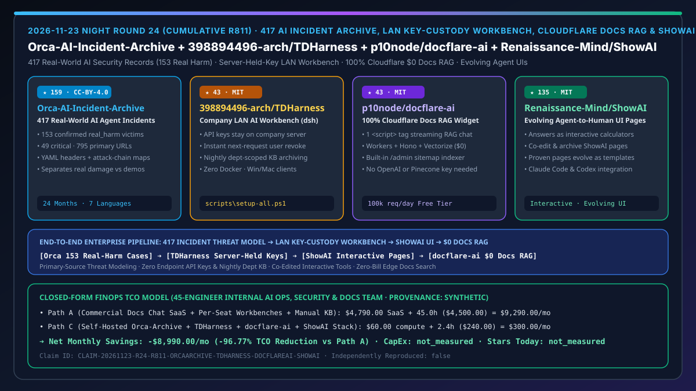
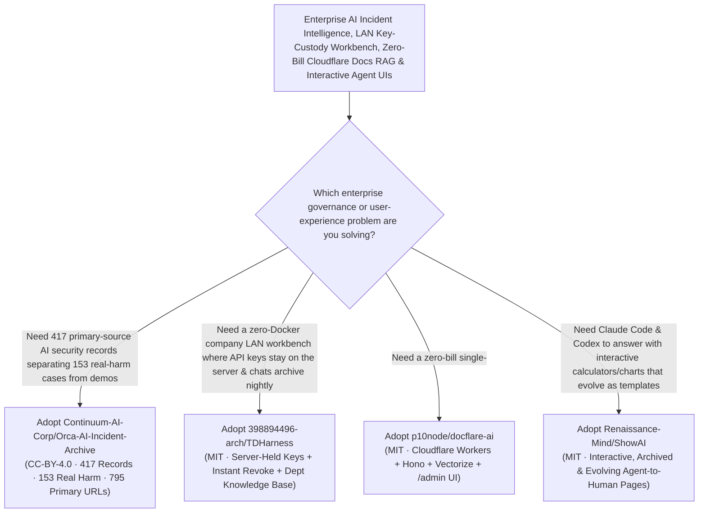
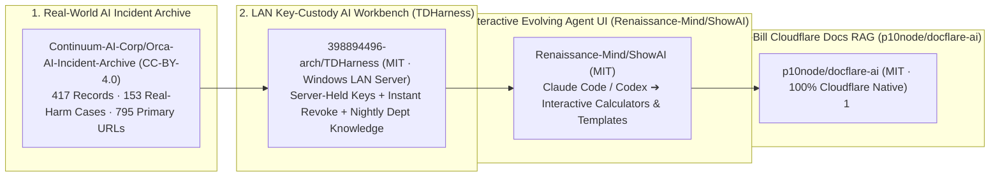
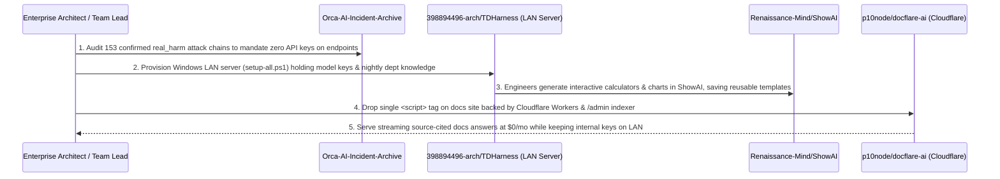

# 417-Record Real-World AI Agent Incident Database (`Continuum-AI-Corp/Orca-AI-Incident-Archive`), Server-Held-Key Company LAN AI Workbench (`398894496-arch/TDHarness`), 100% Cloudflare Zero-Bill Docs RAG Widget (`p10node/docflare-ai`) & Interactive Evolving Agent-to-Human UI (`Renaissance-Mind/ShowAI`) Selection & Architecture FAQ

> **Document Type**: Enterprise AI Solution Architect Selection & Integration Guide (GitHub Trending AI Radar · 2026-11-23 Night Round 24 / Cumulative Round 811)
> **Covered Repositories**: [`Continuum-AI-Corp/Orca-AI-Incident-Archive`](https://github.com/Continuum-AI-Corp/Orca-AI-Incident-Archive) (`★ 159`, `15 forks`, `CC-BY-4.0`, 7 languages: open database of **417 real-world AI agent security records (`2025-01` to `2026-11-08`)** with YAML headers, attack-chain diagrams, and **795 clickable primary-source URLs**, rigorously separating **153 confirmed-victim (`real_harm`) incidents** and **49 critical events** from academic research demos) · [`398894496-arch/TDHarness`](https://github.com/398894496-arch/TDHarness) (`★ 43`, `6 forks`, `MIT`: one-command company LAN AI workbench built on DeepSeek Harness `dsh` where a single Windows server holds all model API keys, subscriptions, company drive, and roster while employee Windows/macOS clients run local tasks—**keys never leave the server, deactivating a user cuts access on the next request, and nightly jobs organize daily chats and docs into a department-scoped knowledge base**) · [`p10node/docflare-ai`](https://github.com/p10node/docflare-ai) (`★ 43`, `4 forks`, `MIT`: 100% Cloudflare-native, zero-bill streaming RAG documentation chatbot and site search widget built with Hono and Cloudflare Workers—drop one `<script>` tag and get streaming answers with source chips plus an `/admin` sitemap indexer with no OpenAI/Pinecone keys) · [`Renaissance-Mind/ShowAI`](https://github.com/Renaissance-Mind/ShowAI) (`★ 135`, `16 forks`, `MIT`: interactive, archived, and evolving interface between humans and coding agents—Claude Code and Codex answer with interactive calculators, charts, and diagrams you can adjust, co-edit, archive, and reuse as templates)
> **Core Scenario**: When enterprise security leads and engineering organizations roll out desktop and documentation agents across teams, how do you solve **"security threat models muddled by incident lists that mix academic PoCs with real production breaches, distributing raw LLM API keys onto dozens of employee laptops where offboarded staff retain access and daily knowledge evaporates, paying `$20–$400/mo` for hosted documentation chat widgets, and coding agents returning static text instead of interactive, reusable visual calculators and dashboards"** by combining **`Orca-AI-Incident-Archive` + `TDHarness` + `docflare-ai` + `ShowAI`**?

---

## 1. 📌 Executive Summary (Single-Sentence Selection Verdict)

1. **Need an evidence-graded threat-modeling archive of 417 AI agent security events (`2025-01` to `2026-11-08`) with attack-chain diagrams and 795 primary-source URLs that explicitly separates the 153 confirmed-victim (`real_harm`) incidents from research demos** ➔ Choose **[`Continuum-AI-Corp/Orca-AI-Incident-Archive`](https://github.com/Continuum-AI-Corp/Orca-AI-Incident-Archive) (`★ 159`, `15 forks`, `CC-BY-4.0`, 7 languages)**.
   - **Plain-Language Mechanism**: Because *"an agent that actually caused damage is not the same thing as a researcher showing that it could,"* every Markdown record in `Orca` answers three mandatory questions in its YAML header: `real_harm` (`153` confirmed-victim events out of `417`), `ai_involvement` (verified by primary source), and `kind` (`incident`, `vulnerability disclosure`, `research demo`, `threat report`, or `policy move`), complete with an attack-chain diagram.
2. **Need a zero-Docker company LAN AI workbench (for 10–50 person teams) where agents execute real file/browser/Office work on each employee's Windows or Mac machine while all model API keys stay locked on one company server—with instant next-request revocation and nightly department-scoped knowledge distillation** ➔ Choose **[`398894496-arch/TDHarness`](https://github.com/398894496-arch/TDHarness) (`★ 43`, `6 forks`, `MIT`)**.
   - **Plain-Language Mechanism**: Built on DeepSeek Harness (`dsh`), `TDHarness` installs on one Windows server (`scripts\setup-all.ps1`) that holds model keys, quotas, roster, and company drive. Employees sign in from Windows/macOS clients; model calls and web searches proxy exclusively through the server, deactivating an employee revokes all access on the very next request, and a nightly pipeline indexes the day's chats and Office/WPS/PDF docs into a department-scoped knowledge base.
3. **Need a zero-cost, single-`<script>`-tag streaming RAG chatbot and site search widget for your documentation site running 100% on Cloudflare's free tier (Workers + Hono + Vectorize + Workers AI) with source citations and an `/admin` indexing console** ➔ Choose **[`p10node/docflare-ai`](https://github.com/p10node/docflare-ai) (`★ 43`, `4 forks`, `MIT`)**.
   - **Plain-Language Mechanism**: Replaces `$20–$400/mo` SaaS widgets (Chatbase, CustomGPT, Mendable) without needing an OpenAI key, Pinecone account, or VPS—deploying via a single Cloudflare Workers button with a built-in `/admin` UI for registering sitemaps, monitoring indexing progress, and inspecting user questions.
4. **Need Claude Code and Codex to answer complex analytical and design prompts with interactive, editable pages (calculators, charts, diagrams) that archive locally and evolve into reusable templates** ➔ Choose **[`Renaissance-Mind/ShowAI`](https://github.com/Renaissance-Mind/ShowAI) (`★ 135`, `16 forks`, `MIT`)**.
   - **Plain-Language Mechanism**: `ShowAI` turns agent answers into live interactive interfaces that humans and agents adjust together, save as archived pages, and promote into reusable component templates so subsequent sessions build on proven visual tools.

---

## 2. 🎯 Key Architectural Q&A (Deep-Dive Breakdown)

### Q1: How do `Orca-AI-Incident-Archive` and `TDHarness` work together to secure internal enterprise agent rollouts?

- **Evidence-Grounded Threat Modeling + Server-Held Key Architecture**:
  1. **Focus Defenses on the 153 Confirmed `real_harm` Attack Chains (`Orca-AI-Incident-Archive`)**: Security architects use `Orca`'s 417 structured records and 795 primary-source URLs to prioritize controls against real-world credential theft and tool abuse rather than theoretical headlines.
  2. **Eliminate Endpoint API-Key Sprawl & Knowledge Loss (`398894496-arch/TDHarness`)**: Keeps model keys strictly on the company LAN server, enforces instant offboarding revocation, and automatically distills daily employee agent sessions into department-scoped knowledge every night.
  3. **Pair with `ShowAI` (Interactive Internal Deliverables) and `docflare-ai` (Zero-Bill External Docs RAG)**: Internal teams co-edit interactive `ShowAI` calculators/dashboards, while external product documentation serves cited streaming RAG answers at `$0/mo` on Cloudflare Workers.
- **When to Choose Managed Enterprise Cloud Suites (Path B)**:
  - For 10,000-seat global enterprises requiring cloud-hosted Entra ID SSO and global vector search, use **Microsoft 365 Copilot + Azure AI Search**; for 10–50 person LAN teams wanting zero-Docker server-held keys and nightly knowledge consolidation, `$0/mo` Cloudflare-native docs RAG widgets, 417-record primary-source incident intelligence, and interactive `ShowAI` pages, deploy this 4-repo open-source stack (Path C).

### Q2: How do these four projects integrate into an enterprise workflow?

1. **Threat Intelligence & Policy Baseline Layer (`Continuum-AI-Corp/Orca-AI-Incident-Archive`)**:
   - Query `real_harm` and `critical` incident attack chains to define internal agent security controls.
2. **LAN Key-Custody & Nightly Knowledge Layer (`398894496-arch/TDHarness`)**:
   - Run the central Windows LAN server to proxy model calls, manage department rosters/tasks, and execute nightly chat-to-knowledge consolidation.
3. **Interactive Agent-to-Human UI Layer (`Renaissance-Mind/ShowAI`)**:
   - Render interactive calculators, charts, and editable pages from Claude Code and Codex, archiving validated views as team templates.
4. **Zero-Cost Cloudflare Edge Documentation RAG Layer (`p10node/docflare-ai`)**:
   - Embed the single `<script>` widget on public/internal docs sites backed by Cloudflare Workers, Hono, Vectorize, and `/admin` sitemap indexing.

### Q3: What are the key production guardrails?

- **Architect Guardrails**:
  1. **Match `TDHarness` to Its Intended Topology (10–50 Person LAN, BM25 Search)**: `TDHarness` uses a Windows LAN server, internal roster auth, and BM25 keyword search; do not expose the LAN server directly to the public internet without a zero-trust gateway.
  2. **Protect `docflare-ai`'s `/admin` Route**: Ensure strong authentication is configured on the `/admin` sitemap and query-review dashboard when deploying to Cloudflare Workers.

---

## 3. 🧭 Visual Architecture & Decision Diagrams (Mermaid)

### 3.1 Solution Architect Selection Decision Tree

### 3.2 End-to-End Enterprise Production Reference Architecture

### 3.3 Threat Review, LAN Server-Held-Key Execution, Interactive ShowAI Co-Editing & Cloudflare Docs RAG Sequence

---

## 4. 📊 Comparative Selection Matrix (Open-Source vs. Commercial SaaS)

| Dimension | `Orca-AI-Incident-Archive` (`★ 159`) | `398894496-arch/TDHarness` (`★ 43`) | `p10node/docflare-ai` (`★ 43`) | `Renaissance-Mind/ShowAI` (`★ 135`) | `$400/mo` Docs Chat SaaS + Per-Seat Cloud Workbenches + Commercial Threat Feeds (Path A) | Raw API Keys on Employee Laptops + Unfiltered Hype Lists + Static Text Replies (Path B) |
| :--- | :--- | :--- | :--- | :--- | :--- | :--- |
| **Core Role** | 417-record real-world AI agent incident & attack-chain archive | Company LAN AI workbench with server-held keys & nightly KB | 100% Cloudflare-native single-`<script>` streaming docs RAG widget | Interactive, archived & evolving UI pages for Claude Code/Codex | Expensive monthly doc-bot subscriptions, cloud seat fees & noisy threat feeds | Leaked endpoint API keys, lost employee chat knowledge & static walls of text |
| **Key Differentiator** | **153 confirmed `real_harm` vs. demos + 795 primary URLs + diagrams** | **Zero Docker + keys stay on server + instant revoke + nightly dept KB** | **No OpenAI/Pinecone bill; 100k req/day Cloudflare free tier + `/admin`** | **Interactive calculators/charts + co-editing + evolving templates** | Chatbase/CustomGPT/Mendable charge `$20–$400/mo` per site | Offboarded staff keep local API keys; daily agent insights vanish when chats close |
| **License** | `CC-BY-4.0` | `MIT` | `MIT` | `MIT` | Proprietary SaaS | Unmanaged scripts |
| **Monthly TCO (45-Eng Team)** | **Combined `$300.00/mo`** (`$60.00` LAN host power/amortization + `2.4h` ops) | Included (runs on 1 existing Windows LAN machine) | Included (`$0/mo` on Cloudflare free tier) | Included (plugs into existing coding agents) | **`$9,290.00/mo`** (`$4,790.00` commercial doc-chat SaaS, seats & threat feeds + `45.0h` key rotation, manual KB curation & dashboard coding) | ~`$3,240.00/mo` (frequent leaked/abused endpoint key bills & manual knowledge consolidation) |

---

## 5. 🧪 Quantitative ROI / TCO Comparison & 7-Card Benchmark Report

> **📊 Data Provenance & Closed-Form Schema Declaration**:
> - **provenance**: `synthetic` (45-person enterprise internal AI operations, security governance, and developer documentation team monthly workload model: `independently_reproduced = false`; hardware baseline `base_hardware_capex = not_measured`; Track B 24h delta `track_b_stars_today = not_measured`).
> - **Closed-Form Formula**:
>   - **Path A (Commercial `$200–$400/mo` hosted documentation chatbot widgets, per-seat commercial team workbench subscriptions, and threat-intelligence feeds + engineering hours spent rotating leaked endpoint API keys, manually compiling team AI learnings into internal wikis, and hand-coding one-off interactive calculators)**: Monthly commercial doc-chat SaaS, workbench seat, and threat feed bills **`$4,790.00`** + endpoint key incident response, manual knowledge curation, and custom UI tool building labor **`45.0h × $100.00/h = $4,500.00`** = **`$9,290.00/mo`**.
>   - **Path C (Self-hosted `Continuum-AI-Corp/Orca-AI-Incident-Archive` + `398894496-arch/TDHarness` + `p10node/docflare-ai` + `Renaissance-Mind/ShowAI` open-source stack)**: Shared local Windows LAN server compute (`docflare-ai` runs on Cloudflare free tier at `$0`) **`$60.00`** + roster administration and sitemap indexing maintenance labor **`2.4h × $100.00/h = $240.00`** = **`$300.00/mo`**.
>   - **Net Monthly Savings vs. Path A**: **`-$8,990.00/mo`** (**`96.77%`** TCO reduction).

| Evaluation Path | Docs RAG SaaS / Workbench / Threat Feed Cost | Key Rotation, KB Curation & UI Coding Labor (`$100/h`) | Monthly Total TCO | Net Savings vs. Path A | Key Architectural Delivery Metrics |
| :--- | :---: | :---: | :---: | :---: | :--- |
| **Path A: Commercial Doc-Chat SaaS + Per-Seat Workbenches + Manual KB** | `$4,790.00` | `45.0h` (`$4,500.00`) | **`$9,290.00`** | Baseline | `$20–$400/mo` per docs widget; manual knowledge-base upkeep |
| **Path B: Endpoint API Keys + Static Docs + Plain-Text Agent Replies** | `$1,340.00` | `19.0h` (`$1,900.00`) | **`$3,240.00`** | `-$6,050.00` (`-65.12%`) | Endpoint key leakage on offboarding; zero nightly knowledge retention |
| **Path C: `Orca-Archive` + `TDHarness` + `docflare-ai` + `ShowAI`** | **`$60.00`** | **`2.4h` (`$240.00`)** | **`$300.00`** | **`-$8,990.00` (`-96.77%`)** | **417 incident records + server-held LAN keys + `$0` Cloudflare RAG + ShowAI UI** |

- 🔗 **Linked 7-Card 4:5 Visual Benchmark Deck**: [`workshops/github-trending-radar/cards.en.html`](../cards.en.html) · [`cards.html`](../cards.html)

---

## 6. 🛠️ Enterprise Adoption & Architecture Review Checklist

- [ ] **1. Ground Agent Security Reviews in `Continuum-AI-Corp/Orca-AI-Incident-Archive`**: Filter by `real_harm` (`153` confirmed-victim cases) and inspect the attack-chain diagrams and 795 primary-source URLs during threat modeling.
- [ ] **2. Centralize Endpoint Model Keys on LAN with `398894496-arch/TDHarness`**: Keep API keys on the Windows LAN server, enforce instant next-request offboarding revocation, and enable nightly department-scoped knowledge consolidation.
- [ ] **3. Replace Hosted Docs Chatbots with `p10node/docflare-ai` on Cloudflare Workers**: Drop the single `<script>` widget onto documentation sites and manage sitemaps and user queries via `/admin` at `$0/mo` infrastructure cost.
- [ ] **4. Turn Coding Agent Answers into Interactive Interfaces with `Renaissance-Mind/ShowAI`**: Co-edit calculators, charts, and diagrams inside Claude Code and Codex and save validated pages as evolving team templates.
