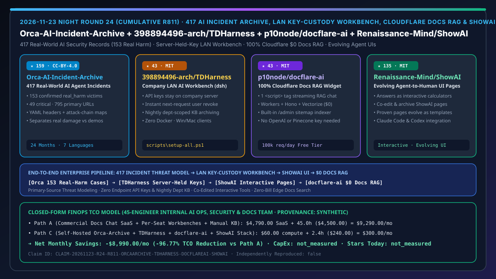
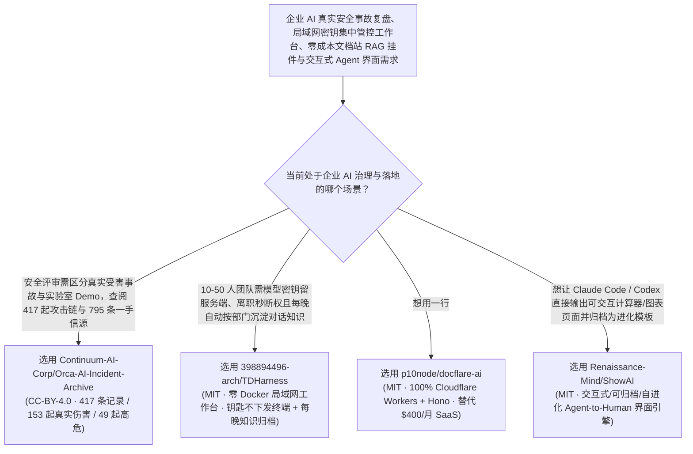
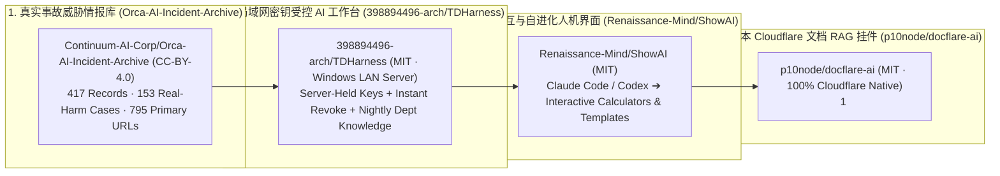
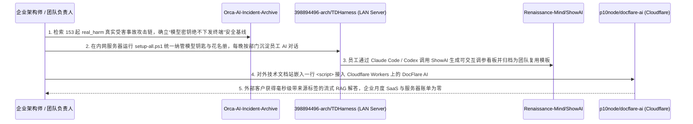

# 417 起真实 AI 智能体安全事件与 153 起实锤受害者攻击链档案库（`Continuum-AI-Corp/Orca-AI-Incident-Archive`）、API 密钥留服务端且离职秒断的企业局域网智能体工作台（`398894496-arch/TDHarness`）、单 `<script>` 标签基于 Cloudflare 免费层零账单的文档流式 RAG 挂件（`p10node/docflare-ai`）与让 Claude Code/Codex 直接返回可交互/可归档/可进化 UI 页面的协作界面（`Renaissance-Mind/ShowAI`）选型与集成架构 FAQ

> **文档类型**：企业 AI 解决方案架构师（AI Solution Architect）选型决策指南（GitHub Trending AI 雷达 2026-11-23 Night Round 24 / 累计第 811 轮）
> **覆盖项目**：[`Continuum-AI-Corp/Orca-AI-Incident-Archive`](https://github.com/Continuum-AI-Corp/Orca-AI-Incident-Archive)（`★ 159`、`15 forks`、`CC-BY-4.0`：覆盖 2025-01 至 2026-11 的 **417 条真实世界 AI 智能体安全事件开源档案库**，含 **49 起高危、153 起确认存在真实受害者（`real_harm`）及 795 条可点击一手信源 URL**，每条均配 YAML 元数据与完整攻击链图解，严格区分“真实造成损害的生产事故”与“学术概念验证 Demo”）· [`398894496-arch/TDHarness`](https://github.com/398894496-arch/TDHarness)（`★ 43`、`6 forks`、`MIT`：基于 DeepSeek Harness (`dsh`) 定制的**零 Docker 企业局域网 AI 工作台**，一台 Windows 机器作服务端集中保管模型 API Key、花名册、公司网盘与按部门隔离的每晚自动沉淀知识库，员工客户端本地干活但**密钥永不下发终端、停用账号下一次请求即刻断权**）· [`p10node/docflare-ai`](https://github.com/p10node/docflare-ai)（`★ 43`、`4 forks`、`MIT`：100% 原生构建在 Cloudflare 免费层（Workers + Hono + Vectorize + Workers AI）上的**零账单文档站流式 RAG 问答与搜索挂件**，一行 `<script>` 标签即可替代 `$20–$400/月` 的 Chatbase/CustomGPT/Mendable 并自带 `/admin` 站点地图索引与问题统计后台）· [`Renaissance-Mind/ShowAI`](https://github.com/Renaissance-Mind/ShowAI)（`★ 135`、`16 forks`、`MIT`：面向 Claude Code 与 Codex 的**可交互、可归档、可进化人机界面引擎**，让智能体不再只吐纯文本，而是直接返回可调参计算器、动态图表与可共同编辑保存的交互式网页模板）
> **核心场景**：当企业安全委员会与中小型研发组织规划 AI 智能体全面铺开时，面对**“管理层被外界夸大的‘数百起 AI 安全事故’吓住分不清哪些是实验室 PoC 哪些是真有受害者的生产攻击链、把大模型 API Key 直接发给几十名员工配在各自电脑上导致离职带走密钥且每日办公经验无法沉淀回公司、为技术文档站买商业 AI 问答挂件每月白交数百美元订阅费、以及 Claude Code / Codex 分析完数据只能吐出干巴巴的 Markdown 文字无法生成供业务方滑块调参的交互式看板”**四大痛点，如何通过 **Orca-Archive + TDHarness + DocFlare-AI + ShowAI** 构建有威胁情报支撑、密钥受控、零云账单的企业智能体工作流？

---

## 一、📌 核心结论速览（选型一句话结论）

1. **想在做企业 AI 安全架构评审（Threat Modeling）时彻底告别道听途说，直接检索 24 个月内 417 起 AI 智能体安全事件、精准筛选出其中“153 起真有受害者（`real_harm`）与 49 起高危生产事故”的完整攻击链图解与 795 条一手信源** ➔ 选 **[`Continuum-AI-Corp/Orca-AI-Incident-Archive`](https://github.com/Continuum-AI-Corp/Orca-AI-Incident-Archive)（`★ 159`，`15 forks`，`CC-BY-4.0`，支持 7 种语言）**。
   - **通俗原理**：市面上绝大多数安全榜单把“研究员在实验室演示的理论漏洞”和“真正在生产环境造成客户损失的事故”混为一谈。`Orca AI Incident Archive` 强制每篇 Markdown 档案回答三个核心字段：① `real_harm`（是否有确认受害者——417 条中仅 **153 条**为真实伤害）；② `ai_involvement`（一手信源确认的 AI 参与度）；③ `kind`（严格区分为真实事故、漏洞披露、研究演示、威胁报告或政策动态），并附带可复盘的攻击链流向图。
2. **想在 10–50 人的企业局域网里零 Docker 一键搭起团队 AI 工作台，既要让每个员工电脑上的 Agent 能操作本地 Word/Excel/WPS、浏览器与桌面软件真干活，又要保证“模型 API Key 留在公司服务端绝不下发、员工离职秒级吊销全部权限、且每晚自动把全员对话按部门权限沉淀进公司知识库”** ➔ 选 **[`398894496-arch/TDHarness`](https://github.com/398894496-arch/TDHarness)（`★ 43`，`6 forks`，`MIT`）**。
   - **通俗原理**：基于 `DeepSeek Harness (dsh)` 针对企业内网深度改造：只需一台常开的 Windows 主机执行一行 PowerShell 脚本即可拉起服务端，统一接管模型密钥池、人员花名册、任务卡与公司共享盘；员工在各自 Windows / macOS 安装客户端登录后，模型推理与联网搜索统一经由公司服务端代理，**停用某人账号后其下一次请求立即被拒**，且服务端每晚自动将全天 AI 对话与办公文档归档进按部门隔离的 BM25 知识库。
3. **想给企业开发文档、产品手册或开源站点加上“带原文出处链接的流式 AI 问答与站内搜索挂件”，且不想交 `$20–$400/月` 的商业 SaaS 订阅费、不想维护任何云服务器或购买 OpenAI / Pinecone 密钥** ➔ 选 **[`p10node/docflare-ai`](https://github.com/p10node/docflare-ai)（`★ 43`，`4 forks`，`MIT`）**。
   - **通俗原理**：100% 榨干 Cloudflare 原生免费额度（Cloudflare Workers + Hono 每日 10 万次请求 + Workers AI Embedding/LLM + Vectorize 向量库）：只需在文档站插入一行 `<script>` 标签，即可获得流式问答浮窗与引用来源标签（Source Chips），并自带 `/admin` 管理后台用于注册 Sitemap 自动爬取索引与查看高频用户提问。
4. **想让 Claude Code 和 Codex 在回答复杂架构测算、数据分析或方案比选问题时，不再只回复静态文本，而是直接生成“可滑块调参、可持久归档、可人机共同编辑并沉淀为复用模板”的交互式 UI 页面** ➔ 选 **[`Renaissance-Mind/ShowAI`](https://github.com/Renaissance-Mind/ShowAI)（`★ 135`，`16 forks`，`MIT`）**。
   - **通俗原理**：`ShowAI` 作为插件嵌入你现有的编码智能体中：当你提问时，Agent 直接返回带交互式图表、TCO 计算器或动态拓扑的 ShowAI 页面；你可以边拖动参数边与 Agent 协作修改，将成熟页面归档入库，并在遇到新表达需求时由 Agent 现场编写新组件，让后续每一轮对话都站在更高起点上。

---

## 二、🎯 客户与架构师灵魂拷问 Q&A（深度架构拆解）

### Q1：在企业内部推广桌面智能体（如 Claude Code / DeepSeek Harness）时，为什么“给每个员工发一个 API Key”是重大安全与资产流失隐患？

- **分散式个人 Key vs `TDHarness` 局域网集中管控 + `Orca-Archive` 真实威胁建模**：
  1. **防密钥外泄与秒级权限回收（`398894496-arch/TDHarness`）**：对照 `Orca-AI-Incident-Archive` 中的 153 起真实受害案例，终端 API Key 泄露与离职人员未及时收回权限是高频事故源头；`TDHarness` 将全部模型钥匙锁在公司服务端，员工客户端只有会话令牌，人事一旦停用账号，其模型、公司盘与知识库权限在下一秒即刻归零。
  2. **组织智力资产每晚自动归仓**：员工白天用 AI 处理完 Excel 销售表或项目复盘后，若无集中沉淀机制，经验随会话关闭即烟消云散；`TDHarness` 每晚定时将全员对话与文档提炼进按部门隔离的知识库。
- **何时直接选用大型商业云套件（Path B）？**
  - 若企业为万人级跨国集团且强制要求对接全套 Entra ID / LDAP / 全球多地域向量检索，可直接采购 **Microsoft 365 Copilot 企业版 + Azure AI Search**；若为 10–50 人精锐研发/业务团队希望零 Docker 在办公局域网一键管住模型密钥与部门知识库、用 Cloudflare 免费层零成本搭建文档站流式 RAG 挂件、查阅 417 起真实 AI 安全事故攻击链、或用 `ShowAI` 生成可交互调参看板，则采用本轮四合一开源栈（Path C）。

### Q2：典型企业级“真实事故威胁建模 (`Orca-Archive`) ➔ 局域网密钥不出端工作台 (`TDHarness`) ➔ 可交互调参页面共创 (`ShowAI`) ➔ 零成本外部文档 RAG 挂件 (`docflare-ai`)”参考架构怎么搭？

1. **真实攻击链威胁建模与红线制定层（`Continuum-AI-Corp/Orca-AI-Incident-Archive`）**：
   - 从 153 起确认真实伤害（`real_harm`）与 49 起高危事故中提取攻击链模式，制定内网智能体权限边界。
2. **局域网集中密钥管理与每晚部门知识沉淀层（`398894496-arch/TDHarness`）**：
   - 单台 Windows 服务器运行 `setup-all.ps1` 托管模型密钥、人员花名册与每晚自动归档的部门知识库，员工客户端在本地安全执行办公任务。
3. **人机共创可交互、可进化 UI 页面层（`Renaissance-Mind/ShowAI`）**：
   - 架构师与分析师通过 `ShowAI` 插件让 Claude Code / Codex 输出带交互计算器与图表的可编辑页面，并沉淀为团队标准组件模板。
4. **100% Cloudflare 原生零账单外部文档问答层（`p10node/docflare-ai`）**：
   - 对外公开的产品手册与开发文档通过一行 `<script>` 接入部署在 Cloudflare Workers 上的 `docflare-ai`，实现零成本流式溯源问答。

### Q3：这套架构的适用边界与注意事项是什么？

- **架构师落地红线**：
  1. **明确 `TDHarness` 的适用规模与检索特性**：`TDHarness` 专为 10–50 人局域网办公场景设计，服务端运行在 Windows 上且采用精确关键词检索（BM25），若需跨义词向量检索可配合本专栏前序轮次的混合检索组件使用。
  2. **监控 `docflare-ai` 在 Cloudflare 免费层的日请求配额**：Cloudflare Workers 免费层提供每日 10 万次请求额度，面向超高流量C端门户时应在 `/admin` 后台配置缓存与速率限制。

---

## 三、🧭 直观可视化图解（Mermaid 决策树 + 集成架构 + 时序图）

### 3.1 架构师选型决策树

### 3.2 企业端到端生产集成参考架构图

### 3.3 攻击链复盘、局域网受控办公、交互式页面共创与 Cloudflare 零成本文档问答时序图

---

## 四、📊 同类开源与商业云服务横向选型决策矩阵

| 对比维度 | `Orca-AI-Incident-Archive` (`★ 159`) | `398894496-arch/TDHarness` (`★ 43`) | `p10node/docflare-ai` (`★ 43`) | `Renaissance-Mind/ShowAI` (`★ 135`) | 商业文档问答 SaaS ($400/月) + 按人头商业办公套件 + 商业威胁情报订阅 (Path A) | 把 API Key 明文发给全员电脑 + 夸大失实的营销安全报告 + 纯文本回复 (Path B) |
| :--- | :--- | :--- | :--- | :--- | :--- | :--- |
| **核心能力定位** | 417 条真实 AI 智能体安全事件与攻击链开源数据库 | 密钥留服务端、每晚自动沉淀知识的局域网 AI 工作台 | 100% Cloudflare 免费层零账单的文档站流式 RAG 挂件 | 让 Claude Code/Codex 返回可交互/可进化页面的界面引擎 | 高昂的月度文档机器人订阅、高企的席位费与混杂噪音的安全报告 | 离职员工带走 API Key 盗刷、无法沉淀团队经验与难以复用的纯文本回答 |
| **核心技术突破** | **严格区分 153 起真实受害 (`real_harm`) 与实验室 Demo + 795 条一手信源** | **零 Docker 一键安装 + 钥匙不下发客户端 + 停用账号秒断权 + 夜间归档** | **单 `<script>` 标签 + Workers/Hono/Vectorize 全免费层 + `/admin` 后台** | **回答即交互式计算器/图表 + 人机协同编辑归档 + 自动长出新组件模板** | Chatbase/Mendable 等文档挂件动辄 `$100–$400/月`；商业威胁报告缺乏可点击原始攻击链 | 个人电脑存明文 Key 极易被窃密木马扫走；每天散装聊天无法形成部门知识库 |
| **开源协议** | `CC-BY-4.0` | `MIT` | `MIT` | `MIT` | 闭源商业 SaaS | 内部松散管理 |
| **月度 TCO（45 人团队）** | **组合仅 `$300.00/月`**（`$60.00` 局域网常开主机电费/折旧分摊 + `2.4h` 维护） | 同左（无需云账号与 Docker 集群） | 同左（100% Cloudflare 免费层 `$0` 账单） | 同左（复用现有编码 Agent） | **`$9,290.00/月`**（`$4,790.00` 商业文档问答 SaaS/企业席位/威胁情报订阅 + `45.0h` 密钥泄露善后、手工整理周报知识与重做前端报表） | 约 `$3,240.00/月`（大量因离职/多机 Key 滥用导致的账单失控与手工汇总部门经验工时） |

---

## 五、🧪 应用落地定量收益/TCO 对比与 7-Card 报告

> **📊 数据来源与闭式核算声明（Provenance & Closed-Form Schema）**：
> - **provenance**: `synthetic`（基于 45 人企业内网智能体协同办公、安全合规审计与外部开发者文档门户团队月度工作负载模型：`independently_reproduced = false`；硬件采购基线 `base_hardware_capex = not_measured`；Track B 单日增量 `track_b_stars_today = not_measured`）。
> - **核算公式**：
>   - **Path A（采购多个 `$200–$400/月` 的商业文档问答挂件 SaaS + 按人头购买商业企业协同席位与商业安全情报源 + 工程师手工排查个人终端 API Key 滥用、人工汇总团队日常 AI 经验文档与反复手写一次性交互测算工具）**：月度商业文档问答 SaaS、企业协同席位与安全情报订阅账单 **`$4,790.00`** + 密钥审计善后、知识库手工整理与交互式报表开发人工 **`45.0h × $100.00/h = $4,500.00`** = **`$9,290.00/月`**。
>   - **Path C（自建 `Continuum-AI-Corp/Orca-AI-Incident-Archive` + `398894496-arch/TDHarness` + `p10node/docflare-ai` + `Renaissance-Mind/ShowAI` 开源组合栈）**：局域网单机服务端分摊开销（DocFlare 跑在 Cloudflare 免费层 `$0`）**`$60.00`** + 花名册权限与站点 Sitemap 索引例行维护人工 **`2.4h × $100.00/h = $240.00`** = **`$300.00/月`**。
>   - **净节省（Net Savings vs Path A）**：**`-$8,990.00/月`**（成本降低 **`96.77%`**）。

| 评估方案 | 文档 RAG SaaS / 协同席位 / 情报订阅成本 | 密钥善后、知识汇总与交互页面开发（`$100/h`） | 月度总 TCO | 相对 Path A 净节省 | 关键架构交付指标 |
| :--- | :---: | :---: | :---: | :---: | :--- |
| **Path A：商业文档问答 SaaS + 商业协同席位 + 人工汇总知识** | `$4,790.00` | `45.0h` (`$4,500.00`) | **`$9,290.00`** | Baseline | 文档挂件月费高；日常 AI 对话经验需人工手动整理 |
| **Path B：全员电脑明文发 Key + 静态文档无搜索 + 纯文本回答** | `$1,340.00` | `19.0h` (`$1,900.00`) | **`$3,240.00`** | `-$6,050.00` (`-65.12%`) | 存在终端 API Key 泄露与离职盗刷风险；经验随聊天流失 |
| **Path C：`Orca-Archive` + `TDHarness` + `docflare-ai` + `ShowAI`** | **`$60.00`** | **`2.4h` (`$240.00`)** | **`$300.00`** | **`-$8,990.00` (`-96.77%`)** | **417 起事故攻击链 + 局域网锁 Key 夜归档 + 零账单 Cloudflare RAG + 交互式 ShowAI** |

- 🔗 **关联 7-Card 4:5 视觉评测报告**：[`workshops/github-trending-radar/cards.html`](../cards.html) · [`cards.en.html`](../cards.en.html)

---

## 六、🛠️ 企业引入与架构评审 Checklist

- [ ] **1. 基于 `Continuum-AI-Corp/Orca-AI-Incident-Archive` 开展智能体上线前威胁建模**：重点对照 153 起确认真实受害者（`real_harm`）的攻击链图解，逐项检查工具调用与凭据隔离设计。
- [ ] **2. 在办公局域网部署 `398894496-arch/TDHarness` 收回分散在员工终端的 API Key**：由服务端集中代持模型密钥与额度，启用离职即时断权与每晚按部门自动归档对话知识库。
- [ ] **3. 用 `p10node/docflare-ai` 替换昂贵的商业文档问答 SaaS**：将整套爬虫、向量化与流式问答部署在 Cloudflare Workers 免费层，通过一行 `<script>` 与 `/admin` 后台赋能文档门户。
- [ ] **4. 在 Claude Code 与 Codex 中集成 `Renaissance-Mind/ShowAI`**：将高频数据分析、架构算账与方案对比转化为可交互、可归档、可持续进化的 UI 模板页。
