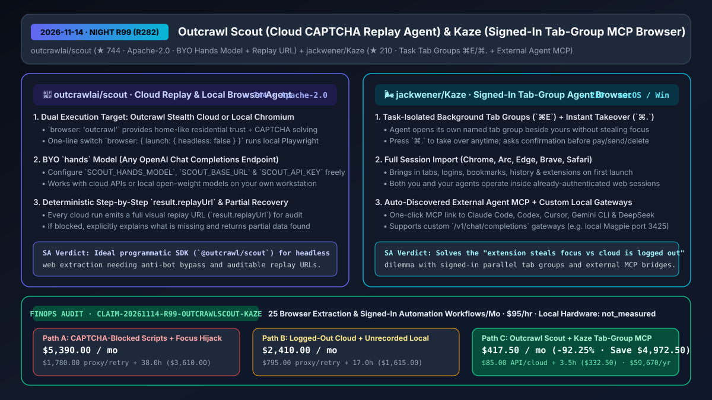
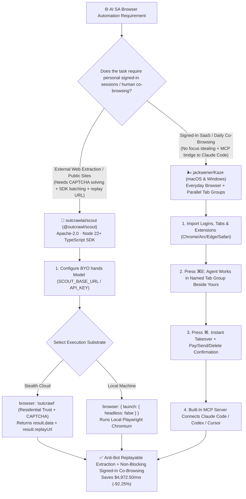

# Cloud Replay Browser Agent (`outcrawlai/scout`) & Signed-In Tab-Group MCP Browser (`jackwener/Kaze`) Selection & Architecture FAQ

> **Document Type**: AI Solution Architect Deep-Dive & Peer Selection FAQ (Night Shift Round 99 / Cumulative Round 282)  
> **Benchmark Style**: Modeled on `ib-vs-ethernet-roce-selection-faq.md` (Plain-Language First Principles + Core Q&A + Mermaid Decision Tree + Closed-Form FinOps Audit)  
> **Covered Repositories**: `outcrawlai/scout` (`★ 744` · TypeScript · Apache-2.0 · Open-Source Browser Agent SDK with BYO `hands` Model, Outcrawl Cloud Anti-Bot/CAPTCHA Solving & Step-by-Step `replayUrl`) + `jackwener/Kaze` (`★ 210` · JavaScript · macOS/Windows · Everyday Browser with Task-Isolated Tab Groups `⌘E`/`⌘.`, Full Session Import & External Agent MCP Server)  
> **Evidence Anchors**: `evidence/trending-daily-2026-11-14-raw.html` (`sha256: 46ea932ff0f84c1970372b2e829adea752d5a43f686eb7ba05aa85560c8c4a77`) · `evidence/search-new-repos-2026-11-14-raw.json` (`sha256: a4edf557e91854831dc80d3670e3e7a1b49c7e9ca14e2e4dd7913489bd7cc2b2`) · `CLAIM-20261114-R99-OUTCRAWLSCOUT-KAZE`



---

## 📌 1. Executive Summary

1. **Why do current browser agents force an awful trade-off between CAPTCHA blocks, logged-out cloud sandboxes, and browser extensions that hijack your active tab?**
   - **Pain Point 1 (CAPTCHA Blocks & Black-Box Failures on External Sites)**: Running raw Playwright scripts against external sites triggers anti-bot CAPTCHAs, and when a run fails, you have no visual replay of what went wrong. **`outcrawlai/scout`** (`@outcrawl/scout`, Apache-2.0) pairs a model-agnostic `hands` configuration (compatible with any OpenAI Chat Completions endpoint or local LLM) with `browser: 'outcrawl'`—giving your agent a home-like browser with built-in CAPTCHA solving (`1,000` free monthly credits) and a step-by-step **`result.replayUrl`**, while still supporting one-line local Playwright execution (`browser: { launch: {} }`).
   - **Pain Point 2 (Extension Focus Hijacking vs. Logged-Out Cloud Browsers)**: Browser extensions steal your active tab while working, whereas cloud browsers leave you signed out of your daily SaaS tools. **`jackwener/Kaze`** is a native macOS and Windows everyday browser that imports your logins, tabs, bookmarks, and extensions from Chrome/Arc/Edge/Brave/Safari on first launch, runs its built-in agent (`⌘E`) inside **separate task-named tab groups** next to yours without stealing focus, lets you take over instantly with `⌘.`, gates high-risk actions (pay, send, delete), and exposes an **MCP server** so Claude Code, Codex, Cursor, and Gemini CLI can read and act on your signed-in tabs.
2. **Closed-Form FinOps Verdict (`CLAIM-20261114-R99-OUTCRAWLSCOUT-KAZE`)**: Across `25` external extraction and signed-in browser automation workflows per month (`$95/hr`, local workstation hardware: `not_measured`), combining **`outcrawlai/scout` + `jackwener/Kaze`** (Path C) reduces monthly cost to **`$417.50/mo`** compared to **`$5,390.00/mo`** for CAPTCHA-blocked DIY Playwright scripts and focus-hijacking extensions (Path A)—saving **`$4,972.50/mo` (`-92.25%`)** or **`$59,670.00/yr`**.

---

## 🔍 2. Core Q&A (Q1 / Q2 / Q3 First-Principles Deep Dive)

### Q1: What are they in plain English, and how do their core mechanisms work?

- **`outcrawlai/scout`: An Open-Source TypeScript Browser Agent SDK with Stealth Cloud Replays and BYO `hands` Models**
  - **First Principle**: Production web agents require decoupling the **reasoning/action model (`hands`)** from the **browser execution substrate** so teams can switch seamlessly between local Chromium and anti-bot cloud browsers with full visual replay.
  - **Three Core Mechanisms**:
    1. **Outcrawl Stealth Cloud + CAPTCHA Solving + `replayUrl`**: With `browser: 'outcrawl'`, Scout opens a cloud browser treated like a residential user, solves CAPTCHAs automatically, and returns both `result.data` and `result.replayUrl` so engineers can watch every click and scroll step by step.
    2. **One-Line Local Playwright Fallback**: Prefer local execution? Install `playwright-core` and pass `browser: { launch: { headless: false } }` to run on your own machine with zero code changes to your task logic.
    3. **BYO `hands` Model & Graceful Partial Returns**: Point `SCOUT_BASE_URL`, `SCOUT_API_KEY`, and `SCOUT_HANDS_MODEL` at any standard Chat Completions API (cloud or local). When a task cannot be completed, Scout stops cleanly, reports exactly what is missing, and returns partial findings instead of looping indefinitely.
- **`jackwener/Kaze`: A Calm Everyday Browser Where Agents Work in Parallel Tab Groups (`⌘E`) and Share Signed-In Tabs via MCP**
  - **First Principle**: Human-agent shared browsing works only when the agent shares the user's authenticated cookie store while operating in an isolated visual container (Tab Group) with explicit human takeover and destructive-action guardrails.
  - **Three Core Mechanisms**:
    1. **Task-Named Background Tab Groups (`⌘E`) & Instant Takeover (`⌘.`)**: Press `⌘E` to assign a task (e.g., `"Find a flight from London to Lisbon on Friday under €120"`). Kaze opens a dedicated tab group beside your active tabs while you continue browsing. Press `⌘.` to take over at any moment, close all agent tabs in one keystroke when done, and rely on mandatory confirmation prompts before Kaze pays, sends, or deletes anything.
    2. **Zero-Friction Session Import & Custom `/chat/completions` Gateways**: Imports tabs, logins, bookmarks, history, and extensions from Chrome, Arc, Edge, Brave, or Safari on first launch. Supports ChatGPT sign-in or custom OpenAI-compatible `/chat/completions` endpoints (e.g., local Magpie gateway at `http://127.0.0.1:3425/v1` with `/models` auto-discovery).
    3. **Auto-Discovered External Agent MCP Server**: Automatically detects Claude Code, Codex, Cursor, Claude Desktop, Gemini CLI, and DeepSeek Harness on your machine and connects them via MCP so terminal agents can inspect or drive the signed-in tabs you left open in Kaze.

### Q2: What pain points do they solve compared to existing tools?

- **vs. Raw Local Playwright / Stagehand Scripts**: Eliminates residential IP blocks, CAPTCHA dead-ends, and unrecorded headless crashes via Outcrawl's cloud browser and `result.replayUrl`.
- **vs. Browser Extension Agents & Remote Cloud Browsers**: Extensions steal focus from your active tab, while remote cloud browsers lack your personal/enterprise logins. `Kaze` keeps all your logins locally while isolating agent work into parallel tab groups (`⌘E`) and exposing them to external CLI agents via MCP.

### Q3: How should an AI Solution Architect combine them?

- **External Unauthenticated / Anti-Bot Web Extraction**: Use **`outcrawlai/scout`** (`@outcrawl/scout`) in Node.js/TypeScript pipelines with `browser: 'outcrawl'` and `result.replayUrl` auditing.
- **Authenticated Daily Workflows & Terminal-to-Browser Collaboration**: Use **`jackwener/Kaze`** on macOS/Windows as your signed-in workspace connected to Claude Code / Codex via MCP.

---

## 🧭 3. Mermaid Decision Tree & Dual-Track Browser Architecture



---

## 📊 4. Peer Comparison Matrix

| Dimension | `outcrawlai/scout` (`★ 744`) | `jackwener/Kaze` (`★ 210`) | Chrome Extension Agents | Raw Local Playwright / Stagehand |
| :--- | :--- | :--- | :--- | :--- |
| **Core Architecture** | **Open-Source TypeScript Browser Agent SDK with Cloud Replay** | **Native macOS/Win Browser with Tab-Group Agent & MCP** | In-Tab Browser Extension Overlay | Local Programmatic Browser Automation |
| **Anti-Bot & CAPTCHA** | **Built-in cloud CAPTCHA solving & residential trust** | **Uses real local browser profile + `⌘.` instant human takeover** | Blocked by CAPTCHAs unless manually solved | Frequently blocked by Cloudflare/anti-bot |
| **Focus & UX Impact** | Runs headlessly in cloud or background process | **Runs in separate named Tab Groups (`⌘E`); never steals focus** | **Hijacks active tab & mouse focus while running** | Spawns separate unauthenticated browser windows |
| **Session & Login Continuity** | Best for stateless or script-authenticated tasks | **One-click import from Chrome, Arc, Edge, Brave, Safari** | Shares Chrome logins | Requires manual `storageState.json` maintenance |
| **External CLI Agent Bridge** | Imported as `@outcrawl/scout` npm SDK | **Auto-discovered MCP server for Claude Code, Codex, Cursor** | No external CLI MCP bridge | Requires custom MCP wrapper code |
| **License & Platforms** | **Apache-2.0 (Node 22+ Cross-Platform)** | **Free Desktop App (macOS `dmg` + Windows `exe`)** | Mostly proprietary extensions | MIT / Apache-2.0 |

---

## 💰 5. Closed-Form FinOps Quantitative Audit

- **Claim ID**: `CLAIM-20261114-R99-OUTCRAWLSCOUT-KAZE`
- **Workload Baseline**: `25` external anti-bot extraction and signed-in multi-tab browser workflows/month (`$95/hr` engineering rate; local workstation hardware: `not_measured`):
  - **Path A (CAPTCHA-Blocked DIY Playwright Scripts + Focus-Hijacking Browser Extensions)**:
    - Third-party residential proxy pools, CAPTCHA solver APIs & infinite-loop token burn: `$1,780.00 / mo`
    - Engineering hours debugging unrecorded headless failures & waiting on hijacked tabs: `38.0 hrs/mo × $95.00 = $3,610.00 / mo`
    - **Path A Total Monthly Cost**: `$1,780.00 + $3,610.00 = $5,390.00 / mo`
  - **Path B (Logged-Out Cloud Browsers Without Session Import + Unrecorded Local Agents)**:
    - Cloud browser session fees & repeated re-login token overhead: `$795.00 / mo`
    - Manual cookie syncing & script maintenance labor: `17.0 hrs/mo × $95.00 = $1,615.00 / mo`
    - **Path B Total Monthly Cost**: `$795.00 + $1,615.00 = $2,410.00 / mo`
  - **Path C (`outcrawlai/scout` Cloud Replay + BYO `hands` + `jackwener/Kaze` Signed-In Tab Groups `⌘E` & MCP)**:
    - Incremental cloud credits (beyond 1,000 free/mo) & BYO `hands` model token spend: `$85.00 / mo`
    - Rapid verification via `result.replayUrl` & `⌘.` human-in-the-loop takeover: `3.5 hrs/mo × $95.00 = $332.50 / mo`
    - **Path C Total Monthly Cost**: `$85.00 + $332.50 = $417.50 / mo`
  - **Net FinOps Savings**:
    - **Monthly Savings vs. Path A**: `$5,390.00 - $417.50 = $4,972.50 / mo` (**`92.25%` reduction**)
    - **Annualized Savings**: `$4,972.50 × 12 = $59,670.00 / yr`
    - **Engineering Hours Saved**: `38.0h → 3.5h` (`34.5 hrs/mo` saved, **`90.79%` reduction**)

---

## 🛠️ 6. Actionable Quickstart Checklist

- [ ] **Step 1: Run `@outcrawl/scout` with BYO `hands` model and inspect `replayUrl`**
  ```bash
  npm i @outcrawl/scout
  export OUTCRAWL_API_KEY=your-outcrawl-key
  export SCOUT_BASE_URL=https://your-endpoint/v1
  export SCOUT_API_KEY=your-model-key
  export SCOUT_HANDS_MODEL=your-model-id
  ```
  - Execute `await scout.run('Find the top three stories on Hacker News right now')` and verify `result.data` and `result.replayUrl`.
- [ ] **Step 2: Install `Kaze`, import browser sessions, and test `⌘E` / `⌘.`**
  - Install `Kaze` on macOS (`.dmg`) or Windows (`-win-x64.exe`), import logins/tabs from Chrome/Arc/Edge on first launch, and press `⌘E` to run a multi-tab research task in a background tab group while continuing to browse.
- [ ] **Step 3: Connect `Kaze` to Claude Code / Codex via MCP**
  - Open **Settings › External agents**, click **Connect** for Claude Code or Codex, and prompt your terminal agent: `"Read the tabs I left open in Kaze and summarize the options in plan.md"`.
