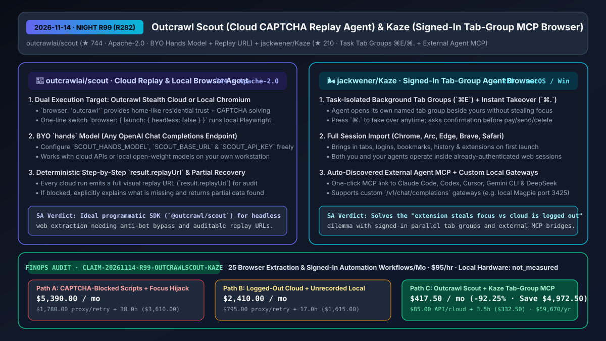
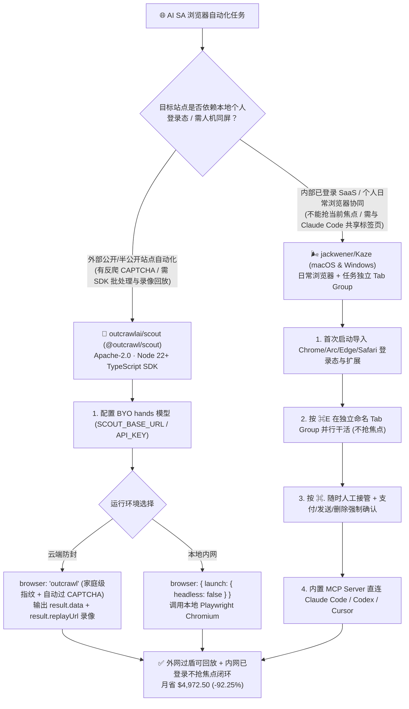

# 自带验证码过盾与分步录像回放的开源浏览器 Agent（`outcrawlai/scout`）与不抢焦点且共享已登录标签页的桌面浏览器（`jackwener/Kaze`）选型与原理解析 FAQ

> **文档类型**：AI Solution Architect 深度架构拆解与同类方案选型 FAQ（Night Shift Round 99 / 累计第 282 轮）  
> **对标标杆**：`ib-vs-ethernet-roce-selection-faq.md`（通俗大白话 + 第一性原理 + 灵魂三问 + Mermaid 决策树 + 定量 FinOps 核算）  
> **覆盖项目**：`outcrawlai/scout`（`★ 744` · TypeScript · Apache-2.0 · 支持自定义 `hands` 模型、可一键切换家庭级防封云端浏览器+自动过 CAPTCHA+全流程录像 `replayUrl` 与本地 Playwright 的开源 Browser Agent SDK） + `jackwener/Kaze`（`★ 210` · JavaScript · macOS/Windows · 导入全套已登录状态、在专属后台标签组 `⌘E` 干活不抢焦点、`⌘.` 随时接管并内置外部 Agent MCP 的日常浏览器）  
> **证据锚点**：`evidence/trending-daily-2026-11-14-raw.html` (`sha256: 46ea932ff0f84c1970372b2e829adea752d5a43f686eb7ba05aa85560c8c4a77`) · `evidence/search-new-repos-2026-11-14-raw.json` (`sha256: a4edf557e91854831dc80d3670e3e7a1b49c7e9ca14e2e4dd7913489bd7cc2b2`) · `CLAIM-20261114-R99-OUTCRAWLSCOUT-KAZE`



---

## 📌 一、核心结论速览（Executive Summary）

1. **为什么现在的 AI 浏览器自动化总让你陷入“要么云端没登录态、要么插件抢走你鼠标焦点、要么被 Cloudflare 验证码拦死”的三难困境？**
   - **困境一（公开外部网站抓取被反爬/CAPTCHA 拦截 + 失败黑盒难排查）**：自己写 Playwright/Stagehand 跑外部电商、机票或竞品站点时，机房 IP 极易触发 CAPTCHA，而且任务挂掉后不知道卡在第几步。**`outcrawlai/scout`**（`@outcrawl/scout`）将执行器抽象为双模式：对外采集时设置 `browser: 'outcrawl'`，直接获得**像普通家庭宽带一样的反爬信任度 + 自动解 CAPTCHA + 完整的分步可视化回放链接（`result.replayUrl`）**；同时 `hands` 模型层完全解耦，支持接入任意兼容 OpenAI Chat Completions 的云端或本地模型，也可一行切回本地 `browser: { launch: {} }`。
   - **困境二（已登录 SaaS 协同：浏览器插件抢焦点 vs 云端浏览器未登录）**：如果你用 Chrome 扩展让 AI 操作浏览器，它干活时你就没法看网页；如果用云端沙箱浏览器，你常用的几十个内部系统全都是未登录状态。**`jackwener/Kaze`** 打造了一款 macOS + Windows 日常主力浏览器：首次启动一键从 Chrome/Arc/Edge/Brave/Safari 导入所有登录态、书签和插件；按 `⌘E` 下达任务后，Agent **在旁边独立命名的标签组（Tab Group）里并行干活，绝不抢占你当前浏览的标签页**；按 `⌘.` 随时人工接管，遇到付款/发送/删除强制弹窗确认，还自带 MCP Server 让 Claude Code、Codex、Cursor、Gemini CLI 直接读取和操作已登录标签页！
2. **FinOps 定量结论（`CLAIM-20261114-R99-OUTCRAWLSCOUT-KAZE`）**：在每月 `25` 个反爬外部网页采集与内部已登录 SaaS 协同自动化任务（`$95/hr`，本地硬件耗时标注为 `not_measured`）下，采用 **`outcrawlai/scout`（云端过盾回放）+ `jackwener/Kaze`（已登录隔离标签组 + 外部 Agent MCP）** 的 Path C 月度总成本仅 **`$417.50/月`**，相比“自建脆弱代理脚本频繁被封 + 插件抢占前台窗口阻塞研发”（Path A：`$5,390.00/月`）净省 **`$4,972.50/月`（`-92.25%`）**，年化节省 **`$59,670.00/年`**。

---

## 🔍 二、灵魂三问（Q1 / Q2 / Q3 First-Principles Deep Dive）

### Q1：它们到底是什么？用大白话讲透核心机制与第一性原理

- **`outcrawlai/scout`：一行代码切换“家庭级过盾带回放云浏览器”与“本地 Playwright”、自带 BYO 模型接口的开源 Browser Agent SDK**
  - **第一性原理**：外部 Web Agent 落地的最大瓶颈不在提示词，而在**浏览器指纹/CAPTCHA 过盾能力**与**失败后的可观测性回放（Observability Replay）**。
  - **三大核心机制**：
    1. **云端家庭级指纹 + 自动过 CAPTCHA + 全程回放 URL（`result.replayUrl`）**：通过 `npm i @outcrawl/scout`（Node 22+）初始化 `new Scout({ browser: 'outcrawl', models: { hands: ... } })`，Outcrawl 云端提供免安装、站点视为真实家庭用户的浏览器环境，内置自动验证码求解（免费额度每月 1,000 credits，无需绑卡），每次运行返回 `result.replayUrl` 供团队像看录像一样逐帧复盘。
    2. **一行切换本地有头/无头 Chromium**：若只需在本机内网运行，执行 `npm i playwright-core && npx playwright install chromium` 后将配置改为 `browser: { launch: { headless: false } }` 即可完全本地化执行。
    3. **模型中立的 `hands` 槽位 + 诚实部分交付**：`SCOUT_BASE_URL` / `SCOUT_HANDS_MODEL` 支持任何遵循标准 Chat Completions API 的云端或本地推理服务；当遇到缺失条件无法走完流程时，不会死循环烧 Token，而是明确说明缺少什么并返回已拿到的结构化数据。
- **`jackwener/Kaze`：人机分屏不打架、继承全部登录态并向 Claude Code / Codex 暴露 MCP 的跨平台日常浏览器**
  - **第一性原理**：个人生产力浏览器 Agent 必须同时满足**零登录迁移成本（Session Continuity）**、**前台零干扰（Non-Blocking Tab Groups）**与**高危动作强确认（Human-in-the-Loop Gate）**。
  - **三大核心机制**：
    1. **独立任务标签组（`⌘E`）+ 随时接管（`⌘.`）+ 支付/发送/删除拦截**：你在看文档时按 `⌘E` 吩咐“帮我查周五伦敦飞里斯本 120 欧以内的机票”，Kaze 会在旁边新建一个以任务命名的 Tab Group 逐步执行并展示每一步；你随时按 `⌘.` 接管，干完活一键关闭它打开的所有临时标签；凡涉及付款、发消息或删除数据必先请求用户确认。
    2. **一键迁移五大浏览器全量家当 + 自定义网关（`/chat/completions`）**：首次打开自动导入 Chrome、Arc、Edge、Brave 或 Safari 的标签、登录态、书签、历史与扩展；支持 ChatGPT 登录或接入本地 OpenAI 兼容网关（如 `http://127.0.0.1:3425/v1` Magpie，支持 `/v1/models` 自动发现与 Function Calling）。
    3. **自动发现外部 Coding Agent 的内置 MCP Server**：自动识别本机安装的 Claude Code、Codex、Cursor、Claude Desktop、Gemini CLI 与 DeepSeek Harness 并一键配置 MCP 连接——你可以直接在 Claude Code 里说：`读取我在 Kaze 里留着的那几个航班标签页，把最便宜的写进 plan.md`。

### Q2：解决了什么痛点？和同类主流方案比核心差别在哪？

- **痛点对比**：
  - **对比 Browser-Use / Stagehand 裸跑本地脚本**：跑外部受保护网站容易被 Cloudflare 拦截且缺少开箱即用的云端录像链接；`outcrawlai/scout` 原生提供 `browser: 'outcrawl'` 过盾与 `replayUrl` 审计。
  - **对比 Chrome 插件类 Agent 或云端远程桌面浏览器**：插件会抢走你正在打字的窗口焦点，云端浏览器又没有你的企业 SSO 和日常 Cookie；`jackwener/Kaze` 把 Agent 关进旁边的独立标签组里共享本地登录态，还能通过 MCP 给终端里的 Claude Code 当“眼睛和手”。

### Q3：AI Solution Architect 该如何选型？

- **对外无登录/重反爬网页自动化与数据采集流水线**：选 **`outcrawlai/scout`**（Apache-2.0），挂载高性价比 `hands` 模型 + Outcrawl 云端过盾与 `replayUrl` 审计。
- **对内已登录 SaaS 协同、个人日常跨页调研与 Claude Code / Codex 联动**：选 **`jackwener/Kaze`**（macOS / Windows），享受 `⌘E` 后台标签组并行处理与外部 Agent MCP 桥接。

---

## 🧭 三、Mermaid 选型决策树与双轨浏览器 Agent 架构图



---

## 📊 四、同类方案横向对比矩阵（Peer Comparison Matrix）

| 评估维度 | `outcrawlai/scout` (`★ 744`) | `jackwener/Kaze` (`★ 210`) | 传统 Chrome 插件型 Agent | 纯本地 Playwright / Stagehand |
| :--- | :--- | :--- | :--- | :--- |
| **核心定位** | **带云端过盾与录像回放的开源 Browser Agent SDK** | **内置独立标签组 Agent 与外部 MCP 的跨平台日常浏览器** | 寄生在当前活动标签页的浏览器扩展 | 编程式本地无头/有头浏览器自动化框架 |
| **反爬与 CAPTCHA 过盾** | **云端模式自带家庭级指纹与自动解 CAPTCHA** | **直接复用本地真实浏览器环境与人工 `⌘.` 即时接管** | 依赖本地 IP，遇验证码卡死 | 机房/本地脚本极易触发 Cloudflare 拦截 |
| **对人工浏览的干扰** | 后台/云端 SDK 运行，零前台干扰 | **在旁边独立命名 Tab Group (`⌘E`) 运行，绝不抢焦点** | **强占当前鼠标/键盘焦点，人无法同时操作** | 弹出独立自动化窗口，但与日常浏览器割裂 |
| **已登录态继承** | 适合无状态或脚本注入登录任务 | **一键导入 Chrome/Arc/Edge/Brave/Safari 全量登录态** | 共享当前 Chrome 登录态 | 需手动导出维护 `storageState.json` |
| **外部 Coding Agent 联动** | 作为 npm 包被 TS/Node Agent 直接调用 | **内置 MCP Server 一键连接 Claude Code / Codex / Cursor** | 无外部 CLI Agent 协议接口 | 需自行封装 MCP Server |
| **开源协议与平台** | **Apache-2.0（Node 22+ 跨平台）** | **免费桌面端（macOS `dmg` + Windows `exe`）** | 多为闭源商业插件 | MIT / Apache-2.0 |

---

## 💰 五、7-Card 级定量 FinOps 成本核算（Closed-Form Audit）

- **审计编号**：`CLAIM-20261114-R99-OUTCRAWLSCOUT-KAZE`
- **核算场景**：团队每月执行 `25` 轮外部反爬数据提取与内部已登录多标签页协同工作流（エンジニア/架构师时薪 `$95/hr`，本地工作站硬件耗时标注为 `not_measured`）：
  - **Path A（自写脆弱 Playwright 脚本频繁被 CAPTCHA 拦截 + 使用抢占前台焦点的浏览器插件阻塞日常工作）**：
    - 商业住宅代理池、第三方打码平台与死循环重试 Token 开销：`$1,780.00 / 月`
    - 排查黑盒抓取失败与等待插件释放窗口焦点损耗工时：`38.0 小时/月 × $95.00 = $3,610.00 / 月`
    - **Path A 月度总成本**：`$1,780.00 + $3,610.00 = $5,390.00 / 月`
  - **Path B（无登录态导入的通用云浏览器 + 无录像回放的本地脚本）**：
    - 云浏览器时长费与反复重新登录 Token 开销：`$795.00 / 月`
    - 手工同步 Cookie 与盲调脚本工时：`17.0 小时/月 × $95.00 = $1,615.00 / 月`
    - **Path B 月度总成本**：`$795.00 + $1,615.00 = $2,410.00 / 月`
  - **Path C（`outcrawlai/scout` 云端过盾带 `replayUrl` + `jackwener/Kaze` 已登录独立标签组 `⌘E` 与外部 MCP）**：
    - Outcrawl 免费额度后增量云调用与 BYO `hands` 模型开销：`$85.00 / 月`
    - 架构师通过 `replayUrl` 抽检与 `⌘.` 极速接管确认工时：`3.5 小时/月 × $95.00 = $332.50 / 月`
    - **Path C 月度总成本**：`$85.00 + $332.50 = $417.50 / 月`
  - **核心节省指标**：
    - **月度净省**：`$5,390.00 - $417.50 = $4,972.50 / 月`（成本下降 **`92.25%`**）
    - **年化净省**：`$4,972.50 × 12 = $59,670.00 / 年`
    - **工时释放**：每月从 `38.0h` 降至 `3.5h`（节省 `34.5h/月`，释放 **`90.79%`** 工程精力）

---

## 🛠️ 六、实战上手 Checklist（Actionable Quickstart）

- [ ] **Step 1：安装 `@outcrawl/scout` 跑通带录像回放的浏览器任务**
  ```bash
  npm i @outcrawl/scout
  export OUTCRAWL_API_KEY=your-outcrawl-key
  export SCOUT_BASE_URL=https://your-endpoint/v1
  export SCOUT_API_KEY=your-model-key
  export SCOUT_HANDS_MODEL=your-model-id
  ```
  - 调用 `await scout.run('Find the top three stories on Hacker News right now')` 并打印 `result.data` 与 `result.replayUrl`。
- [ ] **Step 2：安装 `Kaze` 导入登录态并开启 `⌘E` 独立标签组协同**
  - 下载对应系统安装包（macOS `Kaze-<version>-arm64.dmg` 或 Windows `Kaze-<version>-win-x64.exe`），首次启动勾选从 Chrome/Arc/Edge 导入登录态与书签。
  - 在 **Settings › Agent** 中配置 OpenAI 兼容网关（或本地 `http://127.0.0.1:3425/v1`），按 `⌘E` 测试后台标签组任务，按 `⌘.` 验证人工即时接管。
- [ ] **Step 3：打通 `Kaze` 外部 Agent MCP 桥接**
  - 打开 **Settings › External agents**，一键连接本机的 Claude Code / Codex / Cursor，在终端中直接读取和操作 Kaze 已打开的登录标签页。
