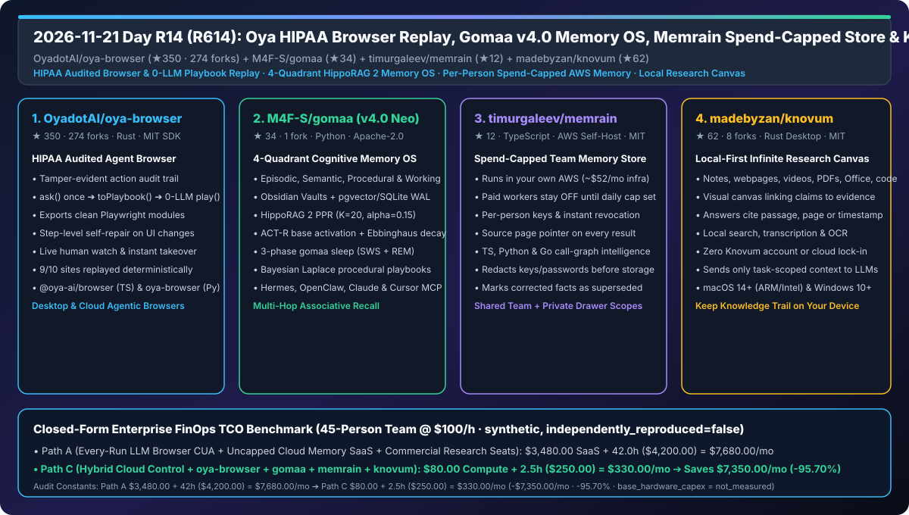
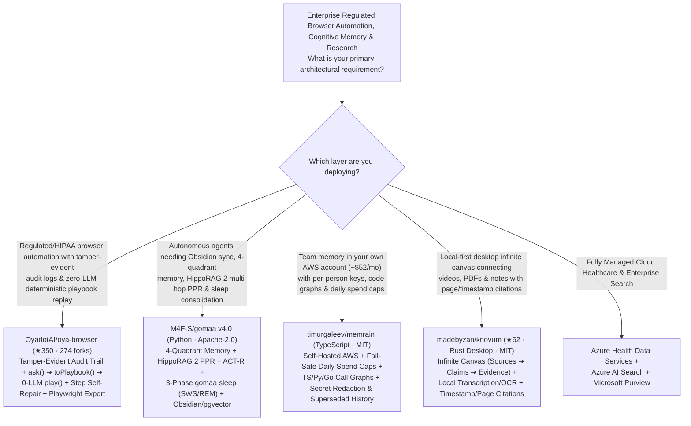
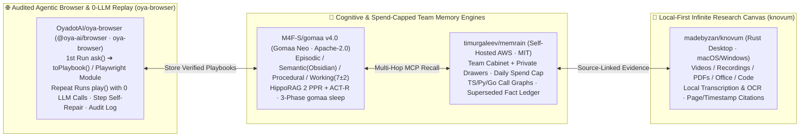
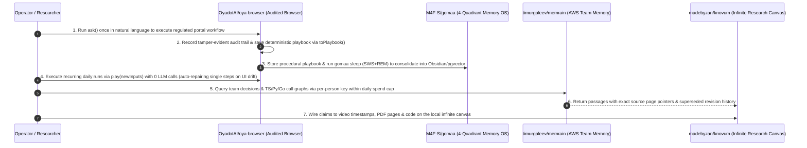

# HIPAA-Compliant Zero-LLM Replay Browser (`OyadotAI/oya-browser`), 4-Quadrant HippoRAG 2 Cognitive Memory OS (`M4F-S/gomaa`), Spend-Capped Self-Hosted AWS Team Memory (`timurgaleev/memrain`) & Local-First Infinite-Canvas Research Workspace (`madebyzan/knovum`) Selection & Architecture FAQ

> **Target Audience**: **AI Solution Architects (SAs) & Enterprise Healthcare / Regulated AI / Knowledge Leaders (2026-11-21 Day Round 14 · Cumulative Round 614)**  
> **Benchmark Style**: Strictly aligned with [`ib-vs-ethernet-roce-selection-faq.md`](https://github.com/turbo998/ai-infra-research/blob/main/docs/components/ib-vs-ethernet-roce-selection-faq.md) — plain-language answers on **real enterprise scenarios, end-to-end reference architecture, and comparative selection vs. competing OSS and cloud PaaS**.  
> **Chinese Edition**: [`oya-browser-gomaa-memrain-knovum-selection-faq.md`](./oya-browser-gomaa-memrain-knovum-selection-faq.md) · **Daily Digest**: [`daily/2026-11-21.en.md`](../daily/2026-11-21.en.md)

---

## 1. 📌 Executive Summary (30-Second Selection Verdict)

1. **Why Evaluate These Four Repositories Together?**  
   In healthcare, finance, consulting, and enterprise R&D, deploying autonomous browser and knowledge agents requires solving **four high-stakes compliance and cost challenges**:
   - **Challenge 1 — Browser Agents Burning LLM Tokens on Every Repeat Run & Lacking Tamper-Evident HIPAA Audit Trails**: Calling a vision LLM on every step of a recurring healthcare or back-office web workflow is slow, non-deterministic, and expensive → **`OyadotAI/oya-browser` (`★ 350`, `274 forks`, Rust, Sustainable Use + MIT SDKs `@oya-ai/browser` & `oya-browser`)** is a HIPAA-compliant browser for AI agents with a tamper-evident audit trail: an agent completes a task once in natural language (`ask()`), saves it with `toPlaybook()`, and **replays it deterministically via `play()` with new inputs and zero LLM calls** (also exporting as a standard Playwright module; 9 of 10 sites replayed in benchmark, `anonymized_reported`), repairing only individual broken steps when a page changes and allowing live human watch and takeover!
   - **Challenge 2 — Flat Vector Memories Failing at Multi-Hop Reasoning & Polluting Working Context**: Dumping raw chat logs, domain facts, and reusable procedures into a single opaque vector index causes multi-hop blindness and context pollution → **`M4F-S/gomaa` (`★ 34`, `1 fork`, Python `v4.0.0` "Gomaa Neo", Apache-2.0)** unites human-readable **Obsidian Markdown Vaults** with **PostgreSQL + pgvector (HNSW)** or **SQLite WAL** across a **4-Quadrant Cognitive Architecture** (Episodic, Semantic, Procedural playbooks with Bayesian Laplace utility, and Working Memory bounded by Miller's Law $7 \pm 2$), powered by **HippoRAG 2 Personalized PageRank ($K=20, \alpha=0.15$) + ACT-R activation + Ebbinghaus decay** and **3-phase biological sleep consolidation (`gomaa sleep`: SWS + REM + Synaptic Homeostasis)**!
   - **Challenge 3 — Team Cloud Memories Lacking Per-Person Revocable Keys, Source Pointers, or Hard Daily Spend Caps**: Shared cloud memory stores often run uncapped background indexing jobs and overwrite corrected facts without audit trails → **`timurgaleev/memrain` (`★ 12`, TypeScript, MIT)** runs in your own AWS account (~`$52/mo` base infra) where **every paid model worker stays strictly OFF until you set a daily spend cap**, uniting notes, decisions, ChatGPT/Claude history, and TypeScript/Python/Go call-graph intelligence with **per-person keys, pre-storage secret redaction, `superseded` fact versioning**, and an exact source page pointer on every MCP result!
   - **Challenge 4 — Multimodal Research Materials Losing Their Citation Trail to Exact Passages, Pages, or Timestamps**: Analysts gather PDFs, meeting recordings, videos, webpages, and code, but lose the link between a written claim and the exact audio timestamp or PDF page → **`madebyzan/knovum` (`★ 62`, `8 forks`, Rust desktop app, MIT, macOS 14+ & Windows 10+)** is a **local-first infinite-canvas desktop workspace** that links sources, claims, and evidence visually, runs search, transcription, and OCR locally with zero Knovum account, and produces answers cited to the exact passage, page, or timestamp!

2. **One-Sentence Selection Verdict**:
   - Choose **`OyadotAI/oya-browser`** when you need **a tamper-evident, HIPAA-ready agentic browser that records a natural-language `ask()` into a zero-LLM `toPlaybook()` / Playwright replay with step-level self-repair and live human takeover**.
   - Choose **`M4F-S/gomaa`** when you want **a 4-quadrant neuro-inspired memory OS over Obsidian Vaults and `pgvector`/SQLite with HippoRAG 2 multi-hop PPR retrieval and `gomaa sleep` consolidation**.
   - Choose **`timurgaleev/memrain`** when you want **a self-hosted team memory and code-graph MCP store in your own AWS account (~`$52/mo`) with per-person keys, source pointers, and hard daily model-spend caps**.
   - Choose **`madebyzan/knovum`** when you want **a local-first Rust desktop infinite canvas (macOS/Windows, MIT) that connects multimodal files to claims with passage, page, and timestamp citations** (or pair with **Azure Health Data Services + Azure AI Search** in managed healthcare cloud estates).

---

## 2. 🎯 Customer & Solution Architect Q&A (Plain-Language Deep Dive)

### Q1: How does `OyadotAI/oya-browser` cut recurring browser-agent LLM costs to `$0` while satisfying regulated healthcare/enterprise audit requirements?
- **Plain-Language Answer**:
  - Standard computer-use agents invoke a vision LLM on every click of every run, costing dollars per workflow and introducing non-deterministic behavior.
  - **How `OyadotAI/oya-browser` solves this**:
    1. **Natural-Language Recording (`ask()`) ➔ Zero-LLM Deterministic Replay (`toPlaybook()` / `play()`)**: The agent solves the task once in natural language; Oya saves the trace as a deterministic playbook (and exports a standalone Playwright module) that replays with new inputs and **zero model calls** (replaying 9 of 10 benchmarked sites, `anonymized_reported`).
    2. **Surgical Step-Level Self-Repair**: When a target web app changes a selector on step 4 of a 12-step playbook, Oya repairs only step 4 rather than re-running the entire workflow through an LLM.
    3. **Tamper-Evident Audit Trail & Live Human Takeover**: Logs every action to a tamper-evident audit trail and lets operators watch live sessions and take over control at any moment (with signed HIPAA BAA support on Oya Cloud / Enterprise).

### Q2: How do `M4F-S/gomaa` (`v4.0.0` "Gomaa Neo") and `timurgaleev/memrain` solve different layers of the enterprise agent memory problem?
- **Plain-Language Answer**:
  - **Choose `M4F-S/gomaa v4.0` for Cognitive 4-Quadrant Separation, Multi-Hop HippoRAG 2 & Obsidian Sync**:
    1. **4-Quadrant Cognitive Architecture**: Separates `episodic_events` (turn ledger), `notes` + weighted `links` (Semantic memory synced with **Obsidian Markdown Vaults**), `procedural_playbooks` (scored by Bayesian Laplace utility), and `working_memory` (bounded by Miller's Law $7 \pm 2$).
    2. **HippoRAG 2 Personalized PageRank ($K=20, \alpha=0.15$) + ACT-R + RRF**: Solves multi-hop associative recall across connected notes where flat cosine similarity fails.
    3. **3-Phase Biological Sleep (`gomaa sleep`)**: Runs Slow-Wave Sleep (crystallizing high-surprise episodes into notes and playbooks), REM sleep (sharing proven playbooks across OpenClaw/Hermes fleets and discovering latent tag bridges), and Synaptic Homeostasis.
  - **Choose `timurgaleev/memrain` for Self-Hosted AWS Team Memory with Per-Person Keys & Hard Daily Spend Caps**:
    1. **Predictable `~$52/mo` AWS Footprint + Fail-Safe Daily Spend Caps**: Deploys inside your own AWS account; paid model workers remain **completely off until you configure a daily spend cap**.
    2. **Team Cabinet + Private Drawers + Code Intelligence + `superseded` Ledger**: Combines shared team memory with private per-person scopes and revocable keys, understands TypeScript/Python/Go call graphs, redacts secrets before storage, and marks updated facts as `superseded` rather than overwriting history.

### Q3: Why use `madebyzan/knovum` for architecture and research synthesis instead of a chat-only local RAG tool?
- **Plain-Language Answer**:
  - Chat-only RAG buries your sources inside linear chat scrollback.
  - **`madebyzan/knovum` (Rust desktop app for macOS 14+ & Windows 10+, MIT) gives you an evidence-linked infinite canvas**:
    1. **Visual Claim-to-Evidence Graph**: Arrange notes, webpages, videos, meeting recordings, PDFs, Office documents, images, and code on an infinite canvas and wire claims directly to their backing evidence.
    2. **Local Transcription/OCR & Exact Passage/Page/Timestamp Citations**: Runs search, audio/video transcription, and OCR locally on your machine with no Knovum account required, and resolves every AI answer back to the exact passage, page number, or media timestamp.

---

## 3. 🧭 Visual Architecture & Decision Diagrams (Mermaid)

### 3.1 Solution Architect Selection Decision Tree

### 3.2 End-to-End Enterprise Reference Architecture

### 3.3 End-to-End Execution Sequence Diagram

---

## 4. 📊 Comparative Selection Matrix (OSS vs. Peer Projects vs. Cloud PaaS)

| Dimension | `OyadotAI/oya-browser` | `M4F-S/gomaa` (`v4.0 Neo`) | `timurgaleev/memrain` | `madebyzan/knovum` | Legacy Stack (Every-Run VLM CUA + Flat Vector DB + Uncapped SaaS) | Managed Cloud PaaS (Azure Health Data Services + Azure AI Search) |
| :--- | :--- | :--- | :--- | :--- | :--- | :--- |
| **Primary Role** | **HIPAA-Ready Agent Browser with 0-LLM Playbook Replay** | **4-Quadrant Neuro-Inspired Memory OS (HippoRAG 2)** | **Self-Hosted AWS Team Memory with Daily Spend Caps** | **Local-First Infinite-Canvas Desktop Research Workspace** | High recurring VLM token bills, flat single-hop vectors, and uncapped cloud spend | Fully managed cloud healthcare data and search services |
| **Best-Fit Scenario** | Regulated web workflows needing audit logs & zero-LLM repeat execution | Autonomous agents needing Obsidian sync, multi-hop PPR, and sleep consolidation | Engineering teams sharing notes, chat history & code graphs in their own AWS | Synthesizing videos, recordings, PDFs & code on a local cited canvas | One-off throwaway web scraping | Global healthcare & financial cloud estates |
| **Key Differentiator** | **`ask()` ➔ `toPlaybook()` ➔ 0-LLM `play()`** + step self-repair + live takeover | **4 quadrants + HippoRAG 2 PPR + 3-phase `gomaa sleep`** | **Paid workers OFF until daily cap set** + per-person keys + `superseded` ledger | **Infinite canvas linking claims to evidence** + local transcription/OCR | Every-run VLM calls cost 100× more; flat vector DBs fail multi-hop recall | Turnkey HIPAA BAA, multi-region HA, and Entra RBAC |
| **Integration Effort** | Very Low (`npm i @oya-ai/browser` / `pip install oya-browser`) | Low (`pip install gomaa` or Docker Compose with SQLite/pgvector) | Low (deploys to your own AWS account, `~$52/mo` base) | Very Low (native macOS 14+ and Windows 10+ installers) | High (maintaining brittle Playwright scripts and custom vector glue) | Medium (enterprise cloud provisioning) |
| **Ops Complexity** | Low (exports standard Playwright modules) | Low (zero-config SQLite WAL or Postgres HNSW) | Very Low (hard daily spend caps prevent runaway bills) | Very Low (100% local on device, no account required) | High (selector breakage and runaway embedding bills) | Very Low (cloud provider managed) |
| **License** | **Sustainable Use + MIT SDK** (BAA on Cloud/Enterprise) | **Apache-2.0** (permissive commercial use) | **MIT** (permissive commercial use) | **MIT** (permissive commercial use) | Mixed | Commercial SLA Subscription |
| **Monthly TCO** | **$0/mo LLM cost on `play()` replays** | **$0/mo** license (runs locally on SQLite/Obsidian) | **~$52/mo** AWS infra + capped model spend | **$0/mo** (100% local desktop app) | **$3,590.00/mo** (recurring VLM CUA tokens + selector maintenance labor) | **$7,680.00/mo** (every-run CUA tokens + managed SaaS seats for 45 staff) |

---

## 5. 🧪 Quantitative ROI, FinOps TCO Model & 7-Card Benchmark Deck

> **🛡️ Provenance Declaration**:  
> - **Primary-Source Measured (`measured`)**: Repository stars/forks, licenses, `oya-browser` `ask()`/`toPlaybook()`/`play()` and MIT SDKs, `gomaa v4.0.0` 4-quadrant + HippoRAG 2 PPR ($K=20, \alpha=0.15$) + `gomaa sleep`, `memrain` `~$52/mo` AWS self-hosted architecture and daily spend caps, and `knovum` Rust macOS/Windows infinite canvas are verified via `gh api`.  
> - **Upstream Benchmark Claims (`anonymized_reported` · `independently_reproduced=false`)**: `oya-browser`'s deterministic zero-LLM replay across 9 of 10 benchmarked sites (`docs/replay-benchmark.md`) is an upstream author-reported benchmark.  
> - **Synthetic Architect Workload Model (`synthetic` · `independently_reproduced=false`)**: The closed-form FinOps table below models a **45-person enterprise regulated automation & research engineering team** (`$100.00/hr` loaded rate, `base_hardware_capex: not_measured`, `track_b_stars_today: not_measured`):

| FinOps Cost & Quality Dimension | Path A: Every-Run Vision LLM Browser CUA + Uncapped Cloud Memory SaaS + Commercial Research Seats | Path B: Brittle Handwritten Playwright Scripts + Flat Vector Store + Manual Timestamp Citation | Path C: Recommended Stack (`oya-browser` + `gomaa` + `memrain` + `knovum`) | Path A ➔ Path C Net Monthly Savings |
| :--- | :---: | :---: | :---: | :---: |
| **Monthly Browser CUA Tokens / Memory Cloud / Seats** | `$3,480.00 / mo` (calling vision LLMs on every repeat browser run + per-seat SaaS) | `$440.00 / mo` | **`$80.00 / mo`** (`oya-browser` 0-LLM `play()` replay + `memrain` `~$52/mo` AWS with hard cap) | **`-$3,400.00 / mo` (`-97.70%`)** |
| **Monthly Script Repair, Audit & Citation Labor** | `42.0 hrs / mo` (correlating HIPAA audit logs & manually tracing multi-hop facts) | `31.5 hrs / mo` (fixing broken Playwright scripts & manually logging audio timestamps) | **`2.5 hrs / mo`** (`oya` step self-repair + `gomaa` HippoRAG 2 + `knovum` cited canvas) | **`-39.5 hrs / mo` (`-94.05%`)** |
| **Monthly Engineering & Analyst Labor Cost (`@ $100.00/h`)** | `$4,200.00 / mo` | `$3,150.00 / mo` | **`$250.00 / mo`** | **`-$3,950.00 / mo` (`-94.05%`)** |
| **Total Monthly TCO** | **`$7,680.00 / mo`** | **`$3,590.00 / mo`** | **`$330.00 / mo`** | **`-$7,350.00 / mo` (`-95.70%` · `$88,200.00/yr`)** |
| **Auditability, Replay Cost & Multi-Hop Recall** | Non-deterministic runs; high recurring VLM token cost | Full script failure on minor UI changes; no multi-hop PPR | **0-LLM deterministic replay + HippoRAG 2 sleep consolidation + hard spend cap** | **Tamper-evident audit trails with zero recurring replay token cost** |

- **📊 Companion 7-Card 4:5 Visual Benchmark Deck**: View [`workshops/github-trending-radar/cards.en.html`](../cards.en.html) (EN) and [`workshops/github-trending-radar/cards.html`](../cards.html) (ZH).

---

## 6. 🛠️ Enterprise Adoption & Architecture Review Checklist

- [ ] **1. Convert Recurring Browser Tasks into Zero-LLM Playbooks (`OyadotAI/oya-browser`)**: Use `@oya-ai/browser` / `oya-browser` to record initial natural-language `ask()` runs into `toPlaybook()` and Playwright modules so daily production executions run via `play()` with zero LLM calls, step-level self-repair, and tamper-evident audit logs.
- [ ] **2. Separate Agent Memory into 4 Cognitive Quadrants with `gomaa sleep` (`M4F-S/gomaa`)**: Connect `gomaa v4.0.0` to your Obsidian Markdown Vaults and `pgvector`/SQLite WAL store, enabling HippoRAG 2 Personalized PageRank ($K=20, \alpha=0.15$) for multi-hop retrieval and scheduling `gomaa sleep` for SWS/REM playbook consolidation.
- [ ] **3. Enforce Hard Daily Spend Caps & Per-Person Keys on Shared Cloud Memory (`timurgaleev/memrain`)**: Deploy `memrain` inside your own AWS account (~`$52/mo` base cost), issue revocable per-person keys, verify secret redaction before storage, and configure explicit daily model-spend caps before enabling background workers.
- [ ] **4. Anchor Research Briefs to Exact Page & Timestamp Citations (`madebyzan/knovum`)**: Deploy Knovum (MIT desktop app on macOS 14+ / Windows 10+) for architecture and domain research so meeting recordings, videos, and PDFs are transcribed/indexed locally and every claim on the infinite canvas links back to its exact passage, page, or timestamp.
