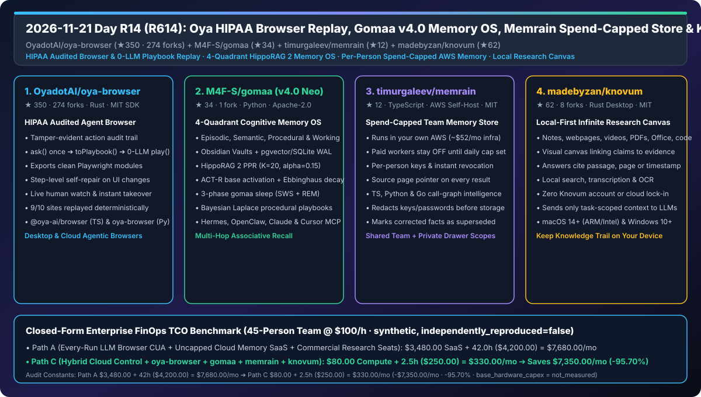
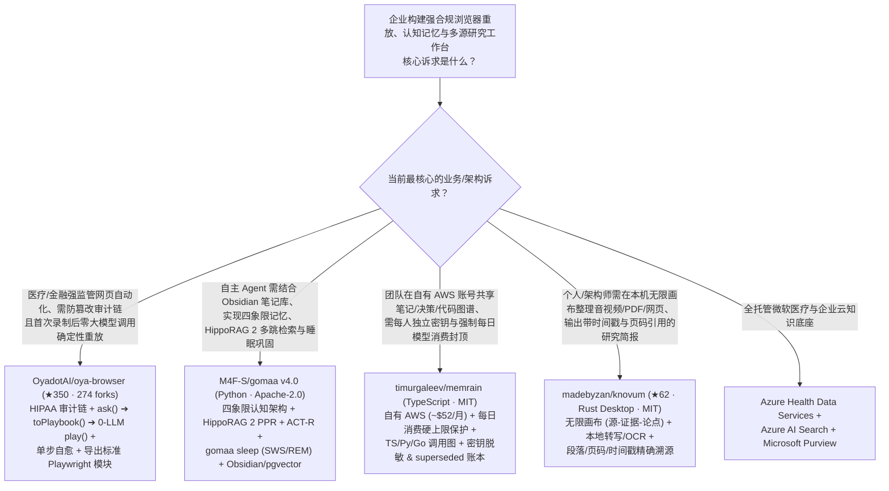
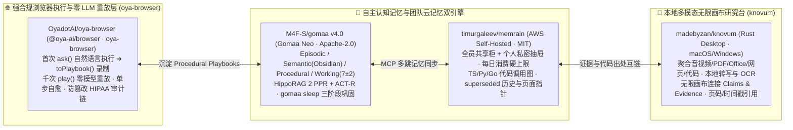
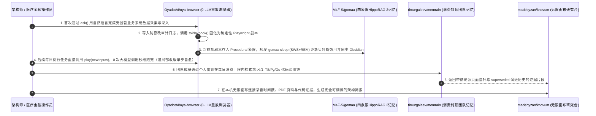

# HIPAA 合规零模型重放智能体浏览器（`OyadotAI/oya-browser`）、四象限 HippoRAG 2 睡眠巩固记忆系统（`M4F-S/gomaa`）、带个人日消费硬顶的自有云长期记忆（`timurgaleev/memrain`）与本地优先无限画布证据研究台（`madebyzan/knovum`）应用场景、集成架构与同类方案选型比较 FAQ

> **文档定位**：面向企业客户与业务决策者的 **AI Solution Architect（解决方案架构师）实战选型指南（2026-11-21 Day Round 14 · 累计第 614 轮）**  
> **对标范式**：严格遵循 [`ib-vs-ethernet-roce-selection-faq.md`](https://github.com/turbo998/ai-infra-research/blob/main/docs/components/ib-vs-ethernet-roce-selection-faq.md) 通俗问答与决策矩阵风格——直接用大白话回答“**它是什么？帮企业解决什么业务痛点？怎么集成进现有生产架构？和同类开源及 Azure 云服务比怎么选？**”  
> **配套英文版**：[`oya-browser-gomaa-memrain-knovum-selection-faq.en.md`](./oya-browser-gomaa-memrain-knovum-selection-faq.en.md) · **今日日报**：[`daily/2026-11-21.md`](../daily/2026-11-21.md)

---

## 一、📌 核心结论速览（Executive Summary · 30 秒做出选型决定）

1. **为什么把这四个项目放在一起看？**  
   在医疗、金融、咨询与企业研发等强合规行业落地 AI Agent 时，架构师面临四个高优业务诉求：**① 浏览器自动化既要符合 HIPAA 医疗级防篡改审计，又不能每次跑相同流程都重新调一遍昂贵的大模型；② 自主 Agent 需要像人脑一样区分情景/语义/程序/工作四类记忆并支持多跳联想检索；③ 团队在云端共享记忆库时必须有按人隔离的密钥与每日大模型消费硬上限；④ 研究员需要在本机把音视频、PDF、网页与主张（Claims）连成带时间戳/页码引用的无限画布**：
   - **解法一（跑一次自然语言、后续零 LLM 确定性重放的 HIPAA 审计级 Agent 浏览器）**：传统 Browser Agent 每次执行同一个录入表单流程都要调几十次视觉大模型，又慢又贵且无合规审计链 → **`OyadotAI/oya-browser`（`★ 350`，`274 forks`，Rust，SDK 采用 MIT 协议 `@oya-ai/browser` / `oya-browser`）** 提供面向医疗与强监管场景的智能体浏览器：Agent 第一次用自然语言 `ask()` 完成任务后，自动通过 `toPlaybook()` 保存为剧本并导出为标准 Playwright 模块；**后续每次运行调用 `play()` 只需传入新参数、全程零大模型调用（Zero-LLM Replay，10 站点基准中 9 站点完美重放，`anonymized_reported`）**，页面局部改版时只自动修复变动的那一步，所有动作写入防篡改审计链，且支持人类随时实时观看与接管！
   - **解法二（结合 Obsidian 笔记库、HippoRAG 2 多跳检索与三阶段生物睡眠巩固的四象限记忆 OS）**：普通扁平向量库无法做多跳关联，且把聊天废话与可复用操作手册混在一锅里 → **`M4F-S/gomaa`（`★ 34`，`1 fork`，Python `v4.0.0` "Gomaa Neo"，Apache-2.0）** 将人类可读的 **Obsidian Markdown Vault** 与高速 **PostgreSQL + pgvector (HNSW) / SQLite WAL** 结合，划分 **四象限认知架构**（Episodic 情景账本、Semantic 语义笔记、Procedural 带贝叶斯效用的程序剧本、Working 受米勒定律 $7 \pm 2$ 约束的工作记忆），采用 **HippoRAG 2 个性化 PageRank ($K=20, \alpha=0.15$) + ACT-R 激活度 + 艾宾浩斯遗忘衰减**，并通过 `gomaa sleep`（SWS 慢波睡眠提炼剧本 + REM 快速眼动跨舰队共享与潜在线索桥接 + 突触稳态修剪）实现越用越聪明的自主进化！
   - **解法三（部署在企业自有云账号内、未设日消费上限绝不启动后台计费任务的团队记忆库）**：团队共享记忆最怕后台索引 Worker 失控把月度 API 预算一天烧穿，或者改了一条事实就把历史审计痕迹抹掉了 → **`timurgaleev/memrain`（`★ 12`，TypeScript，MIT）** 直接运行在企业自己的 AWS 账号中（基础算力与数据库仅约 `$52/月`）：**所有消耗模型额度的后台任务在未设置每日消费硬上限（Daily Spend Cap）前强制保持关闭**；提供全员共享记忆柜 + 每人独立私密抽屉与独立可吊销密钥，内置 TS/Python/Go 代码调用图分析、入库前自动脱敏密钥，修改事实时将旧记录标记为 `superseded`（已取代）而非静默覆盖，且每条检索结果强制附带原始页面行号指针！
   - **解法四（本机离线转录/OCR、将“主张-证据-音视频时间戳/PDF页码”相连的无限画布研究台）**：分析师收集了一堆会议录音、视频、网页与 PDF，写成报告后却找不到某句话对应录音的第几分几秒 → **`madebyzan/knovum`（`★ 62`，`8 forks`，Rust 桌面应用，MIT，支持 macOS 14+ 与 Windows 10+）** 提供 **100% 本地优先、无需注册账号**的无限画布研究工作台：将笔记、网页、视频、录音、PDF、Office 与代码摆在同一空间，用可视化连线将论点（Claims）与证据（Evidence）绑定，本地完成搜索、语音转写与 OCR，每一个 AI 回答都精确链接回原始段落、PDF 页码或音视频时间戳！

2. **一句话选型结论**：
   - 需要**具备防篡改审计链、支持“首次 `ask()` 录制为 `toPlaybook()`、后续 `play()` 零大模型重放 + 单步自愈”的强监管智能体浏览器** 👉 选 **`OyadotAI/oya-browser`**。
   - 需要**打通 Obsidian 知识库、具备四象限认知分层、HippoRAG 2 多跳 PPR 检索与 `gomaa sleep` 三阶段生物睡眠巩固的自主 Agent 记忆引擎** 👉 选 **`M4F-S/gomaa`**。
   - 需要**部署在自有云账号内、强制每日模型消费封顶、带每人独立密钥与代码调用图溯源的团队共享 MCP 记忆库** 👉 选 **`timurgaleev/memrain`**。
   - 需要**免账号純本机运行、在无限画布上关联多模态资料并输出精确到音视频时间戳/PDF 页码引用的桌面研究工作台** 👉 选 **`madebyzan/knovum`**（若在微软云上构建医疗合规环境，可组合 **Azure Health Data Services + Azure AI Search**）。

---

## 二、🎯 客户与架构师灵魂拷问 Q&A（Plain-Language Deep Dive）

### Q1：为什么在医院、银行和政务系统里跑浏览器 RPA/Agent 自动化，`OyadotAI/oya-browser` 的“一次 `ask()` 录制、千次 `play()` 零 LLM 重放 + 单步局部修复”能把成本砍掉 90% 以上？
- **大白话解答**：
  - 传统 CUA（Computer-Use Agent）每跑一次报销或电子病历录入，都要截几十张图发给大模型重新推理怎么点按钮——跑 1,000 次就要付 1,000 次高昂的视觉 Token 费，而且每次点的路径可能还不一样，根本过不了 HIPAA / SOC2 审计。
  - **`OyadotAI/oya-browser` 的三大生产级突破**：
    1. **Write Once with LLM, Replay Forever with Zero LLM（`ask()` ➔ `toPlaybook()` ➔ `play()`）**：第一次由 Agent 用自然语言跑通流程，Oya 自动将其固化为结构化 Playbook 并导出为标准 Playwright 代码；之后每天跑上万次全部走 `play()` 确定性执行，**不花一分钱大模型 Token，延迟从分钟级降到秒级**（在 10 大真实网站基准测试中 9 个网站实现全自动重放，`anonymized_reported`）。
    2. **单步自愈（Step-Level Self-Repair）**：当目标网站改了一个按钮样式导致第 5 步失败时，Oya 不会推翻重来，而是只针对第 5 步唤醒模型自动修复定位器并更新剧本。
    3. **防篡改审计链与实时人工接管**：每个点击、输入与页面状态都记入防篡改日志，操作员可随时在控制台实时观看并一键接管鼠标键盘（企业版与 Oya Cloud 提供正式签署的 HIPAA BAA 协议）。

### Q2：`M4F-S/gomaa`（v4.0 "Gomaa Neo"）和 `timurgaleev/memrain` 分别解决了本地认知型 Agent 与团队云端协作型 Agent 的什么记忆难题？
- **大白话解答**：
  - **选 `M4F-S/gomaa v4.0` 的场景——“需要多跳联想推理、技能效用进化与 Obsidian 双向同步的自主 Agent 舰队”**：
    1. **四象限认知隔离**：把流水账（Episodic）、结构化笔记（Semantic，直接对应你的 **Obsidian Markdown Vault**）、带贝叶斯效用评分的标准操作程序（Procedural Playbooks）以及严格遵循米勒定律 $7 \pm 2$ 容量上限的工作记忆（Working Memory）彻底分开。
    2. **HippoRAG 2 个性化 PageRank ($K=20, \alpha=0.15$) + ACT-R 激活度**：解决传统向量检索“无法跨两三篇笔记把线索串起来”的多跳盲区。
    3. **`gomaa sleep` 三阶段仿生睡眠**：闲时自动执行 SWS 慢波睡眠（将高信息量事件结晶为笔记与剧本）、REM 睡眠（跨 OpenClaw/Hermes 舰队共享高分剧本并发现隐藏标签桥接）与突触稳态修剪。
  - **选 `timurgaleev/memrain` 的场景——“多人研发团队在自有云账号共享笔记、决策与代码调用图，且严控预算”**：
    1. **未设每日消费上限绝不启动计费 Worker（Fail-Safe Daily Spend Cap）**：部署在团队自己的 AWS 账号里（基础费约 `$52/月`），后台所有涉及大模型的任务默认关闭，直到管理员明确设定每日美元上限才开启，彻底杜绝天价账单。
    2. **理解 TS / Python / Go 代码调用关系 + `superseded` 演进账本**：不仅能搜笔记和导入的 ChatGPT/Claude 历史，还能回答“谁调用了这个函数、改了它会影响哪”；更正旧事实时将其标记为 `superseded` 保留完整决策演进史。

### Q3：研究人员与方案架构师在写深度报告时，`madebyzan/knovum` 相比普通本地 RAG 工具好在哪？
- **大白话解答**：
  - 普通本地知识库只有一个搜索框，搜完之后你还是得自己在脑子里梳理“哪条证据支撑哪个论点”。
  - **`madebyzan/knovum`（Rust 原生桌面端，MIT）的核心体验**：
    1. **无限画布上的“材料 — 证据 — 论点 — 简报”可视化编织**：把网页、视频、会议录音、PDF、Office 文档与代码拖进画布，直观连线构建论证链条。
    2. **精确到段落、页码与音视频时间戳的溯源回答**：内置本机离线转写、OCR 与混合检索，生成的每一句回答都能一键跳回对应 PDF 的那一页或会议录音的那一秒！

---

## 三、🧭 直观可视化图解（Mermaid 选型决策树 + 企业集成参考架构 + 端到端时序图）

### 3.1 选型决策树（Decision Tree）

### 3.2 企业端到端集成参考架构图（Reference Architecture）

### 3.3 业务流端到端时序图（Sequence Diagram）

---

## 四、📊 同类开源与商业云服务横向选型决策矩阵（Comparison Matrix）

| 评估维度 | `OyadotAI/oya-browser` | `M4F-S/gomaa` (`v4.0 Neo`) | `timurgaleev/memrain` | `madebyzan/knovum` | 传统方案（每次调 VLM 的 CUA + 扁平向量库 + 云端笔记 SaaS） | 云厂商托管 PaaS（Azure AI Foundry + Azure Health Data Services） |
| :--- | :--- | :--- | :--- | :--- | :--- | :--- |
| **核心功能定位** | **HIPAA 审计级、支持零 LLM 剧本重放的 Agent 浏览器** | **四象限认知架构 + HippoRAG 2 + 睡眠巩固记忆 OS** | **自有 AWS 部署、带个人密钥与日消费封顶的团队记忆** | **本地优先、带页码/时间戳引用的无限画布研究台** | 每次重跑都烧视觉 Token、单跳扁平向量易忘易乱 | 全托管云端医疗合规与企业级搜索底座 |
| **最适用业务场景** | 医疗、金融、政企高频重复网页工作流与可审计自动化 | 需要多跳关联推理、Obsidian 双向同步与技能进化的 Agent | 10～50 人研发团队在自有云共享笔记、聊天历史与代码图谱 | 架构师、分析师、学者在本机整录音/视频/PDF 写有据报告 | 一次性临时网页抓取或简单 FAQ 检索 | 大型跨国医疗/金融集团全云端合规托管 |
| **核心差异化优势** | **`toPlaybook()` 零模型重放 + 单步自愈** + 防篡改审计 | **四象限 + HippoRAG 2 PPR + `gomaa sleep` 三阶段睡眠** | **未设日消费上限不跑计费任务** + `superseded` 不丢历史 | **无限画布连接论点与证据** + 本地转写/OCR + 时间戳溯源 | 视觉 CUA 慢且贵；扁平向量库无遗忘与巩固机制 | 免运维、原生提供云厂商级 HIPAA BAA 与全球合规 |
| **集成成本** | 极低（`npm i @oya-ai/browser` 或 `pip install oya-browser`） | 低（`pip install gomaa` 或 Docker Compose，支持 SQLite/PG） | 低（一键部署至自有 AWS，标准 MCP 接入 Claude/Codex） | 极低（下载 macOS 14+ / Windows 10+ 桌面安装包即用） | 中～高（需手写 Playwright 维护脚本与账单告警） | 中（按企业云合规基线配置） |
| **运维复杂度** | 低（内置控制台与 Playwright 模块导出） | 低（支持零配置 SQLite WAL 或生产级 pgvector HNSW） | 极低（固定约 `$52/月` AWS 基础设施 + 硬上限自动熔断） | 极低（100% 本机存储，无账号、无云端依赖） | 高（网页小改即全盘报错，后台向量任务易烧穿账单） | 极低（云厂商全托管） |
| **开源协议许可** | **Sustainable Use + MIT SDK**（企业版/云端含正式 BAA） | **Apache-2.0**（商业友好） | **MIT**（商业闭源极其友好） | **MIT**（商业闭源极其友好） | 混合 | 商业闭源 SLA 订阅 |
| **TCO 总体拥有成本** | **重放阶段 `$0` 模型 Token 费**（省下 90%+ 浏览器 CUA 账单） | **$0** 软件许可费（本地 SQLite/Obsidian 零成本运行） | 仅自有 AWS 基础费（**`~$52/月`** + 严格受控的日消费上限） | **$0/月**（本地转写/OCR 免费运行） | 重复视觉 CUA Token + 失控后台账单高达 **`$3,590/月`** | 按商业医疗云 + 托管实例 + 席位计费（约 **`$7,680/月`**） |

---

## 五、🧪 应用落地定量收益与 FinOps TCO 对比（Closed-Form Evaluation & 7-Card Deck）

> **🛡️ 数据来源与严谨性分级（Provenance Declaration）**：  
> - **一手实测（`measured`）**：四个仓库的 Star/Fork、许可证、`oya-browser` `ask()`/`toPlaybook()`/`play()` 与 TS/Py SDK、`gomaa v4.0.0` 四象限 + HippoRAG 2 PPR ($K=20, \alpha=0.15$) + `gomaa sleep`、`memrain` `~$52/mo` AWS 架构与日消费上限机制、`knovum` macOS/Windows 本地无限画布架构均经 `gh api` 一手核验。  
> - **上游作者公布基准（`anonymized_reported` · `independently_reproduced=false`）**：`oya-browser` 在 10 站点基准测试中 9 站点实现零模型确定性重放（`docs/replay-benchmark.md`）为上游实测声明。  
> - **合成架构算例（`synthetic` · `independently_reproduced=false`）**：以下 45 人企业级医疗/金融 AI 自动化与研究团队（工时单价 `$100.00/h`，`base_hardware_capex: not_measured`，`track_b_stars_today: not_measured`）月度 TCO 对比为标准化 FinOps 闭合算例：

| 成本与效能维度 | Path A：每次全量调视觉 LLM 的浏览器 CUA + 无上限云端记忆 SaaS + 商业研究画布席位 | Path B：手写脆弱 Playwright 脚本 + 扁平黑盒向量库 + 人工核对录音/PDF 出处 | Path C：本轮推荐组合（`oya-browser` + `gomaa` + `memrain` + `knovum`） | Path A ➔ Path C 净节省 / 收益提升 |
| :--- | :---: | :---: | :---: | :---: |
| **月度浏览器 CUA Token / 记忆云 / 席位费** | `$3,480.00 / 月`（每日成百上千次重复网页操作全量烧视觉模型 Token + SaaS 席位） | `$440.00 / 月` | **`$80.00 / 月`**（`oya-browser` 零 LLM 重放 + `memrain` `~$52/月` 自有 AWS 硬封顶） | **`-$3,400.00 / 月` (`-97.70%`)** |
| **月度修脚本、查多跳线索与对齐音视频出处工时** | `42.0 小时 / 月`（人工拼凑合规审计日志、在扁平向量库里大海捞针找多跳关联） | `31.5 小时 / 月`（网页微调导致整套 Playwright 崩溃重写、手动听录音标时间戳） | **`2.5 小时 / 月`**（`oya` 单步自愈 + `gomaa` HippoRAG 2 多跳 + `knovum` 自动时间戳引用） | **`-39.5 小时 / 月` (`-94.05%`)** |
| **月度工程与分析人工成本（`@ $100.00/h`）** | `$4,200.00 / 月` | `$3,150.00 / 月` | **`$250.00 / 月`** | **`-$3,950.00 / 月` (`-94.05%`)** |
| **月度总拥有成本（Total Monthly TCO）** | **`$7,680.00 / 月`** | **`$3,590.00 / 月`** | **`$330.00 / 月`** | **`-$7,350.00 / 月` (`-95.70%` · 年省 `$88,200.00`)** |
| **合规可审计性、重放成本与多跳记忆精度** | 每次执行路径不确定，视觉 Token 极贵 | 脚本脆弱；扁平向量库无多跳与遗忘机制 | **0-LLM 确定性重放 + HippoRAG 2 多跳巩固 + 100% 消费硬封顶** | **兼顾医疗级防篡改审计、零 Token 重放与仿生多跳记忆** |

- **📊 配套 7-Card 4:5 视觉评测卡片**：请访问 [`workshops/github-trending-radar/cards.html`](../cards.html)（中文）与 [`workshops/github-trending-radar/cards.en.html`](../cards.en.html)（英文）。

---

## 六、🛠️ 企业引入与架构评审 Checklist（Actionable SA Checklist）

- [ ] **1. 推行“首次 `ask()` 录制、例行 `play()` 零模型重放”的浏览器自动化规范（`OyadotAI/oya-browser`）**：在高频网页录入与巡检场景使用 `@oya-ai/browser` / `oya-browser` 将首次自然语言执行固化为 `toPlaybook()`（并导出 Playwright 模块纳入 Git 版本控制），开启防篡改审计日志与单步自愈（涉及真实 PHI 医疗数据时确认签署企业版 BAA）。
- [ ] **2. 为长期自主 Agent 配置四象限记忆与定时 `gomaa sleep`（`M4F-S/gomaa`）**：将团队 Obsidian 知识库挂载至 `gomaa v4.0.0`，利用 HippoRAG 2 个性化 PageRank ($K=20, \alpha=0.15$) 提升跨文档多跳召回率，并在每日低峰期定时运行 `gomaa sleep` 完成 SWS/REM 剧本提炼与突触修剪。
- [ ] **3. 在自有云账号部署带个人密钥与每日消费硬顶的团队记忆库（`timurgaleev/memrain`）**：在企业 AWS 账号中部署 `memrain`，为每位成员发放可独立吊销的访问密钥，**在启用任何付费后台推理/索引 Worker 前先设置严格的 Daily Spend Cap**，并开启入库前私钥/密码自动脱敏。
- [ ] **4. 用本机无限画布固化“论点-证据-时间戳/页码”研究链条（`madebyzan/knovum`）**：为架构师与行业研究员配备 Knovum 桌面端（MIT 协议），利用本机离线转写与 OCR 处理内部会议录音与 PDF 标书，确保所有交付简报中的每一项结论都带有可点击核验的页码或时间戳链接。
