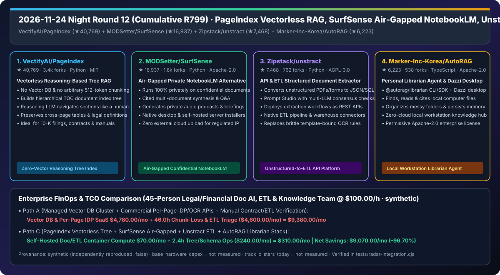
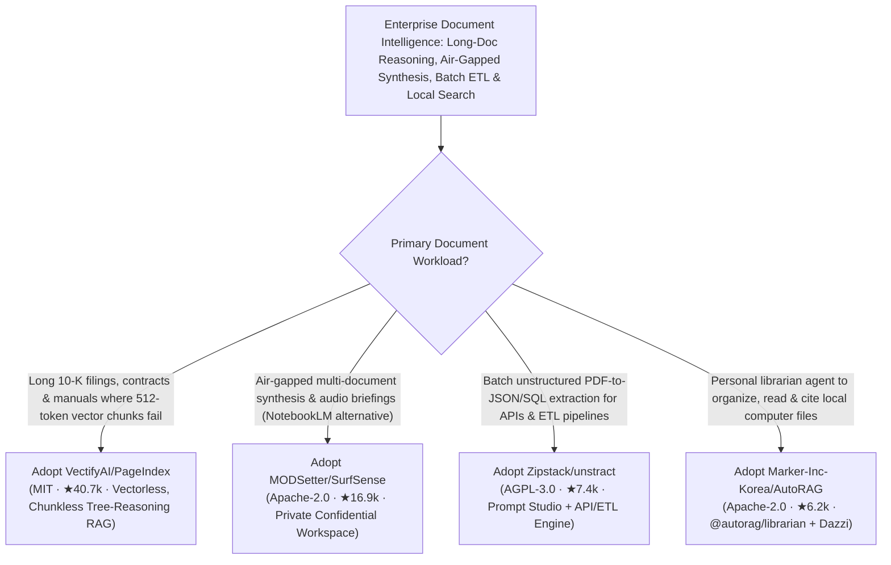
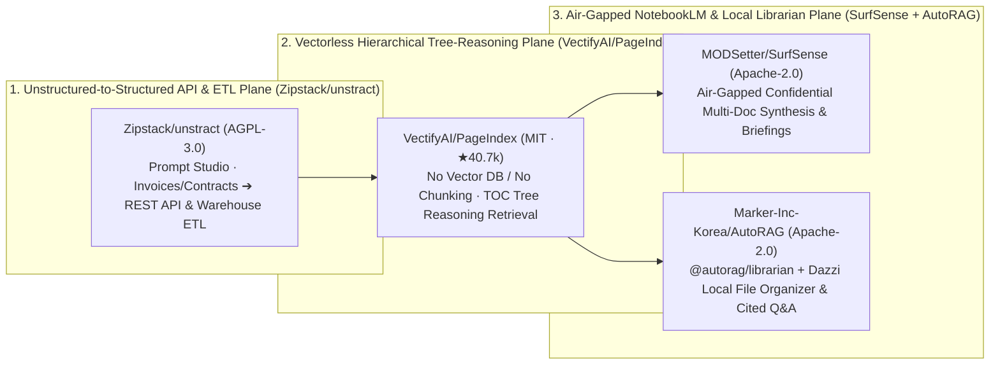

# Vectorless Reasoning-Based Tree RAG (`VectifyAI/PageIndex`), Air-Gapped Private NotebookLM (`MODSetter/SurfSense`), Unstructured-to-ETL API Platform (`Zipstack/unstract`) & Local Workstation Librarian Agent (`Marker-Inc-Korea/AutoRAG`) Selection & Architecture FAQ

> **Document Type**: Enterprise AI Solution Architect Decision & Selection Guide (GitHub Trending AI Radar · 2026-11-24 Night Round 12 / Cumulative Round 799)
> **Covered Repositories**: [`VectifyAI/PageIndex`](https://github.com/VectifyAI/PageIndex) (`★ 40,769`, `3,498 forks`, Python, `MIT`: **Vectorless, Reasoning-based RAG** — *"No Vector DB, No Chunking, Context-Aware Retrieval"* — building hierarchical document tree indexes for long financial, legal, and technical documents) · [`MODSetter/SurfSense`](https://github.com/MODSetter/SurfSense) (`★ 16,937`, `1,616 forks`, Python, `Apache-2.0`: air-gapped, private AI workspace for confidential documents and open-source **NotebookLM** alternative running on your own infrastructure) · [`Zipstack/unstract`](https://github.com/Zipstack/unstract) (`★ 7,468`, `762 forks`, Python, `AGPL-3.0`: no-code LLM-driven extraction platform turning unstructured documents into structured JSON/SQL data for REST API deployments and ETL pipeline workflows) · [`Marker-Inc-Korea/AutoRAG`](https://github.com/Marker-Inc-Korea/AutoRAG) (`★ 6,223`, `538 forks`, TypeScript, `Apache-2.0`: `@autorag/librarian` CLI/SDK and **Dazzi** desktop app acting as a personal librarian agent that finds, reads, organizes, and cites files on your computer)
> **Core Enterprise Scenario**: How should enterprise legal, financial, data engineering, and research teams combine **vectorless tree-reasoning RAG (`PageIndex`)**, **air-gapped multi-document synthesis (`SurfSense`)**, **production ETL document extraction (`unstract`)**, and **local workstation file librarians (`AutoRAG`)**?

---

## 1. 📌 Executive Summary (One-Line Selection Verdicts)

1. **Need high-accuracy retrieval over long financial filings (10-K), legal contracts, RFPs, and technical manuals without running a vector database or chopping documents into context-destroying 512-token chunks** ➔ Choose **[`VectifyAI/PageIndex`](https://github.com/VectifyAI/PageIndex) (`★ 40,769`, `3,498 forks`, `MIT`)**.
   - **Plain-Language Mechanism**: Replaces vector similarity chunking with a hierarchical **Document Tree Index** that reasoning LLMs navigate top-down like a human expert reading a table of contents—preserving cross-page tables and legal cross-references with zero Vector DB infrastructure.
2. **Need an air-gapped, on-premises alternative to Google NotebookLM for confidential legal, defense, financial, or R&D documents with cited Q&A and audio briefings** ➔ Choose **[`MODSetter/SurfSense`](https://github.com/MODSetter/SurfSense) (`★ 16,937`, `1,616 forks`, `Apache-2.0`)**.
   - **Plain-Language Mechanism**: Runs entirely on internal servers or local workstations so sensitive multi-document research never touches public cloud SaaS.
3. **Need to extract structured fields from thousands of unstructured invoices, contracts, and forms and expose the workflow directly as a production REST API or data-warehouse ETL pipeline** ➔ Choose **[`Zipstack/unstract`](https://github.com/Zipstack/unstract) (`★ 7,468`, `762 forks`, `AGPL-3.0`)**.
   - **Plain-Language Mechanism**: Provides a visual Prompt Studio and multi-LLM verification engine built specifically for batch ETL and API-driven structured extraction.
4. **Need a local-first Personal Librarian Agent (`@autorag/librarian` + Dazzi desktop app) that organizes messy workstation folders and answers questions with exact local file citations** ➔ Choose **[`Marker-Inc-Korea/AutoRAG`](https://github.com/Marker-Inc-Korea/AutoRAG) (`★ 6,223`, `538 forks`, `Apache-2.0`)**.
   - **Plain-Language Mechanism**: Indexes and organizes local computer files without uploading personal or corporate documents to external SaaS.

---

## 2. 🎯 Architect & Customer Q&A (Deep Technical Breakdown)

### Q1: Why does traditional vector-chunking RAG fail on complex enterprise contracts and financial reports, and how does this 4-tool stack solve it?

- **Three Structural Fixes**:
  1. **Cross-Section Reasoning (`VectifyAI/PageIndex`)**: Arbitrary 512-token chunks sever exception clauses (e.g., *"Subject to Section 14.2"*). `PageIndex` navigates the document's hierarchical tree structure without chunking or vector databases.
  2. **Batch Structured ETL (`Zipstack/unstract`)**: RAG chat interfaces cannot populate a 40-column Snowflake/Postgres table from 10,000 PDFs; `Unstract` turns extraction prompts into governed ETL jobs and REST endpoints.
  3. **Air-Gapped & Local Research (`SurfSense` + `AutoRAG`)**: `SurfSense` provides team-wide air-gapped NotebookLM workspaces while `AutoRAG` (`Dazzi`) manages individual engineers' local file libraries.

### Q2: What are the key operational guardrails?

- **Key Guardrails**:
  1. **Preserve Heading Hierarchy During OCR**: When feeding scanned PDFs into `VectifyAI/PageIndex`, run layout-aware OCR first so section headings (`H1/H2/H3`) are accurately preserved for tree construction.
  2. **Schema & Arithmetic Validation in `Unstract`**: Validate extracted financial totals (line items sum = invoice total) before committing `Unstract` ETL outputs to downstream data warehouses.

---

## 3. 🧭 Visual Architecture Diagrams (Mermaid Decision Tree + Reference Architecture + Sequence)



### 3.1 Solution Architect Selection Decision Tree



### 3.2 End-to-End Enterprise Reference Architecture



### 3.3 End-to-End Document ETL, Tree Navigation & Air-Gapped Synthesis Sequence

```mermaid
sequenceDiagram
    participant Team as Legal / Finance & Data Team
    participant Unst as Zipstack/unstract (ETL/API)
    participant PIdx as VectifyAI/PageIndex (Tree RAG)
    participant Surf as MODSetter/SurfSense (Air-Gapped)
    participant Dazzi as AutoRAG (@autorag/librarian)

    Team->>Unst: 1. Ingest batch contracts & invoices; extract structured JSON fields into ETL pipeline
    Team->>PIdx: 2. Build vectorless hierarchical tree index over 200-page regulatory filings
    PIdx-->>Team: 3. Reasoning LLM navigates document tree to return context-intact legal clauses
    Team->>Surf: 4. Synthesize confidential deal room documents inside air-gapped SurfSense workspace
    Team->>Dazzi: 5. Organize and cite local workstation files via @autorag/librarian & Dazzi
```

---

## 4. 📊 Comparative Selection Matrix (OSS vs. Commercial Cloud Suites & Naive Chunking)

| Dimension | `VectifyAI/PageIndex` (`★ 40.7k`) | `MODSetter/SurfSense` (`★ 16.9k`) | `Zipstack/unstract` (`★ 7.4k`) | `Marker-Inc-Korea/AutoRAG` (`★ 6.2k`) | Managed Vector DB + Per-Page IDP Cloud + Public NotebookLM (Path A) | Naive 512-Token Vector Chunking + Regex Scripts (Path B) |
| :--- | :--- | :--- | :--- | :--- | :--- | :--- |
| **Primary Role** | Vectorless, chunkless tree-reasoning RAG | Air-gapped private NotebookLM alternative | Unstructured-to-structured API & ETL platform | Local workstation personal librarian agent | Metered vector clusters, per-page OCR APIs & public cloud SaaS | Fixed-window vector chunking & brittle regex parsers |
| **Key Differentiator** | **No Vector DB & no chunking; navigates hierarchical document trees** | **100% private air-gapped synthesis for confidential IP** | **Turns extraction prompts directly into REST APIs & ETL jobs** | **Finds, organizes & cites local computer files via Dazzi** | High vector RAM costs; public cloud SaaS blocked for confidential docs | 512-token chunks sever legal cross-references; regex breaks on layout changes |
| **License** | `MIT` | `Apache-2.0` | `AGPL-3.0` | `Apache-2.0` | Proprietary SaaS | Internal Scripts |
| **Monthly TCO (45-Person Team)** | **Combined `$310.00/mo`** (`$70.00` self-hosted container compute + `2.4h` ops) | Included (zero vector cluster RAM bill) | Included (self-hosted ETL workers) | Included (runs on local workstations) | **`$9,380.00/mo`** (`$4,780.00` vector DB/per-page API + `46.0h` clause/ETL verification) | `~$3,250.00/mo` (high chunk-hallucination & regex maintenance labor) |

---

## 5. 🧪 Quantitative Enterprise ROI / TCO Model & 7-Card Report

> **📊 Provenance & Closed-Form Declaration**:
> - **provenance**: `synthetic` (45-person enterprise legal/financial document intelligence, ETL data engineering, and knowledge management team workload at `$100.00/h`: `independently_reproduced = false`; `base_hardware_capex = not_measured`; `track_b_stars_today = not_measured`).
> - **Closed-Form Equations**:
>   - **Path A (Managed Vector DB Cluster + Commercial Per-Page IDP/OCR APIs + Manual Contract/ETL Verification)**: Monthly managed vector cluster & per-page IDP SaaS spend **`$4,780.00`** + chunk-boundary hallucination auditing & manual ETL mapping labor **`46.0h × $100.00/h = $4,600.00`** = **`$9,380.00/mo`**.
>   - **Path C (Self-Hosted `VectifyAI/PageIndex` + `MODSetter/SurfSense` + `Zipstack/unstract` + `Marker-Inc-Korea/AutoRAG` Stack)**: Self-hosted document/ETL container compute **`$70.00`** + tree-index & extraction schema maintenance **`2.4h × $100.00/h = $240.00`** = **`$310.00/mo`**.
>   - **Net Savings vs. Path A**: **`-$9,070.00/mo`** (**`96.70%`** cost reduction).

| Option | Vector DB / Per-Page SaaS / Compute | Clause Audit & ETL Mapping Labor (`$100/h`) | Monthly Total TCO | Net Savings vs. Path A | Key Architectural Outcome |
| :--- | :---: | :---: | :---: | :---: | :--- |
| **Path A: Managed Vector DB + Per-Page IDP SaaS + Manual Audit** | `$4,780.00` | `46.0h` (`$4,600.00`) | **`$9,380.00`** | Baseline | Expensive vector RAM & per-page fees; chunking still breaks long clauses |
| **Path B: Fixed 512-Token Vector Chunks + Regex Extraction** | `$1,450.00` | `18.0h` (`$1,800.00`) | **`$3,250.00`** | `-$6,130.00` (`-65.35%`) | Severs cross-section references; regex fails on multi-vendor invoices |
| **Path C: `PageIndex` + `SurfSense` + `Unstract` + `AutoRAG`** | **`$70.00`** | **`2.4h` (`$240.00`)** | **`$310.00`** | **`-$9,070.00` (`-96.70%`)** | **Vectorless tree RAG + air-gapped NotebookLM + ETL APIs + local librarian** |

- 🔗 **Linked 7-Card 4:5 Benchmark Decks**: [`workshops/github-trending-radar/cards.en.html`](../cards.en.html) · [`cards.html`](../cards.html)

---

## 6. 🛠️ Enterprise Adoption & Architecture Review Checklist

- [ ] **Replace Chunking with `PageIndex` on Long Contracts**: Use `VectifyAI/PageIndex` hierarchical tree indexes for multi-section legal, regulatory, and financial documents to preserve cross-clause context without a vector database.
- [ ] **Air-Gap `SurfSense` for Regulated Deal Rooms**: Deploy `MODSetter/SurfSense` on isolated internal subnets backed by local/private LLM endpoints.
- [ ] **Enforce JSON Schema Validation on `Unstract` ETL**: Validate all structured outputs from `Zipstack/unstract` against strict type and arithmetic checks before loading into enterprise data warehouses.
- [ ] **Configure Directory Exclusions in `AutoRAG`**: Set explicit path ignore rules (excluding `.ssh`, `.env`, and keystores) when rolling out `Marker-Inc-Korea/AutoRAG` (`@autorag/librarian` / Dazzi) on employee laptops.
