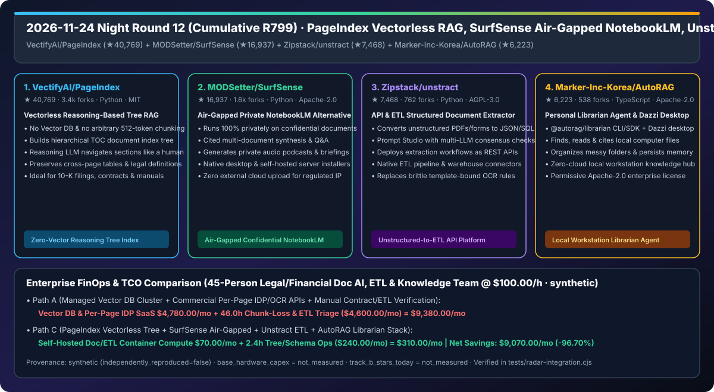
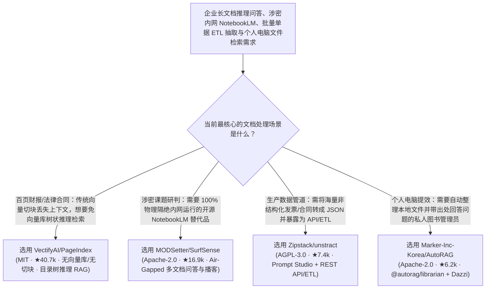
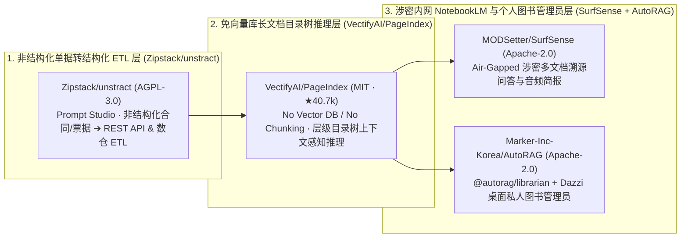
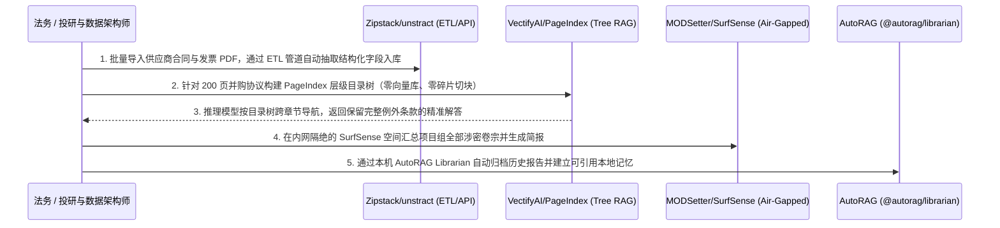

# 免向量库免切块的树状推理型 RAG（`VectifyAI/PageIndex`）、物理隔绝内网涉密文档 NotebookLM 替代（`MODSetter/SurfSense`）、面向 API 与 ETL 流水线的非结构化单据抽取平台（`Zipstack/unstract`）与本地终端私人图书管理员智能体（`Marker-Inc-Korea/AutoRAG`）选型与集成架构 FAQ

> **文档类型**：企业 AI 解决方案架构师（AI Solution Architect）选型决策指南（GitHub Trending AI 雷达 2026-11-24 Night Round 12 / 累计第 799 轮）
> **覆盖项目**：[`VectifyAI/PageIndex`](https://github.com/VectifyAI/PageIndex)（`★ 40,769`、`3,498 forks`、`MIT`，首创 **“无向量库、无机械切块（No Vector DB, No Chunking）”** 的推理型文档树索引引擎，让大模型像人类专家查目录一样跨章节精准检索财报、标书与法律合同）· [`MODSetter/SurfSense`](https://github.com/MODSetter/SurfSense)（`★ 16,937`、`1,616 forks`、`Apache-2.0`，专为涉密文档打造的物理隔绝 Air-Gapped 开源 **NotebookLM** 替代方案，支持多源文档精准溯源问答与本地私有播客简报生成）· [`Zipstack/unstract`](https://github.com/Zipstack/unstract)（`★ 7,468`、`762 forks`、`AGPL-3.0`，将发票、保单、合同等非结构化文档转化为结构化 JSON/数据库字段并直接发布为 REST API 或接入 ETL 数据仓库管道的企业级平台）· [`Marker-Inc-Korea/AutoRAG`](https://github.com/Marker-Inc-Korea/AutoRAG)（`★ 6,223`、`538 forks`、`Apache-2.0`，升级为 `@autorag/librarian` 与 Dazzi 桌面应用，在个人电脑上自动查找、阅读、整理文件并带精确引用回答一切问题）
> **核心场景**：当企业法务、投研、财务与研发部门处理海量高价值长文档时，如何解决**“传统向量 RAG 把 200 页招股书或合同按 512 Token 机械切碎后完全丢掉章节上下文与跨页表格指代、高密级战略文档严禁上传 Google NotebookLM 公有云、财务单据与合同字段抽取难以嵌入自动化 ETL 管道、以及员工本机积压数千份历史报告找不到出处”**四大文档智能痛点？

---

## 一、📌 核心结论速览（选型一句话结论）

1. **想在百页以上的上市公司财报（10-K）、法律长合同、招投标文件与工程技术手册上获得远超传统向量 RAG 的准确率，且不想维护复杂的向量数据库与调优切片大小（Chunk Size）** ➔ 选 **[`VectifyAI/PageIndex`](https://github.com/VectifyAI/PageIndex)（`★ 40,769`，`3,498 forks`，`MIT`）**。
   - **通俗原理**：人类律师或财务分析师看 300 页合同时，绝不会把合同撕成几百张碎片按词频匹配，而是**先看目录树（Table of Contents），根据问题推理该去哪一章哪一节，再翻到对应页码精读上下文**。`PageIndex` 将长文档构建为层级树状索引（Document Tree Index），由推理大模型自顶向下导航定位章节，彻底消灭了机械切块导致的“表格断头”与“条款指代丢失”，且完全不需要部署任何 Vector DB。
2. **想在军工、政务、金融内网或律所本地电脑上部署一套 100% 物理隔绝（Air-Gapped）的 Google NotebookLM 替代品，对绝密文档做带引用溯源的多文档研判与音频简报** ➔ 选 **[`MODSetter/SurfSense`](https://github.com/MODSetter/SurfSense)（`★ 16,937`，`1,616 forks`，`Apache-2.0`）**。
   - **通俗原理**：提供开箱即用的本地安装包与内网服务端，支持将多份涉密 PDF、笔记、网页与会议纪要汇聚在私有空间内，所有检索、总结与引用核对均在自有硬件闭环完成。
3. **想把成千上万份格式各异的采购发票、物流提单、理赔申请与供应商合同，稳定抽取为强 Schema 约束的 JSON 字段，并一键发布为生产级 REST API 或定时写入雪花/Postgres 数仓 ETL 管道** ➔ 选 **[`Zipstack/unstract`](https://github.com/Zipstack/unstract)（`★ 7,468`，`762 forks`，`AGPL-3.0`）**。
   - **通俗原理**：不同于聊天式的文档问答，`Unstract` 专为“非结构化转结构化 ETL（Unstructured-to-Structured）”设计：内置可视化 Prompt Studio，支持多模型交叉校验防幻觉，测试调通后无需写后端胶水代码即可直接发布为 API 端点或 ETL 作业。
4. **想给每位架构师、咨询顾问或研究员的个人电脑配一位“私人图书管理员（Personal Librarian Agent）”，自动整理杂乱文件夹并在回答时精确引用本机具体文件与段落** ➔ 选 **[`Marker-Inc-Korea/AutoRAG`](https://github.com/Marker-Inc-Korea/AutoRAG)（`★ 6,223`，`538 forks`，`Apache-2.0`）**。
   - **通俗原理**：提供 `@autorag/librarian` CLI/SDK 与 **Dazzi** 桌面应用，专注于本地文件系统的语义发现、自动归档整理与带出处的长程记忆问答。

---

## 二、🎯 客户与架构师灵魂拷问 Q&A（深度架构拆解）

### Q1：传统向量切片 RAG（Vector Chunking）在什么场景下会彻底失效？何时该切到 `PageIndex` + `Unstract` + `SurfSense`？

- **传统向量 RAG 的三大死穴与解方**：
  1. **长文档跨节逻辑断裂 ➔ `VectifyAI/PageIndex`**：合同第 42 页写着“除第 12.3 条另有约定外”，普通向量检索只召回第 42 页切片就会给出完全相反的错误结论；`PageIndex` 通过树状推理导航同时展开关联章节。
  2. **批量结构化入库 ➔ `Zipstack/unstract`**：向量 RAG 适合回答单点问题，不适合把 10,000 份 PDF 合同的 35 个字段精准抽取进数仓宽表；批处理抽取选 `Unstract`。
  3. **涉密内网研判与个人工作站 ➔ `SurfSense` + `AutoRAG`**：严禁出网的专题研究选 `SurfSense`；个人电脑全盘文件整理与溯源检索选 `AutoRAG` (`Dazzi`)。
- **何时直接用云厂商托管方案（Path A）？**
  - 若处理的是带有复杂手写印章、倾斜扫描件的标准财务票据且数据允许上云，优先选用 **Azure AI Document Intelligence** 预构建发票/收据模型；在其之上叠加 `PageIndex` 处理长篇合同条款推理。

### Q2：典型企业级“树状无向量长文档推理 (`PageIndex`) + 批量 ETL 结构化抽取 (`Unstract`) + 涉密内网研判台 (`SurfSense`) + 终端图书管理员 (`AutoRAG`)”架构怎么搭？

1. **自动化数据管道与 API 抽取层（`Zipstack/unstract`）**：
   - 对接企业对象存储与邮箱附件，将每日流入的非结构化单据/合同抽取为标准 JSON 写入业务数据库与数仓。
2. **长文档深度推理索引层（`VectifyAI/PageIndex`）**：
   - 对规章制度、招投标书、年报与复杂技术规范构建 `PageIndex` 层级目录树索引，供法务与投研 Agent 进行免向量推理问答。
3. **涉密专题工作台与个人终端层（`MODSetter/SurfSense` + `Marker-Inc-Korea/AutoRAG`）**：
   - 部门级涉密课题在 `SurfSense` 私有空间协同研判；员工个人电脑挂载 `AutoRAG` (`Dazzi`) 管理本机历史方案。

### Q3：这套架构的生产落地红线是什么？

- **架构师落地红线**：
  1. **扫描件 OCR 前置质量把关**：`VectifyAI/PageIndex` 依赖准确的文档标题层级来构建目录树；对于纯图片扫描版 PDF，必须先通过高精度版面分析 OCR（如 Azure Document Intelligence Layout 或本地高质量解析器）恢复 Markdown 标题层级再建树。
  2. **`Unstract` 关键金额字段的双模型校验**：在财务与法务 ETL 流水线中，对合同总额、违约金比例等核心数字字段应开启置信度校验或双模型比对，不一致时自动转人工复核队列。

---

## 三、🧭 直观可视化图解（Mermaid 决策树 + 集成架构 + 时序图）

### 3.1 架构师选型决策树

### 3.2 企业端到端生产集成参考架构图

### 3.3 合同单据 ETL 抽取、PageIndex 树状推理导航、SurfSense 涉密研判与 AutoRAG 本地归档时序图

---

## 四、📊 同类开源与商业云服务横向选型决策矩阵

| 对比维度 | `VectifyAI/PageIndex` (`★ 40.7k`) | `MODSetter/SurfSense` (`★ 16.9k`) | `Zipstack/unstract` (`★ 7.4k`) | `Marker-Inc-Korea/AutoRAG` (`★ 6.2k`) | 商业托管向量数据库集群 + 按页计费商业 IDP API + 公有云 NotebookLM (Path A) | 固定 512-Token 切块脚本 + 正则表达式抽字段 (Path B) |
| :--- | :--- | :--- | :--- | :--- | :--- | :--- |
| **核心能力定位** | 免向量库、免切块的树状推理型 RAG | 物理隔绝内网开源 NotebookLM 替代 | 面向 API 与 ETL 的非结构化抽取平台 | 本地电脑私人图书管理员 Agent 与桌面端 | 按存储节点与页数高额计费的商业云套件 | 机械切碎文档的初级向量脚本与脆弱正则 |
| **核心技术突破** | **无向量库、无机械切块，模拟人类按目录树跨章节推理** | **Air-Gapped 涉密部署，支持引用溯源与本地简报** | **直接将文档抽取流程发布为生产 REST API 与 ETL** | **`@autorag/librarian` + Dazzi 自动整理本机文件并精准引用** | 向量库常驻内存贵；公有云 NotebookLM 无法上传涉密文件 | 512-Token 切块切断跨页表格与法律除外条款；正则遇版式微调即崩 |
| **开源协议** | `MIT` | `Apache-2.0` | `AGPL-3.0` | `Apache-2.0` | 闭源商业 SaaS | 内部脚本 |
| **月度 TCO（45 人团队）** | **组合仅 `$310.00/月`**（`$70.00` 自托管容器算力 + `2.4h` 维护） | 同左（省去专用向量数据库集群开销） | 同左（内网自托管 ETL） | 同左（运行在员工本机零云成本） | **`$9,380.00/月`**（`$4,780.00` 向量集群/按页 API + `46.0h` 切片失真核对与人工录单） | 约 `$3,250.00/月`（大量修复跨页切片错误与维护解析正则工时） |

---

## 五、🧪 应用落地定量收益/TCO 对比与 7-Card 报告

> **📊 数据来源与闭式核算声明（Provenance & Closed-Form Schema）**：
> - **provenance**: `synthetic`（基于 45 人企业法务/金融文档智能、数据 ETL 工程与知识管理团队月度工作负载模型：`independently_reproduced = false`；硬件采购基线 `base_hardware_capex = not_measured`；Track B 单日增量 `track_b_stars_today = not_measured`）。
> - **核算公式**：
>   - **Path A（租用高配托管向量数据库集群 + 按页调用商业文档抽取 API + 人工核对因向量切块截断导致的合同/财报条款漏读与手工录单）**：月度托管向量库与按页抽取 SaaS 账单 **`$4,780.00`** + 跨页条款人工复核与 ETL 字段映射排障人工 **`46.0h × $100.00/h = $4,600.00`** = **`$9,380.00/月`**。
>   - **Path C（自建 `VectifyAI/PageIndex` + `MODSetter/SurfSense` + `Zipstack/unstract` + `Marker-Inc-Korea/AutoRAG` 开源文档智能栈）**：内网自托管 SurfSense 与 Unstract 容器开销 **`$70.00`**（完全省去向量数据库集群） + 目录树索引与抽取 Schema 维护人工 **`2.4h × $100.00/h = $240.00`** = **`$310.00/月`**。
>   - **净节省（Net Savings vs Path A）**：**`-$9,070.00/月`**（成本降低 **`96.70%`**）。

| 评估方案 | 向量集群 / 按页 SaaS / 容器成本 | 条款复核、ETL 映射与检索排障人工（`$100/h`） | 月度总 TCO | 相对 Path A 净节省 | 关键架构交付指标 |
| :--- | :---: | :---: | :---: | :---: | :--- |
| **Path A：商业向量数据库 + 按页抽取 SaaS + 人工复核** | `$4,780.00` | `46.0h` (`$4,600.00`) | **`$9,380.00`** | Baseline | 向量集群常驻成本高；机械切块仍切断长合同跨节条款 |
| **Path B：自建 512-Token 向量切片 + 手写正则抽取脚本** | `$1,450.00` | `18.0h` (`$1,800.00`) | **`$3,250.00`** | `-$6,130.00` (`-65.35%`) | 无法处理复杂长文档层级推理；版式变化即导致 ETL 挂死 |
| **Path C：`PageIndex` + `SurfSense` + `Unstract` + `AutoRAG`** | **`$70.00`** | **`2.4h` (`$240.00`)** | **`$310.00`** | **`-$9,070.00` (`-96.70%`)** | **免向量库目录树推理 + 涉密内网 NotebookLM + 结构化 ETL + 本地管理员** |

- 🔗 **关联 7-Card 4:5 视觉评测报告**：[`workshops/github-trending-radar/cards.html`](../cards.html) · [`cards.en.html`](../cards.en.html)

---

## 六、🛠️ 企业引入与架构评审 Checklist

- [ ] **长篇合同与财报优先切换 `PageIndex` 树索引**：针对超过 30 页、含大量交叉引用条款的制度、标书与财报，停用 512-Token 机械切块，改用 `VectifyAI/PageIndex` 构建层级树索引。
- [ ] **涉密卷宗强制进入 `SurfSense` Air-Gapped 环境**：配置内网防火墙阻断 `MODSetter/SurfSense` 容器的外网出站连接，对接企业内网私有部署大模型。
- [ ] **Unstract 抽取 API 的 JSON Schema 门禁**：在 `Zipstack/unstract` 将非结构化文档写入数仓前，强制通过 Pydantic/JSON Schema 校验必填字段类型与金额平衡公式。
- [ ] **员工终端部署 `AutoRAG` 个人知识管家**：在架构师与顾问终端安装 `@autorag/librarian` / Dazzi，设置敏感密钥目录排除列表（Ignore List）后自动归档本地研究文档。
