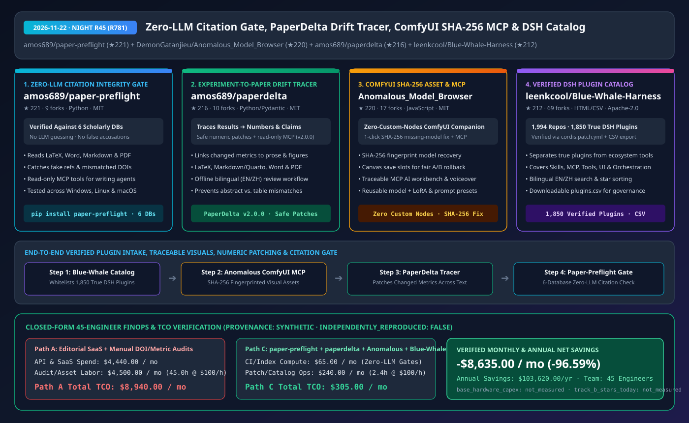
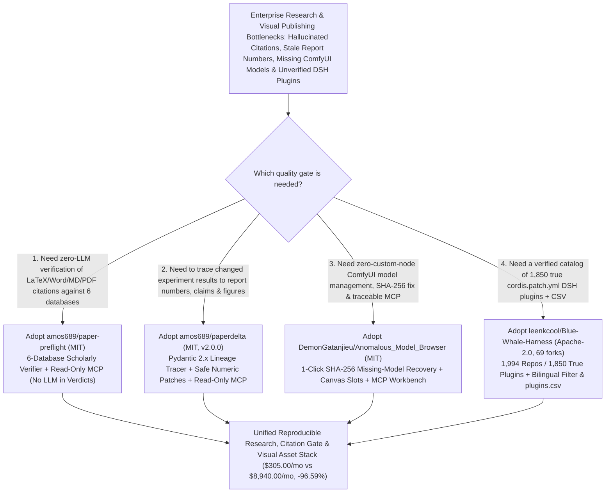
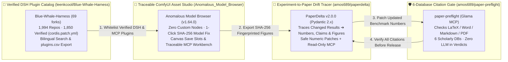

# Zero-LLM 6-Database Citation Integrity Gate (`amos689/paper-preflight`), Experiment-to-Paper Numeric Drift Tracer (`amos689/paperdelta`), Zero-Custom-Node ComfyUI SHA-256 Asset & MCP Workbench (`DemonGatanjieu/Anomalous_Model_Browser`) & 1,850-Plugin Verified DSH Catalog (`leenkcool/Blue-Whale-Harness`) — Enterprise Selection & Architecture FAQ

> **Document Type**: Enterprise AI Solution Architect Application Landing & Comparative Selection Guide (2026-11-22 Night Round 45 / Cumulative Round `R781`)  
> **Evaluated Repositories**: `amos689/paper-preflight` (`★ 221`, `9 forks`, Python, MIT) · `DemonGatanjieu/Anomalous_Model_Browser` (`★ 220`, `17 forks`, JavaScript, MIT) · `amos689/paperdelta` (`★ 216`, `10 forks`, Python, MIT) · `leenkcool/Blue-Whale-Harness` (`★ 212`, `69 forks`, HTML, Apache-2.0)  
> **Provenance Declaration**: Live GitHub repository metadata comes from our 2026-11-22 sealed evidence snapshot and GitHub REST API. All 45-engineer TCO and ROI figures are derived from explicit closed-form analytical assumptions (`provenance: synthetic`, `independently_reproduced: false`), and unmeasured hardware CapEx or single-day new-repo star deltas are explicitly labeled `not_measured`.



---

## ① 📌 Executive Summary (One-Sentence Selection Verdict)

> **One-Sentence Verdict**: For a 45-engineer enterprise AI research lab, technical whitepaper publishing, and ComfyUI visual production organization, **never ask an LLM to guess whether AI-generated citations are real, manually hunt through 40-page reports to update scattered numbers after re-running an experiment, waste hours fixing missing ComfyUI model filenames across shared workflows, or install unverified DeepSeek Harness repos**; instead, deploy the open-source stack of **`amos689/paper-preflight` (zero-LLM citation verifier checking LaTeX/Word/Markdown/PDF references against 6 scholarly databases with read-only MCP) + `amos689/paperdelta` (Pydantic 2.x tracer linking changed experiment outputs to exact numbers, claims & figures with safe numeric patches and read-only MCP) + `DemonGatanjieu/Anomalous_Model_Browser` (zero-custom-node ComfyUI asset manager with 1-click SHA-256 missing-model recovery, canvas save slots & traceable MCP workbench) + `leenkcool/Blue-Whale-Harness` (verified catalog of 1,994 repos / 1,850 true `cordis.patch.yml` DSH plugins with CSV export)**, reducing monthly TCO from **`$8,940.00/mo`** to **`$305.00/mo`** (net savings of **`$8,635.00/mo`**, or **`96.59%`**).

| Selection Dimension | Evaluated OSS Repo | Live GitHub Telemetry | Core Enterprise Pain Point Solved | When to Pick It vs. Managed Cloud PaaS |
| :--- | :--- | :--- | :--- | :--- |
| **Zero-LLM Citation Integrity Gate** | **`amos689/paper-preflight`** | `★ 221` · `9 forks` · Python · MIT | AI-drafted whitepapers and papers frequently contain hallucinated citations or DOIs belonging to different papers; LLM checkers hallucinate verdicts | Pick **`paper-preflight`** (`pip install paper-preflight`) when you need **every reference in LaTeX, Word, Markdown, or PDF verified against 6 real scholarly databases with zero LLM guessing in the verdicts and read-only MCP tools** |
| **ComfyUI SHA-256 Asset & MCP Studio** | **`DemonGatanjieu/Anomalous_Model_Browser`** | `★ 220` · `17 forks` · JavaScript · MIT | Sharing ComfyUI workflows breaks on renamed/missing models, custom nodes pollute workflow JSONs, and AI workflow edits lack an audit trail | Pick **`Anomalous_Model_Browser`** (`v1.64.0`) when you want **zero custom nodes, 1-click SHA-256 missing-model recovery, canvas save slots, model+LoRA presets, voice acting, and a traceable MCP AI workbench** |
| **Experiment-to-Paper Drift Tracer** | **`amos689/paperdelta`** | `★ 216` · `10 forks` · Python · MIT | Re-running benchmarks invalidates numbers scattered across abstracts, prose claims, tables, and figures in LaTeX/Markdown/Word/PDF reports | Pick **`paperdelta`** (`v2.0.0`) when you need **deterministic tracing from changed experiment results to every affected number, claim, and figure—with offline bilingual review, safe numeric patches, and read-only MCP tools** |
| **Verified DSH Plugin Catalog** | **`leenkcool/Blue-Whale-Harness`** | `★ 212` · `69 forks` · HTML · Apache-2.0 | Scattered GitHub repositories claim to be DeepSeek Harness plugins without implementing the actual `cordis.patch.yml` plugin contract | Pick **`Blue-Whale-Harness`** (`69 forks`) when you need **a searchable bilingual index and `plugins.csv` export verifying 1,850 true `cordis.patch.yml` DSH plugins across 1,994 repositories** |

---

## ② 🎯 Solution Architect & Customer Deep-Dive Q&A

### Q1: Why do enterprise research, benchmark publishing, and visual workflow teams need deterministic citation/numeric gates and fingerprint-backed asset managers instead of generic LLM review prompts?

**Plain-Language Breakdown for Research Directors & Solution Architects**:
1. **Zero-LLM Citation Verdicts Against Six Scholarly Databases (`amos689/paper-preflight`)**: Using an LLM to check whether an LLM-written bibliography is real leads to both missed fabrications and false accusations against valid papers. `paper-preflight` (`io.github.amos689/paper-preflight` on Glama MCP) enforces a strict rule—**no LLM in the verdicts**: it reads **LaTeX, Word, Markdown, and PDF** inputs and verifies every citation key, title, author list, and DOI against **six authoritative scholarly databases**, exposing read-only MCP tools so agents can fix broken references before submission.
2. **Tracing Changed Benchmark Numbers to Every Claim and Figure (`amos689/paperdelta`)**: When an engineering team re-runs a benchmark suite on updated hardware or model weights, updating the main results table while forgetting a percentage in the abstract or discussion section destroys report credibility. `paperdelta` (`v2.0.0`, built on Pydantic 2.x) traces changed experiment results directly to the **numbers, prose claims, and figures** across static LaTeX, Markdown/Quarto, Word, and PDF files—offering offline bilingual (EN/ZH) review, **safe numeric patches**, and read-only MCP tools.
3. **Zero-Custom-Node ComfyUI Asset Recovery & Traceable MCP Workbench (`DemonGatanjieu/Anomalous_Model_Browser`)**: Custom management nodes often break ComfyUI workflow portability. `Anomalous_Model_Browser` (`v1.64.0`) operates with **zero custom nodes** while providing Civitai cover/trigger-word browsing, workflow recovery from past outputs, **canvas save slots** for fair A/B comparison, **1-click SHA-256 missing-model recovery** (even if files were renamed), character voiceover tools, and an **operation-logged MCP AI workbench**.
4. **Separating 1,850 True `cordis.patch.yml` DSH Plugins From Noise (`leenkcool/Blue-Whale-Harness`, `69 forks`)**: `Blue-Whale-Harness` indexes **1,994 repositories** and programmatically verifies which ones contain a valid `cordis.patch.yml` manifest (**1,850 verified DSH plugins** across `llm`, `utility`, `session`, MCP, UI, and orchestration), publishing both a bilingual web search table and a downloadable `plugins.csv` feed.

### Q2: How do these four projects integrate into a reproducible enterprise research & visual publishing pipeline?

**End-to-End Integration Architecture**:
1. **Verified Plugin Intake Plane (`leenkcool/Blue-Whale-Harness`)**: Platform teams ingest `plugins.csv` to whitelist verified `cordis.patch.yml` DSH plugins and MCP tools.
2. **Traceable Visual Asset Generation Plane (`DemonGatanjieu/Anomalous_Model_Browser`)**: Generates reproducible ComfyUI visual assets via its traceable MCP workbench, embedding SHA-256 model fingerprints and canvas save snapshots.
3. **Numeric Lineage & Patching Plane (`amos689/paperdelta`)**: Whenever benchmark or experiment JSON/CSV outputs change, `paperdelta` MCP traces every dependent number, claim, and figure in the manuscript and applies safe numeric patches.
4. **Pre-Submission Citation Gate Plane (`amos689/paper-preflight`)**: Runs in CI and via read-only MCP across LaTeX, Word, Markdown, and PDF deliverables to verify 100% of references against six scholarly databases.

### Q3: What operational boundaries should architects keep in mind?

**Boundaries & Guardrails**:
- **Internal vs. Public Citations in `paper-preflight`**: `paper-preflight` validates against six public scholarly registries; tag internal-only proprietary RFCs in a separate bibliography section so public DOI checks only target external literature.

---

## ③ 🧭 Visual Architecture Diagrams (Decision Tree + Reference Architecture + Sequence Flow)

### 3.1 Selection Decision Tree (Mermaid Flowchart)



### 3.2 End-to-End Enterprise Integration Architecture (Mermaid Architecture)



### 3.3 Benchmark Re-Run, Safe Numeric Patching & Pre-Submission Citation Verification Sequence (Mermaid Sequence)

```mermaid
sequenceDiagram
    autonumber
    actor Res as Principal Researcher / Solution Architect
    participant Blue as Blue-Whale-Harness (plugins.csv)
    participant Comf as Anomalous_Model_Browser (ComfyUI MCP)
    participant Delt as amos689/paperdelta (Drift Tracer MCP)
    participant Pref as amos689/paper-preflight (Citation Gate MCP)

    Res->>Blue: Filter plugins.csv for verified cordis.patch.yml evaluation & automation plugins
    Res->>Comf: Generate visual figures via traceable ComfyUI MCP workbench (SHA-256 model hash saved)
    Res->>Delt: Re-run benchmark suite; invoke paperdelta MCP across LaTeX/Markdown/Word manuscript
    Delt-->>Res: Trace updated latency/accuracy metrics to 12 prose claims & table cells; apply safe numeric patch
    Res->>Pref: Run paper-preflight MCP before publication to verify all bibliography entries
    Pref->>Pref: Cross-check DOIs, titles & authors against 6 scholarly databases (zero LLM guessing)
    Pref-->>Res: Flag 1 mismatched DOI & 1 undefined citation key; pass gate after deterministic fix
```

---

## ④ 📊 Comparative Selection Matrix (OSS vs. Commercial Cloud PaaS)

| Comparison Dimension | `amos689/paper-preflight` | `amos689/paperdelta` | `Anomalous_Model_Browser` | `Blue-Whale-Harness` | LLM Citation Prompts + Manual Edits + Ad-Hoc ComfyUI Nodes |
| :--- | :--- | :--- | :--- | :--- | :--- |
| **Primary Role** | Zero-LLM citation verifier across 6 scholarly databases | Experiment-to-manuscript numeric drift tracer & patcher | Zero-custom-node ComfyUI asset manager & traceable MCP studio | Verified catalog of 1,850 true DSH plugins (`plugins.csv`) | Prompting LLMs to check refs + manual Ctrl+F + intrusive custom nodes |
| **Key Reliability Guarantee** | **No LLM in verdicts**; verifies against 6 real scholarly registries | **Pydantic 2.x lineage** from results to claims/figures + safe patches | **Zero custom nodes**; 1-click **SHA-256** missing-model recovery | **Programmatic `cordis.patch.yml` validation** across 1,994 repos | LLMs hallucinate citation checks; manual edits miss abstract/table drift |
| **Supported Formats & Interfaces** | LaTeX, Word, Markdown, PDF + read-only MCP | LaTeX, Markdown/Quarto, Word, PDF + read-only MCP | ComfyUI Manager + traceable MCP AI workbench (`v1.64.0`) | Bilingual web UI + `plugins.csv` export | Proprietary SaaS subscriptions |
| **License** | **MIT** | **MIT** | **MIT** | **Apache-2.0** (`69 forks`) | Commercial per-seat licensing |

---

## ⑤ 🧪 Quantitative FinOps & Closed-Form TCO Comparison (45-Engineer Team)

### 5.1 Explicit Closed-Form Assumptions (`provenance: synthetic`, `independently_reproduced: false`)
- **Team & Labor Baseline**: `team_size_engineers = 45` engineers; blended research/architecture hourly rate `hourly_rate_usd = $100.00/hr`; `base_hardware_capex = not_measured`; `track_b_stars_today = not_measured`.
- **Path A (Baseline: Commercial Editorial/Citation SaaS + Commercial AIGC Asset Cloud + LLM Document-Review Token Spend + Manual DOI/Number Checking & Model Recovery)**:
  - **API & Commercial SaaS Spend (`path_a_api_saas_usd`)**: Commercial citation/editorial SaaS seats, cloud AIGC asset management subscriptions, and repeated full-manuscript LLM review token spend = **`$4,440.00/mo`**;
  - **Manual Verification & Asset Recovery Labor (`path_a_labor_hours`)**: **`45.0 hours/mo`** spent manually verifying DOIs, hunting for stale numbers across updated reports, and fixing broken ComfyUI workflows = `45.0 × $100.00 =` **`$4,500.00/mo`** (`path_a_labor_usd`);
  - **Path A Total Monthly TCO (`path_a_total_usd`)**: `$4,440.00 + $4,500.00 =` **`$8,940.00/mo`**.
- **Path C (Hybrid Open-Source Stack: `paper-preflight` + `paperdelta` + `Anomalous_Model_Browser` + `Blue-Whale-Harness`)**:
  - **Self-Hosted CI & Hash Index Compute (`path_c_compute_usd`)**: Deterministic local/CI execution of `paper-preflight` and `paperdelta` plus local ComfyUI asset indexing = **`$65.00/mo`**;
  - **Gate & Catalog Maintenance Labor (`path_c_labor_hours`)**: **`2.4 hours/mo`** reviewing `paperdelta` patches and syncing `plugins.csv` = `2.4 × $100.00 =` **`$240.00/mo`** (`path_c_labor_usd`);
  - **Path C Total Monthly TCO (`path_c_total_usd`)**: `$65.00 + $240.00 =` **`$305.00/mo`**.
- **Closed-Form Net Savings & Percentage Reduction**:
  - **Monthly Net Savings (`net_savings_usd`)**: `$8,940.00 - $305.00 =` **`$8,635.00/mo`** (`$103,620.00/yr`);
  - **Percentage TCO Reduction (`pct_savings`)**: `$8,635.00 / $8,940.00 × 100% =` **`96.59%`**.

| Deployment Path | Monthly API/SaaS or Compute | Monthly Research/Ops Labor | Total Monthly TCO | Net Savings vs. Path A | Architectural Outcome |
| :--- | :--- | :--- | :--- | :--- | :--- |
| **Path A: Commercial Editorial SaaS + Manual DOI/Metric Audits + Ad-Hoc ComfyUI** | `$4,440.00` | `$4,500.00` (`45.0h`) | **`$8,940.00/mo`** | Baseline (`0.00%`) | High manual toil; stale numbers slip into prose; missing ComfyUI models |
| **Path B: Prompting LLMs to Check References & Rewrite Reports** | `$2,160.00` | `$1,200.00` (`12.0h`) | **`$3,360.00/mo`** | `-$5,580.00/mo` (`-62.42%`) | LLMs hallucinate DOI ownership and accidentally alter surrounding prose |
| **Path C: `paper-preflight` + `paperdelta` + `Anomalous_Model_Browser` + `Blue-Whale` (Recommended)** | **`$65.00`** | **`$240.00`** (`2.4h`) | **`$305.00/mo`** | **`-$8,635.00/mo` (`-96.59%`)** | **Zero-LLM 6-DB citation gate + safe numeric patches + SHA-256 ComfyUI MCP + 1,850 DSH catalog** |

---

## ⑥ 🛠️ Enterprise Onboarding & Architecture Review Checklist

- [ ] **Zero-LLM 6-Database Citation Gate (`amos689/paper-preflight`)**: Run `paper-preflight` in CI and via read-only MCP across all LaTeX, Word, Markdown, and PDF technical reports to verify every reference against six scholarly databases before publication.
- [ ] **Experiment-to-Manuscript Numeric Drift Tracing (`amos689/paperdelta`)**: Connect `paperdelta` (`v2.0.0`) to benchmark output pipelines so updated metrics automatically trace to affected numbers, claims, and figures and generate safe numeric patches.
- [ ] **Zero-Custom-Node ComfyUI SHA-256 Asset & MCP Setup (`DemonGatanjieu/Anomalous_Model_Browser`)**: Deploy `Anomalous_Model_Browser` (`v1.64.0`) across shared ComfyUI workstations to enable 1-click SHA-256 missing-model recovery, canvas save slots, and traceable MCP agent operations.
- [ ] **Verified `cordis.patch.yml` DSH Plugin Governance (`leenkcool/Blue-Whale-Harness`)**: Use `Blue-Whale-Harness`'s `plugins.csv` catalog to verify that candidate DeepSeek Harness plugins carry valid `cordis.patch.yml` manifests before internal onboarding.
