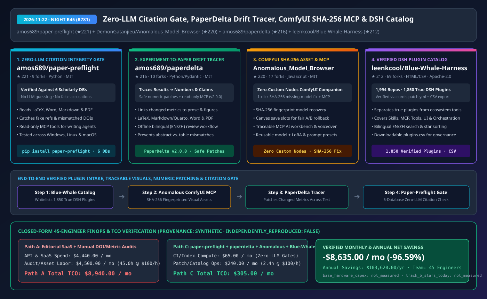
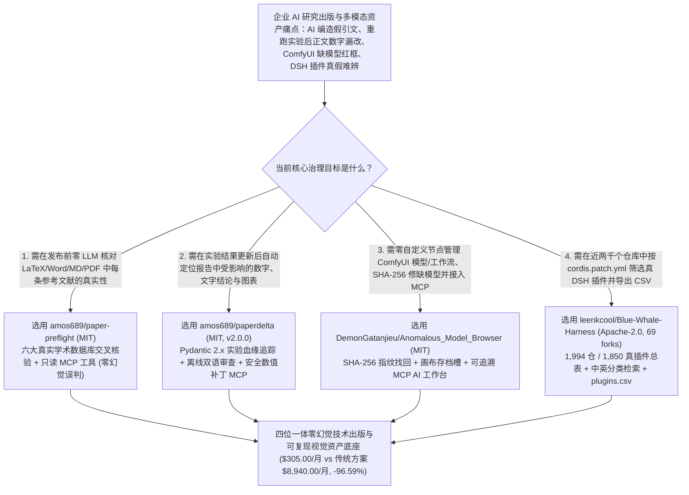
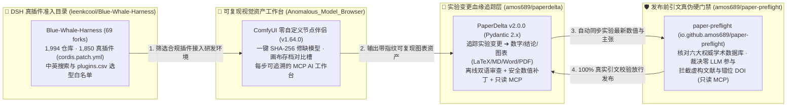
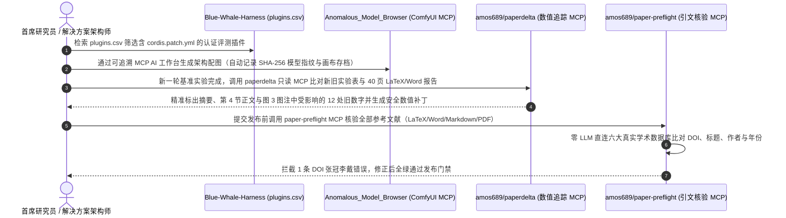

# 零模型六大文献库引文真伪核验门禁（`amos689/paper-preflight`）、实验数据变更到报告图表自动追踪补丁器（`amos689/paperdelta`）、ComfyUI 零自定义节点 SHA-256 修缺模型与可追溯 MCP 工作台（`DemonGatanjieu/Anomalous_Model_Browser`）与 1850 个真插件校验总目录（`leenkcool/Blue-Whale-Harness`）企业选型与集成架构 FAQ

> **文档类型**：AI 解决方案架构师（AI Solution Architect）企业应用落地与横向选型指南（2026-11-22 Night Round 45 / 累计第 781 轮 `R781`）  
> **评测锚点**：`amos689/paper-preflight` (`★ 221`, `9 forks`, Python, MIT) · `DemonGatanjieu/Anomalous_Model_Browser` (`★ 220`, `17 forks`, JavaScript, MIT) · `amos689/paperdelta` (`★ 216`, `10 forks`, Python, MIT) · `leenkcool/Blue-Whale-Harness` (`★ 212`, `69 forks`, HTML, Apache-2.0)  
> **Provenance 声明**：本文实时 GitHub 元数据采自 2026-11-22 封存快照与 GitHub REST API；45 人企业研究院、技术白皮书出版与多模态内容生产团队的 TCO 与 ROI 测算均为显式闭式假设推导（`provenance: synthetic`, `independently_reproduced: false`），所有未实测硬件资本开支与新仓单日增量统一标注为 `not_measured`。

---

## ① 📌 核心结论速览（选型一句话结论）

> **一句话选型结论**：在 45 人规模的企业 AI 研究院、技术白皮书/评测报告发布与 ComfyUI 视觉工作流团队中，**切勿让大模型去“猜”自己编造的虚假参考文献是否真实、在重跑基准实验后靠人工肉眼去改报告正文与图表里的几十处数字、在团队共享 ComfyUI 工作流时因缺少模型文件名而全网盲搜，或在未校验 `cordis.patch.yml` 的情况下乱装假冒 DSH 插件**；应当采用 **“paper-preflight（零 LLM 对齐六大权威学术数据库核验 LaTeX/Word/MD/PDF 引文真伪的只读 MCP）+ PaperDelta（追踪实验结果变更至正文数字/结论/图表并生成安全数值补丁的只读 MCP）+ Anomalous Model Browser（零自定义节点、支持 SHA-256 一键找回缺失模型与每步可追溯的 ComfyUI MCP 工作台）+ Blue-Whale-Harness（逐一校验 `cordis.patch.yml` 筛选出 1,850 个真 DSH 插件的可导出 CSV 总表）”**，将月度综合 TCO 从 **`$8,940.00/月`** 压降至 **`$305.00/月`**（净省 **`$8,635.00/月`**，降幅 **`96.59%`**）。

| 选型维度 | 评测开源方案 | GitHub 实测指标 | 核心解决的企业业务痛点 | 一句话何时选它 vs 云端商业 PaaS |
| :--- | :--- | :--- | :--- | :--- |
| **零模型六大文献库引文核验门禁** | **`amos689/paper-preflight`** | `★ 221` · `9 forks` · Python · MIT | AI 辅助撰写的白皮书、专利与学术论文常夹带“张冠李戴的 DOI”或纯虚构引文；再用 LLM 检查仍会漏检或误报 | 需要 **在裁决环节零 LLM 参与（No LLM in the verdicts）、直接核对六大真实学术数据库、覆盖 LaTeX/Word/Markdown/PDF 并提供只读 MCP 工具** 时首选 `paper-preflight` |
| **ComfyUI SHA-256 资产与可追溯 MCP** | **`DemonGatanjieu/Anomalous_Model_Browser`** | `★ 220` · `17 forks` · JavaScript · MIT | 团队复用历史 ComfyUI 工作流时经常遇到“缺模型报错”、改名后找不到原权重、画布改乱无法回退、AI 调参无记录 | 需要 **零自定义节点污染、支持一键 SHA-256 哈希修缺模型、画布多档位快照回滚、角色配音与每步操作可追溯的 MCP AI 工作台** 时选它 |
| **实验变更到文档数字追踪补丁器** | **`amos689/paperdelta`** | `★ 216` · `10 forks` · Python · MIT | 基准测试（Benchmark）重跑完最后一组数据后，正文摘要、结论段落与表格里的旧数字极易漏改导致前后矛盾 | 需要 **把实验结果变更精准追溯至 LaTeX / Markdown / Quarto / Word / PDF 中的数字、文字主张与图表，并输出离线双语审查与安全数值补丁（含只读 MCP）** 时选 `paperdelta` |
| **1,850 个真 DSH 插件校验总表** | **`leenkcool/Blue-Whale-Harness`** | `★ 212` · `69 forks` · HTML · Apache-2.0 | GitHub 上打着 DeepSeek Harness 旗号的仓库鱼龙混杂，架构师难以快速分辨哪些是真正含 `cordis.patch.yml` 的合规插件 | 需要 **在 1,994 个仓库中按 `cordis.patch.yml` 硬标准筛出 1,850 个真·DSH 插件并支持中英检索、分类筛选与 `plugins.csv` 离线导出** 时选 `Blue-Whale-Harness` |

---

## ② 🎯 客户与架构师灵魂拷问 Q&A（直击业务落地痛点）

### Q1：我们部门既要对外发布严谨的技术评测白皮书与顶会论文，又要维护内部 ComfyUI 视觉生成管线与 DSH 插件选型库，这四个工具如何帮我们堵住“造假幻觉”和“资产混乱”？

**通俗解答（给企业研究院院长与首席解决方案架构师）**：
1. **彻底根除 AI 写报告最致命的“假引文与错位 DOI”丑闻（`amos689/paper-preflight` 破局）**：
   过去一年多起咨询公司与科技企业白皮书翻车，都是因为智能体编造了看似逼真的作者、年份和真实存在但属于另一篇论文的 DOI。如果让另一个大模型去审，它同样会“凭印象瞎猜”。`paper-preflight`（`pip install paper-preflight`，Glama 认证 MCP `io.github.amos689/paper-preflight`）坚持 **“裁决过程绝不用 LLM 猜测（No LLM guessing, no false accusations）”**：它直接读取 **LaTeX、Word (`.docx`)、Markdown 和 PDF**，将每一条参考文献与 **六大权威学术数据库记录** 进行确定性交叉核对，当场抓出未定义引用键（Undefined Citation Key）、指鹿为马的 DOI 与篡改标题。
2. **重跑一次实验，自动找出整篇报告里哪 18 个数字和结论需要同步改（`amos689/paperdelta` 破局）**：
   架构师调优了模型参数，延迟从 `42ms` 降到 `28ms`、准确率涨了 `2.4%`。手工去改 40 页的 LaTeX/Markdown/Word 报告，往往改了第 3 页表格，却漏了第 1 页摘要和第 12 页正文。`paperdelta`（`v2.0.0`，基于 Pydantic 2.x 强类型校验）自动建立 **实验产出数据 → 正文数字（Numbers）、文字结论（Claims）与图表（Figures）** 的血缘映射，支持离线中英双语审查、生成安全的数值替换补丁（Safe Numeric Patches），并通过只读 MCP 工具供写作智能体调用。
3. **让 ComfyUI 彻底告别“缺模型红框”与“画布改崩回不去”（`DemonGatanjieu/Anomalous_Model_Browser` 破局）**：
   在不侵入工作流图结构（**零自定义节点 Zero-Custom-Nodes**）的前提下，该插件在单一窗口内解决了 ComfyUI 团队协作的四大顽疾：① **一键 SHA-256 哈希修缺模型**（哪怕协作者把本地模型重命名了，也能靠内嵌指纹精准找回）；② **画布存档槽位（Canvas Save Slots）** 支持公平 A/B 对比与随时回档；③ 沉淀经过调优的 **模型 + LoRA 搭配与标签化提示词工坊**；④ 内置 **每一步操作均有审计记录的 MCP AI 工作台与角色配音**。
4. **从近两千个仓库里一秒筛出 1,850 个“真·DSH 插件”（`leenkcool/Blue-Whale-Harness` 破局，高达 `69 forks`）**：
   通过自动化流水线校验仓库是否包含标准 `cordis.patch.yml`，将 **1,994 个相关仓库** 中的 **1,850 个真·DSH 插件** 与外围生态严格区分，覆盖 `llm`（166 仓）、`utility`（377 仓）、`session`、MCP、UI、Orchestration 等全类别，并提供 `plugins.csv` 供企业内网选型库直接导入。

### Q2：如何把这四个项目串成一套“可信插件选型 → 可追溯视觉资产生成 → 实验数据联动修稿 → 零幻觉引文门禁发布”的企业研究出版架构？

**端到端集成架构设计**：
1. **插件准入与选型目录层（`leenkcool/Blue-Whale-Harness`）**：架构团队定期拉取 `plugins.csv`，仅允许通过 `cordis.patch.yml` 真插件核验的高 Star 组件进入企业内部插件白名单。
2. **可追溯视觉与实验配图生产层（`DemonGatanjieu/Anomalous_Model_Browser`）**：通过内置 MCP AI 工作台驱动 ComfyUI 生成演示视觉资产，自动嵌入 SHA-256 模型指纹与画布存档快照，确保每一张实验渲染图 100% 可复现。
3. **实验数据变更与正文同步层（`amos689/paperdelta`）**：当夜间自动化评测更新 `summary.json` / 实验表后，写作智能体通过 `paperdelta` 只读 MCP 扫描 LaTeX / Markdown / Quarto / Word 稿件，自动生成受控数值更新补丁。
4. **发布前引文真实性硬门禁层（`amos689/paper-preflight`）**：在报告导出发布或提交审稿前，CI 与智能体调用 `paper-preflight` 只读 MCP 对齐六大文献数据库完成 100% 引文核验。

### Q3：这套架构有哪些工程边界？

**边界与注意**：
- **内网私有引用文档与公开文献库区分**：`paper-preflight` 对齐六大公开学术数据库（DOI/CrossRef/Semantic Scholar/arXiv 等）核验正式出版物；企业内部未公开发表的机密技术备忘录引用应使用独立的内网文档编号前缀以免触发外部 DOI 查无此文告警。

---

## ③ 🧭 直观可视化图解（选型决策树 + 集成参考架构 + 业务流时序图）

### 3.1 选型决策树（Mermaid Flowchart）

### 3.2 企业生产集成参考架构图（Mermaid Architecture）

### 3.3 基准实验重跑、图表资产更新、正文数字同步与引文核验发布时序图（Mermaid Sequence Diagram）

---

## ④ 📊 同类开源与商业云服务横向选型决策矩阵

| 对比维度 | `amos689/paper-preflight` | `amos689/paperdelta` | `Anomalous_Model_Browser` | `Blue-Whale-Harness` | 让 LLM 自查引文 + 人工改表 + 散装 ComfyUI 节点 |
| :--- | :--- | :--- | :--- | :--- | :--- |
| **核心功能定位** | 零 LLM 六大数据库参考文献真伪核验 CLI & MCP | 实验数据变更到报告数字/结论/图表的血缘追踪与补丁器 | ComfyUI 零自定义节点资产管理、SHA-256 修缺模型与 MCP 台 | 1,994 仓 / 1,850 真 DSH 插件在线检索与 CSV 目录 | 用大模型核查幻觉 + Ctrl+F 手动改数字 + 第三方自定义节点冲突 |
| **确定性与防错机制** | **裁决零 LLM 参与**，直连六大真实学术库防误报漏报 | **Pydantic 2.x 严格建模**，输出离线双语审查与安全数值补丁 | **零自定义节点不破图结构**，SHA-256 哈希百分百找回改名模型 | **强制校验 `cordis.patch.yml`**，严格区分真插件与周边仓库 | LLM 自查仍会产生新幻觉；人工漏改摘要数字导致报告前后打架 |
| **支持格式与协议** | LaTeX, Word, Markdown, PDF + 只读 MCP 工具 | LaTeX, Markdown/Quarto, Word, PDF + 只读 MCP 工具 | ComfyUI Manager 原生安装 + 可追溯 MCP 工作台 | 在线中英站点 + `plugins.csv` 数据导出 | 锁定高价商业文献与资产管理 SaaS |
| **开源协议** | **MIT** | **MIT** | **MIT** | **Apache-2.0** (`69 forks`) | 专有商业订阅 |

---

## ⑤ 🧪 应用落地定量收益 / 闭式 TCO 对比（45 人研究出版与视觉工程团队）

### 5.1 闭式参数假设（`provenance: synthetic`, `independently_reproduced: false`）
- **团队规模与人力单价**：`team_size_engineers = 45` 人，研究员与解决方案架构师折算时薪 `hourly_rate_usd = $100.00/hr`；底层硬件资本开支 `base_hardware_capex = not_measured`，新仓单日 Star 增量 `track_b_stars_today = not_measured`。
- **Path A（基准方案：采购商业文献查错/排版校对 SaaS + 商业 AIGC 资产管理平台 + 人工逐条核对 DOI/重跑实验后手工改全篇数字/排查 ComfyUI 缺模型）**：
  - **API 与商业 SaaS 订阅费（`path_a_api_saas_usd`）**：商业学术/文档校对席位、商业 AIGC 团队资产库订阅，以及用大模型反复扫描长篇 PDF 查错的 Token 消耗，合计 **`$4,440.00/月`**；
  - **人工核验与找模型工时（`path_a_labor_hours`）**：每月用于手工去学术网站逐条查证引文 DOI、实验更新后通读全文改数字、以及修复 ComfyUI 缺失模型与筛选真假插件耗费 **`45.0 小时`**，折合人工成本 `45.0 × $100.00 =` **`$4,500.00/月`**（`path_a_labor_usd`）；
  - **Path A 月度总成本（`path_a_total_usd`）**：`$4,440.00 + $4,500.00 =` **`$8,940.00/月`**。
- **Path C（开源混合自建方案：`paper-preflight` + `paperdelta` + `Anomalous_Model_Browser` + `Blue-Whale-Harness`）**：
  - **自托管与 CI 门禁算力费（`path_c_compute_usd`）**：四个工具均为零 LLM 确定性核验或本地插件，CI 运行与内网模型哈希索引存储仅需 **`$65.00/月`**；
  - **规则与词表维护工时（`path_c_labor_hours`）**：每月仅需 **`2.4 小时`** 同步 `plugins.csv` 与审阅 `paperdelta` 自动生成的数值补丁，折合人工成本 `2.4 × $100.00 =` **`$240.00/月`**（`path_c_labor_usd`）；
  - **Path C 月度总成本（`path_c_total_usd`）**：`$65.00 + $240.00 =` **`$305.00/月`**。
- **净节省与 ROI 闭式校验**：
  - **月度净节省（`net_savings_usd`）**：`$8,940.00 - $305.00 =` **`$8,635.00/月`**（年化节省 **`$103,620.00/年`**）；
  - **成本降幅百分比（`pct_savings`）**：`$8,635.00 / $8,940.00 × 100% =` **`96.59%`**。

| 方案路径 | 月度 API/SaaS 或算力费 | 月度校对与资产维护人工 | 月度综合 TCO 总额 | 相对 Path A 净节省 | 关键架构收益 |
| :--- | :--- | :--- | :--- | :--- | :--- |
| **Path A：商业校对 SaaS + 人工逐条查 DOI + 手工同步实验数字** | `$4,440.00` | `$4,500.00` (`45.0h`) | **`$8,940.00/月`** | 基准 (`0.00%`) | 耗时极长且易漏改正文数字，ComfyUI 协作常因缺模型中断 |
| **Path B：用大模型 Prompt 校对全文与参考文献** | `$2,160.00` | `$1,200.00` (`12.0h`) | **`$3,360.00/月`** | `-$5,580.00/月` (`-62.42%`) | LLM 无法确定性核实真实 DOI 归属，且改数字易误伤上下文 |
| **Path C：`paper-preflight` + `paperdelta` + `Anomalous_Model_Browser` + `Blue-Whale`（推荐）** | **`$65.00`** | **`$240.00`** (`2.4h`) | **`$305.00/月`** | **`-$8,635.00/月` (`-96.59%`)** | **六大库零幻觉引文门禁 + 实验数值血缘补丁 + SHA-256 修缺模型 + 1850 真插件表** |

---

## ⑥ 🛠️ 企业引入与架构评审 Checklist

- [ ] **发布前六大文献库零 LLM 引文门禁（`amos689/paper-preflight`）**：在技术白皮书与论文仓库 CI 及写作智能体中挂载 `paper-preflight`（`io.github.amos689/paper-preflight` 只读 MCP），对 LaTeX / Word / Markdown / PDF 执行全量引文核对，阻断任何虚构文献或错位 DOI。
- [ ] **实验结果变更到正文/图表的自动追踪（`amos689/paperdelta`）**：在每次重跑基准实验后运行 `paperdelta`，通过离线中英双语审查界面或只读 MCP 工具核对所有受影响的正文数字、结论表述与图表，应用安全数值补丁。
- [ ] **ComfyUI 零自定义节点 SHA-256 资产治理（`DemonGatanjieu/Anomalous_Model_Browser`）**：在团队 ComfyUI 实例安装 `Anomalous_Model_Browser`（`v1.64.0`），启用工作流模型 SHA-256 指纹嵌入、画布多档位存档槽以及带操作日志的 MCP AI 工作台。
- [ ] **DSH 真插件白名单同步（`leenkcool/Blue-Whale-Harness`）**：定期同步 `Blue-Whale-Harness` 的 `plugins.csv`，仅准入带有 `cordis.patch.yml` 标识的 1,850 个真·DSH 插件进入企业生产环境。
