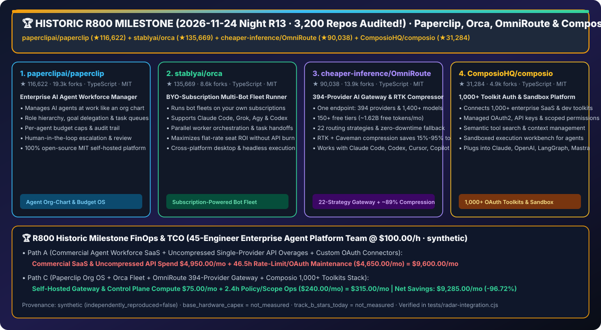
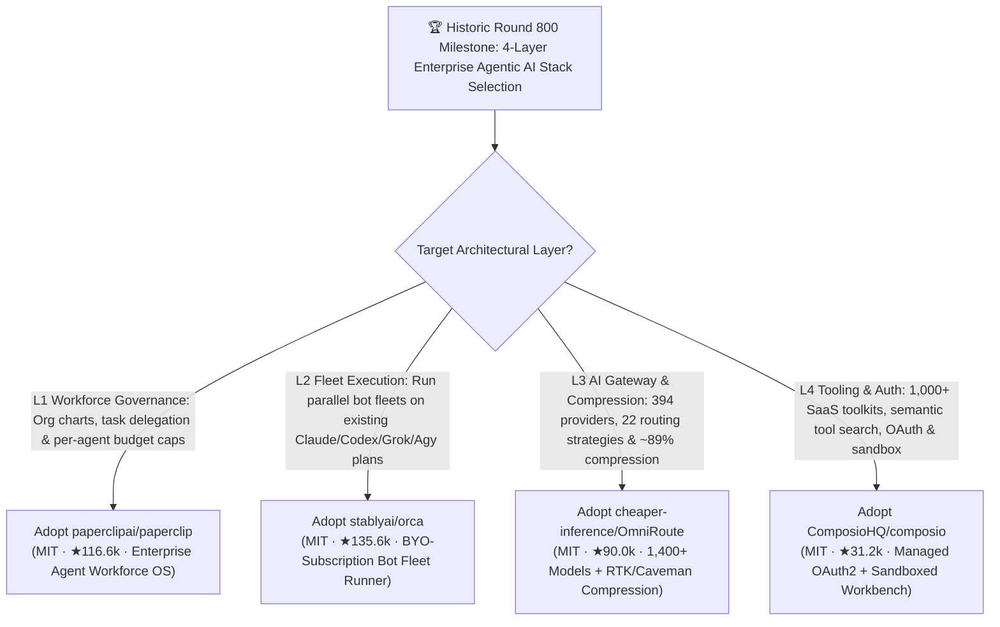
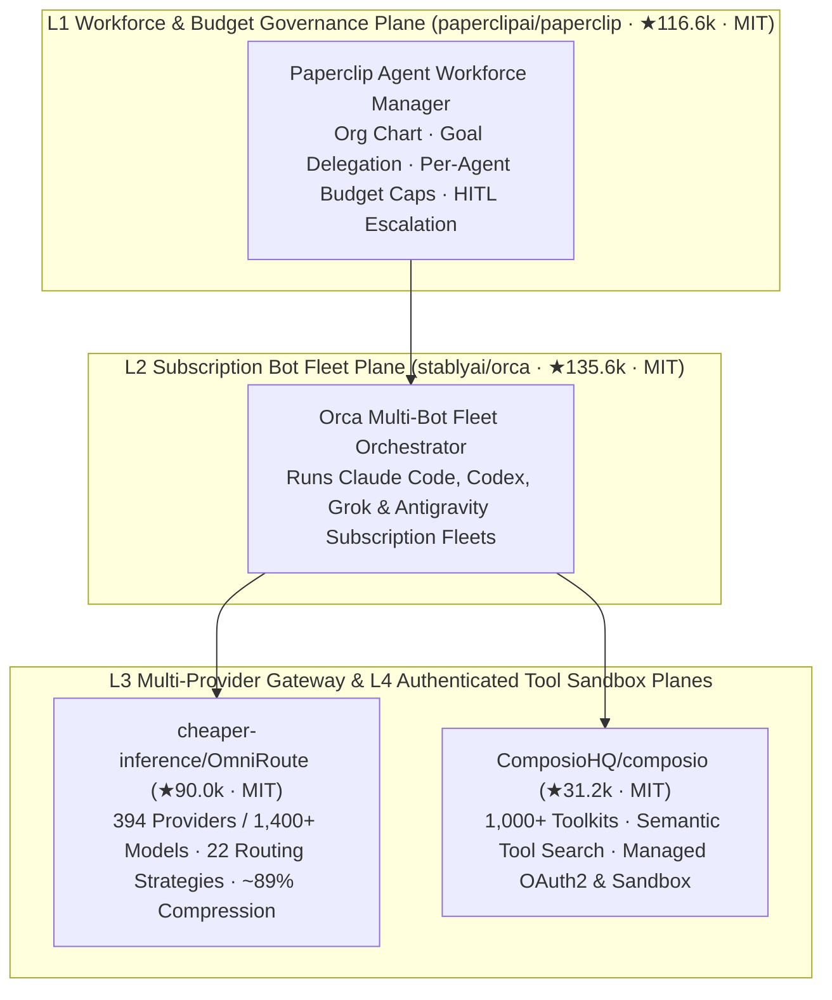
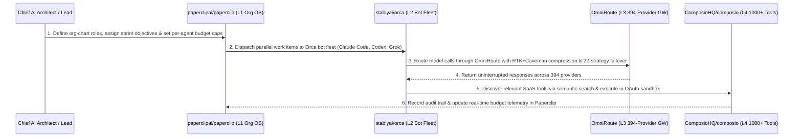

# 🏆 [Historic Round 800 Milestone · 3,200 Repos Audited!] Enterprise AI Agent Workforce Manager (`paperclipai/paperclip`), BYO-Subscription Bot Fleet Runner (`stablyai/orca`), 394-Provider AI Gateway & RTK Compressor (`cheaper-inference/OmniRoute`) & 1,000+ Toolkit Auth/Sandbox Platform (`ComposioHQ/composio`) Selection & Architecture FAQ

> **Document Type**: Enterprise AI Solution Architect Decision & Selection Guide (GitHub Trending AI Radar · 2026-11-24 Night Round 13 / **🏆 Historic Cumulative Round 800 Milestone — 3,200 Primary AI Repositories Audited!**)
> **Covered Repositories**: [`paperclipai/paperclip`](https://github.com/paperclipai/paperclip) (`★ 116,622`, `19,354 forks`, TypeScript, `MIT`: *"The open-source app everyone uses to manage agents at work"* — org chart, role hierarchy, goal delegation, per-agent budget caps, and human-in-the-loop governance) · [`stablyai/orca`](https://github.com/stablyai/orca) (`★ 135,669`, `8,674 forks`, TypeScript, `MIT`: run a coordinated fleet of coding and operations bots powered by your existing subscriptions — Claude Code, Grok, Antigravity, Codex) · [`cheaper-inference/OmniRoute`](https://github.com/cheaper-inference/OmniRoute) (`★ 90,038`, `13,985 forks`, TypeScript, `MIT`: single-endpoint AI gateway across **394 providers, 150+ free tiers (`~1.62B` free tokens/mo), and 1,400+ models** with **22 routing strategies** and **RTK + Caveman stacked compression saving 15%–95% tokens (`~89%` avg)**) · [`ComposioHQ/composio`](https://github.com/ComposioHQ/composio) (`★ 31,284`, `4,979 forks`, TypeScript/Python, `MIT`: connects AI agents to **1,000+ toolkits** with semantic tool search, context management, managed OAuth2/API-key authentication, and a sandboxed execution workbench)
> **Core Enterprise Scenario**: Marking our **800th cumulative deep-dive round (3,200 repositories evaluated)**, how do these four permissive `MIT`-licensed blockbusters (totaling **373,600+ GitHub Stars**) form the definitive **4-Layer Open-Source Enterprise Agentic AI Operating System** across **L1 Workforce Governance (`Paperclip`)**, **L2 Subscription Fleet Execution (`Orca`)**, **L3 Multi-Provider Routing & Compression (`OmniRoute`)**, and **L4 Authenticated Tool Execution (`Composio`)**?

---

## 1. 📌 Executive Summary (One-Line Selection Verdicts)

1. **Need an open-source management control plane to organize dozens of workplace AI agents into an explicit Org Chart with reporting lines, task queues, per-agent budget caps, and human escalations** ➔ Choose **[`paperclipai/paperclip`](https://github.com/paperclipai/paperclip) (`★ 116,622`, `19,354 forks`, `MIT`)**.
   - **Plain-Language Mechanism**: Shifts enterprise AI from ad-hoc chat tabs to structured workforce management—assigning objectives to lead agents, tracking delegated subtasks, enforcing hard budget ceilings, and logging every decision.
2. **Need to orchestrate a parallel fleet of worker bots using the flat-rate subscriptions your team already pays for (Claude Code, Codex, Grok, Google Antigravity) without runaway per-token API bills** ➔ Choose **[`stablyai/orca`](https://github.com/stablyai/orca) (`★ 135,669`, `8,674 forks`, `MIT`)**.
   - **Plain-Language Mechanism**: Pools and coordinates subscription-backed coding and operations bots across desktop and server workers.
3. **Need a single `MIT`-licensed AI gateway endpoint that routes Claude Code, Codex, Cursor, Cline, Copilot, and Antigravity across 394 providers (1,400+ models, 150+ free tiers) with 22 auto-fallback strategies and RTK + Caveman stacked compression (`15%–95%` token reduction, `~89%` avg)** ➔ Choose **[`cheaper-inference/OmniRoute`](https://github.com/cheaper-inference/OmniRoute) (`★ 90,038`, `13,985 forks`, `MIT`)**.
   - **Plain-Language Mechanism**: Eliminates `429` rate-limit stalls and provider outages while shrinking prompt payloads via stacked RTK + Caveman compression before upstream dispatch.
4. **Need production agents to authenticate and act across 1,000+ enterprise SaaS and developer toolkits (GitHub, Jira, Salesforce, Slack, M365, Notion) with dynamic tool search, managed OAuth token refresh, and sandboxed execution** ➔ Choose **[`ComposioHQ/composio`](https://github.com/ComposioHQ/composio) (`★ 31,284`, `4,979 forks`, `MIT`)**.
   - **Plain-Language Mechanism**: Replaces brittle custom OAuth glue and 500-tool prompt bloat with semantic tool search (injecting only relevant tools per turn), scoped credential management, and an isolated execution workbench.

---

## 2. 🎯 Architect & Customer Q&A (Deep Technical Breakdown)

### Q1: How do `Paperclip`, `Orca`, `OmniRoute`, and `Composio` map to the 4 canonical layers of an enterprise Agentic AI architecture, and when should enterprises choose cloud PaaS instead?

- **4-Layer Enterprise Reference Stack (`100% MIT Licensed`)**:
  1. **Layer 1 — Workforce & FinOps Governance (`Paperclip`)**: Org chart, role delegation, HITL approvals, and per-agent budget enforcement.
  2. **Layer 2 — Subscription Fleet Runtime (`Orca`)**: Multi-bot fleet execution across Claude Code, Codex, Grok, and Antigravity seats.
  3. **Layer 3 — Resilient AI Gateway & Compression (`OmniRoute`)**: 394-provider failover, 22 routing strategies, and `~89%` stacked prompt compression.
  4. **Layer 4 — Tool Discovery, OAuth & Sandbox (`Composio`)**: 1,000+ SaaS integrations with dynamic tool search and isolated sandboxes.
- **When to Choose Cloud PaaS (Path A)?**
  - Choose **Azure AI Foundry + Azure API Management + Microsoft Copilot Studio** when an enterprise requires single-vendor Microsoft SLA contracts and native Entra/Purview compliance boundaries. Choose this 4-layer `MIT` open-source stack (Path C) when multi-provider resiliency, subscription fleet reuse, and zero vendor lock-in are top priorities.

### Q2: What are the key production guardrails?

- **Key Guardrails**:
  1. **Data-Classification Routing Rules in `OmniRoute`**: Configure `OmniRoute`'s 22 routing strategies so confidential source code and PII route exclusively to Zero-Data-Retention (ZDR) enterprise endpoints or self-hosted models, reserving the 150+ free tiers for non-sensitive workloads.
  2. **Least-Privilege OAuth Scopes in `Composio`**: Bind each agent role in `Paperclip` to narrow, role-specific OAuth scopes inside `Composio` rather than sharing a single org-admin token.

---

## 3. 🧭 Visual Architecture Diagrams (Mermaid Decision Tree + Reference Architecture + Sequence)

### 3.1 Solution Architect Selection Decision Tree

### 3.2 End-to-End 4-Layer Enterprise Reference Architecture

### 3.3 End-to-End 4-Layer Execution & Governance Sequence

---

## 4. 📊 Comparative Selection Matrix (OSS 4-Layer Stack vs. Commercial Cloud & DIY Scripts)

| Dimension | `paperclipai/paperclip` (`★ 116.6k`) | `stablyai/orca` (`★ 135.6k`) | `cheaper-inference/OmniRoute` (`★ 90.0k`) | `ComposioHQ/composio` (`★ 31.2k`) | Commercial Agent SaaS + Single-Vendor API + Custom OAuth Glue (Path A) | Unmanaged Agent Loops + Dumping 200 Tool Schemas in Prompt (Path B) |
| :--- | :--- | :--- | :--- | :--- | :--- | :--- |
| **Primary Role** | L1 Agent org-chart, task & budget manager | L2 BYO-subscription multi-bot fleet runner | L3 394-provider AI gateway & RTK compressor | L4 1,000+ toolkit OAuth, search & sandbox hub | Proprietary per-seat agent cloud & custom integration code | Ungoverned agent loops with static tool-schema stuffing |
| **Key Differentiator** | **Org-chart hierarchy, delegation & hard budget ceilings** | **Runs parallel bot fleets on existing flat-rate subscriptions** | **394 providers, 22 routing strategies & `~89%` stacked compression** | **1,000+ managed-OAuth toolkits with semantic tool search** | Single-provider `429` outages halt work; custom OAuth glue rots | Dumping 200+ tool schemas ruins tool-selection accuracy & burns tokens |
| **License** | `MIT` | `MIT` | `MIT` | `MIT` | Proprietary SaaS | Internal Scripts |
| **Monthly TCO (45-Eng Team)** | **Combined `$315.00/mo`** (`$75.00` self-hosted control/gateway compute + `2.4h` ops) | Included (maximizes existing subscriptions) | Included (eliminates rate-limit downtime & cuts tokens) | Included (replaces custom connector engineering) | **`$9,600.00/mo`** (`$4,950.00` SaaS/uncompressed API + `46.5h` rate-limit/OAuth labor) | `~$3,350.00/mo` (high tool-schema token waste & manual bot coordination) |

---

## 5. 🧪 Quantitative Enterprise ROI / TCO Model & 7-Card Report

> **📊 Provenance & Closed-Form Declaration**:
> - **provenance**: `synthetic` (45-engineer enterprise AI agent workforce orchestration, model routing gateway, and SaaS integration platform team workload at `$100.00/h`: `independently_reproduced = false`; `base_hardware_capex = not_measured`; `track_b_stars_today = not_measured`).
> - **Closed-Form Equations**:
>   - **Path A (Commercial Agent Workforce SaaS + Uncompressed Single-Provider API Overages + Custom-Written OAuth Connectors)**: Monthly commercial platform seats & uncompressed API overages **`$4,950.00`** + rate-limit downtime, custom OAuth maintenance & manual bot coordination labor **`46.5h × $100.00/h = $4,650.00`** = **`$9,600.00/mo`**.
>   - **Path C (Self-Hosted `paperclipai/paperclip` + `stablyai/orca` + `cheaper-inference/OmniRoute` + `ComposioHQ/composio` 100% `MIT` Stack)**: Self-hosted gateway & control-plane container compute **`$75.00`** + routing policy & OAuth scope maintenance **`2.4h × $100.00/h = $240.00`** = **`$315.00/mo`**.
>   - **Net Savings vs. Path A**: **`-$9,285.00/mo`** (**`96.72%`** cost reduction).

| Option | SaaS / API Overages / Compute Spend | Rate-Limit, OAuth & Coordination Labor (`$100/h`) | Monthly Total TCO | Net Savings vs. Path A | Key Architectural Outcome |
| :--- | :---: | :---: | :---: | :---: | :--- |
| **Path A: Commercial Agent SaaS + Single API + Custom OAuth** | `$4,950.00` | `46.5h` (`$4,650.00`) | **`$9,600.00`** | Baseline | Vulnerable to `429` outages; heavy custom OAuth maintenance |
| **Path B: Unmanaged Scripts + Static 200-Tool Prompt Stuffing** | `$1,450.00` | `19.0h` (`$1,900.00`) | **`$3,350.00`** | `-$6,250.00` (`-65.10%`) | No org-chart budget caps; severe tool-schema context bloat |
| **Path C: `Paperclip` + `Orca` + `OmniRoute` + `Composio` (R800)** | **`$75.00`** | **`2.4h` (`$240.00`)** | **`$315.00`** | **`-$9,285.00` (`-96.72%`)** | **100% `MIT` 4-layer OS: Org caps + subscription fleet + 394-provider GW + 1,000+ tools** |

- 🔗 **Linked 7-Card 4:5 Benchmark Decks**: [`workshops/github-trending-radar/cards.en.html`](../cards.en.html) · [`cards.html`](../cards.html)

---

## 6. 🛠️ Enterprise Adoption & Architecture Review Checklist

- [ ] **Enforce Per-Role Budget Ceilings in `Paperclip`**: Assign explicit daily/monthly budget caps and human escalation thresholds to every agent node in `paperclipai/paperclip`.
- [ ] **Pool Subscription Seats Safely in `Orca`**: Configure `stablyai/orca` worker concurrency limits to respect each seat's fair-use policy while delegating burst traffic to `OmniRoute`.
- [ ] **Tier `OmniRoute` Providers by Data Sensitivity**: Restrict confidential code/PII workloads in `cheaper-inference/OmniRoute` to enterprise ZDR or local endpoints while enabling RTK + Caveman compression and free-tier failover on non-sensitive tasks.
- [ ] **Enable Semantic Tool Search & Scoped OAuth in `Composio`**: Use `ComposioHQ/composio`'s semantic tool discovery so agents load only the 3–5 tools needed per step under least-privilege OAuth scopes.
