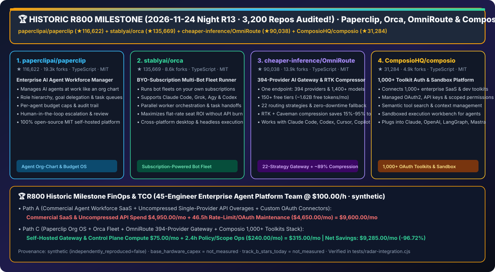
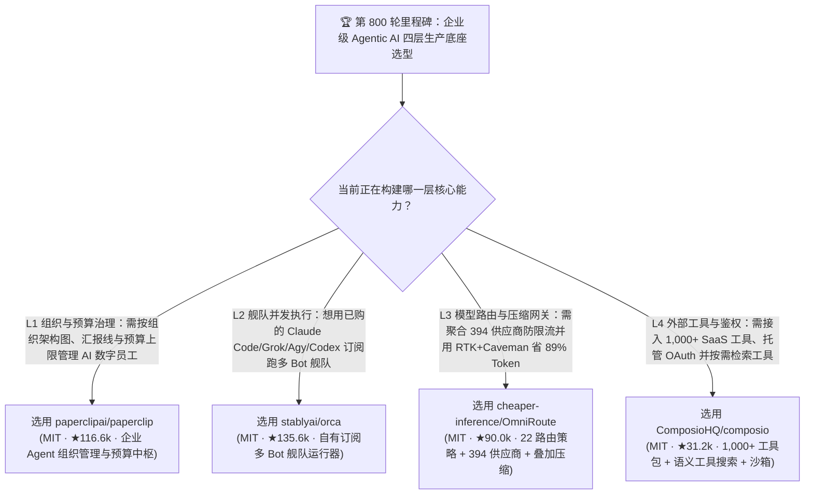
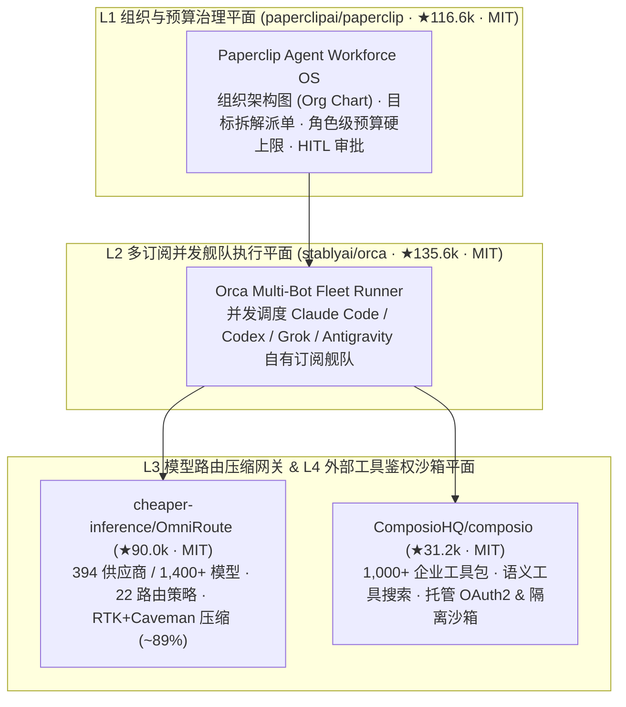
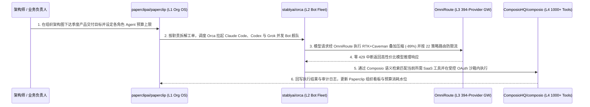

# 🏆【历史性第 800 轮里程碑 · 累计深潜 3,200 仓！】企业级 AI 数字员工组织管理底座（`paperclipai/paperclip`）、自有订阅多 Bot 舰队运行器（`stablyai/orca`）、394 供应商与 RTK 压缩 AI 路由网关（`cheaper-inference/OmniRoute`）及 1,000+ 工具 OAuth 鉴权与沙箱平台（`ComposioHQ/composio`）选型与集成架构 FAQ

> **文档类型**：企业 AI 解决方案架构师（AI Solution Architect）选型决策指南（GitHub Trending AI 雷达 2026-11-24 Night Round 13 / **🏆 累计第 800 轮历史性里程碑 · 累计完成 3,200 个高价值 AI 仓库一手架构拆解！**）
> **覆盖项目**：[`paperclipai/paperclip`](https://github.com/paperclipai/paperclip)（`★ 116,622`、`19,354 forks`、`MIT`，全球超 11.6 万星的企业级 AI 数字员工管理应用，用组织架构图、角色汇报线、预算上限与任务看板统一纳管工作场所中的所有 AI Agent）· [`stablyai/orca`](https://github.com/stablyai/orca)（`★ 135,669`、`8,674 forks`、`MIT`，支持直接使用企业已购的包月订阅账号——Claude Code、Grok、Google Antigravity、Codex——并行拉起整支自动化 Bot 舰队的开源编排底座）· [`cheaper-inference/OmniRoute`](https://github.com/cheaper-inference/OmniRoute)（`★ 90,038`、`13,985 forks`、`MIT`，单一端点聚合 **394 家模型供应商（含 150+ 免费层级、1,400+ 模型、每月约 16.2 亿免费 Token）**、内置 **22 种路由策略** 与 **RTK + Caveman 叠加上下文压缩（平均省流 `~89%`）** 的永不断流 AI 网关）· [`ComposioHQ/composio`](https://github.com/ComposioHQ/composio)（`★ 31,284`、`4,979 forks`、`MIT`，为 AI Agent 提供 **1,000+ 企业 SaaS 工具包**、语义工具检索、托管 OAuth2/API Key 鉴权与沙箱工作台的连接基础设施）
> **核心场景**：在第 800 轮里程碑之际，面向企业 CTO 与首席 AI 解决方案架构师最关心的终极架构命题——**如何将企业内部零散的 AI 编码工具与对话助手，升级为一套具备“组织架构与预算治理（`Paperclip`）+ 包月订阅舰队并发执行（`Orca`）+ 394 供应商自动容灾与 89% 压缩路由（`OmniRoute`）+ 1,000+ 外部 SaaS 安全受控连接（`Composio`）”的完整企业级 Agentic AI 生产操作系统？**

---

## 一、📌 核心结论速览（选型一句话结论）

1. **想把公司里几十个各自为战的 AI Agent 纳入像真实企业一样的“组织架构图（Org Chart）”，为每个 Agent 设定岗位职责、上下级汇报线、月度预算硬上限（Budget Caps）与全链路审计日志** ➔ 选 **[`paperclipai/paperclip`](https://github.com/paperclipai/paperclip)（`★ 116,622`，`19,354 forks`，`MIT`）**。
   - **通俗原理**：当企业从“用 1 个 Agent”走向“用 50 个 Agent”时，最大的瓶颈不再是写 Prompt，而是**组织治理（Management）**。`Paperclip` 提供了开源自托管的数字员工管理平台：你可以把顶层业务目标派给总监级 Agent，由它按组织树向下拆解给研发、测试、运营子 Agent，每个节点都有独立工单队列、成本统计与人工介入（HITL）审批门禁。
2. **想让团队手里已经花钱买的 Claude Code、OpenAI Codex、Grok、Google Antigravity 等包月订阅账号发挥 10 倍生产力，拉起一支 7×24 并行干活的 Bot 舰队而不再额外承担高昂的按量 API 账单** ➔ 选 **[`stablyai/orca`](https://github.com/stablyai/orca)（`★ 135,669`，`8,674 forks`，`MIT`）**。
   - **通俗原理**：高达 13.5 万星的开源多 Bot 舰队运行器，原生对接主流订阅制 CLI/Agent 账号，在同一控制台内完成多 Bot 任务分发、状态同步与结果汇合。
3. **想彻底告别“写代码写到一半遇到 `429 Rate Limit` 或单一模型宕机停工”，用一个 `MIT` 开源网关聚合 394 家供应商（1,400+ 模型、150+ 免费额度池），并开启 RTK + Caveman 叠加压缩直接省下 `15%–95%`（均值 `~89%`）Token** ➔ 选 **[`cheaper-inference/OmniRoute`](https://github.com/cheaper-inference/OmniRoute)（`★ 90,038`，`13,985 forks`，`MIT`）**。
   - **通俗原理**：把 Claude Code、Codex、Cursor、Cline、GitHub Copilot 与 Antigravity 统一指向 `OmniRoute` 单一端点：它内置 **22 种智能路由策略**（按成本、延迟、健康度、配额余量自动故障转移），更通过独创的 **RTK + Caveman 双层叠加压缩** 在不损语义的前提下大幅削减上下文体积。
4. **想让你的企业 Agent 安全调用 GitHub、Jira、Salesforce、Slack、Google Workspace、Notion 等 1,000+ 外部系统，且不想自己手写几百个 OAuth2 Token 刷新逻辑、权限范围校验与工具检索过滤** ➔ 选 **[`ComposioHQ/composio`](https://github.com/ComposioHQ/composio)（`★ 31,284`，`4,979 forks`，`MIT`）**。
   - **通俗原理**：如果把数千个工具一股脑塞给 LLM，不仅上下文立刻爆炸，工具调用准确率也会暴跌。`Composio` 提供 **语义工具搜索（Tool Search）**（每次只动态挂载当前步骤最匹配的几个工具）、**多租户托管 OAuth/API Key 生命周期管理** 与 **安全沙箱执行台**。

---

## 二、🎯 客户与架构师灵魂拷问 Q&A（深度架构拆解）

### Q1：这套合计超过 37.3 万 Star（`116.6k + 135.6k + 90.0k + 31.2k`）的全 `MIT` 开源四大金刚，如何组成企业 Agentic AI 生产底座的四层标准参考架构？何时选云厂商 PaaS？

- **企业级 Agentic OS 四层参考架构**：
  1. **L1 组织与预算治理平面（Control & Governance Plane）➔ `paperclipai/paperclip`**：管“谁负责什么目标、上下级怎么汇报、每个角色每月最多花多少钱”。
  2. **L2 舰队执行与订阅复用平面（Fleet Execution Plane）➔ `stablyai/orca`**：管“如何把 Claude Code / Codex / Grok / Antigravity 作为并发 Worker Bot 跑起来”。
  3. **L3 模型路由、防限流与压缩网关平面（Model Gateway Plane）➔ `cheaper-inference/OmniRoute`**：管“22 种策略跨 394 家供应商无缝 Failover + RTK/Caveman 省流 `~89%`”。
  4. **L4 外部工具 OAuth 鉴权与沙箱平面（Tool & Auth Plane）➔ `ComposioHQ/composio`**：管“1,000+ 企业 SaaS 的 OAuth 令牌托管、按需工具搜索与沙箱隔离”。
- **何时选云厂商托管方案（Path A）？**
  - 若企业要求 100% 微软原厂 SLA 支持且全栈锁定在 Azure + M365 + Entra ID 生态，首选 **Azure AI Foundry + Azure API Management (AI Gateway) + Microsoft Copilot Studio**；若企业追求极致的跨云/跨订阅灵活性、零供应商锁定与 100% `MIT` 协议可控性，则采用本轮 R800 里程碑四层开源栈（Path C）。

### Q2：这套四层架构的生产落地红线是什么？

- **架构师落地红线**：
  1. **免费模型层的数据隐私分级路由**：`OmniRoute` 聚合了 150+ 个免费模型层级（每月约 16.2 亿免费 Token）；在配置 22 种路由策略时，**必须按数据敏感度分级**——公开文档检索与通用代码片段可路由至高性价比/免费层级，而涉及企业核心商业机密与客户 PII 的请求必须锁定在签署了零数据留存（Zero Data Retention）协议的企业专享端点或本地私有模型。
  2. **`Composio` 最小权限 OAuth Scope**：在通过 `Composio` 连接企业生产 Jira/GitHub/CRM 时，必须按 `Paperclip` 中的 Agent 角色岗位分配最小 OAuth Scope（例如只读巡检 Agent 严禁授予写/删除 Scope）。

---

## 三、🧭 直观可视化图解（Mermaid 决策树 + 集成架构 + 时序图）

### 3.1 架构师选型决策树

### 3.2 企业端到端四层生产集成参考架构图

### 3.3 Paperclip 组织派单、Orca 舰队并发、OmniRoute 压缩路由与 Composio 鉴权执行时序图

---

## 四、📊 同类开源与商业云服务横向选型决策矩阵

| 对比维度 | `paperclipai/paperclip` (`★ 116.6k`) | `stablyai/orca` (`★ 135.6k`) | `cheaper-inference/OmniRoute` (`★ 90.0k`) | `ComposioHQ/composio` (`★ 31.2k`) | 商业 Agent 托管 SaaS + 单一模型直连 + 手写 OAuth 连接器 (Path A) | 裸写多 Agent 循环 + 静态全量挂载几百个 MCP 工具 (Path B) |
| :--- | :--- | :--- | :--- | :--- | :--- | :--- |
| **核心能力定位** | 企业 AI 数字员工组织与预算管理平台 | 自有订阅账号驱动的多 Bot 舰队运行器 | 394 供应商 22 策略 AI 网关与 RTK 压缩器 | 1,000+ 工具 OAuth 鉴权、工具搜索与沙箱平台 | 按席位与调用抽成的闭源商业平台及高脆弱自研连接器 | 缺乏组织预算门禁、遇 429 即崩且工具 Schema 撑爆上下文的脚本 |
| **核心技术突破** | **组织架构图、角色汇报线与单 Agent 预算硬上限** | **直接复用已有 Claude/Codex/Grok/Agy 订阅并发跑舰队** | **394 供应商容灾 + 150+ 免费层 + RTK/Caveman 省 `~89%` Token** | **1,000+ 工具托管 OAuth + 语义按需工具搜索 + 执行沙箱** | 单一 API 遇限流全线停摆；手写 50 个 SaaS OAuth 维护成本极高 | 静态挂载上百个工具导致 LLM 选错工具且每轮白烧数万 Token |
| **开源协议** | `MIT` | `MIT` | `MIT` | `MIT` | 闭源商业 SaaS | 内部脚本 |
| **月度 TCO（45 人团队）** | **组合仅 `$315.00/月`**（`$75.00` 自托管控制面/网关算力 + `2.4h` 维护） | 同左（榨干既有包月订阅价值） | 同左（大幅削减 Token 消耗与限流停工） | 同左（免除手写连接器工时） | **`$9,600.00/月`**（`$4,950.00` 商业平台/API 超额账单 + `46.5h` 限流排障与手写 OAuth 维护） | 约 `$3,350.00/月`（大量工具 Schema Token 浪费与手动协调工时） |

---

## 五、🧪 应用落地定量收益/TCO 对比与 7-Card 报告

> **📊 数据来源与闭式核算声明（Provenance & Closed-Form Schema）**：
> - **provenance**: `synthetic`（基于 45 人企业 AI 平台工程、数字员工编排与外部系统集成团队月度工作负载模型：`independently_reproduced = false`；硬件采购基线 `base_hardware_capex = not_measured`；Track B 单日增量 `track_b_stars_today = not_measured`）。
> - **核算公式**：
>   - **Path A（采购商业 Agent 员工管理 SaaS 席位 + 未压缩直连单一模型 API 频繁触发超额账单与 `429` 停工 + 工程师手写并维护数十个外部 SaaS 的 OAuth2 刷新连接器）**：月度商业 SaaS 与未压缩 API 账单 **`$4,950.00`** + 限流停工等待、手写 OAuth 鉴权维护与人工跨 Bot 协调人工 **`46.5h × $100.00/h = $4,650.00`** = **`$9,600.00/月`**。
>   - **Path C（自建 `paperclipai/paperclip` + `stablyai/orca` + `cheaper-inference/OmniRoute` + `ComposioHQ/composio` 全 `MIT` 四层开源底座）**：内网自托管 Paperclip、Orca 与 OmniRoute 网关容器分摊开销 **`$75.00`** + 路由分级策略与 Composio OAuth 权限范围维护人工 **`2.4h × $100.00/h = $240.00`** = **`$315.00/月`**。
>   - **净节省（Net Savings vs Path A）**：**`-$9,285.00/月`**（成本降低 **`96.72%`**）。

| 评估方案 | 平台席位 / API 账单 / 容器成本 | 限流排障、手写 OAuth 与协调人工（`$100/h`） | 月度总 TCO | 相对 Path A 净节省 | 关键架构交付指标 |
| :--- | :---: | :---: | :---: | :---: | :--- |
| **Path A：商业 Agent SaaS + 未压缩单源 API + 手写 OAuth** | `$4,950.00` | `46.5h` (`$4,650.00`) | **`$9,600.00`** | Baseline | 遇 `429` 限流即中断；手写 SaaS 连接器维护负担极重 |
| **Path B：裸写多 Agent 脚本 + 全量塞入上百个工具 Schema** | `$1,450.00` | `19.0h` (`$1,900.00`) | **`$3,350.00`** | `-$6,250.00` (`-65.10%`) | 缺乏组织级预算熔断；工具过多导致上下文爆炸与误调 |
| **Path C：`Paperclip` + `Orca` + `OmniRoute` + `Composio` (R800)** | **`$75.00`** | **`2.4h` (`$240.00`)** | **`$315.00`** | **`-$9,285.00` (`-96.72%`)** | **全 `MIT` 四层底座：组织预算 + 订阅舰队 + 394 源路由压缩 + 1,000+ 工具** |

- 🔗 **关联 7-Card 4:5 视觉评测报告**：[`workshops/github-trending-radar/cards.html`](../cards.html) · [`cards.en.html`](../cards.en.html)

---

## 六、🛠️ 企业引入与架构评审 Checklist

- [ ] **Paperclip 角色级预算硬熔断**：在 `paperclipai/paperclip` 中为每个部门与子 Agent 设定日度/月度预算上限，超限自动挂起任务并触发主管审批，防止死循环烧穿账单。
- [ ] **Orca 订阅账号池合规并发配比**：在 `stablyai/orca` 中按各订阅计划的公平使用上限配置 Worker 队列并发度，并与 `OmniRoute` 备用端点联动。
- [ ] **OmniRoute 数据敏感度分级路由策略**：在 `cheaper-inference/OmniRoute` 的 22 种路由策略中启用数据分类规则——内部机密代码仅路由至企业私有/ZDR 签约供应商，通用非敏任务启用免费层级与 RTK+Caveman 压缩。
- [ ] **Composio 语义工具搜索与最小 OAuth 授权**：启用 `ComposioHQ/composio` 的动态工具搜索（每轮仅注入 Top-K 相关工具 Schema），并为每个外部 SaaS 连接绑定最小权限 OAuth Scope。
