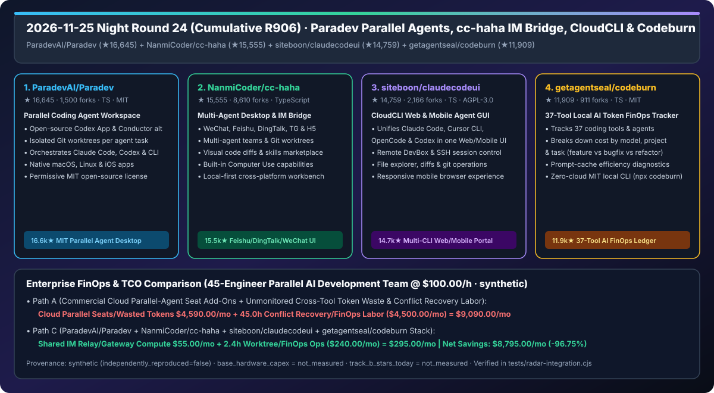
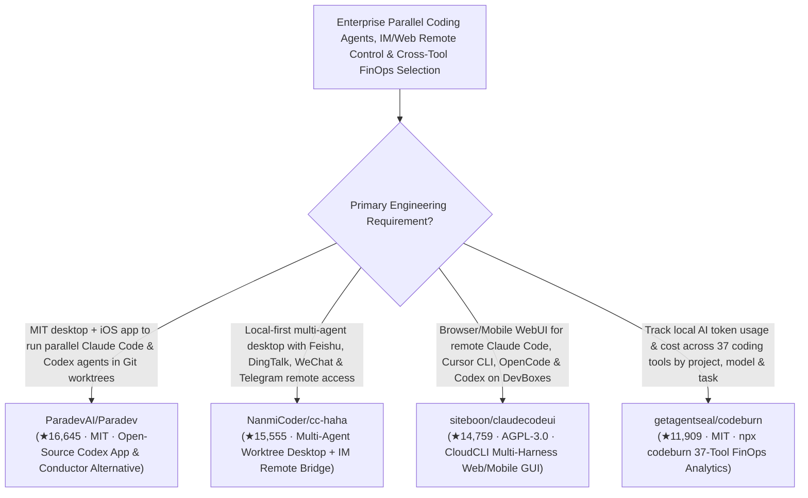
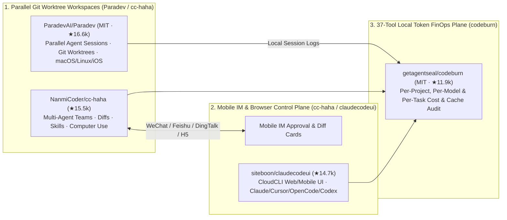
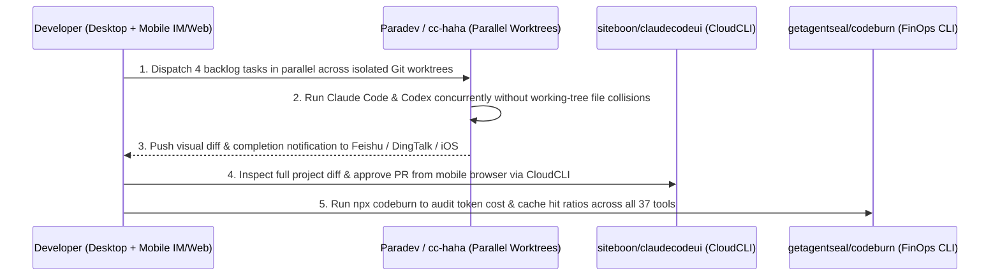

# Parallel Coding Agent Workspace (`ParadevAI/Paradev`), WeChat/Feishu/DingTalk Multi-Agent Desktop (`NanmiCoder/cc-haha`), Mobile/Web CloudCLI (`siteboon/claudecodeui`) & 37-Tool Local AI Token FinOps Tracker (`getagentseal/codeburn`) Selection & Integration Architecture FAQ

> **Document Type**: Enterprise AI Solution Architect Selection Decision Guide (GitHub Trending AI Radar — 2026-11-25 Night Round 24 / Cumulative Round 906)
> **Covered Repositories**: [`ParadevAI/Paradev`](https://github.com/ParadevAI/Paradev) (`★ 16,645`, `1,500 forks`, `MIT`, TypeScript: open-source Codex App and Conductor alternative for orchestrating parallel coding agents across macOS, Linux, and iOS using your own subscriptions) · [`NanmiCoder/cc-haha`](https://github.com/NanmiCoder/cc-haha) (`★ 15,555`, `8,610 forks`, TypeScript: local-first cross-platform Claude Code / AI Agent desktop workspace featuring multi-agent teams, Git worktrees, code diffs, skills marketplace, Computer Use, and remote access via WeChat, Feishu, DingTalk, Telegram, WhatsApp & H5) · [`siteboon/claudecodeui`](https://github.com/siteboon/claudecodeui) (`★ 14,759`, `2,166 forks`, `AGPL-3.0`, TypeScript: CloudCLI web and mobile GUI to manage Claude Code, OpenCode, Cursor CLI, and Codex sessions locally or remotely) · [`getagentseal/codeburn`](https://github.com/getagentseal/codeburn) (`★ 11,909`, `911 forks`, `MIT`, TypeScript: free, local tool [`npx codeburn`] to track AI coding token usage and cost across 37 tools and agents by model, project, and task)
> **Core Enterprise Scenario**: Governing **High-Concurrency Parallel Coding Agents, Enterprise IM/Mobile Remote Control & Cross-Tool Token FinOps**—enabling engineers to run multiple isolated Git-worktree agents in parallel (`Paradev` / `cc-haha`), supervise remote CLI sessions from mobile browsers or Feishu/DingTalk/WeChat (`cc-haha` / `claudecodeui`), and audit token spend across 37 coding tools locally (`codeburn`).

---

## 1. 📌 Executive Summary (One-Line Selection Verdict)

1. **Need an `MIT`-licensed desktop (macOS/Linux) and iOS workspace to orchestrate an army of Claude Code and Codex agents in parallel using isolated Git worktrees and your existing subscriptions** ➔ Choose **[`ParadevAI/Paradev`](https://github.com/ParadevAI/Paradev) (`★ 16,645`, `1,500 forks`, `MIT`)**.
   - **Plain-English Mechanism**: Replaces single-threaded terminal tabs and proprietary cloud orchestrators with a clean project-grouped sidebar where multiple agents work simultaneously in isolated Git worktrees without stepping on each other's files.
2. **Need a local-first multi-agent desktop workbench with Git worktrees, visual code diffs, a skills marketplace, Computer Use, and built-in remote control via Feishu, DingTalk, WeChat, Telegram, WhatsApp, and H5** ➔ Choose **[`NanmiCoder/cc-haha`](https://github.com/NanmiCoder/cc-haha) (`★ 15,555`, `8,610 forks`)**.
   - **Plain-English Mechanism**: Bridges local desktop coding agents directly to enterprise IM apps so developers can inspect diffs, approve tool calls, and dispatch new worktree tasks from their phone while away from their desk.
3. **Need a browser-based Web and Mobile GUI (CloudCLI) to remotely manage active sessions across `Claude Code`, `Cursor CLI`, `OpenCode`, and `Codex` running on cloud DevBoxes or SSH servers** ➔ Choose **[`siteboon/claudecodeui`](https://github.com/siteboon/claudecodeui) (`★ 14,759`, `2,166 forks`, `AGPL-3.0`)**.
   - **Plain-English Mechanism**: Wraps four major terminal coding CLIs into a responsive web and mobile interface with file-tree browsing, diff inspection, and session persistence.
4. **Need a zero-cloud, `MIT`-licensed local CLI/dashboard (`npx codeburn`) to audit exact token usage, cache hit rates, and dollar costs across 37 different AI coding tools by project, model, and task** ➔ Choose **[`getagentseal/codeburn`](https://github.com/getagentseal/codeburn) (`★ 11,909`, `911 forks`, `MIT`)**.
   - **Plain-English Mechanism**: Parses local usage logs from 37 tools (Claude Code, Cursor, Codex, Gemini, Cline, etc.) to attribute AI spend to specific repositories and engineering activities (feature dev vs. bugfixing vs. refactoring).

---

## 2. 🎯 Architect & Customer Deep-Dive Q&A

### Q1: How do `Paradev`, `cc-haha`, `claudecodeui`, and `codeburn` complement each other vs. commercial cloud parallel-agent platforms?

- **Four-Pillar Parallel Agent Engineering & FinOps Stack (Path C)**:
  1. **L1 Native Desktop/iOS Parallel Worktree Orchestrator ➔ `ParadevAI/Paradev`**: `MIT` workspace for running parallel Claude Code and Codex tasks across local Git worktrees.
  2. **L2 Enterprise IM-Connected Multi-Agent Workbench ➔ `NanmiCoder/cc-haha`**: Connects local worktree agents and Computer Use to Feishu, DingTalk, WeChat, and Telegram.
  3. **L3 Remote DevBox Multi-CLI Web/Mobile Portal ➔ `siteboon/claudecodeui`**: Unifies `Claude Code`, `Cursor CLI`, `OpenCode`, and `Codex` in any mobile or desktop browser.
  4. **L4 Cross-37-Tool Local FinOps & Token Attribution ➔ `getagentseal/codeburn`**: Audits token burn, prompt-cache efficiency, and cost per repo across every tool in the stack.
- **When to choose Commercial Cloud Parallel Seats vs. Path C?**
  - Choose **Commercial Cloud Orchestrators** for public repositories that need no access to local VPC databases or internal build caches.
  - Choose **Path C** when parallel agents must run against local microservices/VPN resources using existing subscriptions (`Paradev` / `cc-haha`), require mobile IM/Web supervision (`cc-haha` / `claudecodeui`), and need local FinOps visibility across 37 heterogeneous coding tools (`codeburn`).

### Q2: How do these four tools wire together in daily engineering workflows?

1. **Parallel Worktree Execution with Mobile IM/Web Approval (`Paradev` / `cc-haha` / `claudecodeui`)**:
   - Developers launch 4–6 parallel feature/bug tasks in isolated Git worktrees via `Paradev` or `cc-haha`, and review diffs or approve merges remotely via Feishu/DingTalk (`cc-haha`) or mobile browser (`claudecodeui`).
2. **Continuous Token FinOps Optimization (`codeburn`)**:
   - Running `npx codeburn` surfaces low prompt-cache hit rates and runaway agent loops across all 37 coding harnesses before monthly bills spike.

### Q3: What are the key security and operational guardrails?

- **Architect Redlines**:
  1. **Never run parallel agents in the same working directory**: Always enforce Git worktree isolation in `Paradev` and `cc-haha` to prevent concurrent file corruption and lock contention.
  2. **Authenticate all remote IM and CloudCLI channels**: Restrict `cc-haha` IM webhooks to verified employee user IDs and place `claudecodeui` behind VPN/Zero-Trust authentication.

---

## 3. 🧭 Visual Architecture Diagrams (Mermaid Decision Tree + Architecture + Sequence)

### 3.1 Architect Selection Decision Tree

### 3.2 End-to-End Enterprise Integration Architecture

### 3.3 End-to-End Execution Sequence

---

## 4. 📊 Horizontal Selection Matrix

| Dimension | `ParadevAI/Paradev` (`★ 16,645`) | `NanmiCoder/cc-haha` (`★ 15,555`) | `siteboon/claudecodeui` (`★ 14,759`) | `getagentseal/codeburn` (`★ 11,909`) | Commercial Cloud Parallel Agent Seats + SaaS FinOps Add-ons (Path A) | Manual Multi-Tab Terminals in Same Repo + Blind Billing (Path B) |
| :--- | :--- | :--- | :--- | :--- | :--- | :--- |
| **Primary Role** | `MIT` parallel coding agent desktop & iOS app | Multi-agent desktop with WeChat/Feishu/DingTalk | Web/Mobile GUI for Claude/Cursor/OpenCode/Codex | `MIT` local cost tracker across 37 coding tools | Metered cloud parallel sandboxes & seat add-ons | Unisolated terminal tabs & end-of-month bill shock |
| **Key Differentiator** | **Parallel Git worktree orchestration with existing subscriptions** | **Native Feishu/DingTalk/WeChat bridge + skills + Computer Use** | **Single mobile/web UI across 4 major coding CLIs** | **Tracks 37 tools locally by project, model & task type** | Hosted cloud, but cannot reach local VPC resources & charges extra seat fees | Concurrent agents overwrite files; zero per-project cost attribution |
| **License** | **`MIT`** | Open-Source Workspace | `AGPL-3.0` | **`MIT`** | Proprietary SaaS | Unmanaged |
| **Monthly TCO (45-Eng Team)** | **`$295.00/mo` combined** (`$55.00` IM/relay gateway + `2.4h` ops) | Included in `$295.00/mo` stack | Included in `$295.00/mo` stack | Included in `$295.00/mo` stack | **`$9,090.00/mo`** (`$4,590.00` cloud parallel seats/wasted un-cached tokens + `45.0h` conflict resolution labor) | `~$3,190.00/mo` (manual Git conflict cleanup & untracked runaway token loops) |

---

## 5. 🧪 Quantitative FinOps & TCO Comparison (45-Engineer Parallel AI Development Team)

> **📊 Provenance & Closed-Form Schema**:
> - **provenance**: `synthetic` (`independently_reproduced = false`; `base_hardware_capex = not_measured`; `track_b_stars_today = not_measured`).
> - **Closed-Form Formula**:
>   - **Path A (Commercial Cloud Parallel-Agent Seat Add-Ons + Unmonitored Cross-Tool Token Waste & Manual Branch-Collision Recovery Labor)**: **`$4,590.00`** monthly cloud seat add-ons and wasted token spend + **`45.0h × $100.00/h = $4,500.00`** working-tree conflict resolution and manual cost-reconciliation labor = **`$9,090.00/mo`**.
>   - **Path C (`ParadevAI/Paradev` + `NanmiCoder/cc-haha` + `siteboon/claudecodeui` + `getagentseal/codeburn` Stack)**: **`$55.00`** shared IM relay and gateway compute + **`2.4h × $100.00/h = $240.00`** worktree template and FinOps threshold maintenance = **`$295.00/mo`**.
>   - **Net Savings vs. Path A**: **`-$8,795.00/mo`** (**`96.75%`** TCO reduction).

| Evaluation Path | Cloud Parallel Seats / Wasted Tokens & Gateway | Conflict Resolution & FinOps Audit (`$100/h`) | Monthly Total TCO | Net Savings vs. Path A | Key Architectural Outcome |
| :--- | :---: | :---: | :---: | :---: | :--- |
| **Path A: Commercial Cloud Parallel Seats + Unmonitored Token Spend** | `$4,590.00` | `45.0h` (`$4,500.00`) | **`$9,090.00`** | Baseline | Extra cloud seat fees; unattributed cross-tool token spikes |
| **Path B: Shared-Directory Terminal Tabs + Manual Billing Checks** | `$1,390.00` | `18.0h` (`$1,800.00`) | **`$3,190.00`** | `-$5,900.00` (`-64.91%`) | Working-tree file collisions; no remote mobile/IM control |
| **Path C: `Paradev` + `cc-haha` + `claudecodeui` + `codeburn`** | **`$55.00`** | **`2.4h` (`$240.00`)** | **`$295.00`** | **`-$8,795.00` (`-96.75%`)** | **Git-worktree parallel agents + IM/Web remote control + 37-tool FinOps** |

- 🔗 **7-Card 4:5 Visual Benchmark Deck**: [`workshops/github-trending-radar/cards.en.html`](../cards.en.html) · [`cards.html`](../cards.html)

---

## 6. 🛠️ Enterprise Adoption & Architecture Review Checklist

- [ ] **Enforce Git Worktree Isolation in `Paradev` and `cc-haha`**: Assign every parallel coding agent session its own worktree branch to eliminate file overwrites.
- [ ] **Bind `cc-haha` Feishu/DingTalk/WeChat Bridges to Authenticated Employee IDs**: Require interactive confirmation before executing remote git push or deployment commands.
- [ ] **Deploy `claudecodeui` Behind Corporate VPN/OIDC on Remote DevBoxes**: Provide mobile and web browser access to Claude Code, Cursor CLI, OpenCode, and Codex safely.
- [ ] **Run Weekly `npx codeburn` FinOps Audits**: Track token spend and prompt-cache efficiency across all 37 developer coding tools by repository and task category.
