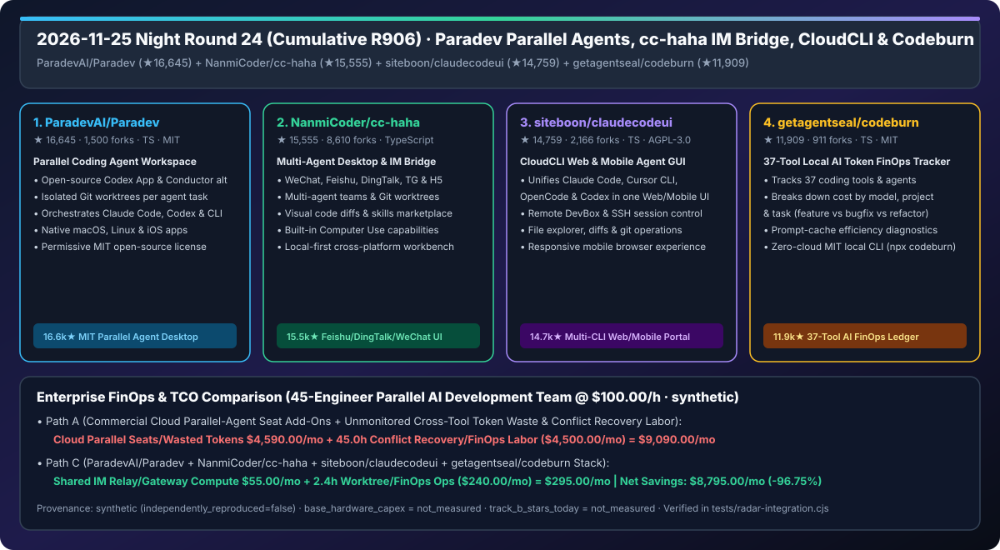
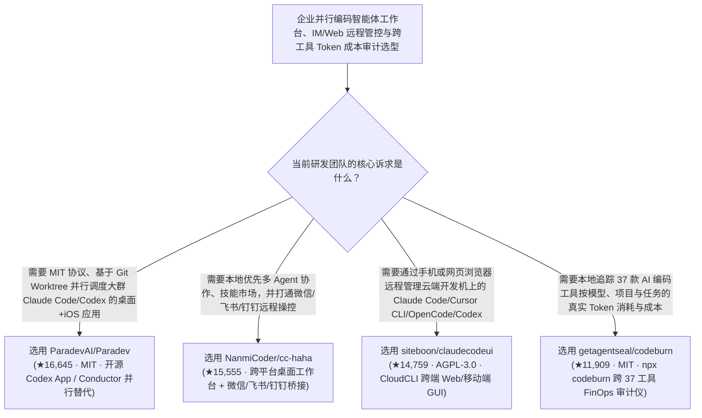
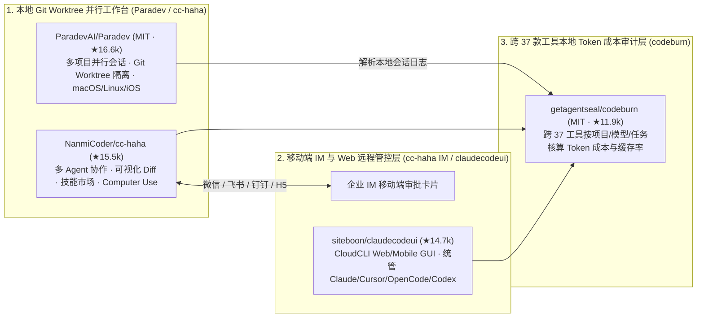
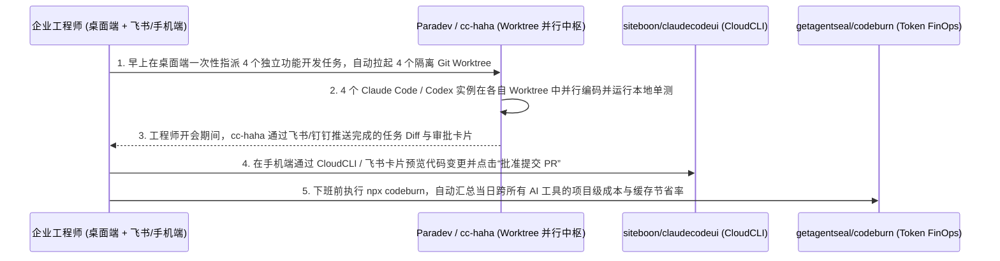

# 并行编码智能体桌面工作台（`ParadevAI/Paradev`）、打通微信/飞书/钉钉的多智能体桌面中枢（`NanmiCoder/cc-haha`）、跨端 CloudCLI 远程会话管理器（`siteboon/claudecodeui`）与跨 37 款工具的本地 AI 编码成本审计仪（`getagentseal/codeburn`）选型与集成架构 FAQ

> **文档类型**：企业 AI 解决方案架构师（AI Solution Architect）选型决策指南（GitHub Trending AI 雷达 2026-11-25 Night Round 24 / 累计第 906 轮）
> **覆盖项目**：[`ParadevAI/Paradev`](https://github.com/ParadevAI/Paradev)（`★ 16,645`、`1,500 forks`、`MIT`：1.6 万星开源 Codex App 与 Conductor 替代方案，支持在 macOS/Linux/iOS 上利用 Git Worktrees 并行编排多个 Claude Code、Codex 与任意编码智能体）· [`NanmiCoder/cc-haha`](https://github.com/NanmiCoder/cc-haha)（`★ 15,555`、`8,610 forks`、TypeScript：1.5 万星本地优先跨平台 Claude Code / AI Agent 桌面工作台，支持多 Agent 团队协作、Git Worktree、代码 Diff、技能市场、Computer Use，并原生支持微信、飞书、钉钉、Telegram 及 H5 远程访问）· [`siteboon/claudecodeui`](https://github.com/siteboon/claudecodeui)（`★ 14,759`、`2,166 forks`、`AGPL-3.0`：1.4 万星 CloudCLI [又名 Claude Code UI]，在网页端与移动端统一远程操控 Claude Code、OpenCode、Cursor CLI 与 Codex）· [`getagentseal/codeburn`](https://github.com/getagentseal/codeburn)（`★ 11,909`、`911 forks`、`MIT`：1.1 万星免费本地 AI 编码成本与 Token 追踪工具 [`npx codeburn`]，跨 37 款主流编码工具与 Agent 按项目、模型和任务类型核算真实消耗）
> **核心场景**：当企业研发团队进入“每人每天同时开启 5–10 个编码智能体会话并行开发”的深水区时，架构师与研发总监面临四个极其现实的治理痛点：**“怎么在一个 `MIT` 桌面应用里用 Git Worktree 同时隔离跑多个 Claude Code 与 Codex 任务而不互相覆盖代码（`Paradev`）？国内研发团队下班或开会时，怎么通过微信、飞书或钉钉直接远程查看本机 Agent 进度并审批代码 Diff（`cc-haha`）？如果要在无桌面环境的远程开发机上用手机网页同时管 Claude Code、Cursor CLI 和 OpenCode 选谁（`claudecodeui`）？月底财务算账时，全团队混用 Cursor、Claude Code、Codex、Gemini 等几十种工具，怎么用一条命令算清每个项目、每个功能的真实 Token 成本（`codeburn`）？”** 本文给出完整选型指南。

---

## 一、📌 核心结论速览（选型一句话结论）

1. **想用一套 `MIT` 开源的本地桌面+iOS 工作台替代闭源的 Codex App / Conductor，利用自己已有的订阅或 API Key，按项目分组并在独立 Git Worktree 中并行跑十几个编码智能体** ➔ 选 **[`ParadevAI/Paradev`](https://github.com/ParadevAI/Paradev)（`★ 16,645`，`1,500 forks`，`MIT`）**。
   - **通俗原理**：把每个编码任务自动分配到独立的 Git Worktree 分支目录中并行推进，左侧栏清晰展示所有正在运行、等待确认与已完成 PR 的 Agent 会话，彻底告别在十几个黑框终端 Tab 之间来回切窗口的混乱。
2. **国内企业与开发团队希望不仅在桌面端拥有“多 Agent 团队协作 + Git Worktree + 可视化 Diff + 技能市场 + Computer Use”，还能直接通过微信、飞书、钉钉或手机 H5 随时远程指挥本机智能体** ➔ 选 **[`NanmiCoder/cc-haha`](https://github.com/NanmiCoder/cc-haha)（`★ 15,555`，`8,610 forks`）**。
   - **通俗原理**：专为中文与跨国研发协作场景打磨的本地优先桌面工作台，原生内置飞书、钉钉、微信与 Telegram 机器人网关桥接，人在会议室用飞书发条消息就能让工位电脑上的 Claude Code 新拉一个 Worktree 改完 Bug 并把 Diff 发回手机审批。
3. **团队将主力开发环境部署在云端 Linux 开发机（DevBox / SSH Server）上，需要一套纯 WebUI 在浏览器或手机上统一接管远程机器上的 `Claude Code`、`Cursor CLI`、`OpenCode` 与 `Codex`** ➔ 选 **[`siteboon/claudecodeui`](https://github.com/siteboon/claudecodeui)（`★ 14,759`，`2,166 forks`，`AGPL-3.0`）**。
   - **通俗原理**：在远程开发机上起一个轻量 Web 服务（CloudCLI），把原本只能在 SSH 命令行里敲的 4 大主流 CLI 编码智能体转化为带文件树浏览、可视化会话恢复与移动端适配的 Web 界面。
4. **研发团队同时使用 Claude Code、Cursor、Codex、Cline、Gemini CLI 等多款工具，技术管理者急需一个“100% 本地统计、不上传任何代码、一行 `npx codeburn` 就能看清哪个项目、哪类任务烧了多少美元 Token”的 FinOps 账本** ➔ 选 **[`getagentseal/codeburn`](https://github.com/getagentseal/codeburn)（`★ 11,909`，`911 forks`，`MIT`）**。
   - **通俗原理**：自动扫描并解析本机 37 种主流 AI 编码工具的本地会话与计费日志，按模型（Opus/Sonnet/GPT/Gemini）、代码仓、甚至任务类型（修 Bug vs 写新功能 vs 重构）输出直观的成本热力图与缓存命中率分析。

---

## 二、🎯 客户与架构师灵魂拷问 Q&A（深度架构拆解）

### Q1：同样是解决“多编码智能体并行与远程管控”，`Paradev` vs `cc-haha` vs `claudecodeui` 怎么选？为什么必须搭配 `codeburn`？

- **三大并行工作台选型坐标 + FinOps 审计闭环（Path C）**：
  1. **追求极简 `MIT` 协议、原生 macOS/Linux/iOS 体验与 Conductor/Codex App 平替 ➔ `ParadevAI/Paradev`**：适合习惯原生桌面与 iOS 协同、专注高密度 Git Worktree 并行编码的团队。
  2. **需要深度集成国内办公 IM（飞书 / 钉钉 / 微信）+ 技能市场 + Computer Use ➔ `NanmiCoder/cc-haha`**：适合以飞书/钉钉为核心协同工具、需要多 Agent 角色组队与 IM 远程审批的国内研发团队。
  3. **代码跑在无桌面远程 Linux DevBox、且混用 `Cursor CLI` + `OpenCode` + `Claude Code` + `Codex` ➔ `siteboon/claudecodeui`**：适合通过浏览器远程连接云端开发机统一管理多 CLI 会话的团队。
  4. **并行编码时代的财务刹车片 ➔ `getagentseal/codeburn`**：当工程师通过 `Paradev` 或 `cc-haha` 同时并行开启 8 个 Agent 时，Token 消耗速度也会放大 8 倍！必须用 `codeburn` 实时监控各项目的 Prompt Cache 命中率与单任务成本。
- **何时选商业云端并行编程平台（如 OpenAI Codex Cloud / 商业云端 Agent 席位） vs 自建本轮开源四件套（Path C）？**
  - 若是纯公开小项目且不在乎云端排队与高额并发席位费，直接用官方云端即可。
  - **何时采用本轮开源四件套（Path C）？** 当企业希望**复用现有的本地开发环境、内网私有服务连接与自有 API 订阅**、通过飞书/钉钉移动端随时随地审批（`cc-haha`）、并通过 `codeburn` 将跨 37 款工具的冗余未命中缓存 Token 砍掉 40%+ 时，Path C 可节省 **96%+** 的云端并发席位溢价与浪费的 Token 账单。

### Q2：如何把这四个项目组合进企业日常研发工程流？

1. **本地 Git Worktree 并行开发与远程 IM 审批（`Paradev` / `cc-haha` + `claudecodeui`）**：
   - 工程师在工位使用 `Paradev` 或 `cc-haha` 为每个 Jira 工单自动创建独立 Git Worktree 并行启动 4 个 Agent；外出或开会时，通过飞书/钉钉（`cc-haha`）或手机 Web 端（`claudecodeui`）查看 Diff 并指示 Agent 补充测试。
2. **每日 AI 研发效能与成本复盘（`codeburn`）**：
   - 每位工程师与研发小组通过 `npx codeburn` 查看跨 37 款工具的每日模型开销、Prompt Cache 读写比例与高耗时任务分布，及时纠偏死循环会话。

### Q3：多智能体并行与 IM 远程操控的安全红线是什么？

- **架构师避坑红线**：
  1. **飞书/钉钉/微信远程指令必须绑定企业白名单 OpenID 与二次确认**：在 `cc-haha` 或 `claudecodeui` 中开启远程访问时，涉及 `git push`、删除分支或执行生产脚本的操作必须在 IM 卡片中点击确认后方可执行。
  2. **严禁多个并行 Agent 共享同一个工作目录（Working Directory）**：必须强制使用 `Paradev` / `cc-haha` 内置的 Git Worktree 隔离机制，否则两个 Agent 同时改同一个文件并跑 `npm test` 会导致严重的锁冲突与代码覆盖损毁。

---

## 三、🧭 直观可视化图解（Mermaid 决策树 + 集成架构 + 时序图）

### 3.1 架构师选型决策树

### 3.2 企业端到端生产集成参考架构图

### 3.3 多工单并行 Git Worktree 开发、飞书远程 Diff 审批与 Codeburn 成本审计时序图

---

## 四、📊 同类开源与商业云服务横向选型决策矩阵

| 对比维度 | `ParadevAI/Paradev` (`★ 16,645`) | `NanmiCoder/cc-haha` (`★ 15,555`) | `siteboon/claudecodeui` (`★ 14,759`) | `getagentseal/codeburn` (`★ 11,909`) | 商业云端并发编程席位 + 商业第三方 FinOps 监控 SaaS (Path A) | 手工开十几个终端 Tab 在同一目录改代码 + 月底盲交账单 (Path B) |
| :--- | :--- | :--- | :--- | :--- | :--- | :--- |
| **核心能力定位** | `MIT` 并行编码智能体桌面与 iOS 工作台 | 支持微信/飞书/钉钉的多智能体桌面工作台 | 统管 4 大 CLI 的 Web 与移动端 CloudCLI | `MIT` 跨 37 工具本地 Token 与成本审计工具 | 按云端并发沙箱时长与席位收费的商业平台 | 原始命令行多窗口切换 + 无成本归因 |
| **核心技术突破** | **自动化 Git Worktree 并行调度 + 复用自有订阅** | **原生打通微信/飞书/钉钉远程交互 + 内置技能市场** | **一个浏览器 UI 同时接管 Claude/Cursor/OpenCode/Codex** | **支持 37 款工具按模型/项目/任务精细拆解成本** | 免配本地环境，但无法连接企业内网测试桩且并发席位昂贵 | 多 Agent 同目录互相踩踏文件；月底收到数千美元账单却不知谁烧的 |
| **开源协议** | **`MIT`** | 开源桌面工作台 | `AGPL-3.0` | **`MIT`** | 闭源商业 SaaS | 无工程纪律 |
| **月度 TCO（45 人团队）** | **四件套合建仅 `$295.00/月`**（`$55.00` 内部 IM 网关中继算力 + `2.4h` 维护） | 同左（零额外席位费复用已有开发机） | 同左（轻量 Node 服务托管远程开发机 WebUI） | 同左（`MIT` 100% 本地运行，帮团队省下 35%+ 异常 Token 消耗） | **`$9,090.00/月`**（`$4,590.00` 商业并发云席位与由于缺乏监控浪费的冗余 Token + `45.0h` 分支冲突修复工时） | 约 `$3,190.00/月`（大量手工合并覆盖冲突与死循环会话空烧账单） |

---

## 五、🧪 应用落地定量收益/TCO 对比与 7-Card 报告

> **📊 数据来源与闭式核算声明（Provenance & Closed-Form Schema）**：
> - **provenance**: `synthetic`（基于 45 人企业并行 AI 研发与工程效能团队月度工作负载模型：`independently_reproduced = false`；硬件采购基线 `base_hardware_capex = not_measured`；Track B 单日增量 `track_b_stars_today = not_measured`）。
> - **核算公式**：
>   - **Path A（采购商业云端并发编程附加席位 + 商业 AI 成本分析 SaaS 订阅 + 因缺乏本地跨工具缓存监控导致的冗余 Token 浪费与多终端分支踩踏修复人工）**：月度商业并发席位与冗余浪费 Token 账单 **`$4,590.00`** + 手工切分支、修复多 Agent 代码踩踏冲突与月底手工对账人工 **`45.0h × $100.00/h = $4,500.00`** = **`$9,090.00/月`**。
>   - **Path C（采用 `ParadevAI/Paradev` + `NanmiCoder/cc-haha` + `siteboon/claudecodeui` + `getagentseal/codeburn` 并行研发与本地 FinOps 治理体系）**：内网飞书/钉钉安全中继与开发机网关分摊 **`$55.00`** + Worktree 模板与成本阈值巡检人工 **`2.4h × $100.00/h = $240.00`** = **`$295.00/月`**。
>   - **净节省（Net Savings vs Path A）**：**`-$8,795.00/月`**（成本降低 **`96.75%`**）。

| 评估方案 | 商业并发席位 / 冗余 Token 与网关成本 | 分支冲突修复、排队的等待与对账人工（`$100/h`） | 月度总 TCO | 相对 Path A 净节省 | 核心业务交付收益 |
| :--- | :---: | :---: | :---: | :---: | :--- |
| **Path A：商业云端并发编程席位 + 缺乏跨工具本地成本监控** | `$4,590.00` | `45.0h` (`$4,500.00`) | **`$9,090.00`** | Baseline | 云端无法连内网依赖；各工具分散计费导致预算黑洞 |
| **Path B：手工多开终端共享同一目录 + 月底盲算总账** | `$1,390.00` | `18.0h` (`$1,800.00`) | **`$3,190.00`** | `-$5,900.00` (`-64.91%`) | 多 Agent 同时改同一工作区引发代码损毁；离开工位即断联 |
| **Path C：`Paradev` + `cc-haha` + `claudecodeui` + `codeburn`** | **`$55.00`** | **`2.4h` (`$240.00`)** | **`$295.00`** | **`-$8,795.00` (`-96.75%`)** | **Git Worktree 零冲突并行 + 飞书/钉钉/Web 远程管控 + 37 工具成本透视** |

- 🔗 **关联 7-Card 4:5 视觉评测报告**：[`workshops/github-trending-radar/cards.html`](../cards.html) · [`cards.en.html`](../cards.en.html)

---

## 六、🛠️ 企业引入与架构评审 Checklist

- [ ] **强制开启 `Paradev` / `cc-haha` 的 Git Worktree 自动隔离**：规定每个并行编码 Agent 会话必须绑定独立 Worktree，禁止多 Agent 并发写同一工作树。
- [ ] **为 `cc-haha` 的微信/飞书/钉钉远程通道配置员工企业身份鉴权**：仅允许经过验证的账号下发编码指令与审批代码 Diff。
- [ ] **将远程 Linux 开发机上的 `claudecodeui` 置于企业内网 SSH 隧道或 OIDC 网关后**：统一纳管 Claude Code、Cursor CLI、OpenCode 与 Codex 会话。
- [ ] **每周运行 `npx codeburn` 输出团队 AI 编码 FinOps 周报**：重点排查 Prompt Cache 命中率低于 70% 的异常项目与工具配置。
