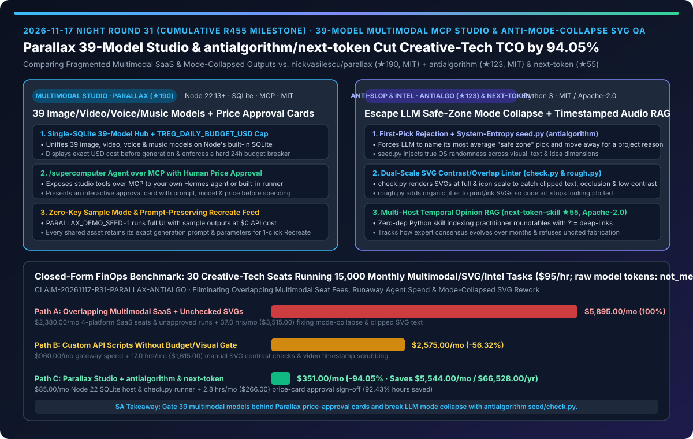
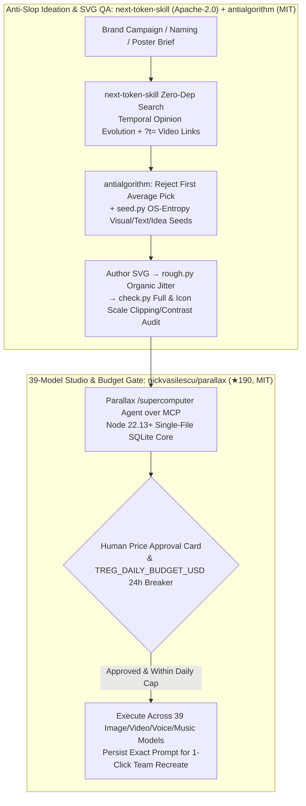

# 39-Model Multimodal MCP Studio (`nickvasilescu/parallax`) & Anti-Mode-Collapse SVG QA Suite (`mankidev/antialgorithm` & `next-token-skill`) Selection FAQ

> **Document Type**: Enterprise AI Solution Architect Practical Selection Guide (Standard 6-Section FAQ)  
> **Shift & Round**: 2026-11-17 Night Round 31 (Cumulative Round 455 Milestone)  
> **Tracked Repositories**:
> - **`nickvasilescu/parallax`** (`★ 190`, TypeScript / Node 22.13+ Built-In SQLite / 39 Image, Video, Voice & Music Models / MCP, `MIT`): Self-hosted multimodal creative studio unifying 39 models on a single SQLite file with upfront USD price display, a 24-hour spend circuit breaker (`TREG_DAILY_BUDGET_USD`), 1-click prompt `Recreate`, and `/supercomputer` MCP integration that gates agent generations behind human price-approval cards
> - **`mankidev/antialgorithm`** (`★ 123`, Python 3 / `seed.py`, `rough.py`, `check.py`, `MIT`) & **`next-token-tv/next-token-skill`** (`★ 55`, Zero-Dep Python 3, `Apache-2.0`): Creative steering skill that forces LLMs out of "safe-zone" mode collapse using OS-entropy seeds (`seed.py`), organic SVG jitter (`rough.py`), and dual-scale visual clipping/occlusion/contrast verification (`check.py`), paired with a zero-dependency podcast intelligence skill returning exact `?t=` video timestamps  
> **Audit Claim ID**: `CLAIM-20261117-R31-PARALLAX-ANTIALGO` (underlying per-generation upstream model API charges marked `not_measured`)

---

## 📌 1. Executive Summary

1. **Why Enterprise Creative-Tech and Product Marketing Teams Hit Two Bottlenecks: Fragmented Multimodal SaaS Seat Sprawl and LLM "Safe-Zone" Mode Collapse**:
   - **Bottleneck 1 — Overlapping 4-Tool SaaS Seats & Unbounded Agent Generation Spend**: Provisioning separate per-seat subscriptions across image, video, voice, and music SaaS platforms for a 30-person team costs `$2,000+/mo` and scatters prompt provenance across silos. Worse, giving an autonomous agent direct access to paid video/image generation APIs without per-call price approval cards and a hard 24-hour spend cap risks runaway overnight bills.
   - **Bottleneck 2 — "Safe-Zone" Mode Collapse & Broken SVG Layouts**: When asked for product names, copy, UI layouts, or SVG posters, unconstrained LLMs converge on the same narrow probability peak (producing six nearly identical generic posters across six runs) while frequently rendering SVG text that runs off the canvas edge, sits underneath shapes, or becomes illegible at icon scale.
   - **The Solution Architect Stack (`parallax` MIT + `antialgorithm` MIT + `next-token-skill` Apache-2.0)**: Deploy **`nickvasilescu/parallax`** (`MIT`) on Node 22.13+'s built-in SQLite to unify **39 image, video, voice, and music models** behind upfront price display, `TREG_DAILY_BUDGET_USD` daily circuit breakers, and `/supercomputer` MCP price-approval cards; pair it with **`mankidev/antialgorithm`** (`MIT`, `seed.py` OS randomness + first-pick rejection + `check.py` full/icon-scale SVG visual linter) and **`next-token-tv/next-token-skill`** (`Apache-2.0`, zero-dependency temporal practitioner insight retrieval with exact `?t=` video deep-links).
2. **Closed-Form FinOps Impact (30 Creative-Tech & Product Strategy Seats Running 15,000 Monthly Multimodal/SVG/Intel Tasks at `$95.00/hr`)**:
   - Transitioning from **Path A (Overlapping 4-Platform Multimodal SaaS Seats + Unchecked Mode-Collapsed SVG Outputs at `$5,895.00/mo`)** to **Path C (`Parallax` 39-Model Studio + `antialgorithm` & `next-token-skill` at `$351.00/mo`)** saves **`$5,544.00/mo` (`-94.05%`, or `$66,528.00/yr`)** while cutting mode-collapse re-rolls, SVG clipping repairs, and manual video scrubbing from `37.0 hrs/mo` to `2.8 hrs/mo` (**`92.43%` reduction**).

---

## 💬 2. Core Architectural Q&A (Q1–Q3)

### Q1: How does `nickvasilescu/parallax` unify 39 multimodal models on a single SQLite file while preventing runaway agent spend?
- **Plain-Language Definition**: `Parallax` (`MIT`) is a **self-hosted 39-model image, video, voice, and music web studio and MCP tool surface** that runs on Node.js 22.13+'s built-in SQLite with zero external database dependencies.
- **Three Enterprise Governance Features**:
  1. **Zero-Key Sample Mode (`PARALLAX_DEMO_SEED=1`) & Prompt-Preserving `Recreate` Feed**: Starts immediately with built-in sample outputs and 60+ seeded creations where every post preserves the exact prompt and parameters for one-click `Recreate` across the team;
  2. **Upfront Price Transparency & Hard 24-Hour Circuit Breaker (`TREG_DAILY_BUDGET_USD`)**: Shows the exact USD price of each generation across all 39 models before the user clicks Generate, and automatically halts paid requests once 24-hour spend reaches `TREG_DAILY_BUDGET_USD`;
  3. **`/supercomputer` Hermes MCP Engine with Human Price-Approval Cards**: Connects your own Hermes agent to Parallax's studio tools over MCP—whenever the agent wants to generate an image, video, voice, or music clip, **the user receives an interactive approval card displaying the prompt, model, and exact price before any spend occurs**.

### Q2: How does `mankidev/antialgorithm` break LLM creative mode collapse and catch broken SVGs, and how does `next-token-skill` ground product strategy?
- **`mankidev/antialgorithm` (Escaping the Safe-Zone Peak + Automated SVG Linting, `MIT`)**:
  1. **Explicit First-Pick Rejection**: Forces the LLM to state its first, most average "safe-zone" choice out loud and deliberately move away from it for a project-grounded reason;
  2. **Three Deterministic Python Scripts (`seed.py`, `rough.py`, `check.py`)**:
     - `seed.py`: Draws from OS randomness to roll visual seeds (making method, colors, layout, type, verb, scale, setting), text seeds (voice, way in, register), or idea seeds so identical prompts never collide on the same starting point;
     - `rough.py`: Perturbs straight lines, shapes, and even spacing on hand-made SVG styles (print, paint, stamps, ink) so code-drawn vectors stop looking mechanically plotted;
     - `check.py`: Rasterizes SVGs via `rsvg-convert` / `cairosvg` + Pillow/NumPy at **both full size and icon size** to automatically detect text running off an edge, text occluded underneath a shape, low contrast, or illegible font sizes.
- **`next-token-tv/next-token-skill` (Zero-Dependency Temporal Opinion RAG, `Apache-2.0`)**:
  - Uses pure standard-library Python 3 to search full multi-host roundtable transcripts, tracking how practitioner consensus and disagreements evolve month-over-month with clickable Bilibili/YouTube `?t=` timestamp deep-links and strict refusal when a topic was never discussed.

### Q3: How should an AI Solution Architect combine `Parallax`, `antialgorithm`, and `next-token-skill`?
- **Ideation & Vector QA Layer (`next-token-skill` + `antialgorithm`)**: Ground product positioning in timestamp-verified practitioner debates (`next-token-skill`), break creative mode collapse via `seed.py`, and gate all SVG graphics on `check.py` dual-scale checks.
- **Multimodal Production Layer (`Parallax` MCP)**: Route approved briefs to `Parallax`'s `/supercomputer` MCP studio under `TREG_DAILY_BUDGET_USD` caps and human price-approval cards.

---

## 🧭 3. End-to-End Reference Architecture & Decision Tree (Mermaid)

---

## 📊 4. Peer Solution Comparison Matrix (Decision Matrix)

| Evaluation Dimension | Option A: 4 Separate Multimodal SaaS Subscriptions + Raw LLM Prompts | Option B: Custom API Scripts Without Approval Cards or SVG QA | **Option C (Recommended): `Parallax` (MIT) + `antialgorithm` (MIT) + `next-token-skill`** |
| :--- | :--- | :--- | :--- |
| **Multimodal Consolidation & Team Prompt Reuse** | ❌ 4 separate per-seat subscriptions; prompts lost in private chats | ⚠️ CLI-only scripts with no visual library or 1-click `Recreate` | ✅ **39 image/video/voice/music models on 1 SQLite file with shared `Recreate` feed** |
| **Agent Spend Governance & Budget Circuit Breakers** | ❌ No unified daily spend cap across tools | ❌ Runaway agent loops silently drain API balances | ✅ **Upfront USD price display + `/supercomputer` MCP approval cards + `TREG_DAILY_BUDGET_USD` cap** |
| **Creative Diversity & Automated SVG Layout QA** | ❌ Severe mode collapse (6 runs look identical) + clipped SVG text | ❌ No automated full/icon-scale visual contrast & occlusion linter | ✅ **`seed.py` OS-entropy seeds + `check.py` dual-scale clipping/occlusion/contrast gate** |
| **Practitioner Insight Grounding** | ❌ Generic web search surfaces SEO fluff | ⚠️ Manual scrubbing through hour-long video episodes | ✅ **Zero-dep temporal opinion tracking with exact `?t=` video timestamp deep-links** |
| **Monthly TCO (30 Seats / 15,000 Tasks/Mo)** | **`$5,895.00 / mo`** (`$2,380` SaaS seats + `37.0 hrs` rework) | **`$2,575.00 / mo`** (`$960` gateway + `17.0 hrs` manual SVG/video fixes) | **`$351.00 / mo`** (**`-94.05%` savings**; `$85` SQLite host + `2.8 hrs` price-card sign-off) |

---

## 🧮 5. 7-Card Quantitative Insights & Closed-Form FinOps (`CLAIM-20261117-R31-PARALLAX-ANTIALGO`)

> **Scope & Boundary Declaration**: Evaluated for a 30-seat creative-technology and product marketing team executing **15,000 monthly multimodal generations, SVG visual QA checks, and practitioner intelligence queries** at a blended rate of `$95.00/hr` (underlying per-generation upstream model API charges marked `not_measured`):

$$\text{Total Monthly TCO} = \text{Multimodal Seat / Host Spend} + (\text{Mode-Collapse Rework, SVG QA \& Research Hours} \times \$95.00)$$

| Cost Component | Path A: 4 Overlapping Multimodal SaaS + Raw Prompts | Path B: Unchecked Custom API Scripts | **Path C: `Parallax` + `antialgorithm` + `next-token`** |
| :--- | :---: | :---: | :---: |
| **Monthly Multimodal SaaS Seats / Self-Hosted SQLite Studio** | `$2,380.00` | `$960.00` | **`$85.00`** |
| **Monthly Mode-Collapse Rework, SVG Fix & Scrubbing Hours** | `37.0 hrs` | `17.0 hrs` | **`2.8 hrs`** (**`92.43%` reduction**) |
| **Monthly Creative-Tech & Product Labor (`@ $95.00/hr`)** | `$3,515.00` | `$1,615.00` | **`$266.00`** |
| **Total Monthly TCO** | **`$5,895.00`** | **`$2,575.00`** (`-56.32%`) | **`$351.00`** (**`-94.05%`**) |
| **Net Savings vs. Path A (Monthly / Annual)** | Baseline (`$0.00`) | `$3,320.00 / mo` (`$39,840/yr`) | **`$5,544.00 / mo` (`$66,528.00 / yr`)** |

---

## ✅ 6. Solution Architect Action Checklist

- [ ] **Step 1 — Launch `Parallax` on Node 22.13+ & Set `TREG_DAILY_BUDGET_USD`**: Clone `nickvasilescu/parallax`, verify workflows at `$0` cost with `PARALLAX_DEMO_SEED=1 npm run dev`, and set `TREG_DAILY_BUDGET_USD` in `.env.local` before enabling live gateway tokens.
- [ ] **Step 2 — Connect `/supercomputer` to Your Hermes Agent with Price-Approval Cards**: Route agent-initiated image, video, voice, and music requests through Parallax's MCP tools so humans approve the exact USD cost card before execution.
- [ ] **Step 3 — Install `mankidev/antialgorithm` & Gate SVGs on `check.py`**: Clone `antialgorithm` into `~/.claude/skills/antialgorithm`, roll OS-random seeds via `seed.py`, and run `check.py` at full and icon scales to eliminate clipped or low-contrast text.
- [ ] **Step 4 — Add `next-token-skill` for Timestamp-Grounded Practitioner Research**: Link `next-token` into `~/.claude/skills/next-token` so strategy agents cite exact `?t=` video timestamps when summarizing practitioner debates.
