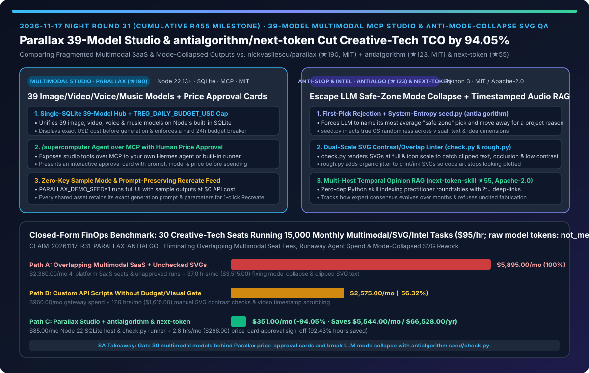
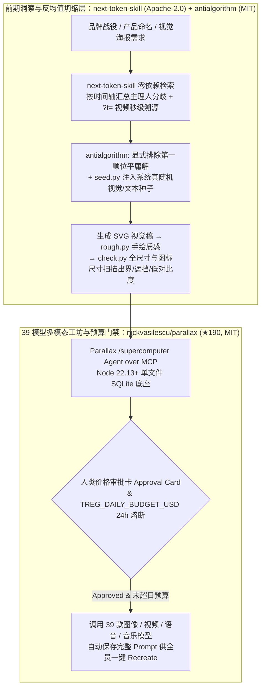

# 39 模型多模态预算门禁工作台（`nickvasilescu/parallax`）与反均值坍缩创意及时间戳知识检索套件（`mankidev/antialgorithm` & `next-token-skill`）架构选型 FAQ

> **文档类型**：AI Solution Architect（AI 解决方案架构师）实战选型指南（六段式标准 FAQ）  
> **所属轮次**：2026-11-17 Night Round 31（Cumulative Round 455 Milestone）  
> **追踪目标**：
> - **`nickvasilescu/parallax`**（`★ 190`，TypeScript / Node 22.13+ 内置单文件 SQLite / 39 个图像·视频·语音·音乐模型 / MCP，`MIT`）：一站式自托管多模态创作工作台，内置生成前精确美元报价、24 小时硬熔断预算上限（`TREG_DAILY_BUDGET_USD`）以及通过 MCP 连接 Hermes Agent 并弹出**人类价格审批卡（Approval Card）**的 `/supercomputer` 智能体
> - **`mankidev/antialgorithm`**（`★ 123`，Python 3 / `seed.py`, `rough.py`, `check.py`，`MIT`）& **`next-token-tv/next-token-skill`**（`★ 55`，Python 3 零依赖，`Apache-2.0`）：强制大模型显式说出并抛弃“最平庸第一顺位答案（Safe-Zone Pick）”且内置双尺度 SVG 遮挡/对比度/出界质检器（`check.py`）的反同质化技能，配合带精确视频秒级时间戳（`?t=`）与时间轴观点演进追踪的行业圆桌检索技能  
> **计量审计 ID**：`CLAIM-20261117-R31-PARALLAX-ANTIALGO`（底层图像/视频/音频生成模型按次原价账单标记为 `not_measured`）

---

## 📌 一、核心结论速览（Executive Summary）

1. **为什么企业品牌创意、产品市场与内容团队在落地多模态 AI 时，普遍面临“图像/视频/配音/音乐需要给全员买 4 套独立 SaaS 席位且 Agent 自动调用容易一晚刷爆信用卡”与“大模型生成的海报/文案/命名千篇一律（均值坍缩 Mode Collapse）且文字经常出界重叠”两大顽疾？**
   - **多模态工具碎片化与失控账单痛点**：生图买 Midjourney、视频买 Runway、配音买 ElevenLabs、音乐买 Suno——给 30 人的团队每人配齐 4 套订阅月费超过 `$2,000`，且历史生成的提示词散落各处无法一键复刻（Recreate）；更可怕的是，一旦把多模态生图/生视频 API 直接交给自主 Agent 循环调用，没有单次报价审批与每日硬上限极易产生天价账单。
   - **大模型“安全区均值坍缩（Safe-Zone Mode Collapse）”与 SVG 排版翻车痛点**：当不同团队用同一个大模型写产品命名、广告文案或生成 SVG 海报时，模型的概率分布会在最平庸的平均值附近形成高耸尖峰（跑 6 次给出 6 张几乎一模一样的紫色渐变平庸海报），且生成的 SVG 经常出现文字超出画布边缘、被图形遮挡或小字号下对比度过低无法辨认。
   - **架构师黄金组合（`parallax` MIT + `antialgorithm` MIT + `next-token-skill` Apache-2.0）**：部署单文件 SQLite 驱动的 **`nickvasilescu/parallax`** 统一收口 **39 个图像、视频、语音与音乐模型**（每次点击生成前明码标出精确价格，设 `TREG_DAILY_BUDGET_USD` 24 小时硬熔断，且 `/supercomputer` Agent 通过 MCP 请求生成时必须先由人类在价格审批卡上点同意）；在创意生成与调研层挂载 **`mankidev/antialgorithm`**（用系统真随机熵 `seed.py` 打破同质化、强制先排除最平庸第一反应，并用 `check.py` 在全尺寸与图标尺寸下自动拦截出界/遮挡/低对比度文字）与 **`next-token-tv/next-token-skill`**（零依赖按时间线追踪多主理人实战观点演进并直跳视频秒级时间戳）。
2. **闭式 FinOps 量化收益（30 个企业创意科技与产品市场席位、每月执行 15,000 次多模态素材生成、SVG 海报质检与行业观点检索，综合时薪 `$95.00/hr`）**：
   - 从 **Path A（4 套重叠多模态商业 SaaS 席位 + 无质检同质化 SVG 返工，`$5,895.00/月`）** 切换至 **Path C（`parallax` 39 模型单库工作台 + `antialgorithm` 质检与 `next-token-skill`，`$351.00/月`）**，每月净省 **`$5,544.00/月`（降幅 `-94.05%`，年化节省 `$66,528.00/年`）**，废片重抽、SVG 文字遮挡修补与长视频扒观点工时从 `37.0 小时/月` 降至 `2.8 小时/月`（节省 **`92.43%`**）。

---

## 💬 二、灵魂拷问 Q1–Q3（大白话拆解应用场景与架构本质）

### Q1：`nickvasilescu/parallax` 是如何只靠 Node.js 22 内置的一个 SQLite 文件，管好 39 个多模态大模型并防住 Agent 乱花钱的？
- **大白话本质定义**：`Parallax`（`MIT`）是一座**“零外部数据库依赖、集齐 39 款图片/视频/人声/音乐大模型、且自带 MCP 人类价格审批卡的企业自建多模态工坊”**。
- **三大架构设计亮点**：
  1. **极简架构与零成本演示模式（`PARALLAX_DEMO_SEED=1`）**：直接利用 Node.js 22.13+ 原生内置的 SQLite（单文件数据库，免装 Postgres/Redis），在不填任何 API Key 时自动返回内置示例素材并预置 60+ 条带完整原始 Prompt 的可复刻作品（点击 `Recreate` 即可一键继承参数）。
  2. **事前明码标价 + 24 小时硬熔断开关（`TREG_DAILY_BUDGET_USD`）**：通过统一网关接入 39 个生图、生视频、配音与配乐模型，每次按下 Generate 前界面都会算出并展示**本次生成的精确美元价格**；一旦过去 24 小时累计消耗达到 `TREG_DAILY_BUDGET_USD` 立即硬性熔断付费请求。
  3. **`/supercomputer` MCP 智能体 + 人类价格审批卡（Approval Card）**：支持挂接你自己的 Hermes Agent（通过 MCP 调用工坊能力）——当 Agent 规划好脚本想要生成一张图或一段视频时，**不会直接扣费执行，而是先在对话流里弹出一张带 Prompt、模型名称与精确价格的 Approval Card，必须人类点击确认后才真正发请求**！

### Q2：`mankidev/antialgorithm` 是怎样破解大模型“千人一面（均值坍缩）”的？`next-token-skill` 又如何做到零依赖精准溯源行业洞察？
- **`mankidev/antialgorithm`（破除 AI 廉价同质化与 SVG 自动视觉质检，`MIT`）**：
  1. **“先点名最平庸答案，再有据可依地逃离它”**：大模型在自由创作（命名、文案、海报、UI）时总是掉进概率最高的安全区（Safe Zone）。该技能强制模型先把脑子里第一个冒出来的“最平均、最俗套的方案”写出来示众，然后结合当前项目的真实特征往反方向推演；
  2. **三把 Python 确定性手术刀（`seed.py` / `rough.py` / `check.py`）**：
     - `seed.py`：调用操作系统真随机数生成器（OS Entropy）摇出视觉种子（制作工艺、配色、构图、字体、动词、尺度）、文本种子（语态、切入点、语域）或创意种子，确保两个人发完全相同的 Prompt 也会从截然不同的起点出发；
     - `rough.py`：针对版画、水彩、印章、水墨等手绘风格 SVG，对笔直的几何线条与等距排列施加微妙扰动，消除一眼假的代码机械感；
     - `check.py`：**双尺度视觉渲染质检器**——用 `rsvg-convert` / `cairosvg` + Pillow/NumPy 将生成的 SVG 同时渲染为**全尺寸图（Full Size）与微缩图标尺寸（Icon Size）**，自动扫描并列出所有**文字超出画布边缘、文字被图形压在底下、对比度过低或字号过小**的硬伤！
- **`next-token-tv/next-token-skill`（零依赖时间轴观点演进与秒级视频直跳检索，`Apache-2.0`）**：
  - 仅用 Python 3 标准库（0 第三方依赖），支持按时间轴纵向对比四位实战主理人对同一产品/技术（如 Personal Agent、AI 游戏、一人公司）在不同月份的评价演进与立场分歧，每条结论强制附上 B 站（`?t=2002`）/ YouTube 精确到秒的跳转链接，且节目未讨论过的话题绝不硬凑幻觉引用。

### Q3：企业 AI 架构师如何把这三者组合进品牌创意与产品策略流水线？
- **前期策略与反同质化构思层**：用 `next-token-skill` 检索最新一线产品实战观点与分歧，再用 `antialgorithm` 的 `seed.py` 生成差异化创意方向并经 `check.py` 校验矢量海报/UI 排版无遮挡；
- **多模态统一生产与成本管控层**：将确认后的多模态脚本交由 `Parallax` 的 `/supercomputer` Agent 通过 MCP 生成图像、视频、配音与配乐，由人类在价格审批卡上逐笔或按 `TREG_DAILY_BUDGET_USD` 日预算安全放行。

---

## 🧭 三、端到端集成参考架构与选型决策树（Mermaid）

---

## 📊 四、同赛道方案横向选型对比矩阵（Decision Matrix）

| 评估维度 | 方案 A：采购 4 套独立多模态 SaaS 席位 + 裸 Prompt 生成海报/文案 | 方案 B：自写多模型 API 脚本（无价格审批卡与 SVG 质检） | **方案 C（推荐）：`Parallax` (MIT) + `antialgorithm` (MIT) + `next-token-skill`** |
| :--- | :--- | :--- | :--- |
| **多模态模型覆盖与团队资产复用** | ❌ 图片/视频/语音/音乐分散在 4 个网站，按人头重复买月卡 | ⚠️ 仅有命令行接口，非技术人员无法预览或一键复刻历史参数 | ✅ **单 SQLite 文件整合 39 个模型，内置社区流一键 `Recreate` 与零 Key 演示模式** |
| **Agent 多模态调用成本门禁** | ❌ 无统一日预算熔断，容易超支 | ❌ Agent 循环报错重试时会在后台静默烧光 API 余额 | ✅ **生成前明码标价 + `/supercomputer` MCP 人类价格审批卡 + `TREG_DAILY_BUDGET_USD` 硬熔断** |
| **创意去同质化与 SVG 排版防翻车** | ❌ 陷入 Safe-Zone 均值坍缩，6 次生成 6 张雷同图，文字常出界重叠 | ❌ 无自动视觉渲染对比度/遮挡检测脚本 | ✅ **`seed.py` 真随机破除均值坍缩 + `check.py` 全尺寸/图标双尺度自动揪出文字出界与低对比度** |
| **行业实战情报溯源与防幻觉** | ❌ 通用网搜容易引用营销软文 | ⚠️ 需人工拖动 1 小时播客进度条找原话 | ✅ **零依赖检索跨期观点演进与分歧，强制附 `?t=` 秒级视频直跳链接** |
| **月度总拥有成本（TCO，30 席位 / 1.5 万次任务）** | **`$5,895.00 / 月`**（含 `$2,380` 多平台席位 + `37.0h` 废稿返工） | **`$2,575.00 / 月`**（含 `$960` 网关费 + `17.0h` 手工修图与查资料） | **`$351.00 / 月`**（**净省 `-94.05%`**，仅 `$85` 单机 SQLite 宿主 + `2.8h` 价格卡签批） |

---

## 🧮 五、7-Card 定量洞察与闭式 FinOps 核算（`CLAIM-20261117-R31-PARALLAX-ANTIALGO`）

> **核算范围与边界声明**：面向 30 名创意科技、品牌设计与产品策略人员，每月执行 **15,000 次多模态（图像/视频/语音/音乐）合成、SVG 视觉质检与实战情报检索**（综合时薪 `$95.00/hr`；底层上游模型按次生成原价部分标记为 `not_measured`）：

$$\text{Total Monthly TCO} = \text{Multimodal Seat / Host Spend} + (\text{Mode-Collapse Rework, SVG QA \& Research Hours} \times \$95.00)$$

| 成本构成项 | Path A：4 套独立多模态 SaaS 席位 + 裸生成 | Path B：自写无门禁 API 脚本 | **Path C：`Parallax` + `antialgorithm` + `next-token`** |
| :--- | :---: | :---: | :---: |
| **月度多平台 SaaS 固定席位费 / 自托管 SQLite 宿主开销** | `$2,380.00` | `$960.00` | **`$85.00`** |
| **月度同质化废稿重做、SVG 文字遮挡修补与扒播客工时** | `37.0 hrs` | `17.0 hrs` | **`2.8 hrs`**（直降 **`92.43%`**） |
| **月度创意与产品工程师人工成本（`@ $95.00/hr`）** | `$3,515.00` | `$1,615.00` | **`$266.00`** |
| **月度总拥有成本（Monthly TCO）** | **`$5,895.00`** | **`$2,575.00`**（`-56.32%`） | **`$351.00`**（**`-94.05%`**） |
| **相对 Path A 净节省（月度 / 年化）** | 基线（`$0.00`） | `$3,320.00 / 月`（`$39,840/年`） | **`$5,544.00 / 月`（`$66,528.00 / 年`）** |

---

## ✅ 六、AI 解决方案架构师实战上手 Checklist（SA Action Checklist）

- [ ] **Step 1 — 部署 `Parallax`（Node 22.13+）并设置 `TREG_DAILY_BUDGET_USD` 硬上限**：克隆 `nickvasilescu/parallax`，先用 `PARALLAX_DEMO_SEED=1 npm run dev` 零成本跑通 39 模型工作台与 `Recreate` 模板库，生产环境配置 `.env.local` 中的 `TREG_DAILY_BUDGET_USD` 24 小时预算熔断。
- [ ] **Step 2 — 将 `/supercomputer` 切换至 Hermes MCP 引擎并启用价格审批卡**：让团队 Agent 通过 MCP 调用 Parallax 工具链，强制所有付费多模态生成先弹出带精确报价的 Approval Card 经人工确认。
- [ ] **Step 3 — 安装 `mankidev/antialgorithm` 并把 `check.py` 设为 SVG 交付硬门禁**：克隆至 `~/.claude/skills/antialgorithm`，所有创意任务先运行 `seed.py` 注入真随机种子，交付 SVG 前必须跑通 `check.py` 双尺度（全尺寸+图标尺寸）零出界、零遮挡、高对比度校验。
- [ ] **Step 4 — 挂载 `next-token-skill` 赋能产品策略调研**：将 `next-token` 链接至 `~/.claude/skills/next-token`，在做产品选型与行业复盘时自动调取带 `?t=` 视频秒级时间戳的一线主理人多视角观点。
