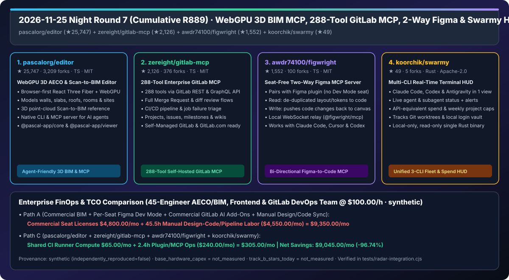
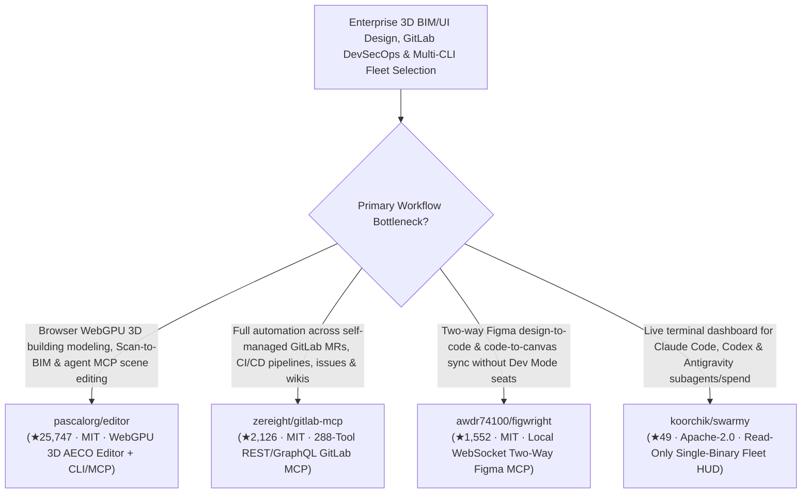
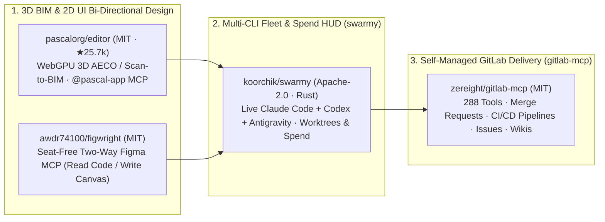
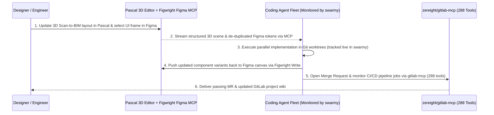

# Browser WebGPU 3D AECO/Scan-to-BIM Editor (`pascalorg/editor`), 288-Tool Enterprise GitLab MCP (`zereight/gitlab-mcp`), Seat-Free Two-Way Figma MCP (`awdr74100/figwright`) & Real-Time Multi-CLI Terminal Analytics (`koorchik/swarmy`) Selection & Integration Architecture FAQ

> **Document Type**: Enterprise AI Solution Architect Selection Decision Guide (GitHub Trending AI Radar — 2026-11-25 Night Round 7 / Cumulative Round 889)
> **Covered Repositories**: [`pascalorg/editor`](https://github.com/pascalorg/editor) (`★ 25,747`, `3,209 forks`, `MIT`: browser-first, local-first 3D architecture and **Scan-to-BIM** software for AECO built with React Three Fiber and WebGPU [`@pascal-app/core`, `@pascal-app/viewer`], featuring native CLI and MCP server integration so AI agents can read, model, validate, and save sites, levels, walls, slabs, roofs, openings, rooms, and furniture) · [`zereight/gitlab-mcp`](https://github.com/zereight/gitlab-mcp) (`★ 2,126`, `376 forks`, `MIT`: comprehensive GitLab MCP Server [`@zereight/mcp-gitlab`] exposing **288 tools** across projects, merge requests, issues, CI/CD pipelines, and wikis via GitLab REST/GraphQL APIs) · [`awdr74100/figwright`](https://github.com/awdr74100/figwright) (`★ 1,552`, `100 forks`, `MIT`: free, two-way Figma MCP server [`@figwright/mcp`] paired with a local WebSocket Figma plugin—requiring no paid Figma Dev Mode seat—to both read de-duplicated design context into framework-aware code and write generated code back onto the Figma canvas) · [`koorchik/swarmy`](https://github.com/koorchik/swarmy) (`★ 49`, `5 forks`, `MIT OR Apache-2.0`: single-binary, local-only, read-only Rust terminal analytics dashboard uniting Claude Code, OpenAI Codex, and Google Antigravity on one screen with live subagent trees, API-equivalent spend, weekly project limits, worktrees, and login vault)
> **Core Enterprise Scenario**: Connecting **3D AECO/BIM spatial modeling and two-way 2D Figma UI design directly into self-managed GitLab CI/CD delivery pipelines while monitoring multi-vendor coding agent fleets in real time**.

---

## 1. 📌 Executive Summary (One-Line Selection Verdict)

1. **Need browser-native WebGPU 3D building modeling and Scan-to-BIM where AI agents can read, edit, and validate architectural scenes via MCP** ➔ Choose **[`pascalorg/editor`](https://github.com/pascalorg/editor) (`★ 25,747`, `3,209 forks`, `MIT`)**.
   - **Plain-English Mechanism**: Runs locally in the browser on WebGPU or via CLI, allowing teams to import 3D point-cloud scans as reference layers and let MCP-connected agents model editable walls, slabs, roofs, openings, and rooms with automated validation.
2. **Need full-lifecycle DevSecOps automation on Self-Managed GitLab or GitLab.com covering Merge Requests, CI/CD pipelines, issues, and wikis** ➔ Choose **[`zereight/gitlab-mcp`](https://github.com/zereight/gitlab-mcp) (`★ 2,126`, `376 forks`, `MIT`)**.
   - **Plain-English Mechanism**: Provides **288 production-tested tools** (`@zereight/mcp-gitlab`) over GitLab's REST and GraphQL APIs, verified by CodeQL and OpenSSF Scorecard checks.
3. **Need two-way synchronization between Figma canvases and production frontend code without buying expensive per-developer Figma Dev Mode seats** ➔ Choose **[`awdr74100/figwright`](https://github.com/awdr74100/figwright) (`★ 1,552`, `100 forks`, `MIT`)**.
   - **Plain-English Mechanism**: Pairs `@figwright/mcp` with a lightweight Figma plugin over a local WebSocket relay—reading de-duplicated layout/typography/variable tokens into code AND pushing code-side component updates back onto the Figma canvas.
4. **Need a single-binary terminal dashboard to watch every live agent and subagent across Claude Code, OpenAI Codex, and Google Antigravity along with API-equivalent spend and worktrees** ➔ Choose **[`koorchik/swarmy`](https://github.com/koorchik/swarmy) (`★ 49`, `5 forks`, `MIT OR Apache-2.0`)**.
   - **Plain-English Mechanism**: Runs 100% locally and read-only as a static Rust binary across Linux, macOS, Windows, and Raspberry Pi, highlighting blocked subagents awaiting human input and tracking weekly project budgets.

---

## 2. 🎯 Architect & Customer Deep-Dive Q&A

### Q1: How does this open-source design-to-delivery stack compare against commercial enterprise suites (e.g., Autodesk Cloud + Figma Dev Mode Enterprise + GitLab Duo Enterprise)?

- **Four-Stage Open-Source Workflow (Path C)**:
  1. **3D Spatial & Scan-to-BIM Authoring ➔ `pascalorg/editor`**: Browser WebGPU 3D building editor + agent MCP scene manipulation.
  2. **Bi-Directional 2D UI Design-to-Code ➔ `awdr74100/figwright`**: Seat-free two-way Figma canvas read/write over local WebSocket.
  3. **Self-Managed GitLab DevSecOps Automation ➔ `zereight/gitlab-mcp`**: 288 tools for MRs, CI/CD job logs, issues, and wikis.
  4. **Multi-CLI Fleet & Spend Observability ➔ `koorchik/swarmy`**: Unified terminal HUD across Claude Code, Codex, and Antigravity.
- **When to choose Commercial Suites vs. Path C?**
  - Choose commercial vendor add-ons if your organization is locked into proprietary desktop CAD formats and already pays for enterprise-wide Figma Dev Mode and GitLab Duo seats.
  - Choose **Path C** when eliminating per-seat Figma Dev Mode fees, requiring two-way code-to-Figma writeback, building WebGPU 3D digital-twin/AECO apps, or orchestrating multi-vendor coding CLIs against self-hosted GitLab.

### Q2: How do these four tools wire together in production?

1. **Bi-Directional 3D & 2D Design Plane (`pascalorg/editor` + `awdr74100/figwright`)**:
   - Spatial layouts are modeled and validated via `Pascal Editor` MCP while UI component specs are synced bi-directionally between Figma and React/Vue via `Figwright`.
2. **Multi-CLI Execution & Budget Tracking (`koorchik/swarmy`)**:
   - Engineers run parallel subagents across isolated Git worktrees while `swarmy` tracks live status, human-input prompts, and weekly spend caps.
3. **Automated GitLab Merge Request & CI Loop (`zereight/gitlab-mcp`)**:
   - Agents open MRs, inspect failing GitLab CI jobs, push fixes, and update project documentation via `@zereight/mcp-gitlab`'s 288 tools.

### Q3: What are the critical security guardrails?

- **Architect Redlines**:
  1. **Bind `figwright` WebSocket relay strictly to `127.0.0.1`**: Never expose the local Figma plugin relay socket to external network interfaces.
  2. **Enforce GitLab Protected Branch rules**: Scope `zereight/gitlab-mcp` tokens so agents can open MRs and comment on diffs but cannot force-push to protected production branches.

---

## 3. 🧭 Visual Architecture Diagrams (Mermaid Decision Tree + Architecture + Sequence)

### 3.1 Architect Selection Decision Tree

### 3.2 End-to-End Enterprise Integration Architecture

### 3.3 End-to-End Execution Sequence

---

## 4. 📊 Horizontal Selection Matrix

| Dimension | `pascalorg/editor` (`★ 25,747`) | `zereight/gitlab-mcp` (`★ 2,126`) | `awdr74100/figwright` (`★ 1,552`) | `koorchik/swarmy` (`★ 49`) | Commercial Enterprise Stack (Desktop BIM + Figma Dev Mode + GitLab Duo) | One-Way Screenshot Prompting + Unmonitored CLI Tabs (Path B) |
| :--- | :--- | :--- | :--- | :--- | :--- | :--- |
| **Primary Role** | WebGPU 3D AECO/Scan-to-BIM editor & MCP | 288-tool GitLab REST/GraphQL MCP | Seat-free two-way Figma MCP server | Multi-CLI terminal fleet & spend HUD | High-cost per-seat proprietary SaaS/desktop stack | Screenshot-to-CSS guessing & manual tab switching |
| **Key Differentiator** | **Browser WebGPU + Scan-to-BIM + native MCP scene editing** | **288 tools covering MRs, pipelines, issues & wikis** | **Two-way Read/Write Figma sync with zero Dev Mode seats** | **Unites Claude Code, Codex & Antigravity live in 1 binary** | Vendor-supported, but high per-seat cost & one-way Figma lock-in | Loses design variables; stalled background subagents go unnoticed |
| **License** | `MIT` | `MIT` | `MIT` | `MIT OR Apache-2.0` | Proprietary | Ad-hoc scripts |
| **Monthly TCO (45-Eng Team)** | **`$305.00/mo` combined** (`$65.00` runner compute + `2.4h` ops) | Included in `$305.00/mo` stack | Included in `$305.00/mo` stack | Included in `$305.00/mo` stack | **`$9,350.00/mo`** (`$4,800.00` BIM/Dev Mode/Duo seats + `45.5h` sync labor) | `~$3,150.00/mo` (manual UI/BIM drift fixes & pipeline debugging) |

---

## 5. 🧪 Quantitative FinOps & TCO Comparison (45-Person Enterprise Team)

> **📊 Provenance & Closed-Form Schema**:
> - **provenance**: `synthetic` (`independently_reproduced = false`; `base_hardware_capex = not_measured`; `track_b_stars_today = not_measured`).
> - **Closed-Form Formula**:
>   - **Path A (Commercial BIM & Per-Seat Figma Dev Mode + Commercial GitLab Add-Ons + Manual Two-Way Design/Code Sync & Multi-Terminal Triage)**: **`$4,800.00`** monthly seat licenses + **`45.5h × $100.00/h = $4,550.00`** engineering/design sync labor = **`$9,350.00/mo`**.
>   - **Path C (`pascalorg/editor` + `zereight/gitlab-mcp` + `awdr74100/figwright` + `koorchik/swarmy` Stack)**: **`$65.00`** shared CI runner compute + **`2.4h × $100.00/h = $240.00`** plugin/MCP maintenance = **`$305.00/mo`**.
>   - **Net Savings vs. Path A**: **`-$9,045.00/mo`** (**`96.74%`** TCO reduction).

| Evaluation Path | Commercial Seat Licenses & Compute | Design-Code Sync & CI Triage Labor (`$100/h`) | Monthly Total TCO | Net Savings vs. Path A | Key Architectural Outcome |
| :--- | :---: | :---: | :---: | :---: | :--- |
| **Path A: Commercial BIM + Figma Dev Mode Seats + Manual Sync** | `$4,800.00` | `45.5h` (`$4,550.00`) | **`$9,350.00`** | Baseline | Expensive per-seat licensing; manual code-to-Figma redraws |
| **Path B: One-Way Screenshots + Manual GitLab Web UI Ops** | `$1,400.00` | `17.5h` (`$1,750.00`) | **`$3,150.00`** | `-$6,200.00` (`-66.31%`) | Lost design tokens; zero visibility across concurrent CLI subagents |
| **Path C: `pascalorg/editor` + `gitlab-mcp` + `figwright` + `swarmy`** | **`$65.00`** | **`2.4h` (`$240.00`)** | **`$305.00`** | **`-$9,045.00` (`-96.74%`)** | **WebGPU 3D BIM MCP + 288-tool GitLab + 2-way Figma + 3-CLI live HUD** |

- 🔗 **7-Card 4:5 Visual Benchmark Deck**: [`workshops/github-trending-radar/cards.en.html`](../cards.en.html) · [`cards.html`](../cards.html)

---

## 6. 🛠️ Enterprise Adoption & Architecture Review Checklist

- [ ] **Scene Validation Gate in `pascalorg/editor`**: Run automated spatial and structural validation before committing agent-edited 3D BIM models.
- [ ] **Scoped Project Tokens for `zereight/gitlab-mcp`**: Restrict agent GitLab tokens to MR creation, CI log inspection, and comment posting while keeping branch merges human-approved.
- [ ] **Staging Frame Isolation in `awdr74100/figwright`**: Configure two-way Figma writes to target dedicated staging frames rather than overwriting locked design-system master components.
- [ ] **Weekly Spend Alerts in `koorchik/swarmy`**: Track API-equivalent spend and subagent stalls across Claude Code, Codex, and Antigravity worktrees.
