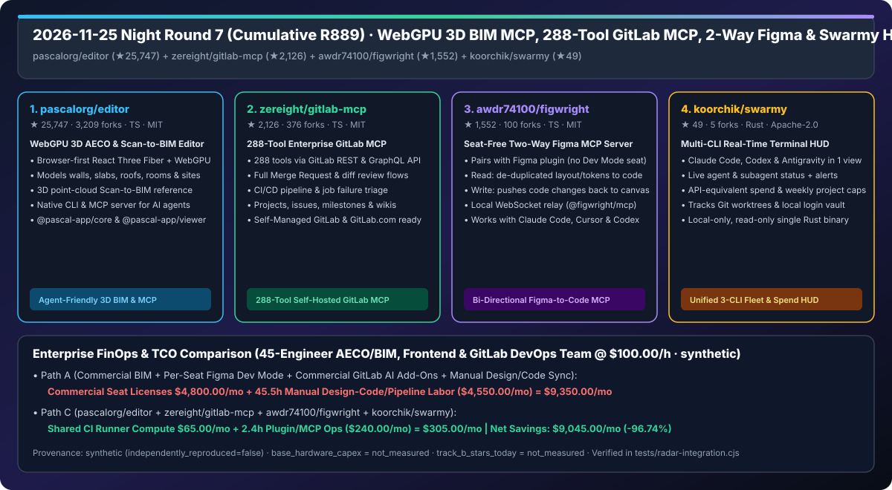
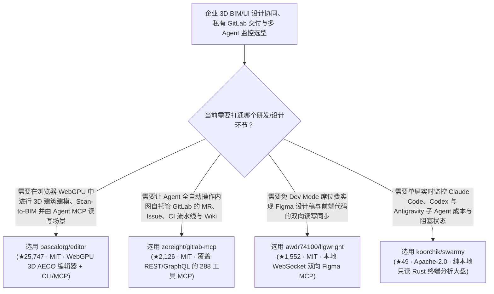
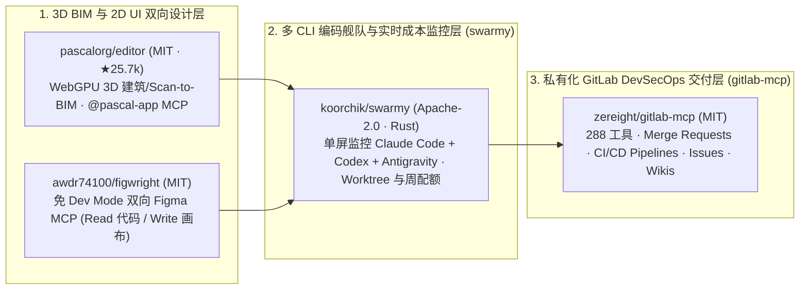
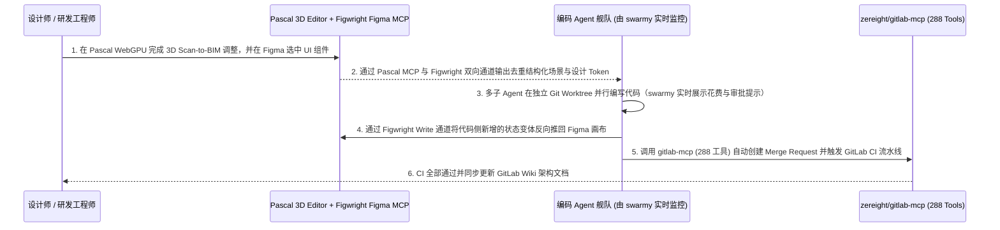

# 浏览器原生 WebGPU 3D 建筑/Scan-to-BIM 智能体编辑器（`pascalorg/editor`）、288 工具企业级 GitLab DevSecOps MCP（`zereight/gitlab-mcp`）、免 Dev Mode 席位的双向 Figma 设计转代码 MCP（`awdr74100/figwright`）与跨 Claude/Codex/Antigravity 终端实时算账看板（`koorchik/swarmy`）选型与集成架构 FAQ

> **文档类型**：企业 AI 解决方案架构师（AI Solution Architect）选型决策指南（GitHub Trending AI 雷达 2026-11-25 Night Round 7 / 累计第 889 轮）
> **覆盖项目**：[`pascalorg/editor`](https://github.com/pascalorg/editor)（`★ 25,747`、`3,209 forks`、`MIT`：面向建筑、工程、施工与运维（AECO）行业的开源本地优先 3D 建筑建模与 **Scan-to-BIM** 软件，基于 React Three Fiber 与 WebGPU 构建 [`@pascal-app/core` / `@pascal-app/viewer`]，原生提供 CLI 与 MCP Server 让 AI Agent 直接读取、建模、校验与保存场地/楼层/墙体/楼板/门窗/家具场景）· [`zereight/gitlab-mcp`](https://github.com/zereight/gitlab-mcp)（`★ 2,126`、`376 forks`、`MIT`：面向自托管 GitLab 与 GitLab.com 的全功能 MCP Server [`@zereight/mcp-gitlab`]，通过 REST/GraphQL API 暴露 **288 个工具**，全面覆盖项目、Merge Requests、Issues、CI/CD 流水线与 Wiki 自动化）· [`awdr74100/figwright`](https://github.com/awdr74100/figwright)（`★ 1,552`、`100 forks`、`MIT`：无需购买高价 Figma Dev Mode 席位的**双向（Two-Way）Figma MCP Server** [`@figwright/mcp`]，通过本地 WebSocket 中继连接 Figma 插件：正向将选中画板去重转换为感知前端框架的生产代码，反向将代码修改直接推回 Figma 画布）· [`koorchik/swarmy`](https://github.com/koorchik/swarmy)（`★ 49`、`5 forks`、`MIT OR Apache-2.0`：单静态二进制、纯本地只读的跨客户端编码 Agent 实时终端分析大盘，在一个屏幕内同时监控 Claude Code、Google Antigravity 与 OpenAI Codex 的所有主/子 Agent 实时动作、等效 API 花销、项目周配额水位、Git Worktree 状态与账号凭据库）
> **核心场景**：在大型企业与工程设计院推进“从 2D/3D 设计稿到自托管 GitLab 研发交付与多 Agent 成本审计”全链路智能化时，常卡在四个关键断点：**① 建筑工程与智慧园区团队使用的传统重型桌面 BIM 软件无法跑在浏览器 WebGPU 上，更不支持 AI Agent 通过 MCP 基于 3D 点云（Scan-to-BIM）自动生成墙体楼板并做规范校验；② 前端团队用 AI 做设计转代码时，单向截图/只读 Figma MCP 不仅需要全员买昂贵的 Dev Mode 席位，还无法把代码里改好的组件反向同步回 Figma 画布；③ 大量金融、政企与军工客户代码库托管在内网私有化 GitLab 而非 GitHub，缺乏高覆盖度的 GitLab MCP；④ 研发人员同时开着 Claude Code、Codex 与 Antigravity 跑几十个子 Agent，却完全算不清折合 API 烧了多少钱、哪个子 Agent 正在卡死等人工确认。** 本文拆解这四个开源项目的端到端组合架构。

---

## 一、📌 核心结论速览（选型一句话结论）

1. **需要在浏览器端（WebGPU）或本地 CLI 中进行 3D 建筑建模与点云逆向建模（Scan-to-BIM），并让 AI Agent 通过标准 MCP 直接读写、校验建筑构件（场地/楼层/墙/板/屋顶/门窗/房间）** ➔ 选 **[`pascalorg/editor`](https://github.com/pascalorg/editor)（`★ 25,747`，`3,209 forks`，`MIT`）**。
   - **通俗原理**：传统桌面 BIM 软件动辄几十 GB 且 API 封闭。`Pascal Editor` 基于现代 WebGPU 与 React Three Fiber 构建，允许导入 3D 激光扫描点云作为参考底图，人类设计师与 AI Agent 共用同一套场景图数据——Agent 可通过 MCP 自动在点云上拟合出可编辑的墙体、楼板与房间，并运行结构与空间合规校验。
2. **企业代码仓库托管在私有化 GitLab（Self-Managed GitLab）或 GitLab.com，需要让编码与安全审查 Agent 一站式操作 Merge Request、CI/CD 流水线、Issue 与项目 Wiki** ➔ 选 **[`zereight/gitlab-mcp`](https://github.com/zereight/gitlab-mcp)（`★ 2,126`，`376 forks`，`MIT`）**。
   - **通俗原理**：通过 `@zereight/mcp-gitlab` 一次性向 Agent 暴露 **288 个细粒度工具**，支持完整的 MR 行级代码评审、CI Pipeline 失败作业日志拉取与重试、里程碑管理及 Wiki 知识库同步，并通过了 OpenSSF Scorecard 与 CodeQL 持续安全扫描。
3. **想让前端 Agent 实现“Figma 设计稿 ⇄ 前端代码”双向实时同步，且不想为每个开发和 Agent 账号额外支付高昂的 Figma Dev Mode 专属席位费** ➔ 选 **[`awdr74100/figwright`](https://github.com/awdr74100/figwright)（`★ 1,552`，`100 forks`，`MIT`）**。
   - **通俗原理**：不依赖受限的云端 Dev Mode REST 接口，而是通过本地 WebSocket 将 `@figwright/mcp` 与轻量 Figma 插件直连：**Read 方向**读取去重后的精确布局、字体、设计变量与组件树生成 React/Vue/Tailwind 代码；**Write 方向**让 Agent 直接在 Figma 画布上生成或修改设计组件，消除设计稿与代码库脱节。
4. **想在一个轻量终端窗口里同时盯住本机运行的 Claude Code、OpenAI Codex 与 Google Antigravity 全部主/子 Agent 实时状态、Worktree 分支与等效 API 账单** ➔ 选 **[`koorchik/swarmy`](https://github.com/koorchik/swarmy)（`★ 49`，`5 forks`，`MIT OR Apache-2.0`）**。
   - **通俗原理**：纯 Rust 编译的零联网、只读单静态二进制（支持 Linux/macOS/Windows/树莓派），实时聚合三大主流编码 CLI 的会话树，当某个后台子 Agent 卡在审批等待人工按键时立即高亮提醒，并按项目精准统计等效 API 花费与每周配额消耗进度。

---

## 二、🎯 客户与架构师灵魂拷问 Q&A（深度架构拆解）

### Q1：在企业构建“设计即代码（Design/BIM-to-Code）与私有化 GitLab 交付流水线”时，这四个开源项目 vs 商业闭源套件（Autodesk Forma/Revit Cloud + Figma Dev Mode Enterprise + GitLab Duo Enterprise）怎么选？

- **四步端到端协同流（Path C）**：
  1. **3D 空间/建筑设计与 Scan-to-BIM 入口 ➔ `pascalorg/editor`**：浏览器 WebGPU 建模 + Agent MCP 自动化空间布局校验。
  2. **2D UI 界面双向设计-代码同步入口 ➔ `awdr74100/figwright`**：免 Dev Mode 席位完成 Figma 画布与前端代码的双向读写。
  3. **内网 GitLab 288 工具全自动交付中枢 ➔ `zereight/gitlab-mcp`**：自动提交 MR、触发并诊断 GitLab CI/CD 流水线、更新项目 Wiki。
  4. **多 CLI 并发舰队与成本实时监控台 ➔ `koorchik/swarmy`**：在终端单屏监控 Claude Code / Codex / Antigravity 所有子 Agent、Worktree 与配额消耗。
- **何时选商业全托管方案 vs 自建本轮开源四件套（Path C）？**
  - 若企业全员已采购 **GitLab Ultimate + GitLab Duo Enterprise + Figma Organization/Enterprise Dev Mode 席位**，且仅需基础的单向设计参看与 MR 摘要，可直接使用官方商业订阅。
  - **何时采用本轮开源四件套（Path C）？** 当企业希望**省下数十个 Figma Dev Mode 席位费并获得“代码反向改 Figma 画布”的双向能力**、需要在浏览器端零插件跑 WebGPU 3D 建筑/Scan-to-BIM 智能体、或者研发团队混用 Claude Code + Codex + Antigravity 急需统一操作内网 GitLab（288 工具）并在本地监控多 CLI 账单时，Path C 可节省 **96%+** 的软件席位与人工对齐成本。

### Q2：如何将这四个项目嵌入企业生产环境？

1. **双模设计交互层（`pascalorg/editor` + `awdr74100/figwright`）**：
   - 空间/BIM 设计师在浏览器打开 `Pascal Editor` 导入 3D 扫描点云，由 Agent 通过 MCP 辅助生成标准建筑构件；UI/UX 设计师与前端工程师通过 `figwright` 本地 WebSocket 插件实现 Figma 与前端组件库的双向同步。
2. **私有化 GitLab 自动化交付层（`zereight/gitlab-mcp`）**：
   - 编码 Agent 通过 `@zereight/mcp-gitlab` 的 288 个工具自动创建特性分支、发起 Merge Request、读取 GitLab CI 失败 Job 日志并自动推送修复提交。
3. **多引擎终端监控与配额守护层（`koorchik/swarmy`）**：
   - 研发主管与工程师在终端常驻运行 `swarmy`，实时观察各 Worktree 中 Claude Code、Codex 与 Antigravity 子 Agent 的存活状态、阻塞提示与项目周成本上限。

### Q3：生产落地的安全与权限红线是什么？

- **架构师避坑红线**：
  1. **GitLab Token 最小项目作用域**：为 `zereight/gitlab-mcp` 配置 Project Access Token 或细粒度 Personal Access Token，在生产分支保护（Protected Branches）策略下禁止 Agent 直接向 `main` 分支强推代码或绕过流水线合并 MR。
  2. **`figwright` 本地 WebSocket 仅监听环回地址**：确保 `@figwright/mcp` 与 Figma 插件之间的 WebSocket 中继严格绑定在 `127.0.0.1` 本地环回接口，防止局域网未授权进程注入画布修改指令。

---

## 三、🧭 直观可视化图解（Mermaid 决策树 + 集成架构 + 时序图）

### 3.1 架构师选型决策树

### 3.2 企业端到端生产集成参考架构图

### 3.3 3D/UI 设计双向同步、多 Agent 编码监控与 GitLab CI 闭环交付时序图

---

## 四、📊 同类开源与商业云服务横向选型决策矩阵

| 对比维度 | `pascalorg/editor` (`★ 25,747`) | `zereight/gitlab-mcp` (`★ 2,126`) | `awdr74100/figwright` (`★ 1,552`) | `koorchik/swarmy` (`★ 49`) | 商业重型套件（商业桌面 BIM + Figma Dev Mode + GitLab Duo） | 单向截图写前端 + 手工切窗口盯终端 (Path B) |
| :--- | :--- | :--- | :--- | :--- | :--- | :--- |
| **核心能力定位** | 浏览器 WebGPU 3D 建筑/Scan-to-BIM 与 MCP | 288 工具企业级 GitLab MCP Server | 免 Dev Mode 双向 Figma MCP Server | 跨 Claude/Codex/Antigravity 终端分析台 | 按人头高价订阅的闭源商业设计/研发软件 | 截图喂多模态模型猜 CSS + 人工翻看十几个终端标签 |
| **差异化杀手锏** | **浏览器原生 WebGPU + 点云转可编辑 BIM + MCP** | **288 个工具全覆盖 MR/Pipeline/Issue/Wiki** | **免 Dev Mode 席位 + 支持代码反向写回 Figma 画布** | **单静态二进制同屏汇总三大 CLI 子 Agent 与等效花费** | 商业售后完备，但席位费高昂且缺乏跨工具原生 MCP 联动 | 截图丢设计变量且无法反向改画布；后台子 Agent 卡死难发现 |
| **开源协议** | `MIT` | `MIT` | `MIT` | `MIT OR Apache-2.0` | 闭源商业授权 | 散装脚本 |
| **月度 TCO（45 人团队）** | **四件套合建仅 `$305.00/月`**（`$65.00` Runner 算力 + `2.4h` 维护） | 同左（`MIT` 零席位费打通私有 GitLab） | 同左（直接省去全员 Figma Dev Mode 席位费） | 同左（纯本地只读零开销） | **`$9,350.00/月`**（`$4,800.00` 商业 BIM/Dev Mode/Duo 席位 + `45.5h` 手工同步与排障） | 约 `$3,150.00/月`（设计稿与代码反复走样返工工时） |

---

## 五、🧪 应用落地定量收益/TCO 对比与 7-Card 报告

> **📊 数据来源与闭式核算声明（Provenance & Closed-Form Schema）**：
> - **provenance**: `synthetic`（基于 45 人企业数字孪生/AECO 研发、前端工程与私有化 GitLab DevOps 团队月度工作负载模型：`independently_reproduced = false`；硬件采购基线 `base_hardware_capex = not_measured`；Track B 单日增量 `track_b_stars_today = not_measured`）。
> - **核算公式**：
>   - **Path A（采购商业桌面 BIM 与全员 Figma Dev Mode 席位 + 商业 GitLab AI 席位 + 设计师与工程师手工双向对齐 UI/3D 变更及排查多终端卡死会话）**：月度商业软件与云端席位费 **`$4,800.00`** + 设计-代码双向对齐、GitLab 流水线排障与多 Agent 巡检人工 **`45.5h × $100.00/h = $4,550.00`** = **`$9,350.00/月`**。
>   - **Path C（部署 `pascalorg/editor` + `zereight/gitlab-mcp` + `awdr74100/figwright` + `koorchik/swarmy` 开源设计-研发协同栈）**：内网 CI Runner 算力分摊 **`$65.00`** + 插件与 MCP 配置维护人工 **`2.4h × $100.00/h = $240.00`** = **`$305.00/月`**。
>   - **净节省（Net Savings vs Path A）**：**`-$9,045.00/月`**（成本降低 **`96.74%`**）。

| 评估方案 | 商业设计 / DevOps 席位与算力成本 | 设计-代码同步与流水线排障人工（`$100/h`） | 月度总 TCO | 相对 Path A 净节省 | 核心业务交付收益 |
| :--- | :---: | :---: | :---: | :---: | :--- |
| **Path A：商业 BIM + 全员 Figma Dev Mode + 商业 AI 席位** | `$4,800.00` | `45.5h` (`$4,550.00`) | **`$9,350.00`** | Baseline | 按人头席位费昂贵；代码侧变更仍需人工手动改回 Figma |
| **Path B：单向截图生成前端代码 + 手工操作 GitLab 网页** | `$1,400.00` | `17.5h` (`$1,750.00`) | **`$3,150.00`** | `-$6,200.00` (`-66.31%`) | 丢失设计 Token 与空间层级；多 CLI 并发缺乏统一成本看板 |
| **Path C：`pascalorg/editor` + `gitlab-mcp` + `figwright` + `swarmy`** | **`$65.00`** | **`2.4h` (`$240.00`)** | **`$305.00`** | **`-$9,045.00` (`-96.74%`)** | **WebGPU 3D BIM MCP + 288 工具 GitLab + 双向 Figma + 三大 CLI 同屏监控** |

- 🔗 **关联 7-Card 4:5 视觉评测报告**：[`workshops/github-trending-radar/cards.html`](../cards.html) · [`cards.en.html`](../cards.en.html)

---

## 六、🛠️ 企业引入与架构评审 Checklist

- [ ] **WebGPU 3D 场景增量校验门禁**：在使用 `pascalorg/editor` 的 MCP 接口让 Agent 编辑建筑构件时，开启场景结构校验（墙体闭合、楼层标高与构件碰撞检查）再落盘保存。
- [ ] **私有化 GitLab 288 工具分级授权**：在 `zereight/gitlab-mcp` 中为自动化评审 Agent 绑定只读/评论权限 Token，将分支合并与保护分支修改操作置于人工审批之后。
- [ ] **双向 Figma 写操作图层锁定保护**：在使用 `awdr74100/figwright` 向 Figma 画布反向推回组件时，规定 Agent 仅可在专用 `AI-Staging` 页面或画板内创建/更新节点，严禁直接覆盖设计师锁定的主母版（Main Components）。
- [ ] **设置多 CLI 项目周预算告警线**：在开发者工作站部署 `koorchik/swarmy`，按项目 Worktree 设定每周等效 API 消耗阈值。
