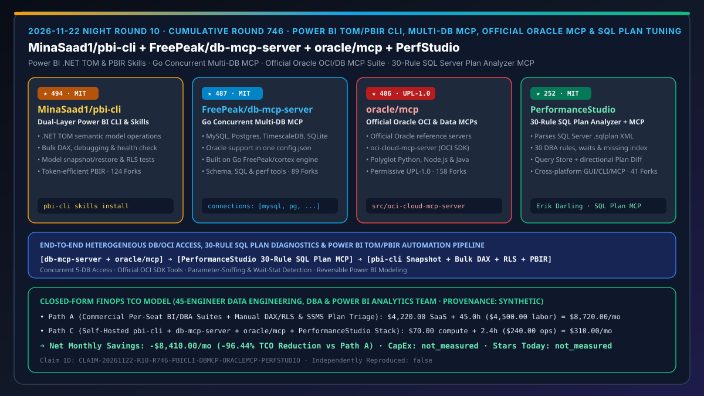
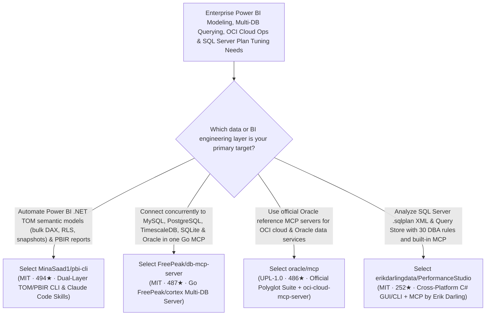
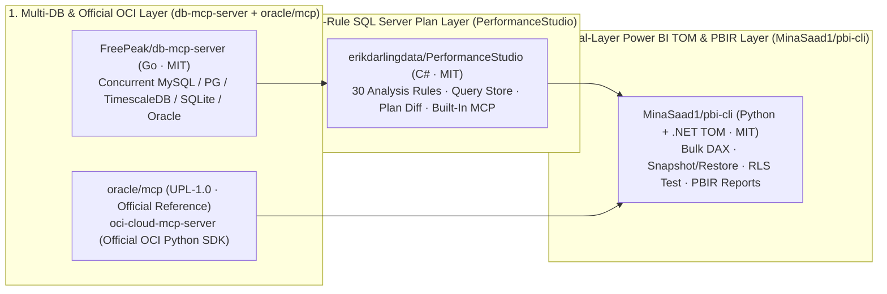
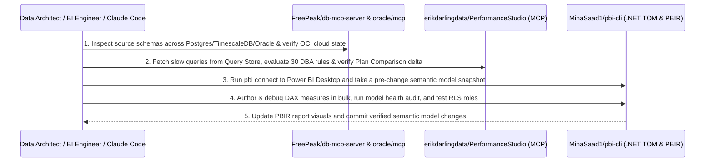

# Dual-Layer Power BI `.NET TOM` & PBIR CLI (`MinaSaad1/pbi-cli`), Go Multi-Database Concurrent MCP (`FreePeak/db-mcp-server`), Official Oracle OCI & Data MCP Suite (`oracle/mcp`) & 30-Rule SQL Server Execution Plan Analyzer MCP (`erikdarlingdata/PerformanceStudio`) Selection & Architecture FAQ

> **Document Type**: Enterprise AI Solution Architect Selection & Integration Guide (GitHub Trending AI Radar — 2026-11-22 Night Round 10 / Cumulative Round 746)
> **Covered Repositories**: [`MinaSaad1/pbi-cli`](https://github.com/MinaSaad1/pbi-cli) (`★ 494`, `124 forks`, `MIT`, `pbi-cli-tool`: dual-layer Power BI CLI and Claude Code skill suite operating on semantic models via `.NET TOM`—bulk DAX measures, debugging, snapshot/restore, model health checks, RLS testing—and PBIR reports) · [`FreePeak/db-mcp-server`](https://github.com/FreePeak/db-mcp-server) (`★ 487`, `89 forks`, `MIT`: Go multi-database MCP server built on `FreePeak/cortex` providing concurrent access to MySQL, PostgreSQL, TimescaleDB, SQLite, and Oracle) · [`oracle/mcp`](https://github.com/oracle/mcp) (`★ 486`, `158 forks`, `UPL-1.0`: official Oracle polyglot MCP server repository including `oci-cloud-mcp-server` powered by the official OCI Python SDK) · [`erikdarlingdata/PerformanceStudio`](https://github.com/erikdarlingdata/PerformanceStudio) (`★ 252`, `41 forks`, `MIT`: cross-platform C# SQL Server `.sqlplan` execution plan analyzer GUI, CLI, and built-in MCP server with 30 DBA analysis rules, Query Store integration, and directional Plan Comparison)
> **Core Scenario**: When enterprise data engineering, DBA, and BI teams need to **automate Power BI semantic modeling (DAX, RLS, snapshots) and PBIR report authoring from Claude Code without blowing up token context, query across heterogeneous relational/time-series databases concurrently, manage Oracle Cloud Infrastructure (OCI) with vendor-official MCP servers, and diagnose SQL Server execution plans with 30 deterministic DBA rules**, how do you integrate **`MinaSaad1/pbi-cli` + `FreePeak/db-mcp-server` + `oracle/mcp` + `erikdarlingdata/PerformanceStudio`** into an end-to-end data and BI engineering stack?

---

## 1. 📌 Executive Summary (One-Line Selection Verdict)

1. **Need Claude Code to connect directly to a live Power BI Desktop `.pbix` instance (`pbi connect`) to create DAX measures in bulk, debug broken DAX, snapshot and restore the semantic model, test Row-Level Security (RLS), and edit PBIR reports token-efficiently?** ➔ Choose **[`MinaSaad1/pbi-cli`](https://github.com/MinaSaad1/pbi-cli) (`★ 494`, `124 forks`, `MIT`)**.
   - **Plain-English Mechanism**: Uses a dual-layer architecture—operating on the **Semantic Model Layer** via Microsoft's `.NET Tabular Object Model (TOM)` and on the **Report Layer** via PBIR—so coding agents perform safe, reversible Power BI modeling and report automation after a 3-command setup (`pipx install pbi-cli-tool`, `pbi-cli skills install`, `pbi connect`).
2. **Need a single Go binary MCP server that connects concurrently to MySQL, PostgreSQL, TimescaleDB, SQLite, and Oracle so an AI assistant can explore schemas, run cross-database checks, and analyze query performance simultaneously?** ➔ Choose **[`FreePeak/db-mcp-server`](https://github.com/FreePeak/db-mcp-server) (`★ 487`, `89 forks`, `MIT`)**.
   - **Plain-English Mechanism**: Built on the Go `FreePeak/cortex` framework, it defines an array of `connections` in a single configuration and exposes unified schema inspection, query execution, transaction management, and performance analysis tools across all connected databases at once.
3. **Running enterprise workloads on Oracle Cloud Infrastructure (OCI) and Oracle databases and want official reference MCP servers maintained directly by Oracle?** ➔ Choose **[`oracle/mcp`](https://github.com/oracle/mcp) (`★ 486`, `158 forks`, `UPL-1.0`)**.
   - **Plain-English Mechanism**: Ships polyglot reference MCP servers under `src/<server-name>/` (Python, Node.js, Java), led by `oci-cloud-mcp-server` which calls the official OCI Python SDK directly under Oracle's permissive `UPL-1.0` license.
4. **Need a cross-platform SQL Server execution plan analyzer (GUI + CLI + built-in MCP server) built by SQL Server expert Erik Darling that parses `.sqlplan` XML, pulls top resource-consuming queries from Query Store, evaluates 30 DBA rules, and computes directional plan comparisons?** ➔ Choose **[`erikdarlingdata/PerformanceStudio`](https://github.com/erikdarlingdata/PerformanceStudio) (`★ 252`, `41 forks`, `MIT`)**.
   - **Plain-English Mechanism**: Eliminates manual SSMS clicking by parsing `.sqlplan` XML into severity-scored human/agent advice cards (parameter sniffing compiled vs. runtime diffs, memory grants, wait stats, missing indexes) and exposing a native MCP server for AI-assisted query tuning.

---

## 2. 🎯 Architect & Customer Deep-Dive Q&A

### Q1: Why does raw LLM prompting fail on Power BI `.pbix` files and SQL Server `.sqlplan` XML dumps? How do these four tools solve it?

- **Four Enterprise Data & BI Breakthroughs**:
  1. **Corrupted Power BI models & token bloat from raw JSON edits ➔ `MinaSaad1/pbi-cli`**: Uses `.NET TOM` for transactional model mutations with built-in **Snapshot & Restore**, bulk DAX debugging, model health audits, and RLS verification.
  2. **Multi-megabyte `.sqlplan` XML files overwhelming LLM context windows ➔ `erikdarlingdata/PerformanceStudio`**: Applies 30 deterministic DBA rules to extract exact operator warnings, compiled-vs-runtime parameter mismatches, and directional regression deltas before handing structured findings to the agent via MCP.
  3. **Siloed single-database MCP processes ➔ `FreePeak/db-mcp-server`**: Connects MySQL, PostgreSQL, TimescaleDB, SQLite, and Oracle concurrently in one Go server.
  4. **Unofficial Oracle cloud wrappers ➔ `oracle/mcp`**: Provides Oracle's official `UPL-1.0` reference servers (`oci-cloud-mcp-server`).
- **When to Choose Managed Cloud PaaS (Path B)?**
  - If your analytics estate runs 100% inside **Microsoft Fabric + Copilot in Power BI + Azure SQL Database**, leverage native cloud Copilots; when automating local `.pbix`/PBIR workflows from Claude Code, diagnosing complex SQL Server execution plans, or bridging heterogeneous Postgres/Timescale/Oracle estates, deploy this open-source stack (Path C).

### Q2: How do we wire `db-mcp-server`, `oracle/mcp`, `PerformanceStudio`, and `pbi-cli` into an end-to-end data and BI pipeline?

1. **Multi-Database & OCI Infrastructure Layer (`FreePeak/db-mcp-server` + `oracle/mcp`)**:
   - Connect operational MySQL, PostgreSQL, TimescaleDB, and Oracle databases via `db-mcp-server` and manage OCI resources via `oci-cloud-mcp-server`.
2. **SQL Server Execution Plan Diagnostics Layer (`erikdarlingdata/PerformanceStudio`)**:
   - Pull top CPU/duration queries from Query Store, run the 30 built-in analysis rules, and compare before/after execution plans via the built-in MCP server.
3. **Power BI `.NET TOM` Semantic Modeling & PBIR Report Layer (`MinaSaad1/pbi-cli`)**:
   - Connect to Power BI Desktop via `pbi connect`, take a model snapshot, create/debug DAX measures in bulk, validate RLS roles, and update PBIR report visuals.

### Q3: What are the production safety guardrails for this data stack?

- **Read-Only Credentials & Pre-Change Snapshots**:
  - Bind `FreePeak/db-mcp-server` to read-only database roles in production, apply least-privilege IAM policies to `oracle/mcp`, and always run a `pbi-cli` model snapshot before bulk DAX or schema changes.

---

## 3. 🧭 Visual Architecture & Workflow Diagrams (Mermaid)

### 3.1 Solution Architect Selection Decision Tree

### 3.2 End-to-End Enterprise Reference Architecture

### 3.3 End-to-End Cross-DB Inspection, SQL Plan Tuning & Power BI Snapshot-Backed Delivery Sequence Diagram

---

## 4. 📊 Peer Open-Source vs. Commercial Cloud Selection Matrix

| Dimension | `MinaSaad1/pbi-cli` (`★ 494`) | `FreePeak/db-mcp-server` (`★ 487`) | `oracle/mcp` (`★ 486`) | `erikdarlingdata/PerformanceStudio` (`★ 252`) | Commercial Per-Seat BI Tools + Commercial DBA Suites + Manual SSMS Clicking (Path A) | Manual Power BI GUI Clicking + Raw Multi-MB `.sqlplan` XML Prompting (Path B) |
| :--- | :--- | :--- | :--- | :--- | :--- | :--- |
| **Primary Role** | Dual-layer Power BI `.NET TOM` & PBIR CLI/skills | Go concurrent multi-database MCP server | Official Oracle OCI & data reference MCP suite | Cross-platform SQL Server `.sqlplan` analyzer + MCP | High-cost commercial Tabular/DBA desktop seats | Manual measure clicking in Power BI GUI & pasting raw `.sqlplan` XML |
| **Key Differentiator** | **`.NET TOM` + PBIR + model snapshot/restore + RLS testing** | **Concurrent MySQL/PG/Timescale/SQLite/Oracle in 1 Go binary** | **Maintained by Oracle (`UPL-1.0`) + official OCI SDK** | **30 DBA rules + Query Store + directional Plan Comparison** | Expensive per-seat licensing; lacks native coding-agent skill/MCP loops | Raw `.sqlplan` XML blows up token budgets; manual PBIR edits risk corruption |
| **License** | `MIT` | `MIT` | `UPL-1.0` | `MIT` | Proprietary Software | Manual workflow |
| **Monthly TCO (45-Eng Team)** | **`$310.00/mo` combined** (`$70.00` shared test DB runner + `2.4h` ops) | Included (single Go binary) | Included (`UPL-1.0` official reference) | Included (`MIT` GUI + CLI + MCP) | **`$8,720.00/mo`** (`$4,220.00` commercial BI/DBA seats + `45.0h` manual DAX/SQL tuning) | ~`$3,100.00/mo` (manual DAX authoring, RLS testing & SSMS plan clicking labor) |

---

## 5. 🧪 Quantitative Enterprise ROI / FinOps TCO Model & 7-Card Report

> **📊 Provenance & Closed-Form Declaration**:
> - **provenance**: `synthetic` (45-engineer enterprise data engineering, DBA performance tuning, and Power BI analytics delivery team workload model: `independently_reproduced = false`; `base_hardware_capex = not_measured`; `track_b_stars_today = not_measured`).
> - **Closed-Form Equations**:
>   - **Path A (Commercial Per-Seat BI Modeling Tools + Commercial SQL Server Diagnostic Suites + Manual Measure/RLS Authoring & Manual SSMS Execution Plan Triage)**: Monthly commercial software seats & raw XML prompt token waste **`$4,220.00`** + manual DAX measure debugging, RLS validation, and slow-query tuning labor **`45.0h × $100.00/h = $4,500.00`** = **`$8,720.00/mo`**.
>   - **Path C (Self-Hosted `MinaSaad1/pbi-cli` + `FreePeak/db-mcp-server` + `oracle/mcp` + `erikdarlingdata/PerformanceStudio` Stack)**: Shared database test runner compute **`$70.00`** + connection config & skill maintenance labor **`2.4h × $100.00/h = $240.00`** = **`$310.00/mo`**.
>   - **Net Monthly Savings vs. Path A**: **`-$8,410.00/mo`** (**`96.44%`** TCO reduction).

| Evaluation Path | BI/DBA Software & Compute Cost | DAX Modeling & SQL Tuning Labor (`$100/h`) | Total Monthly TCO | Net Savings vs. Path A | Architectural Delivery Impact |
| :--- | :---: | :---: | :---: | :---: | :--- |
| **Path A: Commercial BI/DBA Seats + Manual DAX & SSMS Triage** | `$4,220.00` | `45.0h` (`$4,500.00`) | **`$8,720.00`** | Baseline | High per-seat software fees; slow manual DAX & `.sqlplan` inspection |
| **Path B: Raw PBIR JSON Edits + Raw `.sqlplan` XML Prompts** | `$1,500.00` | `16.0h` (`$1,600.00`) | **`$3,100.00`** | `-$5,620.00` (`-64.45%`) | Lacks `.NET TOM` snapshot rollback, 30 DBA rules & multi-DB concurrency |
| **Path C: `pbi-cli` + `db-mcp` + `oracle/mcp` + `PerfStudio`** | **`$70.00`** | **`2.4h` (`$240.00`)** | **`$310.00`** | **`-$8,410.00` (`-96.44%`)** | **TOM/PBIR dual-layer CLI + 5-DB Go MCP + official OCI MCP + 30-rule SQL tuning** |

- 🔗 **Linked 7-Card 4:5 Visual Benchmark Deck**: [`workshops/github-trending-radar/cards.en.html`](../cards.en.html) · [`cards.html`](../cards.html)

---

## 6. 🛠️ Enterprise Adoption & Architecture Review Checklist

- [ ] **1. Install `MinaSaad1/pbi-cli` on BI Engineering Workstations**: Run `pbi-cli skills install` and `pbi connect`, requiring a model snapshot and RLS verification check before committing bulk DAX or PBIR report changes.
- [ ] **2. Diagnose Slow SQL Server Queries with `erikdarlingdata/PerformanceStudio`**: Connect Query Store and the built-in MCP server so coding agents evaluate 30 deterministic DBA rules and directional plan diffs.
- [ ] **3. Unify Cross-Database Access via `FreePeak/db-mcp-server`**: Configure read-only connection pools across MySQL, PostgreSQL, TimescaleDB, SQLite, and Oracle in one Go MCP process.
- [ ] **4. Standardize OCI Automation on `oracle/mcp`**: Use `oci-cloud-mcp-server` with least-privilege OCI IAM policies for cloud and database prototyping.
