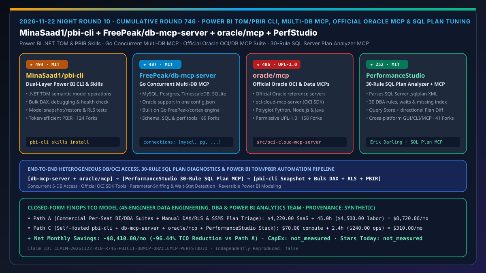
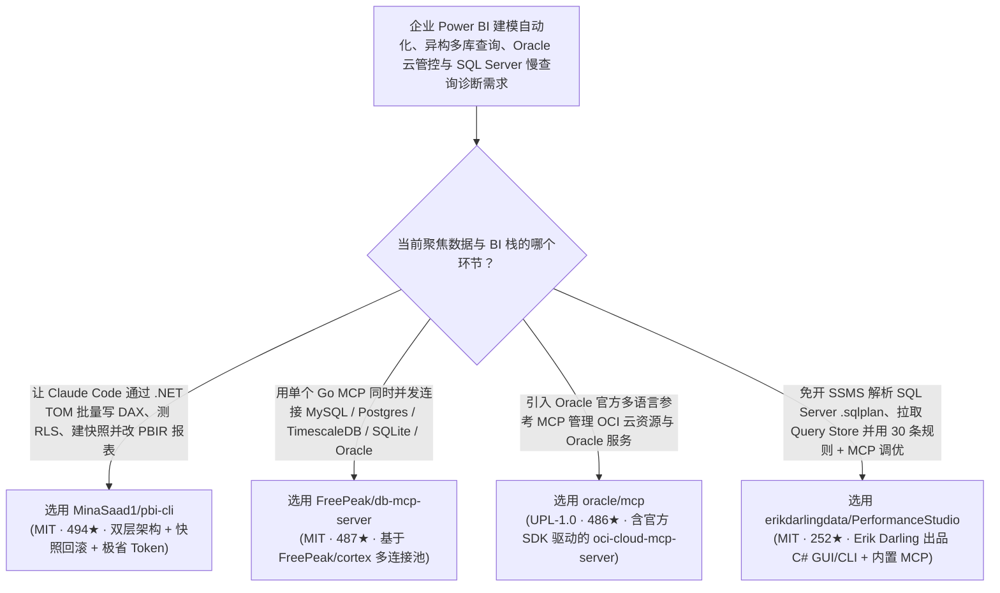
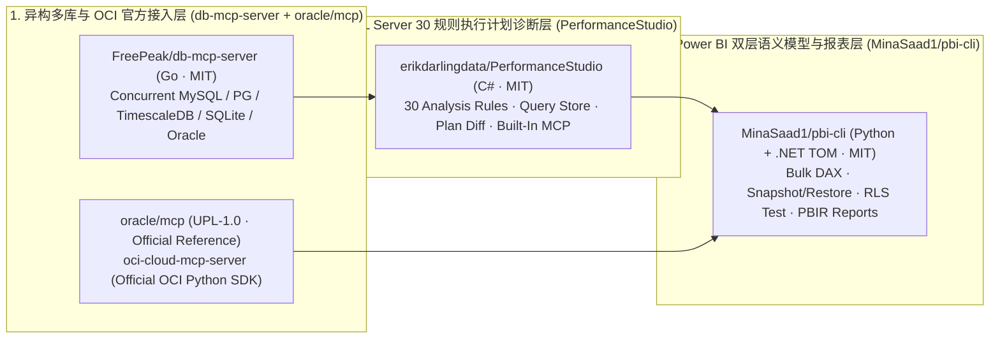
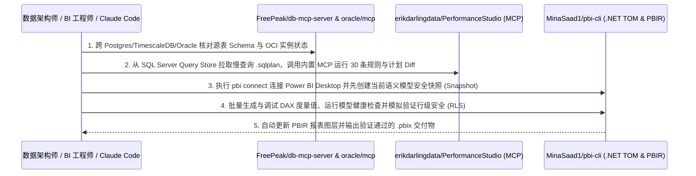

# Power BI 语义模型与 PBIR 报表双层 CLI 技能（`MinaSaad1/pbi-cli`）、Go 多数据库并发事务 MCP（`FreePeak/db-mcp-server`）、Oracle 官方多语言 OCI/数据库 MCP 套件（`oracle/mcp`）与内置 MCP 的 SQL Server 执行计划诊断工作台（`erikdarlingdata/PerformanceStudio`）选型与集成架构 FAQ

> **文档类型**：企业 AI 解决方案架构师（AI Solution Architect）选型决策指南（GitHub Trending AI 雷达 2026-11-22 Night Round 10 / 累计第 746 轮）
> **覆盖项目**：[`MinaSaad1/pbi-cli`](https://github.com/MinaSaad1/pbi-cli)（`★ 494`、`124 forks`、`MIT`，专为 Claude Code 打造的 Power BI 双层 CLI 与技能套件，底层通过 `.NET TOM` 操作语义模型支持批量建 DAX 度量值、排障、快照回滚与 RLS 行级安全测试，上层直接操作 PBIR 报表）· [`FreePeak/db-mcp-server`](https://github.com/FreePeak/db-mcp-server)（`★ 487`、`89 forks`、`MIT`，基于 Go `FreePeak/cortex` 构建的多数据库并发 MCP，单实例同时连接 MySQL、PostgreSQL、TimescaleDB、SQLite 与 Oracle）· [`oracle/mcp`](https://github.com/oracle/mcp)（`★ 486`、`158 forks`、`UPL-1.0`，甲骨文官方开源的跨 Python/Node.js/Java 参考 MCP 服务器集合，涵盖基于官方 SDK 的 `oci-cloud-mcp-server` 等云与数据管理套件）· [`erikdarlingdata/PerformanceStudio`](https://github.com/erikdarlingdata/PerformanceStudio)（`★ 252`、`41 forks`、`MIT`，知名 SQL Server 专家 Erik Darling 开源的跨平台 `.sqlplan` 执行计划分析 GUI/CLI 与内置 MCP Server，含 30 条 DBA 诊断规则、Query Store 集成与计划回归对比）
> **核心场景**：当企业数据工程、DBA 与 BI 分析团队希望让 AI 编码智能体打通**“跨异构数据库（PG/MySQL/Timescale/Oracle）联合查询 ➔ Oracle 云基础设施（OCI）官方自动化管控 ➔ SQL Server 慢查询 `.sqlplan` 根因诊断 ➔ Power BI 语义模型（DAX/RLS）与 PBIR 报表自动化开发”**全链路时，如何组合**`MinaSaad1/pbi-cli` + `FreePeak/db-mcp-server` + `oracle/mcp` + `erikdarlingdata/PerformanceStudio`** 构建省 Token、有快照兜底的企业数据与 BI 智能体架构？

---

## 一、📌 核心结论速览（选型一句话结论）

1. **想让 Claude Code 直接连上正在运行的 Power BI Desktop（`.pbix`），批量编写与调试 DAX 度量值、一键快照备份与恢复模型、测试行级权限（RLS）并自动化修改 PBIR 报表，且避免直接读庞大 JSON 撑爆上下文** ➔ 选 **[`MinaSaad1/pbi-cli`](https://github.com/MinaSaad1/pbi-cli)（`★ 494`，`124 forks`，`MIT`）**。
   - **通俗原理**：只需三步 `pipx install pbi-cli-tool` ➔ `pbi-cli skills install` ➔ `pbi connect`，它就在 Claude Code 与 Power BI 之间架起双层高速公路：**语义模型层（Semantic Model Layer）** 直接调用 `.NET Tabular Object Model (TOM)` 执行批量增删改 DAX、健康体检、快照回滚与 RLS 模拟验证；**报表层（Report Layer）** 针对 PBIR 结构做极高 Token 效率的精准操作。
2. **想用一个高性能 Go 单二进制 MCP 同时挂载公司里的多个异构数据库（MySQL、PostgreSQL、TimescaleDB 时序库、SQLite、Oracle），让 AI 助手跨库探索表结构、管理事务并对比查询性能** ➔ 选 **[`FreePeak/db-mcp-server`](https://github.com/FreePeak/db-mcp-server)（`★ 487`，`89 forks`，`MIT`）**。
   - **通俗原理**：告别“一个数据库实例启一个 Python 进程”的臃肿模式。基于 `FreePeak/cortex` Go 框架，在单个 `config.json` 的 `connections` 数组中声明多个异构库连接池，让 Agent 在同一个会话中并发跨库核对数据一致性。
3. **企业核心业务跑在 Oracle Cloud Infrastructure (OCI) 与 Oracle 数据库体系上，想引入原厂官方维护的参考 MCP 实现来管理云资源与数据服务** ➔ 选 **[`oracle/mcp`](https://github.com/oracle/mcp)（`★ 486`，`158 forks`，`UPL-1.0`）**。
   - **通俗原理**：由 Oracle 官方团队维护（`UPL-1.0` 宽松许可），采用多语言架构（`src/<server-name>/` 涵盖 Python、Node.js、Java），其中首选的 `oci-cloud-mcp-server` 直接基于官方 OCI Python SDK 构建，为企业安全接入 Oracle 云生态提供权威参考样板。
4. **当生产环境 SQL Server 出现慢查询、参数嗅探（Parameter Sniffing）或内存授予（Memory Grant）告警时，想免去打开笨重 SSMS 逐个点图标的痛苦，让 DBA 或 AI Agent 直接通过 30 条专家规则与内置 MCP 秒级定位 `.sqlplan` 病灶** ➔ 选 **[`erikdarlingdata/PerformanceStudio`](https://github.com/erikdarlingdata/PerformanceStudio)（`★ 252`，`41 forks`，`MIT`）**。
   - **通俗原理**：由顶级 SQL Server 性能调优专家 Erik Darling 用 C# 编写的跨平台利器（同时提供桌面 GUI、CLI 与**内置 MCP Server**）。它能直接从 Query Store 拉取 CPU/逻辑读/耗时 Top 查询，解析 `.sqlplan` XML，对比编译值与运行值参数差异，对两版执行计划做带方向判定的 Metric Diff，并生成可直接贴进工单的严重度诊断卡（Advice for Humans）。

---

## 二、🎯 客户与架构师灵魂拷问 Q&A（深度架构拆解）

### Q1：为什么企业在做“数据库排障 + Power BI 报表开发”时，直接把表结构或 `.pbix`/`.sqlplan` 原始文件丢给大模型既烧钱又容易改崩？这四个项目如何解决？

- **四大企业数据与 BI 痛点解方**：
  1. **裸改 Power BI 文件极易损坏模型且无回滚 ➔ `MinaSaad1/pbi-cli`**：通过 `.NET TOM` 官方对象模型操作，内置**模型快照与一键恢复（Snapshot & Restore）**、DAX 语法排错与 RLS 角色模拟测试。
  2. **原始 `.sqlplan` XML 动辄数万行，大模型看花眼也抓不住重点 ➔ `erikdarlingdata/PerformanceStudio`**：先用 Erik Darling 沉淀的 30 条确定性 DBA 规则提取出等待统计、内存授予异常、缺失索引与参数嗅探证据，再通过内置 MCP 喂给 Agent。
  3. **多源数据库需要对账但连接器各自为战 ➔ `FreePeak/db-mcp-server`**：单 Go 进程并发连接 MySQL / PG / TimescaleDB / Oracle。
  4. **Oracle 云与数据底座缺乏原厂标准工具定义 ➔ `oracle/mcp`**：直接使用 Oracle 官方仓库中的 `oci-cloud-mcp-server` 参考实现。
- **何时直接用云厂商托管方案（Path B）？**
  - 若企业已全面迁移至 **Microsoft Fabric（OneLake + Copilot in Power BI + Azure SQL Database Copilot）**，可优先使用云端原生 Copilot；若需在本机通过 Claude Code 批量重构复杂 `.pbix` 模型、跨 Oracle/PG/TimescaleDB 查数或深度剖析线下/云端 SQL Server `.sqlplan`，则采用本轮开源栈（Path C）。

### Q2：典型企业级“多库与 OCI 接入 (`db-mcp` + `oracle/mcp`) + SQL Server 执行计划专家诊断 (`PerformanceStudio`) + Power BI 语义模型与报表自动化 (`pbi-cli`)”架构怎么搭？

1. **底层异构数据库与 OCI 云资源接入层（`FreePeak/db-mcp-server` + `oracle/mcp`）**：
   - 使用 `db-mcp-server` 统一挂载业务 MySQL、PostgreSQL、TimescaleDB 与 Oracle 库；使用 `oracle/mcp`（`oci-cloud-mcp-server`）纳管底层 OCI 资源。
2. **中层 SQL Server 性能体检与慢查询回归层（`erikdarlingdata/PerformanceStudio`）**：
   - 将 SQL Server Query Store 与 `.sqlplan` 接入 `PerformanceStudio` 内置 MCP，自动执行 30 条规则体检与前后执行计划对比（Plan Comparison）。
3. **上层 Power BI 语义建模、RLS 测试与 PBIR 交付层（`MinaSaad1/pbi-cli`）**：
   - 编码 Agent 通过 `pbi connect` 先创建模型快照，随后批量编写 DAX 度量值、执行模型健康检查与 RLS 权限验证，并更新 PBIR 报表视图。

### Q3：在生产数据库与 BI 环境落地这套工具链的安全红线是什么？

- **只读账号与模型快照先行红线**：
  - 在生产库挂载 `FreePeak/db-mcp-server` 与 `oracle/mcp` 时，默认应配置只读数据库角色与最小权限 OCI IAM 策略（참고 `oracle/mcp` 的明确说明：其参考实现适用于原型与受控探索，生产使用需叠加企业审批门禁）；在使用 `MinaSaad1/pbi-cli` 批量修改度量值前，强制先执行一次 Snapshot 快照备份。

---

## 三、🧭 直观可视化图解（Mermaid 决策树 + 集成架构 + 时序图）

### 3.1 架构师选型决策树

### 3.2 企业端到端生产集成参考架构图

### 3.3 跨库元数据探查、SQL Server 执行计划调优与 Power BI 快照式 DAX/RLS 自动化交付时序图

---

## 四、📊 同类开源与商业云服务横向选型决策矩阵

| 对比维度 | `MinaSaad1/pbi-cli` (`★ 494`) | `FreePeak/db-mcp-server` (`★ 487`) | `oracle/mcp` (`★ 486`) | `erikdarlingdata/PerformanceStudio` (`★ 252`) | 商业 BI 建模插件按席位订阅 + 商业 DBA 监控套件 + 手工点 SSMS (Path A) | 手工在 Power BI 逐个粘 DAX + 裸喂几万行 `.sqlplan` XML (Path B) |
| :--- | :--- | :--- | :--- | :--- | :--- | :--- |
| **核心能力定位** | Power BI `.NET TOM` 模型 + PBIR 报表 CLI/技能 | Go 异构多数据库并发查询与事务 MCP | Oracle 官方 OCI 与数据服务参考 MCP | SQL Server 30 规则执行计划分析器 + MCP | 按年高价按席位计费的商业 Tabular 工具与商业 SQL 诊断软件 | 人工在 GUI 里逐个点度量值、把原始 XML 贴进聊天框 |
| **核心技术突破** | **双层 `.NET TOM`/PBIR + 模型快照回滚 + RLS 测试** | **单 Go 进程同时挂载 MySQL/PG/Timescale/Oracle** | **Oracle 原厂出品 + 直接调用官方 OCI SDK** | **30 条专家规则 + 编译/运行参数对比 + 计划回归 Diff** | 商业 DBA 与 BI 外部工具按人头年费昂贵；不支持编码 Agent 闭环自愈 | 裸喂 `.sqlplan` XML 极耗 Token 且漏看隐蔽等待统计；手改 PBIR 易损坏 |
| **开源协议** | `MIT` | `MIT` | `UPL-1.0` | `MIT` | 闭源商业软件 | 人工手工作业 |
| **月度 TCO（45 人团队）** | **组合仅 `$310.00/月`**（`$70.00` 共享测试库容器 + `2.4h` 维护） | 同左（单 Go 二进制轻量运行） | 同左（Oracle 宽松 `UPL-1.0` 协议） | 同左（MIT 免费桌面 GUI + CLI + MCP） | **`$8,720.00/月`**（`$4,220.00` 商业 BI/DBA 软件席位 + `45.0h` 手工写 DAX 与慢 SQL 排障） | 约 `$3,100.00/月`（大量人工逐条调 DAX、测 RLS 与肉眼看执行计划工时） |

---

## 五、🧪 应用落地定量收益/TCO 对比与 7-Card 报告

> **📊 数据来源与闭式核算声明（Provenance & Closed-Form Schema）**：
> - **provenance**: `synthetic`（基于 45 人企业数据工程、DBA 性能调优与 Power BI 商业智能交付团队月度工作负载模型：`independently_reproduced = false`；硬件采购基线 `base_hardware_capex = not_measured`；Track B 单日增量 `track_b_stars_today = not_measured`）。
> - **核算公式**：
>   - **Path A（采购按席位计费的商业 Power BI 高级建模工具 + 商业 SQL Server 性能诊断套件 + BI 工程师手工逐条编写调试 DAX/RLS 与 DBA 手工在 SSMS 逐个排查慢查询执行计划）**：月度商业 BI/DBA 软件席位与大 XML Token 浪费 **`$4,220.00`** + 手工批量建模、RLS 验证与慢 SQL 调优人工 **`45.0h × $100.00/h = $4,500.00`** = **`$8,720.00/月`**。
>   - **Path C（自建 `MinaSaad1/pbi-cli` + `FreePeak/db-mcp-server` + `oracle/mcp` + `erikdarlingdata/PerformanceStudio` 开源数据与 BI 工程栈）**：共享数据库测试沙箱容器开销 **`$70.00`** + 连接池与技能规则维护人工 **`2.4h × $100.00/h = $240.00`** = **`$310.00/月`**。
>   - **净节省（Net Savings vs Path A）**：**`-$8,410.00/月`**（成本降低 **`96.44%`**）。

| 评估方案 | BI/DBA 软件订阅与算力成本 | DAX 建模与 SQL 调优人工（`$100/h`） | 月度总 TCO | 相对 Path A 净节省 | 关键架构交付指标 |
| :--- | :---: | :---: | :---: | :---: | :--- |
| **Path A：商业 BI/DBA 专有席位 + 手工写 DAX 与点 SSMS** | `$4,220.00` | `45.0h` (`$4,500.00`) | **`$8,720.00`** | Baseline | 席位授权贵；手工写百条 DAX 与排查参数嗅探极耗工时 |
| **Path B：手动改 PBIR JSON + 裸贴 `.sqlplan` XML 给大模型** | `$1,500.00` | `16.0h` (`$1,600.00`) | **`$3,100.00`** | `-$5,620.00` (`-64.45%`) | 缺少 `.NET TOM` 快照回滚、30 条 DBA 确定性规则与多库并发连接 |
| **Path C：`pbi-cli` + `db-mcp` + `oracle/mcp` + `PerfStudio`** | **`$70.00`** | **`2.4h` (`$240.00`)** | **`$310.00`** | **`-$8,410.00` (`-96.44%`)** | **TOM/PBIR 双层建模 + 异构多库并发 + OCI 官方套件 + 30 规则 SQL 诊断** |

- 🔗 **关联 7-Card 4:5 视觉评测报告**：[`workshops/github-trending-radar/cards.html`](../cards.html) · [`cards.en.html`](../cards.en.html)

---

## 六、🛠️ 企业引入与架构评审 Checklist

- [ ] **1. 在 BI 研发工作站安装 `MinaSaad1/pbi-cli`**：运行 `pbi-cli skills install` 与 `pbi connect`，规定任何批量 DAX 或模型结构修改前必须先创建模型 Snapshot 并完成 RLS 权限回归测试。
- [ ] **2. 部署 `erikdarlingdata/PerformanceStudio` 赋能 SQL Server 慢查询自治诊断**：连接 Query Store 并开启内置 MCP，用 30 条确定性规则与 Plan Comparison 替代手工翻查 `.sqlplan` XML。
- [ ] **3. 使用 `FreePeak/db-mcp-server` 收口跨库开发联调**：通过单 Go 二进制统一纳管 MySQL、PostgreSQL、TimescaleDB 与 Oracle 测试/只读环境。
- [ ] **4. 引入 `oracle/mcp`（如 `oci-cloud-mcp-server`）标准化 OCI 云管理**：基于官方 OCI SDK 与最小权限 IAM 策略构建受控云运维工具链。
