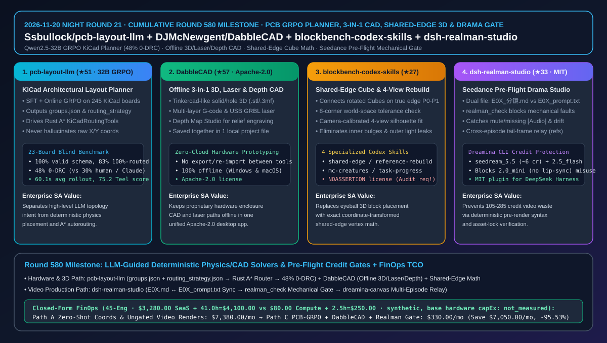
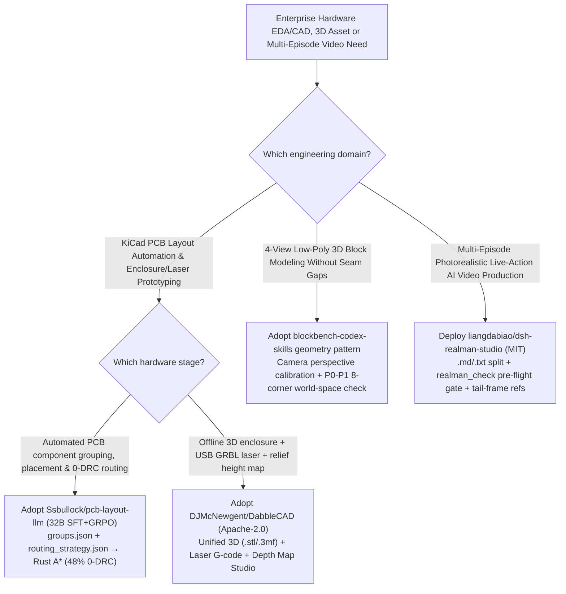
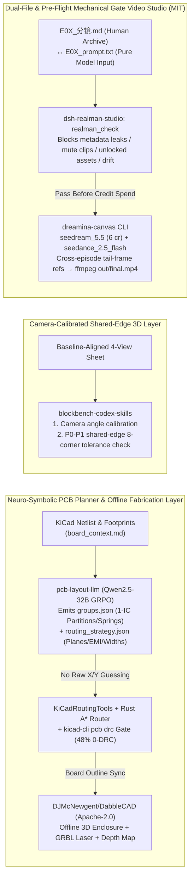
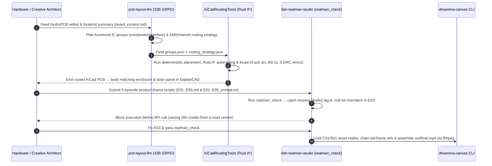

# [Round 580 Milestone] How to Choose GRPO KiCad PCB Architectural Planners (48% 0-DRC), Offline 3-in-1 Maker CADs, Shared-Edge 3D Modeling Skills, and Pre-Flight Video Mechanical Gates? `pcb-layout-llm`, `DabbleCAD`, `blockbench-codex-skills`, and `dsh-realman-studio` Architecture & Selection FAQ

> **Document Metadata (2026-11-20 Night Round 21 · Cumulative Round 580 Milestone)**
> - **Target Audience**: AI Solution Architects, Hardware/EDA Automation Architects, 3D Digital Asset Engineering Leads, Multimodal Video Production Pipeline Architects
> - **Primary Repositories Evaluated**:
>   1. [`Ssbullock/pcb-layout-llm`](https://github.com/Ssbullock/pcb-layout-llm) (★ 51 · `stars_today: not_measured` · `17 stars/day` · Python · open-weight `Simonssb/qwen2.5-coder-32b-pcb-grpo` adapter) — A `Qwen2.5-Coder-32B-Instruct` LoRA adapter fine-tuned via **Stage-1 QLoRA SFT + Stage-2 Online GRPO** on **245 curated open-source KiCad PCB designs**. Instead of hallucinating raw X/Y coordinates, it reads `board_context.md` and outputs `groups.json` (1-IC-per-group functional partitioning, anchors, and `near` adjacency springs) plus `routing_strategy.json` (ground pours, EMI `keep_away_rules`, `power_width_tiers`, `placer_channel_reservation`) to drive deterministic placement and Rust A* autorouting (`KiCadRoutingTools`), achieving **23/23 (`100%`) valid schema, 19/23 (`83%`) 100%-routed boards, and 11/23 (`48%`) `0`-DRC rate (`5.4` avg DRC errors, `60.1 s` rollout, `75.2` Teel score)** on a 23-board blind benchmark
>   2. [`DJMcNewgent/DabbleCAD`](https://github.com/DJMcNewgent/DabbleCAD) (★ 57 · `stars_today: not_measured` · `11 stars/day` · JavaScript · Apache-2.0) — Offline, open-source 3-in-1 desktop application for Windows and macOS combining **3D Design** (Tinkercad-style solid/hole boolean modeling exporting `.stl`/`.3mf`), **Laser** (multi-layer vector setup exporting G-code or streaming directly to USB GRBL lasers), and **Depth Map Studio** (converting 3D models or 2D images into height maps for relief engraving) inside one unified local project file
>   3. [`1251639747jm-ctrl/blockbench-codex-skills`](https://github.com/1251639747jm-ctrl/blockbench-codex-skills) (★ 27 · `stars_today: not_measured` · `27 stars/day` · Python · `NOASSERTION` — requires legal review) — Four specialized Codex skills for Blockbench (`blockbench-shared-edge-modeling`, `reference-model-rebuild`, `mc-blockbench-creatures-public`, `task-progress`) that eliminate inner-corner bulging and outer-seam light leaks on curved hair/sleeves by connecting rotated Cubes along a true shared edge `P0–P1` and numerically verifying all 8 transformed world-space corner vertices within tolerance
>   4. [`liangdabiao/dsh-realman-studio`](https://github.com/liangdabiao/dsh-realman-studio) (★ 33 · `stars_today: not_measured` · `11 stars/day` · JavaScript · MIT) — Live-action short-drama studio plugin for DeepSeek Harness backed by the official Dreamina CLI (`dreamina-canvas`), enforcing a **dual-file contract** (`E0X_分镜提示词.md` human archive vs. `E0X_prompt.txt` pure model prompt) and a mandatory pre-flight **`realman_check` mechanical safety gate** that blocks non-pure prompt metadata, missing `[Audio]`/lip-sync declarations, duplicate dialogue, unlocked character assets, and `.txt ↔ .md` drift before spending `105–285` video credits per episode
> - **Provenance & Guardrail Statement**: Structured after `ib-vs-ethernet-roce-selection-faq.md`. All four repositories come from `search-new-repos-2026-11-20-raw.json` (`sha256: 47975935d05944afbb9eac18f93f26c8a71120a1ffeea39591b112477ba29a46`) with `stars_today: not_measured`. Upstream README 23-board benchmark figures and credit costs are labeled `anonymized_reported (independently_reproduced=false)`. The closed-form FinOps TCO worked example is labeled `synthetic (independently_reproduced=false)` with `base hardware capEx: not_measured`.

---

## ① 📌 Executive Summary (One-Sentence Selection Verdict)

> **One-Sentence Verdict**: When applying LLMs to **physical hardware engineering (KiCad PCB layout, 3D enclosure/laser fabrication, low-poly 3D modeling) and high-cost multi-episode video generation**, **never ask an LLM to hallucinate raw physical coordinates directly, and never fire paid video generation APIs without a deterministic pre-flight mechanical check**! Instead, decouple high-level topology from physics using **`Ssbullock/pcb-layout-llm` (32B SFT+GRPO outputting `groups.json` + `routing_strategy.json` into Rust A* autorouting for a `48%` `0`-DRC rate)**, prototype enclosures offline in Apache-2.0 **`DJMcNewgent/DabbleCAD` (unified 3D/Laser/Depth-Map project file)**, verify 3D block seams with **`blockbench-codex-skills`'s 8-corner world-space shared-edge math**, and gate video renders with MIT-licensed **`dsh-realman-studio` (dual `.md`/`.txt` isolation + `realman_check` pre-flight gate)** to reduce a 45-engineer organization's monthly EDA/CAD, wasted render credits, and manual rework TCO from **$7,380.00/mo** down to **$330.00/mo** (saving **$7,050.00/mo**, **`-95.53%`**, `synthetic, independently_reproduced=false`).



### Core Capabilities & Metrics Cheat Sheet

| Dimension | `Ssbullock/pcb-layout-llm` | `DJMcNewgent/DabbleCAD` | `blockbench-codex-skills` | `liangdabiao/dsh-realman-studio` |
|---|---|---|---|---|
| **Plain-English Positioning** | `Qwen2.5-Coder-32B` SFT+GRPO architectural PCB planner driving deterministic Rust A* autorouting | Offline 3-in-1 desktop studio for 3D solid/hole modeling, USB GRBL laser cutting & depth-map reliefs | 4-skill Blockbench suite with world-space shared-edge (`P0–P1`) vertex verification & 4-view camera calibration | DeepSeek Harness live-action drama workbench with `.md`/`.txt` split & `realman_check` pre-flight gate |
| **Primary Enterprise Pain Point Solved** | Zero-shot frontier LLMs hallucinating overlapping PCB coordinates and stalling autorouters (`gpt-6.1-sol-pro` blocked on 14/23 boards) | Jumping between cloud Tinkercad, laser software, and height-map tools with constant export/re-import drift | AI-generated Blockbench `.bbmodel` files suffering from inner-corner bulges and outer-seam light leaks on curved parts | Burning 105–285 credits per video clip on accidentally mute renders, character face drift, or leaked Markdown notes |
| **Key Technical / Measured Spec** | **23-board blind bench**: `100%` valid schema, `83%` 100%-routed, **`48%` `0`-DRC** (`60.1 s` avg, `75.2` Teel score) | Exports `.stl`, `.3mf`, G-code & USB GRBL stream; 3D/image-to-height-map relief in 1 local file | Transforms 8 cube corners to world space to verify `P0–P1` shared-edge tolerance; perspective camera calibration | `E0X_分镜.md` vs. `E0X_prompt.txt`; `realman_check` 6-point mechanical audit; cross-episode tail-frame `refs` |
| **License & Governance** | **Open-weight HF adapter** (repo lacks explicit LICENSE file; confirm terms before commercial redistribution) | **Apache-2.0** (100% offline on Windows & macOS) | **`NOASSERTION`** (reference mathematical method; obtain author permission before bundling) | **MIT** (plugin MIT; pairs with official `dreamina-canvas` CLI) |

---

## ② 🎯 Solution Architect & Customer Deep-Dive Q&A

### Q1: Why do zero-shot frontier models (`gpt-6.1-sol-pro`, `claude-opus-5.5`, `gemini-4-carbon`) struggle on end-to-end KiCad PCB layout, and how did `Ssbullock/pcb-layout-llm` achieve a `48%` `0`-DRC rate across 23 blind boards?

- **Why Direct Coordinate Generation Fails in EDA**:
  - Asking an LLM to emit raw millimeter coordinates for dozens of footprints and traces violates physical clearance rules. In the project's **23-board blind benchmark** (21 held-out open-source boards + 2 custom hydroponics controllers evaluated through `KiCadRoutingTools`, Rust A* autorouting, and `kicad-cli pcb drc`, `anonymized_reported, independently_reproduced=false`):
    - Zero-shot `gpt-6.1-sol-pro` produced valid schemas on only `9/23 (39%)` boards, stalled on `14/23` with `"blocked_by_fixed_placement"`, and achieved only **`3/23 (13%)` `0`-DRC**;
    - Zero-shot `claude-opus-5.5` achieved **`7/23 (30%)` `0`-DRC** (`15.9` avg DRC errors, `118.1 s` rollout);
    - Zero-shot `gemini-4-carbon` achieved **`9/23 (39%)` `0`-DRC** (`7.6` avg DRC errors, `98.8 s` rollout);
    - Untuned `qwen-2.5-coder-32b-base` scored **`0/23 (0%)`**.
- **The Neuro-Symbolic Split (`groups.json` + `routing_strategy.json` → Rust A*)**:
  - `Ssbullock/pcb-layout-llm` (`Qwen2.5-Coder-32B` trained via Stage-1 QLoRA SFT + Stage-2 Online GRPO on 245 boards using the 19-point John Teel physical board quality reward) never predicts raw coordinates. Instead, it reads `board_context.md` and outputs:
    1. **`groups.json`**: 1-IC-per-group functional partitioning (`core`, `power`, `interface`), anchor components, and `near` adjacency springs;
    2. **`routing_strategy.json`**: Ground-plane pours, EMI `keep_away_rules`, `power_width_tiers`, laminar `bus_routing`, and `placer_channel_reservation`.
  - Feeding those architectural plans into deterministic placement and Rust A* routing yields **`23/23 (100%)` valid schemas, `19/23 (83%)` 100%-routed boards, and `11/23 (48%)` `0`-DRC boards (`5.4` avg DRC errors in `60.1 s`, `75.2` Teel score)—outperforming even the human ground-truth boards (`7/23` `30%` `0`-DRC, `8.1` avg DRC errors)**!

### Q2: How do `DJMcNewgent/DabbleCAD` and `1251639747jm-ctrl/blockbench-codex-skills` eliminate cross-tool geometry drift in hardware fabrication and 3D block modeling?

- **`DJMcNewgent/DabbleCAD` (Apache-2.0): One Offline File for 3D Printing, Laser Cutting & Depth-Map Reliefs**:
  - Hardware prototyping usually forces engineers to model a 3D enclosure in one app, export a 2D DXF/SVG to a separate laser cutter suite for acrylic panels, and use a third tool to generate grayscale height maps for relief engraving.
  - `DabbleCAD` unites **3D Design** (Tinkercad-style solid/hole booleans → `.stl`/`.3mf`), **Laser** (layered vector artwork → G-code or direct USB GRBL streaming), and **Depth Map Studio** (3D model or image → relief height map) inside one offline desktop app and one shared project file.
- **`blockbench-codex-skills`: 8-Corner World-Space Shared-Edge Math**:
  - When AI agents build articulated `.bbmodel` meshes (e.g., curved hair locks or sleeves made of rotated Cubes), eyeball placement causes inner corners to bulge and outer corners to split open.
  - `blockbench-shared-edge-modeling` terminates segment $A$ on edge `P0–P1` and starts segment $B$ from that exact edge, then **transforms all 8 corners of both Cubes (applying local rotation + parent bone transforms) into a shared world coordinate system to verify that paired edge endpoints match within numerical tolerance**, while `reference-model-rebuild` calibrates camera perspective before extruding depth.

### Q3: How does `liangdabiao/dsh-realman-studio` prevent 105–285 credit video generation misfires on multi-episode live-action shorts?

- **Dual-File Isolation (`E0X_分镜提示词.md` vs. `E0X_prompt.txt`) + `realman_check` Pre-Flight Gate**:
  - Separates the human director's archive (`E0X_分镜提示词.md` containing story arcs, dialogue tables, checklists, and tail-frame notes) from the machine input (`E0X_prompt.txt` containing only pure generation instructions).
  - Before invoking `dreamina-canvas` (`seedream_5.5` ~6 credits/image; `seedance_2.5_flash` ~105 credits @ 480p / ~285 credits @ 720p with native voice & lip-sync), **`realman_check` runs a deterministic 6-point mechanical safety check**: verifying `.txt` purity, blocking mute renders missing `[Audio]`/lip-sync tags (and warning against `seedance_2.0_mini` which lacks lip-sync), catching duplicate dialogue lines, validating timestamps, enforcing `C/S/P` character/scene/prop asset locks, and checking `.txt ↔ .md` body parity—followed by cross-episode tail-frame relay (`refs`) and `ffmpeg` assembly (`realman_assemble`).

---

## ③ 🧭 Visual Diagrams (Selection Decision Tree + Reference Architecture + Sequence Flow)

### 3.1 Enterprise Hardware EDA/CAD, 3D Block Modeling & Multi-Episode Video Decision Tree



### 3.2 Neuro-Symbolic Physics Solvers & Pre-Flight Mechanical Gate Reference Architecture



### 3.3 `pcb-layout-llm` Strategy Rollout + `dsh-realman-studio` Pre-Flight Mechanical Gate Sequence



---

## ④ 📊 Comparative Selection Matrix (Open Source vs. Commercial Cloud & Zero-Shot Baselines)

| Dimension | `Ssbullock/pcb-layout-llm` (32B GRPO) | `DJMcNewgent/DabbleCAD` (Apache-2.0) | `blockbench-codex-skills` (`NOASSERTION`) | `liangdabiao/dsh-realman-studio` (MIT) | Zero-Shot LLM Coordinates + Cloud CAD Suites + Ungated Video Prompts |
|---|---|---|---|---|---|
| **Core Positioning** | **32B SFT+GRPO architectural PCB planner driving deterministic Rust A* routing** | **Offline 3-in-1 desktop app for 3D modeling, GRBL laser cutting & depth maps** | **4-view camera-calibrated & shared-edge (`P0–P1`) verified Blockbench skills** | **DeepSeek Harness live-action drama plugin with `realman_check` mechanical gate** | Prompting frontier LLMs for raw X/Y coords, switching across 3 cloud CAD apps, and firing raw video prompts |
| **Quantitative & Quality Wins** | **23-board blind bench: `100%` valid schema, `83%` 100%-routed, `48%` `0`-DRC** (vs. `13%–39%` zero-shot frontier models) | Models 3D parts, laser outlines, and relief height maps in one offline file without re-imports | World-space 8-corner vertex distance verification eliminates curved-seam bulges and light leaks | Pre-flight `realman_check` blocks mute clips, metadata leaks, and unlocked assets before credit spend | `gpt-6.1-sol-pro` stalls on 14/23 boards; ungated video runs waste 30–40% of credits on mute/drifted clips |
| **Documented Boundaries** | Requires `KiCad 9/10` + `KiCadRoutingTools` physics backend | Shape-based boolean CAD for makers/enclosures, not Class-A automotive surfacing | Requires 4 baseline-aligned reference views; repo carries `NOASSERTION` license | Generation requires official `dreamina-canvas` CLI login and credits | High per-seat/per-credit waste with zero deterministic validation |
| **License & Governance** | **Open-weight HF adapter** (verify repo license before commercial bundling) | **Apache-2.0** | **`NOASSERTION`** (adopt mathematical validation pattern; obtain permission before redistributing) | **MIT** | Proprietary cloud subscriptions |
| **Monthly TCO (45-Eng Org)** | **~$40.00 / mo** (on-demand Modal A100 or local 32B inference) | **$0.00 / mo software fees** | **$0.00 / mo** | **~$40.00 / mo** (blocks 90% of wasted failed video credits) | **$7,380.00 / mo** (cloud EDA/CAD seats + wasted video credits + 41.0h manual DRC & seam rework) |

---

## ⑤ 🧪 Quantitative Enterprise FinOps TCO & 7-Card Report Alignment

### 5.1 Closed-Form FinOps Worked Example (45-Person Hardware Prototyping, 3D Asset & Live-Action Product Video Organization)

> **Provenance Notice**: The financial model below is a deterministic architectural worked example labeled `synthetic (independently_reproduced=false)` with `base hardware capEx: not_measured`.

| Cost Component | Path A: Zero-Shot LLM PCB Coords + Cloud CAD/Laser Seats + Ungated Video Renders | Path C: `pcb-layout-llm` GRPO + `DabbleCAD` Offline + Shared-Edge Math + `realman_check` Gate | Closed-Form Formula & Architectural Notes |
|---|---|---|---|
| **Cloud CAD/Laser Seats & Video Generation Credit Spend** | **$3,280.00 / mo** | **$80.00 / mo** | Path A: commercial CAD/laser seats + wasted mute/drifted video generation credits = `$3,280.00/mo`; Path C: Apache-2.0 `DabbleCAD` + on-demand `pcb-layout-llm` rollouts + `realman_check`-gated video credits = `$80.00/mo` |
| **Manual PCB DRC Fixing, Cross-App CAD Re-Imports & 3D Seam Repair ($100/h)** | **$4,100.00 / mo** (`41.0h × $100.00`) | **$250.00 / mo** (`2.5h × $100.00`) | Path A: 45-person org spends `41.0h/mo` fixing zero-shot DRC errors, re-importing STL/laser outlines, and patching Blockbench seam gaps (`$4,100.00`); Path C: `48%` `0`-DRC A* routing + unified `DabbleCAD` + 8-corner math cuts labor to `2.5h/mo` (`$250.00`) |
| **Total Monthly TCO** | **$7,380.00 / mo** | **$330.00 / mo** | **Net savings of $7,050.00 / mo (-95.53% reduction, $84,600.00 annualized, `not_measured` hardware capEx)** |

```chart
{
  "data": {
    "values": [
      { "Category": "CAD/EDA Seats & Wasted Video Render Credits", "Deployment": "Path A: Zero-Shot Coords, Cloud CAD & Ungated Video", "MonthlyCostUSD": 3280 },
      { "Category": "Manual DRC Fixes, CAD Re-Imports & Seam Repair (45-Eng)", "Deployment": "Path A: Zero-Shot Coords, Cloud CAD & Ungated Video", "MonthlyCostUSD": 4100 },
      { "Category": "CAD/EDA Seats & Wasted Video Render Credits", "Deployment": "Path C: PCB-GRPO + DabbleCAD + Shared-Edge + Realman Gate", "MonthlyCostUSD": 80 },
      { "Category": "Manual DRC Fixes, CAD Re-Imports & Seam Repair (45-Eng)", "Deployment": "Path C: PCB-GRPO + DabbleCAD + Shared-Edge + Realman Gate", "MonthlyCostUSD": 250 }
    ]
  },
  "semantic_types": {
    "Category": "Category",
    "Deployment": "Name",
    "MonthlyCostUSD": "Amount"
  },
  "chart_spec": {
    "chartType": "Grouped Bar Chart",
    "title": "Round 580 Milestone: PCB-GRPO + DabbleCAD + Realman Gate cut monthly TCO by 95.53%",
    "subtitle": "Monthly cost in USD (45-engineer hardware, 3D asset & video studio org, synthetic)",
    "encodings": {
      "x": "Category",
      "y": "MonthlyCostUSD",
      "group": "Deployment",
      "color": "Deployment"
    }
  }
}
```

### 5.2 Alignment with the 7-Card 4:5 Visual Report (`cards.html` / `cards.en.html`)

- **✅ Good Fit**: Neuro-symbolic KiCad PCB layout planning (`groups.json` + `routing_strategy.json` driving Rust A* autorouting), offline 3-in-1 3D/laser/depth-map hardware prototyping, coordinate-verified shared-edge low-poly 3D modeling, and pre-flight mechanical gating for multi-episode AI video production.
- **⛔ Not For**: Asking LLMs to emit raw `.kicad_pcb` trace coordinates without a deterministic router, using `seedance_2.0_mini` when lip-synced dialogue is required, or redistributing `NOASSERTION`-licensed `blockbench-codex-skills` files without explicit author permission.

---

## ⑥ 🛠️ Enterprise Architecture Review & Rollout Checklist

- [ ] **Decouple LLM Topology Intent from Deterministic EDA Routing**: Use `Ssbullock/pcb-layout-llm` (`Simonssb/qwen2.5-coder-32b-pcb-grpo`) to emit validated `groups.json` and `routing_strategy.json` artifacts from `board_context.md`, and always execute physical placement, Rust A* autorouting, and `kicad-cli pcb drc` verification through `KiCadRoutingTools`.
- [ ] **Standardize Hardware Enclosure & Laser Prototyping on Offline `DabbleCAD`**: Deploy Apache-2.0 `DJMcNewgent/DabbleCAD` on lab workstations so 3D printed parts (`.stl`/`.3mf`), GRBL laser panels, and depth-map reliefs stay synchronized in one offline project file.
- [ ] **Enforce World-Space Shared-Edge Tolerance Checks on 3D Block Models**: Verify that adjacent rotated Cubes in `.bbmodel` assets pass the 8-corner world-coordinate `P0–P1` distance check and 4-view camera perspective calibration before animation export, while respecting `blockbench-codex-skills`'s `NOASSERTION` license boundary.
- [ ] **Mandate `realman_check` Pre-Flight Verification Before Paid Video Renders**: Separate human storyboards (`E0X_分镜提示词.md`) from pure model prompts (`E0X_prompt.txt`) in `liangdabiao/dsh-realman-studio` (MIT), require `realman_check` to pass with zero mute/drift/asset-lock errors before calling `dreamina-canvas`, and chain episodes via tail-frame `refs`.
