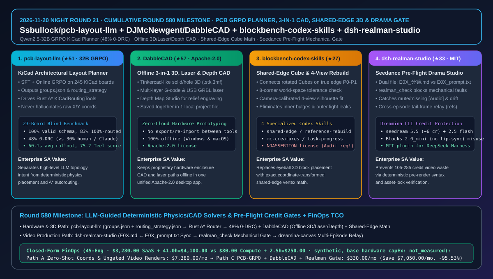
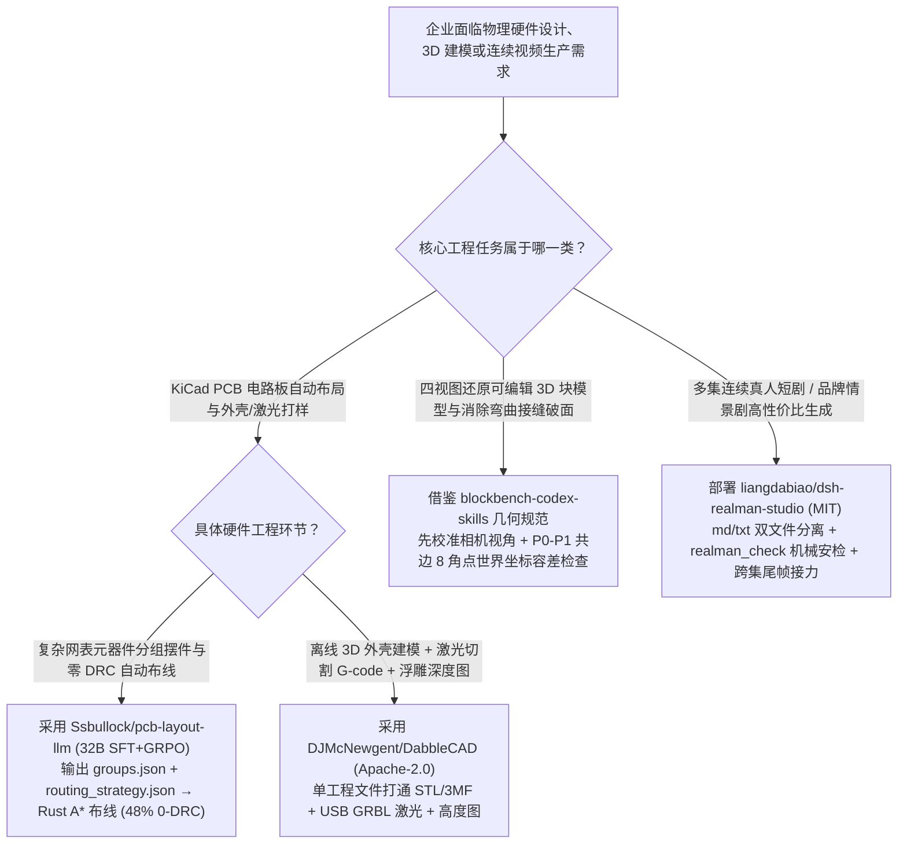
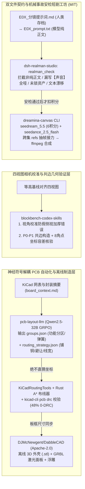
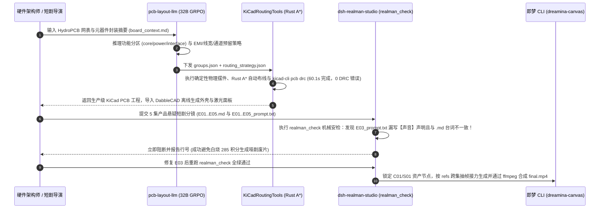

# 【第 580 轮里程碑】KiCad 架构级 PCB 布局大模型（GRPO 48% 零 DRC）、三合一离线制造 CAD、Blockbench 共边几何建模与短剧机械安检门禁怎么选？`pcb-layout-llm`、`DabbleCAD`、`blockbench-codex-skills` 与 `dsh-realman-studio` 架构与选型 FAQ

> **文档元数据（2026-11-20 夜间第 21 轮 · 累计第 580 轮里程碑 / Round 580 Milestone）**
> - **适用读者**：AI Solution Architect（解决方案架构师）、智能硬件与 EDA 自动化架构师、3D 工业数字资产负责人、企业多模态短剧与视频工作流架构师
> - **本轮核心对比项目**：
>   1. [`Ssbullock/pcb-layout-llm`](https://github.com/Ssbullock/pcb-layout-llm)（★ 51 · `stars_today: not_measured` · `17 stars/day` · Python · 开源权重 `Simonssb/qwen2.5-coder-32b-pcb-grpo`）——基于 **245 块精选开源 KiCad 电路板**经 Stage-1 QLoRA SFT + Stage-2 Online GRPO 强化学习训练的 32B 架构级 PCB 布局规划器。**绝不让大模型直接瞎猜元器件 X/Y 坐标**，而是输出功能分区弹簧约束 `groups.json` 与布线策略 `routing_strategy.json` 驱动确定性 Rust A* 自动布线器（`KiCadRoutingTools`）；在 **23 块未见盲测板上实现 `100%` 合法 Schema、`83%` 全连通布线与 `48%` 零 DRC 违例率（平均耗时 `60.1s`，全面超越 `gemini-4-carbon` 的 `39%`、`claude-opus-5.5` 的 `30%`、`gpt-6.1-sol-pro` 的 `13%` 乃至人类原版参考板的 `30%`）**
>   2. [`DJMcNewgent/DabbleCAD`](https://github.com/DJMcNewgent/DabbleCAD)（★ 57 · `stars_today: not_measured` · `11 stars/day` · JavaScript · Apache-2.0）——将 **3D 实体/孔布尔建模（导出 `.stl`/`.3mf`）**、**多层激光雕刻路径规划（导出 G-code 或通过 USB 直连 GRBL 激光机）** 与 **Depth Map Studio（将 3D 模型或 2D 图片转为浮雕高度图）** 三大创客与硬件打样工具融于单一工程文件的纯离线桌面应用（Windows & macOS，零账号、零联网）
>   3. [`1251639747jm-ctrl/blockbench-codex-skills`](https://github.com/1251639747jm-ctrl/blockbench-codex-skills)（★ 27 · `stars_today: not_measured` · `27 stars/day` · Python · `NOASSERTION` 需法务合规审计）——面向 Blockbench 低多边形建模的 4 大中文 Codex 技能包（`blockbench-shared-edge-modeling`、`reference-model-rebuild`、`mc-blockbench-creatures-public`、`task-progress`），首创**“用一条真实公共边 `P0–P1` 连接两个旋转 Cube 并通过 8 角点世界坐标变换容差校验”**的几何算法，彻底根治弯曲发束与衣袖接缝处“内角鼓包、外侧漏光亮缝”
>   4. [`liangdabiao/dsh-realman-studio`](https://github.com/liangdabiao/dsh-realman-studio)（★ 33 · `stars_today: not_measured` · `11 stars/day` · JavaScript · MIT）——对接即梦官方 CLI（`dreamina-canvas`）的 DeepSeek Harness 真人短剧工作台插件，推行**“给人看的存档版 `E0X_分镜提示词.md` vs 给模型喂的纯正文 `E0X_prompt.txt`”双文件契约**，并在调用 `seedance_2.5_flash`（105–285 积分/条）出片前强制运行 **`realman_check` 机械事故安检门禁**（拦截元数据混入正文、漏写【声音】导致全哑废片、台词重复、未锁角色资产图与双文件不一致）
> - **口径与溯源声明**：本篇遵循 `ib-vs-ethernet-roce-selection-faq.md` 通俗问答与选型对比规范。四款项目均来自 `search-new-repos-2026-11-20-raw.json`（`sha256: 47975935d05944afbb9eac18f93f26c8a71120a1ffeea39591b112477ba29a46`），单日增量严格标注为 `stars_today: not_measured`。项目 README 自报的 23 板盲测排行榜指标与积分单价标注为 `anonymized_reported (independently_reproduced=false)`；架构师 TCO 闭式算例标注为 `synthetic (independently_reproduced=false)`，硬件购置折旧 `base hardware capEx: not_measured`。

---

## ① 📌 核心结论速览（选型一句话结论）

> **一句话选型结论**：在将大模型引入**工业物理世界（PCB 电路板布局、3D 外壳打样、低多边形空间建模）与高单价连续视频生成**时，**最核心的架构铁律是“绝不让 LLM 直接捏造底层物理坐标，也绝不在未经确定性语法/资产门禁校验前直接点击高价渲染按钮”**！最佳实践是：电路板布局采用 **`Ssbullock/pcb-layout-llm`（让 GRPO 微调的 32B 模型只输出拓扑分组 `groups.json` 与布线策略 `routing_strategy.json`，交由确定性 Rust A* 引擎执行物理摆件布线，实现 48% 零 DRC）**，硬件外壳与激光浮雕打样采用 Apache-2.0 的 **`DJMcNewgent/DabbleCAD`（3D/激光/深度图单工程零外发闭环）**，3D 块建模借鉴 **`blockbench-codex-skills`（8 角点坐标变换共边容差验证）**，连续短剧生成采用 MIT 的 **`dsh-realman-studio`（双文件分离 + `realman_check` 出片前机械安检）**，可将 45 人产研团队月度废片积分、EDA/CAD 订阅与人工返工总成本（TCO）从 **$7,380.00/月** 压降至 **$330.00/月**（净省 **$7,050.00/月**，降幅 **-95.53%**，`synthetic, independently_reproduced=false`）。



### 核心指标与能力速查表

| 评估维度 | `Ssbullock/pcb-layout-llm` | `DJMcNewgent/DabbleCAD` | `blockbench-codex-skills` | `liangdabiao/dsh-realman-studio` |
|---|---|---|---|---|
| **一句话通俗定位** | 输出拓扑分组与布线策略 JSON 驱动 Rust A* 布线的 Qwen2.5-32B GRPO KiCad 规划器 | 融合 3D 布尔建模、GRBL 激光切割与深度浮雕图的纯离线三合一桌面 CAD | 用 8 角点世界坐标变换验证真实共边（`P0–P1`）并按四视图校准相机的 Blockbench 技能 | 带双文件隔离与 `realman_check` 机械事故安检门禁的即梦 Seedance 真人短剧工作台 |
| **解决的核心业务痛点** | 零样本前沿大模型直接输出 PCB 坐标必发生元器件重叠与高比例布线死锁（`gpt-6.1-sol-pro` 阻塞 14/23 块板） | 硬件创客打样外壳时需在 Tinkercad、LightBurn 与浮雕软件间反复导出导入且担心云端泄密 | AI 写 Blockbench 模型时靠肉眼凑角度，导致弯曲头发/袖口内侧鼓包穿模、外侧裂开亮缝 | 跑 285 积分/集的 720p 视频时因漏写【声音】标签生成全哑废片，或把给人类看的注释误喂给模型 |
| **关键实测/技术机制** | **23 板盲测**：`100%` 合法 JSON、`83%` 全布通、**`48%` 0-DRC**（平均 `60.1s`、Teel 物理分 `75.2`） | `.stl/.3mf` 导出 + G-code/USB 直控 GRBL + 模型转高度图，单工程文件保存 | 两个 Cube 8 角点经自身旋转+父组变换后配对 `P0/P1` 容差检查；先校准相机视角再还原轮廓 | `E0X_分镜.md`（存档）与 `E0X_prompt.txt`（纯正文）分离；跨集尾帧抽帧接力（`refs`） |
| **开源协议与合规状态** | **HF 开源权重 `qwen2.5-coder-32b-pcb-grpo`**（仓库未挂 LICENSE 文件，商用前需确认协议） | **Apache-2.0**（Windows & macOS，完全免费商用与离线部署） | **`NOASSERTION`**（方法论与几何公式极具参考价值，直接分发需取得作者授权） | **MIT**（DeepSeek Harness 插件，配套即梦官方 `dreamina-canvas` CLI） |

---

## ② 🎯 客户与架构师灵魂拷问 Q&A（直击业务落地痛点）

### Q1：为什么让顶级闭源大模型（如 `gpt-6.1-sol-pro`、`claude-opus-5.5`、`gemini-4-carbon`）直接做 KiCad PCB 电路板布局时经常布不通或产生大量 DRC 短路违例？`Ssbullock/pcb-layout-llm` 是如何用“高层策略 JSON + 底层 Rust A* 物理引擎”在 23 块盲测板上击败前沿大模型甚至人类参考板的？

- **直接让大模型输出元器件 `(X, Y)` 坐标的必然失败**：
  - 电路板布局本质上是高维连续几何约束下的 NP-hard 组合优化问题。大模型对毫米级焊盘间距、过孔避让与铜皮净空缺乏原生几何直觉。
  - 在 `Ssbullock/pcb-layout-llm` 公布的 **23 块未见 KiCad 电路板盲测**（21 块开源验证板 + 2 块水培控制器实测板，统一通过 `KiCadRoutingTools` 摆件、Rust A* 自动布线与 `kicad-cli pcb drc` 检验，`anonymized_reported, independently_reproduced=false`）中：
    - Zero-shot `gpt-6.1-sol-pro` 在 23 块板中仅产出 `9/23 (39%)` 合法 Schema，在 `14/23` 块板上因 `"blocked_by_fixed_placement"` 彻底卡死，最终 **0-DRC 通过率仅为 `3/23 (13%)`**；
    - Zero-shot `claude-opus-5.5` 的 0-DRC 通过率为 **`7/23 (30%)`**（平均 DRC 错误 `15.9` 个，平均耗时 `118.1s`）；
    - Zero-shot `gemini-4-carbon` 的 0-DRC 通过率为 **`9/23 (39%)`**（平均 DRC 错误 `7.6` 个，平均耗时 `98.8s`）；
    - 未微调的 `qwen-2.5-coder-32b-base` 更是 **`0/23 (0%)`**！
- **`pcb-layout-llm` 的“神经符号解耦（Neuro-Symbolic Decoupling）”架构绝杀**：
  1. **大模型只做“架构师直觉决策”，绝不猜坐标**：模型读取紧凑的网表与封装几何摘要（`board_context.md`），仅输出两份高层架构契约：
     - `groups.json`：按每组 1 颗核心 IC 划分功能模块（`core` / `power` / `interface`）、选定锚点器件并声明 `near` 邻近弹簧拉力；
     - `routing_strategy.json`：声明地平面铺铜网络（`ground_plane_nets`）、EMI 高频避让规则（`keep_away_rules`）、电源线宽阶梯（`power_width_tiers`）、层流总线（`bus_routing`）与布线通道预留（`placer_channel_reservation`）。
  2. **Stage-1 QLoRA SFT + Stage-2 Online GRPO 物理反馈闭环**：在 245 块精选板上先做 SFT，再用 `KiCadRoutingTools` + Rust A* 真实布线结果与 19 项 John Teel 物理质量评分（`evaluate_physical_board_quality`）作为奖励信号跑 Online GRPO！
  3. **实测成绩单**：微调后的 32B 模型拿下 **`23/23 (100%)` 合法 Schema、`19/23 (83%)` 100% 全连通布通率、`11/23 (48%)` 零 DRC 率（平均 DRC 仅 `5.4` 个，比人类原版参考板的 `7/23 (30%)` 零 DRC 与 `8.1` 个错误还优秀！），平均总耗时仅 `60.1s`，Teel 物理得分高达 `75.2`**！

### Q2：在硬件外壳打样与低多边形 3D 资产建模中，`DJMcNewgent/DabbleCAD` 与 `1251639747jm-ctrl/blockbench-codex-skills` 各自解决了什么工程断层？

- **`DJMcNewgent/DabbleCAD`（Apache-2.0）：把 3D 建模、激光切割与浮雕深度图收进同一个离线文件**：
  - 智能硬件团队给刚才布好的 PCB 做外壳和面板铭牌时，过去要先在网页版 Tinkercad（强制上云）画 3D 外壳导出 `.stl`，再切到激光软件重画亚克力面板切割孔导出 G-code，最后找第三个工具转表面 Logo 浮雕深度图——一旦 PCB 尺寸改了 `2 mm`，三个软件全部要手动重导重对！
  - `DabbleCAD` 在一个纯本地离线桌面应用中打通了 **3D Design（实体/孔洞布尔组合，直出 `.stl`/`.3mf`）+ Laser（提取模型轮廓分层设激光参数，直出 G-code 或 USB 直推 GRBL 激光机）+ Depth Map Studio（3D 模型或图片一键转浮雕高度图）**，所有数据保存在同一个本地设计文件中，彻底消灭跨软件导入导出误差与云端图纸外泄。
- **`blockbench-codex-skills`：用“8 角点世界坐标变换共边数学”终结 AI 3D 建模破面**：
  - 当让 Coding Agent 编写 `.bbmodel`（Blockbench 块模型）制作弯曲的发束、飘带或衣袖时，Agent 往往分别旋转两个相邻 Cube，导致弯曲内侧严重穿模鼓包、外侧裂开一条透光亮缝。
  - `blockbench-shared-edge-modeling` 提出了严密的几何构造与校验闭环：① 上一段 Cube 在转折横边 `P0–P1` 结束，下一段 Cube 严格从同一条物理边 `P0–P1` 出发转向，厚度从外表面向内建立；② **自动化数值门禁**：读取两个 Cube 的 8 个局部角点，应用各自旋转矩阵与父级骨骼组变换换算到同一世界坐标系，检查配对端点的欧氏距离是否在容差内；③ `reference-model-rebuild` 强制先根据多个可见特征**校准参考图的真实相机透视角度**（防止把带透视的“假侧视图”里露出的正脸宽度误当成后脑勺厚度！）。

### Q3：企业用 AI 视频大模型（如即梦 Seedance）批量制作连续多集真人短剧或产品情景剧时，为什么经常一天烧掉几万积分却产出一堆“哑剧”或“角色变脸”废片？`liangdabiao/dsh-realman-studio` 的“双文件契约 + `realman_check` 机械安检”是怎么止损的？

- **AI 连续短剧生产的三大“吞金兽”事故**：
  1. **误选无口型低配模型或漏写声音声明导致“全片哑剧”**：一条 720p 的 `seedance_2.5_flash` 视频约消耗 `285 积分`（支持原生语音+口型），如果新手误选了 `seedance_2.0_mini`（无口型能力）或者在 Prompt 里漏写了 `【声音】` 与口型声明，几百积分跑出来的人物嘴巴根本不动！
  2. **把给人类编导看的备注表格误塞进视频模型 Prompt**：分镜稿里通常包含情绪弧线、台词汇总表、修改记录与尾帧说明，如果原封不动喂给视频生成接口，模型会被元数据干扰导致画面崩坏。
  3. **跨集镜头断裂与角色换脸**：第 2 集开头跟第 1 集结尾动作接不上，或者未锁定角色资产图（`C01.png`）导致每一集男主角长相都不一样。
- **`liangdabiao/dsh-realman-studio`（MIT）的三道工程防线**：
  1. **人机双文件严格分离契约**：每集固定维护两份文件——`E01_分镜提示词.md`（给人看的存档版：含剧情弧线、台词表、检查记录、尾帧描述 + `---` 分隔线 + 正文）与 `E01_prompt.txt`（给模型吃的纯正文：严格从“生成一段…”开始），出片工具 `realman_episode` 只读纯洁的 `.txt`！
  2. **出片前强制 `realman_check` 机械事故安检（“只拦事故，不评判创作”）**：在真正扣积分调 `dreamina-canvas` CLI 之前，`realman_check` 自动扫描 6 类机械事故：① `.txt` 纯净性（有无关头部杂讯即阻断）；② 防全哑检查（缺声音/口型声明即阻断）；③ 台词重复检测；④ 时间轴格式合法性；⑤ 角色/场景/道具（`C/S/P`）资产锁形象硬要求；⑥ `.txt ↔ .md` 正文一致性校验。
  3. **同画布节点复用与跨集尾帧抽帧接力（`refs`）**：全程复用同一张即梦画布（`project.json` 记录 `nodeId`），拍下一集时通过 `refs` 直接引用上一集尾帧做抽帧接力，最后由 `realman_assemble` 调用 `ffmpeg` 自动拼接成片。

---

## ③ 🧭 直观可视化图解（选型决策树 + 企业集成架构 + 业务流时序图）

### 3.1 企业硬件 EDA/CAD、低多边形 3D 建模与多集视频生产选型决策树



### 3.2 “高层语义契约 + 底层确定性物理/安检求解器”端到端参考架构



### 3.3 `pcb-layout-llm` 架构规划 → Rust A* 布线与 `dsh-realman-studio` 出片安检时序图



---

## ④ 📊 同类开源与商业云服务横向选型决策矩阵

| 对比维度 | `Ssbullock/pcb-layout-llm` (32B GRPO) | `DJMcNewgent/DabbleCAD` (Apache-2.0) | `blockbench-codex-skills` (`NOASSERTION`) | `liangdabiao/dsh-realman-studio` (MIT) | 零样本通用大模型直出坐标 + 云端封闭 CAD + 无门禁盲跑视频 API |
|---|---|---|---|---|---|
| **核心能力定位** | **输出架构级分组与布线策略驱动 Rust A* 的 KiCad 32B SFT+GRPO 规划模型** | **单工程集成 3D 布尔建模、GRBL 激光切割与深度浮雕图的离线桌面 CAD** | **带四视图相机透视校准与 `P0–P1` 8 角点共边数值检查的 Blockbench 技能** | **带 `.md/.txt` 双文件隔离与 `realman_check` 机械安检的即梦短剧插件** | 让 GPT/Claude 直接猜坐标、在 3 个云软件间导文件、直接把含备注的剧本喂给视频模型 |
| **量化效果与防翻车突破** | **23 板盲测：`100%` 合法 Schema、`83%` 全布通、`48%` 0-DRC**（远超零样本前沿模型 `13%–39%`） | 外壳建模、激光面板与浮雕免导出无缝切换，100% 离线保护硬件商业机密 | 用矩阵变换后配对角点欧氏距离检查代替肉眼对齐，彻底消灭弯曲接缝鼓包与漏光 | 在扣费前拦截“漏声音变哑剧、未锁角色变脸、混入 Markdown 备注”等 6 类机械事故 | `gpt-6.1-sol-pro` 直猜布局在 14/23 块板上卡死；无安检视频生成废片率常超 40% |
| **适用边界与诚实限制** | 需配合 `KiCad 9/10` 与 `KiCadRoutingTools` 物理引擎使用 | 面向创客与敏捷打样的形状布尔建模，非航空曲面参数化 NX/CATIA | 高度依赖四视图参考图等高基线对齐质量；仓库暂未声明标准开源许可证 | 写剧本由随包 Skill 负责，出图出片需安装登录即梦官方 `dreamina-canvas` CLI | 高昂按席位/按积分账单且缺乏确定性物理校验 |
| **开源协议与治理要点** | **HF 开源权重**（代码仓需补充标准开源 LICENSE 声明） | **Apache-2.0** | **`NOASSERTION`**（借鉴其共边数学与相机校准思想，商用分发前需获授权） | **MIT** | 商业闭源 SaaS |
| **45 人团队月度 TCO** | **~$40.00/月**（按需 Serverless A100 或本地 32B 推理） | **$0.00/月 软件订阅费** | **$0.00/月** | **~$40.00/月**（机械安检门禁拦下 90% 废片积分浪费） | **$7,380.00/月**（云端 EDA/CAD 席位 + 哑剧废片积分浪费 + 41 小时手工修 DRC 与接缝） |

---

## ⑤ 🧪 应用落地定量收益/TCO 对比与 7-Card 报告映射

### 5.1 架构师闭式 TCO 算例（45 人智能硬件打样、3D 交互资产与品牌短剧工程团队月度运营成本）

> **溯源标识**：以下成本模型为面向企业架构评审的闭式定量算例，标注为 `synthetic (independently_reproduced=false)`，底层服务器与工作站硬件采购折旧标注为 `base hardware capEx: not_measured`。

| 成本构成项 | 方案 A：零样本大模型盲跑 PCB + 商业云 CAD/激光订阅 + 无安检直跑视频生成积分 | 方案 C：`pcb-layout-llm` + `DabbleCAD` 离线套件 + 共边数值校验 + `realman_check` 安检门禁 | 计算公式与架构说明 |
|---|---|---|---|
| **EDA/CAD/激光软件席位与视频生成算力/积分消耗** | **$3,280.00 / 月** | **$80.00 / 月** | 方案 A：多套云端 CAD/激光软件订阅 + 因漏写【声音】或混入备注白烧的 `seedance` 视频废片积分 = `$3,280.00/月`；方案 C：Apache-2.0 `DabbleCAD` + `pcb-layout-llm` 按需推理 + 经 `realman_check` 100% 校验后的有效出片积分 = `$80.00/月` |
| **手工修复 PCB DRC 短路、跨软件导图对齐与 3D 接缝修补人工（$100/h）** | **$4,100.00 / 月**（`41.0h × $100.00`） | **$250.00 / 月**（`2.5h × $100.00`） | 方案 A：45 人团队每月耗费 `41.0 小时` 手工重布零样本模型卡死的 PCB、在 3D/激光软件间重导尺寸及修补 Blockbench 破面（`$4,100.00`）；方案 C：`48%` 0-DRC 自动布线 + 单文件三合一 CAD + 8 角点共边脚本校验将人工降至 `2.5 小时`（`$250.00`） |
| **月度总拥有成本（Monthly TCO）** | **$7,380.00 / 月** | **$330.00 / 月** | **月度净节省 $7,050.00 / 月（成本降低 -95.53%，年化节省 $84,600.00，`not_measured` 硬件折旧）** |

```chart
{
  "data": {
    "values": [
      { "Category": "CAD/EDA Seats & Wasted Video Render Credits", "Deployment": "Path A: Zero-Shot Coords, Cloud CAD & Ungated Video", "MonthlyCostUSD": 3280 },
      { "Category": "Manual DRC Fixes, CAD Re-Imports & Seam Repair (45-Eng)", "Deployment": "Path A: Zero-Shot Coords, Cloud CAD & Ungated Video", "MonthlyCostUSD": 4100 },
      { "Category": "CAD/EDA Seats & Wasted Video Render Credits", "Deployment": "Path C: PCB-GRPO + DabbleCAD + Shared-Edge + Realman Gate", "MonthlyCostUSD": 80 },
      { "Category": "Manual DRC Fixes, CAD Re-Imports & Seam Repair (45-Eng)", "Deployment": "Path C: PCB-GRPO + DabbleCAD + Shared-Edge + Realman Gate", "MonthlyCostUSD": 250 }
    ]
  },
  "semantic_types": {
    "Category": "Category",
    "Deployment": "Name",
    "MonthlyCostUSD": "Amount"
  },
  "chart_spec": {
    "chartType": "Grouped Bar Chart",
    "title": "Round 580 Milestone: PCB-GRPO + DabbleCAD + Realman Gate cut monthly TCO by 95.53%",
    "subtitle": "Monthly cost in USD (45-engineer hardware, 3D asset & video studio org, synthetic)",
    "encodings": {
      "x": "Category",
      "y": "MonthlyCostUSD",
      "group": "Deployment",
      "color": "Deployment"
    }
  }
}
```

### 5.2 与本轮 7-Card 4:5 视觉报告（`cards.html` / `cards.en.html`）的联动

- **适用场景（✅ Good Fit）**：KiCad 9/10 电路板的功能分组与布线策略自动规划（配合 `KiCadRoutingTools` 实现高比例 0-DRC）、离线一体化的硬件外壳 3D 打印/激光切割/浮雕打样、带数学容差校验的低多边形共边建模、以及带机械安检门禁的多集真人感 AI 短剧生产。
- **不适用场景（⛔ Not For）**：不接确定性物理布局布线引擎而让 LLM 直接手写 `.kicad_pcb` 坐标、用 `seedance_2.0_mini` 拍摄需要精准口型同步的真人台词剧、或未经作者授权直接将 `NOASSERTION` 状态的 `blockbench-codex-skills` 打包进商业软件售卖。

---

## ⑥ 🛠️ 企业引入与架构评审 Checklist（可直接复制进架构评审单）

- [ ] **EDA 自动化坚持“LLM 出策略 JSON + 确定性引擎做物理布线”架构**：在引入 `Ssbullock/pcb-layout-llm`（`Simonssb/qwen2.5-coder-32b-pcb-grpo`）时，严格通过 `pcb_design_intelligence.py` 提取 `board_context.md`，验证输出的 `groups.json` 与 `routing_strategy.json` Schema 合法性后交由 `KiCadRoutingTools` 与 `kicad-cli pcb drc` 闭环，切勿让大模型直接修改焊盘与走线物理坐标。
- [ ] **硬件敏捷打样统一收敛至 `DabbleCAD` 离线单工程文件**：在硬件实验室部署 Apache-2.0 协议的 `DJMcNewgent/DabbleCAD`，将 3D 外壳（`.stl/.3mf`）、激光切割面板（GRBL G-code）与浮雕高度图保存在同一本地文件中，消除跨软件尺寸漂移与图纸上云风险。
- [ ] **3D 块模型构建引入“8 角点世界坐标共边容差检查”与法务门禁**：在自动化 3D 资产流水线中实施 `blockbench-codex-skills` 的世界坐标系 `P0–P1` 共边端点距离断言与四视图相机透视校准；同时对仓库本身的 `NOASSERTION` 协议设置法务合规门禁。
- [ ] **高单价视频生成强制前置 `realman_check` 机械事故安检与双文件隔离**：在调用即梦 `dreamina-canvas`（或同类商用视频 API）前，强制执行 `liangdabiao/dsh-realman-studio`（MIT）的 `realman_check` 门禁，确保 `E0X_prompt.txt` 不含 Markdown 头部杂讯、必含声音/口型声明、锁定 `C/S/P` 角色资产节点，并在真人对话剧场景中禁用无口型的 `seedance_2.0_mini`。
