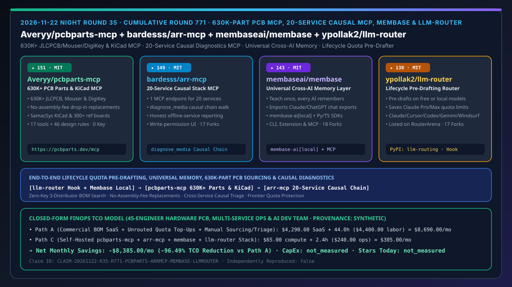
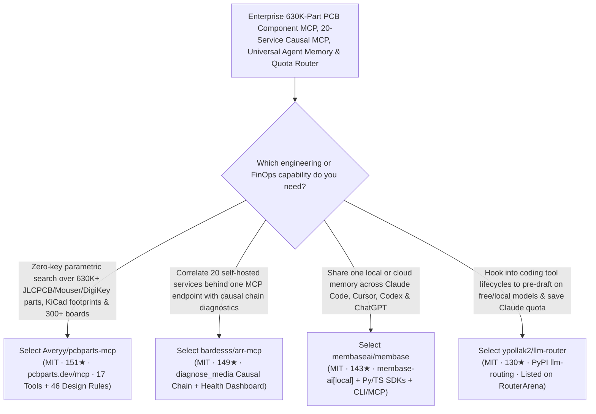
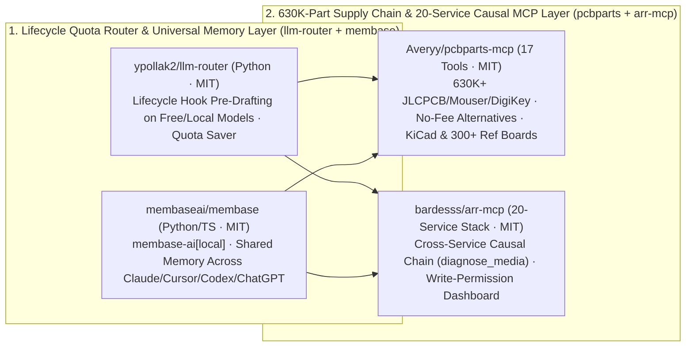

# 630K-Part JLCPCB/Mouser/DigiKey & KiCad MCP (`Averyy/pcbparts-mcp`), 20-Service Causal Diagnostics MCP (`bardesss/arr-mcp`), Cross-AI Universal Memory Layer (`membaseai/membase`) & Lifecycle-Hook Free-Model Pre-Drafter (`ypollak2/llm-router`) Selection & Architecture FAQ

> **Document Type**: Enterprise AI Solution Architect Selection & Integration Guide (GitHub Trending AI Radar — 2026-11-22 Night Round 35 / Cumulative Round 771)
> **Covered Repositories**: [`Averyy/pcbparts-mcp`](https://github.com/Averyy/pcbparts-mcp) (`★ 151`, `15 forks`, `MIT`: zero-key 17-tool MCP server at `https://pcbparts.dev/mcp` providing parametric search over **630K+ in-stock JLCPCB parts**, live Mouser & DigiKey pricing/stock, no-assembly-fee drop-in replacements across 120+ part types, SamacSys KiCad footprints, 300+ reference boards, 1,600+ sensors, and 46 hardware design rules) · [`bardesss/arr-mcp`](https://github.com/bardesss/arr-mcp) (`★ 149`, `17 forks`, `MIT`: single-endpoint MCP server unifying 20 self-hosted services with cross-service causal chain diagnostics via `diagnose_media`) · [`membaseai/membase`](https://github.com/membaseai/membase) (`★ 143`, `18 forks`, `MIT`: universal memory layer for AI agents with `membase-ai[local]`, Python/TypeScript SDKs, CLI, browser extension, and MCP server) · [`ypollak2/llm-router`](https://github.com/ypollak2/llm-router) (`★ 130`, `17 forks`, `MIT`, PyPI `llm-routing`: RouterArena-listed coding tool lifecycle hook that pre-drafts answers on free or local models before consuming Claude Pro/Max quota)
> **Core Scenario**: When enterprise hardware/PCB engineering, multi-service operations, and AI developer productivity teams struggle with **engineers manually cross-checking JLCPCB, Mouser, and DigiKey stock while LLMs hallucinate IC decoupling/crystal wiring, installing 20 separate single-service MCP servers that cannot diagnose a failure spanning 5 APIs, re-explaining project context every time developers switch between Claude Code, Cursor, Codex, and ChatGPT, and burning Claude Pro/Max subscription limits on trivial prompts**, how do you combine **`pcbparts-mcp` + `arr-mcp` + `membase` + `llm-router`** into a high-efficiency engineering stack?

---

## 1. 📌 Executive Summary (One-Line Selection Verdict)

1. **Designing PCBs and want your AI assistant to run plain-English parametric searches over **630K+ in-stock JLCPCB parts**, check live stock and pricing across **JLCPCB, Mouser, and DigiKey**, suggest no-assembly-fee replacements across 120+ part types, download SamacSys KiCad symbols/footprints, and inspect how **300+ open-source reference boards** wire an IC—with zero API key required?** ➔ Choose **[`Averyy/pcbparts-mcp`](https://github.com/Averyy/pcbparts-mcp) (`★ 151`, `15 forks`, `MIT`, `https://pcbparts.dev/mcp`)**.
   - **Plain-English Mechanism**: Connects in one line (`claude mcp add -s user --transport http pcbparts https://pcbparts.dev/mcp`) and exposes 17 specialized hardware tools backed by 1,600+ sensor profiles and 46 EMC/power/layout design rule guides.
2. **Tired of running one isolated MCP server per microservice when real operational questions span 5+ services? Want a single MCP server (`MIT`, `ghcr.io/bardesss/arr-mcp`) that unifies **20 self-hosted media/content pipeline services** and walks the full causal chain (`diagnose_media`) to pinpoint the exact bottleneck?** ➔ Choose **[`bardesss/arr-mcp`](https://github.com/bardesss/arr-mcp) (`★ 149`, `17 forks`, `MIT`)**.
   - **Plain-English Mechanism**: Correlates IDs across request, indexer, downloader, and media server APIs—explicitly reporting any offline service rather than guessing—while providing a dashboard for per-service latency and write permissions.
3. **Want to stop wasting your Claude Pro/Max quota on prompts a free or local model can answer by hooking directly into your coding tool's lifecycle (`MIT`, PyPI `llm-routing`, listed on RouterArena)?** ➔ Choose **[`ypollak2/llm-router`](https://github.com/ypollak2/llm-router) (`★ 130`, `17 forks`, `MIT`)**.
   - **Plain-English Mechanism**: Works across Claude Code, Cursor, Codex, Gemini CLI, Copilot, Kimi, and Windsurf—reading each prompt before the frontier model does and drafting an answer on a free/local model first (with documented sample sizes $n$ and acceptance telemetry in `docs/MEASUREMENT.md`).
4. **Want one project-isolated memory layer (`MIT`, `pip install membase-ai[local]` & `@membaseai/membase`) where facts, docs, web pages, and Claude/ChatGPT chat exports are written once and read by every AI tool over SDK or MCP?** ➔ Choose **[`membaseai/membase`](https://github.com/membaseai/membase) (`★ 143`, `18 forks`, `MIT`)**.
   - **Plain-English Mechanism**: Eliminates context re-explanation when switching between Claude Code, Cursor, Codex, ChatGPT, and custom Python/TypeScript apps.

---

## 2. 🎯 Architect & Customer Deep-Dive Q&A

### Q1: Why are `pcbparts-mcp` (Live 3-Distributor + 300 Reference Boards) and `arr-mcp` (Cross-Service Causal Chain MCP) model examples of Domain-Specific MCP Architecture?

- **Three Architectural Insights**:
  1. **Cross-Service Causal Correlation Over Single-API Wrappers ➔ `bardesss/arr-mcp`**: Wrapping 20 REST APIs as 20 separate MCP servers forces the LLM to burn thousands of tokens joining IDs across systems. `arr-mcp` performs the cross-service causal walk (`requested ➔ monitored ➔ downloaded ➔ indexed ➔ imported`) in code and returns the exact root cause.
  2. **Grounding Hardware Design in Live Supply-Chain & Reference Boards ➔ `Averyy/pcbparts-mcp`**: Pairs live JLCPCB/Mouser/DigiKey stock and no-assembly-fee part rules with 300+ real open-source reference schematics and 46 EMC/layout guides.
  3. **Lifecycle Pre-Drafting & Universal Cross-Tool Memory ➔ `llm-router` + `membase`**: Conserves frontier subscription quotas via lifecycle hooks while keeping project memory synchronized in `membase-ai[local]`.
- **When to Choose Commercial Enterprise Suites (Path B)?**
  - Large electronics enterprises with existing **SiliconExpert / Octopart Enterprise + Altium 365** contracts should keep their enterprise ERP integrations; agile hardware teams, R&D labs, and multi-agent developers seeking zero-key 3-distributor component intelligence, cross-service diagnostic MCPs, and Claude quota optimization should deploy this open-source stack (Path C).

### Q2: How do `llm-router`, `membase`, `pcbparts-mcp`, and `arr-mcp` integrate in an engineering workflow?

1. **Lifecycle Quota Routing & Universal Memory Layer (`ypollak2/llm-router` + `membaseai/membase`)**:
   - Intercepts routine prompts via `llm-router` to draft on free/local models and loads project context from `membase-ai[local]`.
2. **Hardware Component & Reference Design Layer (`Averyy/pcbparts-mcp`)**:
   - Selects in-stock JLCPCB/Mouser/DigiKey parts, verifies no-assembly-fee alternatives, and downloads KiCad footprints (pairing seamlessly with `kicad-mcp-pro` from Round 20).
3. **Multi-Service Causal Diagnostics Layer (`bardesss/arr-mcp`)**:
   - Diagnoses end-to-end multi-service pipelines from one MCP endpoint with explicit write-permission controls.

### Q3: How does `ypollak2/llm-router` avoid silently degrading answer quality on hard architectural tasks?

- **Advisory Default Mode & Configurable Enforcement (`LLM_ROUTER_ENFORCE`)**:
  - By default, routed free/local drafts are advisory—the frontier model still reviews and completes the turn unless you explicitly opt into zero-Claude mode, with transparent acceptance metrics documented in `docs/MEASUREMENT.md`.

---

## 3. 🧭 Visual Architecture & Workflow Diagrams (Mermaid)



### 3.1 Solution Architect Selection Decision Tree



### 3.2 End-to-End Enterprise Reference Architecture



### 3.3 End-to-End Lifecycle Quota Pre-Drafting, Universal Memory Lookup, Component Selection & Causal Pipeline Diagnostics Sequence Diagram

```mermaid
sequenceDiagram
    participant Eng as Hardware & Platform Architect (Claude Code / Cursor)
    participant Lrt as ypollak2/llm-router (Lifecycle Hook)
    participant Mmb as membaseai/membase (Local Memory)
    participant Pcb as Averyy/pcbparts-mcp (630K+ Parts)
    participant Arr as bardesss/arr-mcp (20-Service Stack)

    Eng->>Lrt: 1. Submit prompt; lifecycle hook pre-drafts routine steps on free/local model
    Lrt->>Mmb: 2. Retrieve project design rules & prior chat exports from membase-ai[local]
    Eng->>Pcb: 3. Search 630K+ JLCPCB/Mouser/DigiKey parts, pick no-fee replacements & fetch KiCad footprints
    Eng->>Arr: 4. Run diagnose_media across 20-service pipeline to pinpoint first causal bottleneck
```

---

## 4. 📊 Peer Open-Source vs. Commercial Cloud Selection Matrix

| Dimension | `Averyy/pcbparts-mcp` (`★ 151`) | `bardesss/arr-mcp` (`★ 149`) | `membaseai/membase` (`★ 143`) | `ypollak2/llm-router` (`★ 130`) | Commercial Component Intelligence SaaS + Extra Claude Max Quota Packs (Path A) | Manual 3-Distributor Web Browsing + 20 Separate MCPs + Manual Context Copy-Paste (Path B) |
| :--- | :--- | :--- | :--- | :--- | :--- | :--- |
| **Primary Role** | 630K-part JLCPCB/Mouser/DigiKey & KiCad MCP | 20-service unified causal diagnostics MCP | Cross-AI universal memory SDK, CLI & MCP | Coding-tool lifecycle free/local pre-drafter | High-cost commercial BOM supply-chain APIs & unrouted subscription quota burn | Manual LCSC/Mouser web searches, 20 separate MCPs & manual chat export copy-pasting |
| **Key Differentiator** | **Zero-key + no-assembly-fee alts + 300+ ref boards** | **1 endpoint for 20 services + `diagnose_media` chain** | **Imports Claude/ChatGPT exports + `membase-ai[local]`** | **Lifecycle hook pre-drafting + RouterArena benchmarks** | Commercial component intelligence costs tens of thousands/yr; trivial prompts burn quota | 20 separate MCPs bloat tool context; manual BOM selection misses basic-part fee savings |
| **License** | `MIT` | `MIT` | `MIT` | `MIT` | Proprietary SaaS | Ad-hoc scripts |
| **Monthly TCO (45-Eng Team)** | **`$305.00/mo` combined** (`$65.00` shared local container host + `2.4h` ops) | Included (1 Docker container for 20 services) | Included (`membase-ai[local]` on-machine) | Included (`MIT` quota-saving plugin) | **`$8,690.00/mo`** (`$4,290.00` commercial BOM SaaS & quota top-ups + `44.0h` manual BOM/pipeline triage) | ~`$3,020.00/mo` (manual 3-distributor price/stock checks & multi-service log digging) |

---

## 5. 🧪 Quantitative Enterprise ROI / FinOps TCO Model & 7-Card Report

> **📊 Provenance & Closed-Form Declaration**:
> - **provenance**: `synthetic` (45-engineer enterprise hardware electronics, multi-service operations, and AI developer productivity team workload model: `independently_reproduced = false`; `base_hardware_capex = not_measured`; `track_b_stars_today = not_measured`).
> - **Closed-Form Equations**:
>   - **Path A (Commercial Electronic Component Supply-Chain Seats + Unrouted Claude Pro/Max Quota Top-Up Packs + Manual 3-Distributor BOM Sourcing & Multi-Service Log Triage Labor)**: Monthly commercial BOM intelligence and quota top-up bills **`$4,290.00`** + manual JLCPCB/Mouser/DigiKey cross-checking, reference schematic lookup, and multi-service pipeline debugging labor **`44.0h × $100.00/h = $4,400.00`** = **`$8,690.00/mo`**.
>   - **Path C (Self-Hosted `pcbparts-mcp` + `arr-mcp` + `membase` + `llm-router` Stack)**: Shared local container compute **`$65.00`** + router hook & memory maintenance labor **`2.4h × $100.00/h = $240.00`** = **`$305.00/mo`**.
>   - **Net Monthly Savings vs. Path A**: **`-$8,385.00/mo`** (**`96.49%`** TCO reduction).

| Evaluation Path | BOM Intelligence / Quota Packs & Compute | BOM Sourcing & Pipeline Triage Labor (`$100/h`) | Total Monthly TCO | Net Savings vs. Path A | Architectural Delivery Impact |
| :--- | :---: | :---: | :---: | :---: | :--- |
| **Path A: Commercial BOM SaaS + Unrouted Quota Top-Ups** | `$4,290.00` | `44.0h` (`$4,400.00`) | **`$8,690.00`** | Baseline | Expensive component APIs; trivial prompts exhaust frontier quota |
| **Path B: Manual LCSC/Mouser Tabs + 20 Separate MCPs** | `$1,420.00` | `16.0h` (`$1,600.00`) | **`$3,020.00`** | `-$5,670.00` (`-65.25%`) | Lacks no-fee replacement rules, 300+ reference boards & causal `diagnose_media` |
| **Path C: `pcbparts-mcp` + `arr-mcp` + `membase` + `llm-router`** | **`$65.00`** | **`2.4h` (`$240.00`)** | **`$305.00`** | **`-$8,385.00` (`-96.49%`)** | **630K-part zero-key MCP + 20-service causal chain + quota pre-drafter** |

- 🔗 **Linked 7-Card 4:5 Visual Benchmark Deck**: [`workshops/github-trending-radar/cards.en.html`](../cards.en.html) · [`cards.html`](../cards.html)

---

## 6. 🛠️ Enterprise Adoption & Architecture Review Checklist

- [ ] **1. Connect Hardware Agents to `Averyy/pcbparts-mcp` (`https://pcbparts.dev/mcp`)**: Search 630K+ JLCPCB/Mouser/DigiKey parts, prioritize no-assembly-fee replacements, and reference 300+ open-source boards and 46 design rules.
- [ ] **2. Consolidate Multi-Service Diagnostics with `bardesss/arr-mcp`**: Use cross-service causal tools (`diagnose_media`) and per-service write-permission controls instead of 20 separate MCP servers.
- [ ] **3. Preserve Frontier Quotas with `ypollak2/llm-router`**: Enable lifecycle-hook free/local pre-drafting across Claude Code, Cursor, Codex, and Windsurf.
- [ ] **4. Synchronize Cross-AI Project Context with `membaseai/membase`**: Deploy `membase-ai[local]` so Claude Code, Cursor, Codex, and ChatGPT share one project-isolated memory.
